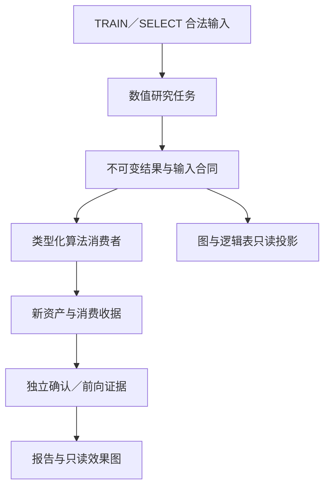

> 最终卡号与唯一实施依赖见ledgers/cards.json及ledgers/execution_phases.json；本专题提到的跨批联合验证不是前置开工依赖。统一阈值见ledgers/acceptance_config.json。专题源清单位于evidence/audit_manifests。原文短路径按包内同名材料定位。

# R31 图表、数值研究产物与完整检测报告施工分册

**用途：最终总包的 B08/B09/B11 专项施工输入。状态：设计已审计，产品代码未修改，Android 真机验收未执行。**

唯一源码基线：`gtt46461-star/starcore-public-build@5237b265a27fe5ad27fd842901c445d5f8c27749`。本分册实际读取21个Java文件，21份本地字节均与源树Git blob SHA-1逐项匹配，文件及本地SHA-256见`source_evidence_manifest.json`；不把局部源审计写成整库逐行审计。检测报告、设备描述及近期事件以提供包为准，不假称已访问用户手机。详细表以`charts.json`、`cards.json`和证据分册为权威可机读附件。

## 1. 先纠正会导致施工方向错误的判断

1. **不是只有15张图，也不是新增研究图一张都没有产物。** `ChartsActivityR83.load`实际读取`ChartsRepositoryR27`；后者装配1状态+14缓存+2报告图+12张实际挂载R83图，共29面板。工作台另有18研究图，共47个登记ID。R83原入口15图全部先查询，之后才过滤3张，隐藏图仍花SQL成本。
2. 报告的14个R27面板均存在缓存行；18研究图中17有当前源码帧，共28帧，仅R06无帧。帧存在不等数值有效，不等数据新鲜，不等手机显示成功。18图原出生消费收据均为0，效果均未知；正式只读图不能强行用“产子代”证明消费。
3. 13个`r27-*`任务全部隔离，其中11个为`F01_WRITE_FAILED|operation=R30_PREPARED_TASK_CLAIM`，另有取消和缺学生；不能把“11种同类失败”写成“仅11任务隔离”。调度与事务问题是图/创造链上游修复项，图UI不应绕过调度另造后台计算器。
4. 44指标状态为33不足、7记录未验证、2部分、1阻塞、1未部署。96个旧检查全部EXECUTED，但只有4个domain_outcome严格为PASS；执行过、读到数据、观测到不等产品通过。`overallAcceptance=INCOMPLETE`、`naturalQuality=INSUFFICIENT`、`physicalDevice=NOT_RUN`必须保留。
5. **不应写“结算完全停止”。** 心跳last settlement=202611020847，但不可变快照最新任务COMPLETED与SHADOW settled都达到202611030010；72项完成，4994项无赛前预测合法终态，453项历史积压待处理。72项SHADOW命中20项约27.78%是影子描述值，不是REAL收益或高胜率证据。当前报告一致性冲突计0仍漏掉心跳范围/陈旧语义检查。
6. `r27_chart_cache`72458行混有主链选择、研究checkpoint和时间线。`MainlineBridgeSU2.r27Intent`读取`mainline/choice`是真正业务依赖；B10完成typed选择记录迁移并对照验证之前绝不可按“无用图表缓存”删除。缓存应成为只读投影，不能新增第二套选择真值。

以上数字的可复现原件：`analysis/report/expanded/R30_REPORT.json#/objectIndex`及`#/metricResults`、`audits/evidence/tasks_60.json`、`checks_96.json`、`settlement_summary.json`、`shadow_validation.json`。`DIAGNOSTIC_SCOPE.allChecks`本身只是数字，96条具体ID来自REPORT_DETAILS。

## 2. 故障分层与恢复次序

| 层 | 能够确认的问题 | 不应越界的推断 | 施工归属 |
|---|---|---|---|
| 输入与任务 | 13个r27任务隔离，许多任务来源未知/阻塞 | 无法由此说所有开奖/结算都停止 | B01/B02/B03/B06 |
| 数值产物 | 已有17图帧；R06无帧；多类型当前支持边界存在 | 不能把有帧等同有样本/有增益 | B07/B08 |
| 消费 | 原出生source消费收据0；部分消费者只有静态绑定 | 不能要求正式只读CONFIRM/FUTURE图参与训练 | B08/B10 |
| 读取 | 全页15秒取消；共享draw读取在单图保护外；全部15旧图先查再丢3图 | 未真机复现，不能指定“唯一卡顿根因” | B09 |
| 展示 | 主图缓存JSON先全量解析再截500点；工作台已有256KiB/hash/点边边界 | 不能为统一而删除已有安全边界 | B09/B05 |
| 语义 | T09漏OPERATOR_GAIN_COST；榜单多重比较m取展示集合；快照新鲜度不完整 | 不能据图数或静态入口数宣称高质量 | B09/B11 |
| 报告 | 部分44指标只有source附件未计算；M32固定0；96检查与44指标口径不同 | 不能把设计完整或未知状态强制改PASS | B11/B12 |

B09可先做stable ID与UI隔离，不等全算法完成。B08的数值合同须与B07出生/模型动作同批联改；B10主链真值迁移须与B05缓存回收合同联动；B11每条指标与源owner接口可并行，但最终必须同一commit集成。跨文件逻辑提交作为一个原子验收单元，不能先发布半套producer或consumer；不要求把所有问题压成一个不可回滚的大提交。

## 3. 唯一数值产物，多个只读视图



“图有效帮助研究”的准确实现，是算法读取图背后的类型化数值结果；UI不看图学习、不靠刷新驱动进化。生产、提交、读取、可见、消费、有效六阶段分别验收。效果需要同预算消融与未参与选择的证据；没有优势时允许产生有据可查的负结果，不能保证随机过程一定产生高胜率资产。

每个产物必须带：`run_id, view_id, measure_kind, dataset_hash, source_commit, source_revision, producer_version, contract_hash, role, from_ordinal, through_ordinal, target_definition, parent_hash/model_hash, point_count, byte_count, payload_hash, status, reason`。消费者增加`consumer_version, input_result_hash, action_kind, before_hash, after_hash, budget, receipt_hash`。时间、role、ABI或parent不匹配必须拒绝；与新出生/模型提交同事务持久化，不出现有回执无资产或有资产无回执。

R11/R14/R18是正式只读审计，`optimizationConsumption=NOT_APPLICABLE`；仍要求同一确认/模型/主链记录能够逐键关联。R08行为签名是多样性与去重工具，不是质量证明。R15输入漂移不等性能退化。R10当前成本是AST节点复杂度，`perObjectCpuNs=null`时不得显示“真实计算效率提升”。R06已有有效的paired→proposal→consume设计，应修复依赖与支持范围，不以删掉unsupported检查假装支持全部家族。

## 4. 页面与缓存实施合同

新增`ChartRegistryR31`集中47稳定ID；`ChartsRepositoryR27.load`不再按中文标题选路；`ChartsRepositoryR83`拆为按ID读取。共享开奖读有独立结果状态，其失败只影响依赖它的描述图。主页面最多2个并发读任务；Activity epoch判断防止取消后旧结果覆盖新页面。每图状态保留`WAITING_INPUT/WAITING_ANALYSIS/INSUFFICIENT/READ_ERROR/STALE/MEASURED`，上一成功帧可保留但必须明确陈旧和原水位。

研究工作台已有：6图一组一致SELECT、256KiB帧检查、payload hash校验、点/边/序列数边界，继续保留。补当前source/ABI/dataset/revision过滤；不适配新版本的旧帧仅在历史组显示。主图旧缓存必须在JSON解析前校验字节预算；仅parse后截500点无法限制解析峰值。展示预算是上限，不是截断后冒充全量：每图记录`total/shown/omitted`，统计分母来自权威全量ledger。

`ChartCacheR27.build`拆为便宜增量投影；不让每轮图刷新再次capture整个报告。输入快照变化才重建对应图；每ID展示缓存保留最新与上次成功帧，研究原件按B05根引用及pin策略保存。`mainline/choice`迁移前保持业务保留，迁移后才允许退为投影。报告引用附件必须实际可取回，不能先删除snapshot再留下一个看似可复算的路径。

性能验收目标是待设备验证的预算：首屏已有缓存P95≤300ms、单图冷读P95≤2s、超过5s给明确单图超时、连续切换100次无游离回调/连接/线程增长。目标失败须调整分页与SQL，而不能删业务样本或以沉默空白页通过。

## 5. 精确缺陷与必须保留的既有实现

| 文件／方法 | 源锚点 | 当前证据 | 必须改动／保留 |
|---|---|---|---|
| ChartsRepositoryR27.load | 22–36 | 15旧图先全部执行后用中文标题丢3图 | stable ID + 可见ID查询；死的旧标题前缀分支删除 |
| ChartsRepositoryR27.cached | 53–79 | 全量JSON parse后才截500点 | 解析前bytes/hash/version校验，读失败与0分开 |
| ChartsRepositoryR83.load/safe/draws | 26–83 | draws在safe之外 | 共享输入独立封装，不让单输入错误拖垮全页 |
| ResearchWorkbenchRepositoryR30R1.load/panel | 14–49 | 有界解析与hash正确；最新frame选择未限定当前revision | 保留边界，补源版本与新鲜度 |
| ResearchTableAdaptersR30R1 | 15 | T09缺OPERATOR_GAIN_COST | 共享枚举；producer→T09合同回归 |
| ResearchObservatoryR30R1.stored | 54–70 | R10写OPERATOR_GAIN_COST，perObjectCpuNs未知 | 节点成本与实测CPU分列 |
| ResearchStoreR30R1.ready/consume | 100–121 | PRUNE_COMPONENT路由，同出生事务收据 | 保留事务；其他动作显式增加实际dispatcher与反事实证据 |
| MetricEvaluatorR29.currentMeasurement | 75–136 | 多项仅source；M32写死0 | 独立测量适配器；跨水位/范围语义冲突检测 |
| ReportSnapshotR30.Query.rows/capture | 方法锚点 | 单SELECT一致性有价值；大group_concat可能先聚合后截 | 保留同快照事实语义；大原件流式可验证导出 |

上述行号是指定commit检索入口；其他分册改动后按方法重新定位。`chart_source_excerpts.json`保存逐图所用原方法完整文本，保留动态表名Java表达式，避免臆造SQL。

## 6. 可直接作为施工输入的关键代码合同

以下是R31拟实现合同，不是已编译补丁。移植时使用项目当前Java/Android兼容级别、DbWriter和Schema owner，禁止引入第二写者。

T09必须修复kind，同时把dataset/source/role作为绑定参数，使用稳定游标分页，不能拼接用户值。当前`ResearchObservatoryR30R1.product`将观测视图顶层`mean_gain/lower95/upper95`写为null，真正对象级收益在`payload_json.frame.points`；下面SQL只修行可见性。适配器还须按schema版本从points投影value/lower/upper/n与nodeCost、保留原件hash，不能用顶层null冒充0，也不能把节点成本称实测CPU：

```sql
SELECT r.run_id,r.role,r.policy_hash,r.recorded_at,
       m.measure_key,m.kind,m.mean_gain,m.payload_json
FROM r30r1_analysis_run AS r
JOIN r30r1_research_measure AS m ON m.run_id=r.run_id
WHERE r.dataset_hash=? AND r.source_revision=? AND r.role='SELECT'
  AND m.kind IN ('OPERATOR_GAIN_COST','OPERATOR_COST',
                 'PARENT_CHILD_GAIN','RESEARCH_BUDGET')
  AND (r.recorded_at < ? OR
       (r.recorded_at = ? AND (r.run_id > ? OR
         (r.run_id = ? AND m.measure_key > ?))))
ORDER BY r.recorded_at DESC,r.run_id ASC,m.measure_key ASC
LIMIT ?;
```

第一页另用不含游标谓词的语句；下一页携带最后一行完整三元游标。`LIMIT`须由可信代码限1—200。历史kind只做兼容历史分类，不与新单位混求均值。索引先`EXPLAIN QUERY PLAN`，建议评估`analysis_run(dataset_hash,source_revision,role,recorded_at DESC,run_id)`与`research_measure(run_id,kind,measure_key)`，已有等价索引时不重复建。

```java
// 拟新增：图是结果的只读投影；Measured不代表Effective。
enum ProductState { WAITING_INPUT, WAITING_ANALYSIS, INSUFFICIENT,
                    MEASURED, FAILED, STALE }
enum ConsumptionKind { RESEARCH_ACTION, FORMAL_READ_ONLY, DIAGNOSTIC }

// 放入当前唯一writer事务；类型与hash校验在提交前完成。
void applyResearchAction(Transaction tx, Result result, Action action) {
    requireAllowedRole(result.role);              // TRAIN/SELECT only
    requireCurrentContract(result);               // source/ABI/dataset/parent
    requireBudgetAndIdempotencyKey(action);
    Artifact child = action.apply(tx, result);     // 真实AST/模型变化
    requireArtifactExistsInThisTransaction(tx, child);
    insertConsumptionReceipt(tx, result, action, child);
    // 任一失败整笔回滚；图缓存不在这里写业务选择真值。
}
```

接口名为设计示意，现有真实接点为`ResearchStoreR30R1.ready/consume`及B07/B10 owner，不得直接以以上伪接口声称编译通过。正式只读图不调用此函数。对consumer“有效”的判定必须单独计算同预算A/B或消融，不得由after_hash变化推导。

## 7. 报告必须回答的问题与状态规则

每条问题输出：`issue_id → 用户能力需求 → 观测/证据路径/时间/范围 → 确认根因或待验证假设 → 影响功能 → 文件/方法 → batch/card → 修改操作 → 验收场景 → 当前结果 → 下一步所缺原件`。报告包含“工程链路是否运行”“是否产出研究结果”“是否真实被消费”“是否产生独立优势”四种独立结论，不能用最后一页一句正常概括。

| 状态 | 准确定义 | 不能替换成 |
|---|---|---|
| NOT_RUN | 规定场景未执行，如真机 | PASS/0故障 |
| UNKNOWN | source缺失/不兼容/无法确定 | 0 |
| EMPTY | source存在且合法查询0行 | 无此代码/生产者不存在 |
| INSUFFICIENT | 有合法输入但支持不足或质量检验未满足 | 失败后强行补数 |
| RECORDED_UNVALIDATED | 已记录真实值但验证原件/场景不齐 | 效果通过 |
| NOT_APPLICABLE | 合同明确不适用，例如正式只读图产子代 | 失败或消费率分母 |
| MEASURED | 合法度量已生成 | 优于对照 |
| PASS/FAIL | 适用预先声明验收有足够证据 | 静态存在/能调用 |

M32必须比较同角色/owner/水位/定义下的JSON、图、章节、设备结果；还要检测过时心跳与业务账不一致。若scope不同，报告须并列scope与时间并说明不可直接比；不是强行把所有来源改成同一数字。历史快照仍然不可变。样例必须覆盖：心跳0847而最新任务0010；报告总数全量但UI只显示60；影子72/20而REAL为0；有frame但空points；两个日期版本ABI混存。

96检查原始执行账完整保留；新增`CheckMetricCrosswalkR31`明确每项静态/运行/设备/质量的覆盖边界。44指标定义逐项版本化，以本分册附件逐项接源，不能用96×44机械笛卡尔表假装有覆盖。自然质量与频率联合验收需预登记样本、每资产身份、完整日历与多重比较预算，不许降低门限保出号。

## 8. 批次与严格验收

| 批次 | 本分册卡 | 联动边界 | 硬性验收 |
|---|---|---|---|
| B08 | R31-B08-C04、R31-B08-C05（总包统一重编号） | B07出生/模型动作；B06合法回放 | 类型产物、T09枚举及对象数值、真实消费与同预算消融均可追溯；正式只读不回流 |
| B09 | R31-B09-C01/02/03/05/06 | B05回收；B10 typed真值迁移 | 47ID+16逻辑表逐项验证；错误隔离、源版本、角色分母正确 |
| B11 | R31-B11-C01/02/03/04 | 所有源owner+B12设备 | 44指标完整接线、96交叉账、语义冲突与可取回附件 |

所有卡都必须通过：源代码定位与编译→最小确定性fixture→失败注入→联动回归→目标设备→自然数据验收适用部分。测试fixture证明管道可运行，不证明自然高胜率。可验收工程完成100%适用检查；不能承诺自然随机结果一定提升、每代一定胜出。对未达到预定自然目标必须明确“未达标”并保留失败处方，不能以完美、全闭环等字眼覆盖。

单图验收矩阵：合法有数据／合法0样本／源缺失／错ABI／坏hash／超预算／取消／并发导报告／前后台反复切换。每个47 ID具备数值一致性、错误状态、可见性回执；每个16表具备SQL prepare、分页去重无遗漏及role过滤。硬性能阈值以实际设备校准后固定，先前目标不冒充测得值。

报告完整性验收：全部引用可定位；included附件hash、bytes匹配；未包含原件明确omitted；每个结论有同口径分母；缺原件不能签复算PASS；中途取消关闭资源，不能增加永久孤儿快照。

## 9. 47图逐项登记

本表“状态”仅为这份报告与源码可支持的观察；所有修复尚未实施。详细每图输入、实际读取SQL、消费方法、无数据诊断、产物引用、验收与原方法全文见`charts.json`及`chart_source_excerpts.json`。

| ID／标题 | 生产者与输入 | 当前状态／主要缺口 | 修改与验收 |
|---|---|---|---|
| status 研究状态/同报告快照 | ChartsRepositoryR27.headlineSnapshotR30；r27_chart_cache(r30-charts/snapshot)；producer=ReportSnapshotR30.capture → ReportChartsR30.packet | PRODUCT_UNKNOWN_RENDER_UNVERIFIED；本索引未附本图产物回执；不能把null当0。按原SQL查询source存在/计数、过滤角色、来源版本和UI超时分层取证。 | 显示服务活着/研究推进/质量达标三条独立状态；禁止以界面成功加载标READY健康 |
| p01_three_scores 三类成绩并列 | ChartCacheR27.threeScores；r27_live_shadow + r27_replay_score + r27_live_frozen + r27_eprocess；producer=RuntimeR27.LiveTask / EvolutionLoopR27 | CACHE_ROW_PRESENT_RENDER_UNVERIFIED；现有缓存行已存在；缺图不能归咎于完全没有生产者。下一步分别查帧points/finite值、source水位、schema/JSON/timeout、实际设备渲染回执。 | 按policy hash、role、dataset分层；ACT和全预测独立；完整候选池多重比较预算 |
| p02_generation_holdout 每代冠军留出：主/打乱/随机 | ChartCacheR27.generationHoldout；r27_generation；producer=EvolutionLoopR27 / FrozenConfirmationStoreR30 | CACHE_ROW_PRESENT_RENDER_UNVERIFIED；现有缓存行已存在；缺图不能归咎于完全没有生产者。下一步分别查帧points/finite值、source水位、schema/JSON/timeout、实际设备渲染回执。 | 固定独立确认taskKey；无新确认不能复用旧留出画代际提升 |
| p03_evolution_events 每代进化事件 | ChartCacheR27.evolutionEvents；r27_generation；producer=EvolutionLoopR27 | CACHE_ROW_PRESENT_RENDER_UNVERIFIED；现有缓存行已存在；缺图不能归咎于完全没有生产者。下一步分别查帧points/finite值、source水位、schema/JSON/timeout、实际设备渲染回执。 | 事件关联算子、实际AST、语义签名、出生与拒绝回执，不能按事件数称更强 |
| p04_seven_counters 进化七计数累计 | ChartCacheR27.sevenCounters；r27_generation；producer=EvolutionLoopR27 | CACHE_ROW_PRESENT_RENDER_UNVERIFIED；现有缓存行已存在；缺图不能归咎于完全没有生产者。下一步分别查帧points/finite值、source水位、schema/JSON/timeout、实际设备渲染回执。 | 计数按trial/generation与窗口去重；verified只计新独立确认，不按每次刷新累加 |
| p05_lineage 父子谱系最近60条 | ChartCacheR27.lineage；r27_lineage + r27_policy + r27_replay_score；producer=EvolutionLoopR27 | CACHE_ROW_PRESENT_RENDER_UNVERIFIED；现有缓存行已存在；缺图不能归咎于完全没有生产者。下一步分别查帧points/finite值、source水位、schema/JSON/timeout、实际设备渲染回执。 | 补完整parent/child/operation/hash键，展示限60不改变总分母 |
| p06_idea_survival 思路族存活率 | ChartCacheR27.ideaSurvival；r27_policy；producer=EvolutionLoopR27 | CACHE_ROW_PRESENT_RENDER_UNVERIFIED；现有缓存行已存在；缺图不能归咎于完全没有生产者。下一步分别查帧points/finite值、source水位、schema/JSON/timeout、实际设备渲染回执。 | 存活率加入尝试分母、计算预算、不同机制数、SELECT与FUTURE分开；0不宣判家族永久无信号 |
| p07_funnel 淘汰漏斗 | ChartCacheR27.funnel；r27_generation + r27_policy + r27_live_shadow + r27_eprocess + r27_certificate；producer=BirthGateR27 → SequentialQualificationR27 → CertificateGateR27 | CACHE_ROW_PRESENT_RENDER_UNVERIFIED；现有缓存行已存在；缺图不能归咎于完全没有生产者。下一步分别查帧points/finite值、source水位、schema/JSON/timeout、实际设备渲染回执。 | 每层记录真实输入/通过/失败/未处理，层层链接同一identity，不把出生等于合格 |
| p08_bss 深度学习A：累计BSS及区间 | ChartCacheR27.bss；r27_brier_pair(FUTURE,ATOMNET legacy ABI)；producer=原ATOMNET冻结/结算写者 | CACHE_ROW_PRESENT_RENDER_UNVERIFIED；现有缓存行已存在；缺图不能归咎于完全没有生产者。下一步分别查帧points/finite值、source水位、schema/JSON/timeout、实际设备渲染回执。 | 仅同ABI同目标配对BSS；新十位置不可混入旧轮换模型；按期聚类 |
| p09_rolling200 深度学习B：滚动200 Brier | ChartCacheR27.rolling；r27_brier_pair；producer=原ATOMNET冻结/结算写者 | CACHE_ROW_PRESENT_RENDER_UNVERIFIED；现有缓存行已存在；缺图不能归咎于完全没有生产者。下一步分别查帧points/finite值、source水位、schema/JSON/timeout、实际设备渲染回执。 | 固定200期窗口、噪声带版本、有效样本数；多次查看不授证 |
| p10_train_holdout_loss 深度学习C：训练/留出损失 | ChartCacheR27.trainHoldout；r27_atomnet_epoch；producer=AtomNetRuntimeR30/原预训练写者 | CACHE_ROW_PRESENT_RENDER_UNVERIFIED；现有缓存行已存在；缺图不能归咎于完全没有生产者。下一步分别查帧points/finite值、source水位、schema/JSON/timeout、实际设备渲染回执。 | 按run/ABI/目标区分TRAIN SELECT与独立CONFIRM；不能因变量旧名hold便认定独立留出 |
| p11_eprocess 序贯进度 | ChartCacheR27.eprocess；r27_eprocess；producer=SequentialQualificationR27 | CACHE_ROW_PRESENT_RENDER_UNVERIFIED；现有缓存行已存在；缺图不能归咎于完全没有生产者。下一步分别查帧points/finite值、source水位、schema/JSON/timeout、实际设备渲染回执。 | 展示alpha/预算ledger/已消费ordinal/缺口/退出原因；图本身不修改预算 |
| p12_mainline_weight 主链算法参与权重 | ChartCacheR27.mainline；ResearchMainlineContributionAuditR922.TABLE；producer=原主链贡献审计写者 | CACHE_ROW_PRESENT_RENDER_UNVERIFIED；现有缓存行已存在；缺图不能归咎于完全没有生产者。下一步分别查帧points/finite值、source水位、schema/JSON/timeout、实际设备渲染回执。 | 改为权威typed选择记录只读投影，接Gate与唯一REAL结算；旧贡献表无数据不可直接补权重 |
| p13_runtime_health 研究运行健康 | ChartCacheR27.health；r27_thread_cpu+r26_service_total+r26_task+r27_write_wait+r27_opportunity；producer=各任务生产者的已提交回执 | CACHE_ROW_PRESENT_RENDER_UNVERIFIED；现有缓存行已存在；缺图不能归咎于完全没有生产者。下一步分别查帧points/finite值、source水位、schema/JSON/timeout、实际设备渲染回执。 | 显示有类型pending/工作游标/日历水位/last commit/最老积压；时间tick不是学习 |
| p14_atom_scores 原子回放评分分布 | ChartCacheR27.atoms；r27_atom_score；producer=RuntimeR27.AtomTask | CACHE_ROW_PRESENT_RENDER_UNVERIFIED；现有缓存行已存在；缺图不能归咎于完全没有生产者。下一步分别查帧points/finite值、source水位、schema/JSON/timeout、实际设备渲染回执。 | 原子历史评分单独显示，新配对贡献看R06；增加适用域/支持量/缺失率 |
| p15_paired_improvement_r30 逐代配对提升/独立确认 | ReportChartsR30.evolution；r27_generation + immutable confirmation detail；producer=FrozenConfirmationStoreR30.generationReport | PRODUCT_UNKNOWN_RENDER_UNVERIFIED；本索引未附本图产物回执；不能把null当0。按原SQL查询source存在/计数、过滤角色、来源版本和UI超时分层取证。 | 显示配对样本数、独立块、复用证据、负结果和缺失原件；与Q06同一结果对象 |
| p16_capability_coverage_r30 能力覆盖与阻塞 | ReportChartsR30.capabilities；CapabilityRegistryR30/同捕获快照；producer=代码注册 + 运行产物/消费收据 | PRODUCT_UNKNOWN_RENDER_UNVERIFIED；本索引未附本图产物回执；不能把null当0。按原SQL查询source存在/计数、过滤角色、来源版本和UI超时分层取证。 | 六层状态独立：implemented/callable/input/produced/consumed/effective；不能由81/82代码入口推出效果 |
| r83_algorithm_all 全部算法逐期实盘榜 | ChartsRepositoryR83.r27AlgorithmBoard；r27_live_shadow JOIN r27_live_frozen(hit>=0,status=FROZEN)；producer=RuntimeR27.LiveTask | PRODUCT_UNKNOWN_RENDER_UNVERIFIED；本索引未附本图产物回执；不能把null当0。按原SQL查询source存在/计数、过滤角色、来源版本和UI超时分层取证。 | 榜名改为前向影子；REAL另列。Bonferroni的m不得仅取LIMIT60返回条数，应取预登记候选族预算 |
| r83_algorithm_rank 算法实盘排行榜 | ChartsRepositoryR83.algorithmBoard；v57_algorithm_genome_r908 JOIN v57_algorithm_predraw_r908；producer=旧R908原冻结写者 | PRODUCT_UNKNOWN_RENDER_UNVERIFIED；该旧ABI查询依赖表在报告快照中确实为0行：{"v57_algorithm_genome_r908": 0, "v57_algorithm_predraw_r908": 0}；因此当前源不具备该旧图数据，但不证明写者代码不存在或所有当前研究为空。保留历史专区与明确EMPTY原因，当前资产另读当前typed来源。 | 保留旧ABI历史专区；新当前资产榜读当前权威身份；不得混列旧影子/真实资金 |
| r83_best_curve 最佳算法累计命中 | ChartsRepositoryR83.bestAlgorithmCurve；v57_algorithm_predraw_r908 + genome；producer=旧R908原冻结写者 | PRODUCT_UNKNOWN_RENDER_UNVERIFIED；该旧ABI查询依赖表在报告快照中确实为0行：{"v57_algorithm_predraw_r908": 0}；因此当前源不具备该旧图数据，但不证明写者代码不存在或所有当前研究为空。保留历史专区与明确EMPTY原因，当前资产另读当前typed来源。 | 保留事后曲线标签；新增事前锁定冠军全后续区间曲线，不把事后择优当样本外 |
| r83_action_candles 出手资金K线 | ChartsRepositoryR83.actionCandles；v57_exploration_r83 JOIN v57_shadow_observation_r35；producer=ExplorationLaneR83/影子冻结与结算 | PRODUCT_UNKNOWN_RENDER_UNVERIFIED；本索引未附本图产物回执；不能把null当0。按原SQL查询source存在/计数、过滤角色、来源版本和UI超时分层取证。 | 保持影子模拟资金；真实资金只能联实际REAL单键/赔率/成本，不从影子转名 |
| r83_all_hit 全部预测命中率走势 | ChartsRepositoryR83.hitTrend(false)；v57_shadow_observation_r35 settled=1；producer=OosAfterDrawWriter/SettlementEngine | PRODUCT_UNKNOWN_RENDER_UNVERIFIED；本索引未附本图产物回执；不能把null当0。按原SQL查询source存在/计数、过滤角色、来源版本和UI超时分层取证。 | 20次是描述窗口；增加已到截止的完整日历分母、冻结缺失与尚未结算 |
| r83_act_hit 出手命中率走势 | ChartsRepositoryR83.hitTrend(true)；v57_exploration_r83 JOIN v57_shadow_observation_r35；producer=ExplorationLaneR83/影子结算 | PRODUCT_UNKNOWN_RENDER_UNVERIFIED；本索引未附本图产物回执；不能把null当0。按原SQL查询source存在/计数、过滤角色、来源版本和UI超时分层取证。 | 角色筛选使用持久化事件角色；按自身条件出手不是REAL出手 |
| r83_number_candles 当前所选位置号码K线 | ChartsRepositoryR83.numberCandles；draws dirty=0 LIMIT600；producer=唯一开奖保存写者 | PRODUCT_UNKNOWN_RENDER_UNVERIFIED；本索引未附本图产物回执；不能把null当0。按原SQL查询source存在/计数、过滤角色、来源版本和UI超时分层取证。 | 保留描述性图；不依据图形直接声称下一期可预测 |
| r83_number_line 当前所选位置号码轨迹 | ChartsRepositoryR83.numberLine；draws dirty=0 LIMIT600；producer=唯一开奖保存写者 | PRODUCT_UNKNOWN_RENDER_UNVERIFIED；本索引未附本图产物回执；不能把null当0。按原SQL查询source存在/计数、过滤角色、来源版本和UI超时分层取证。 | 按ordinal显示连续和缺口，位置可选；窗口选定值持久化仅作展示 |
| r83_omission_heat 号码遗漏热力图 | ChartsRepositoryR83.omissionHeat；draws dirty=0 LIMIT600；producer=唯一开奖保存写者 | PRODUCT_UNKNOWN_RENDER_UNVERIFIED；本索引未附本图产物回执；不能把null当0。按原SQL查询source存在/计数、过滤角色、来源版本和UI超时分层取证。 | 区分窗口外未出现/缺期开奖/确实遗漏；作为候选特征须另立过去窗合同和消融 |
| r83_hot_cold 当前所选位置冷热号 | ChartsRepositoryR83.hotCold；draws最近100期；producer=唯一开奖保存写者 | PRODUCT_UNKNOWN_RENDER_UNVERIFIED；本索引未附本图产物回执；不能把null当0。按原SQL查询source存在/计数、过滤角色、来源版本和UI超时分层取证。 | 去除“±5正常”固定口号；展示样本数、基率与适用假设，研究另做检验 |
| r83_calibration 预测概率校准 | ChartsRepositoryR83.calibration；v57_shadow_observation_r35 selected_hit_p/hit_label LIMIT2000；producer=原影子概率冻结与结算 | PRODUCT_UNKNOWN_RENDER_UNVERIFIED；本索引未附本图产物回执；不能把null当0。按原SQL查询source存在/计数、过滤角色、来源版本和UI超时分层取证。 | 按model/role/ABI/事件定义分箱；每箱支持、缺失和时间隔离可核对 |
| r83_brier20 短期波动参考：滚动20期Brier | ChartsRepositoryR83.networkBrier；atomic_tool_context_r943 network_probability/hit；producer=旧AtomicToolWorld写者 | PRODUCT_UNKNOWN_RENDER_UNVERIFIED；该旧ABI查询依赖表在报告快照中确实为0行：{"atomic_tool_context_r943": 0}；因此当前源不具备该旧图数据，但不证明写者代码不存在或所有当前研究为空。保留历史专区与明确EMPTY原因，当前资产另读当前typed来源。 | 旧ABI短窗描述；标题已改为旧ABI，R27旧startswith分支未命中，应用stable ID不靠中文标题路由 |
| R01 多尺度结构状态与可用窗口 | ResearchObservatoryR30R1.compute → StructureStudyR30R1.compute；结构多尺度条件/支持矩阵；role=SELECT | 帧2；消费收据0；有效性未知。当前源码已有1—2帧；有效数值、可用支持、最新ABI及手机可见性尚未证明。先读payload中的status/reason/points，再查UI；不新增同义空图掩盖。 | 结构候选采样，比较无结构条件同预算对照；保持已有数值计算；补当前source/ABI/dataset/revision/水位校验，独立状态与typed消费收据。正式只读图不强求生成子代回执。 |
| R02 结构预测与下一期落地误差 | ResearchObservatoryR30R1.compute → StructureStudyR30R1.compute；固定64期块结构预测误差；role=SELECT | 帧2；消费收据0；有效性未知。当前源码已有1—2帧；有效数值、可用支持、最新ABI及手机可见性尚未证明。先读payload中的status/reason/points，再查UI；不新增同义空图掩盖。 | 失败轮廓/预先声明窗口收益；不可反向重建事前预测；保持已有数值计算；补当前source/ABI/dataset/revision/水位校验，独立状态与typed消费收据。正式只读图不强求生成子代回执。 |
| R03 号码位置兼容与跨位结构 | ResearchObservatoryR30R1.compute → MatrixResearchR30R1.build；位置兼容与滞后流矩阵；role=SELECT | 帧2；消费收据0；有效性未知。当前源码已有1—2帧；有效数值、可用支持、最新ABI及手机可见性尚未证明。先读payload中的status/reason/points，再查UI；不新增同义空图掩盖。 | 仅过去期跨位信息进入下一期候选；同期目标位置结果绝不能作输入；保持已有数值计算；补当前source/ABI/dataset/revision/水位校验，独立状态与typed消费收据。正式只读图不强求生成子代回执。 |
| R04 多位置围号交集与缩减证据 | ResearchObservatoryR30R1.compute → SetIntersectionPolicyR30.support；围号集合、交集支持、弃权、单集合对照；role=SELECT | 帧1；消费收据0；有效性未知。当前源码已有1—2帧；有效数值、可用支持、最新ABI及手机可见性尚未证明。先读payload中的status/reason/points，再查UI；不新增同义空图掩盖。 | 以合法K3支持和收益共同选择；不足3明确弃权，不补凑；保持已有数值计算；补当前source/ABI/dataset/revision/水位校验，独立状态与typed消费收据。正式只读图不强求生成子代回执。 |
| R05 失败簇到假设到可执行子代 | ResearchObservatoryR30R1.stored；expert proposal→policy→H_SELECT score；role=SELECT | 帧2；消费收据0；有效性未知。当前源码已有1—2帧；有效数值、可用支持、最新ABI及手机可见性尚未证明。先读payload中的status/reason/points，再查UI；不新增同义空图掩盖。 | 失败簇处方实际编译为子代；未生成child即未落地；保持已有数值计算；补当前source/ABI/dataset/revision/水位校验，独立状态与typed消费收据。正式只读图不强求生成子代回执。 |
| R06 原子条件边际贡献 | ResearchStudyTaskR30R1.step → ResearchStoreR30R1.paired；原组件与准确反事实同目标十分类损失；role=SELECT | 帧0；消费收据0；有效性未知。报告R06当前源码帧计数=0；ResearchStudyTask有真实生产代码。检查合法parent AST/组件支持、r27任务隔离及birth dependency，不可删unsupported断言造数据。 | ResearchAdviceR30R1→r30r1_proposal(PRUNE_COMPONENT)→ready/consume同出生事务；保留负/不确定结果；保持已有数值计算；补当前source/ABI/dataset/revision/水位校验，独立状态与typed消费收据。正式只读图不强求生成子代回执。 |
| R07 分子协同与冗余贡献 | ResearchObservatoryR30R1.compute；none/A/B/AB四臂损失 L_A+L_B−L_AB−L_none；role=SELECT | 帧1；消费收据0；有效性未知。当前源码已有1—2帧；有效数值、可用支持、最新ABI及手机可见性尚未证明。先读payload中的status/reason/points，再查UI；不新增同义空图掩盖。 | 分子协同选择只用SELECT；最初仅支持add双子节点，扩大支持需新增完整反事实实现；保持已有数值计算；补当前source/ABI/dataset/revision/水位校验，独立状态与typed消费收据。正式只读图不强求生成子代回执。 |
| R08 思路族行为差异与机制覆盖 | ResearchObservatoryR30R1.compute → BirthGateR27.check；固定训练探针语义签名/Jaccard；role=TRAIN | 帧1；消费收据0；有效性未知。当前源码已有1—2帧；有效数值、可用支持、最新ABI及手机可见性尚未证明。先读payload中的status/reason/points，再查UI；不新增同义空图掩盖。 | 用于行为去重或多样性配额，不计质量；签名探针集合冻结；保持已有数值计算；补当前source/ABI/dataset/revision/水位校验，独立状态与typed消费收据。正式只读图不强求生成子代回执。 |
| R09 专家处方落地与归因 | ResearchObservatoryR30R1.stored；专家proposal与实际AST/SELECT成绩；role=SELECT | 帧2；消费收据0；有效性未知。当前源码已有1—2帧；有效数值、可用支持、最新ABI及手机可见性尚未证明。先读payload中的status/reason/points，再查UI；不新增同义空图掩盖。 | 专家权重以同预算盲化对照贡献更新，不能按提案数量得分；保持已有数值计算；补当前source/ABI/dataset/revision/水位校验，独立状态与typed消费收据。正式只读图不强求生成子代回执。 |
| R10 变异算子增益与计算成本 | ResearchObservatoryR30R1.stored → FusionStudyR30R1.gain；同目标父子proper score＋AST节点成本；role=SELECT | 帧2；消费收据0；有效性未知。当前源码已有1—2帧；有效数值、可用支持、最新ABI及手机可见性尚未证明。先读payload中的status/reason/points，再查UI；不新增同义空图掩盖。 | 算子探索分配；perObjectCpuNs当前null，补对象级CPU再画成本效率，不借全池CPU代替；保持已有数值计算；补当前source/ABI/dataset/revision/水位校验，独立状态与typed消费收据。正式只读图不强求生成子代回执。 |
| R11 父子同期配对与独立确认 | ResearchObservatoryR30R1.stored；r30_frozen_confirm原任务结果；role=CONFIRM_READ_ONLY | 帧2；消费收据0；有效性未知。当前源码已有1—2帧；有效数值、可用支持、最新ABI及手机可见性尚未证明。先读payload中的status/reason/points，再查UI；不新增同义空图掩盖。 | 正式确认只读展示；不能回流同一确认段到候选筛选；verified=0是有效终态；保持已有数值计算；补当前source/ABI/dataset/revision/水位校验，独立状态与typed消费收据。正式只读图不强求生成子代回执。 |
| R12 融合互补与共同失败区域 | ResearchObservatoryR30R1.compute → FusionStudyR30R1.pair；同目标父策略残差相关/共同失败；role=SELECT | 帧1；消费收据0；有效性未知。当前源码已有1—2帧；有效数值、可用支持、最新ABI及手机可见性尚未证明。先读payload中的status/reason/points，再查UI；不新增同义空图掩盖。 | 候选融合新identity新确认；相关性低只是候选条件，需增量收益证据；保持已有数值计算；补当前source/ABI/dataset/revision/水位校验，独立状态与typed消费收据。正式只读图不强求生成子代回执。 |
| R13 置信度失准与支持域风险 | ResearchObservatoryR30R1.compute；候选策略事前K3概率可靠性/支持bin；role=SELECT | 帧1；消费收据0；有效性未知。当前源码已有1—2帧；有效数值、可用支持、最新ABI及手机可见性尚未证明。先读payload中的status/reason/points，再查UI；不新增同义空图掩盖。 | 仅开发诊断；校准拟合只TRAIN，正式FUTURE另验；不能修改原冻结概率；保持已有数值计算；补当前source/ABI/dataset/revision/水位校验，独立状态与typed消费收据。正式只读图不强求生成子代回执。 |
| R14 梯度到概率面到策略消费 | ResearchObservatoryR30R1.stored → ModelSurfaceStoreR30.report；模型artifact/surface/call逐hash链；role=FUTURE_READ_ONLY | 帧2；消费收据0；有效性未知。当前源码已有1—2帧；有效数值、可用支持、最新ABI及手机可见性尚未证明。先读payload中的status/reason/points，再查UI；不新增同义空图掩盖。 | 正式消费审计；此图仅表计数不是梯度质量证明；补准确model→frozen→settle键；保持已有数值计算；补当前source/ABI/dataset/revision/水位校验，独立状态与typed消费收据。正式只读图不强求生成子代回执。 |
| R15 漂移、遗忘与回放价值 | ResearchObservatoryR30R1.compute + ModelReplayStudyR30R1.summary；固定窗口输入JS漂移＋模型前后配对；role=SELECT | 帧1；消费收据0；有效性未知。当前源码已有1—2帧；有效数值、可用支持、最新ABI及手机可见性尚未证明。先读payload中的status/reason/points，再查UI；不新增同义空图掩盖。 | 可请求合法研究重放；输入漂移本身不等性能退化，不能自动重置资格；保持已有数值计算；补当前source/ABI/dataset/revision/水位校验，独立状态与typed消费收据。正式只读图不强求生成子代回执。 |
| R16 研究探索预算与有效产出 | ResearchObservatoryR30R1.stored；本会话continuation CPU＋typed task cursor；role=SELECT | 帧2；消费收据0；有效性未知。当前源码已有1—2帧；有效数值、可用支持、最新ABI及手机可见性尚未证明。先读payload中的status/reason/points，再查UI；不新增同义空图掩盖。 | 调度预算需实际consumer回执和同预算吞吐对照；保护最小探索预算；保持已有数值计算；补当前source/ABI/dataset/revision/水位校验，独立状态与typed消费收据。正式只读图不强求生成子代回执。 |
| R17 失败机制记忆与重复消耗 | ResearchObservatoryR30R1.stored；r30r1_research_measure(kind=FAILURE_MEMORY)；role=SELECT | 帧2；消费收据0；有效性未知。当前源码已有1—2帧；有效数值、可用支持、最新ABI及手机可见性尚未证明。先读payload中的status/reason/points，再查UI；不新增同义空图掩盖。 | 相同ABI/机制/输入反证减少重复试验；新输入允许重测，禁止永久封禁家族；保持已有数值计算；补当前source/ABI/dataset/revision/水位校验，独立状态与typed消费收据。正式只读图不强求生成子代回执。 |
| R18 研究处方到主链效果全链 | ResearchObservatoryR30R1.stored → ResearchProvenanceGraphR30R1.project；proposal→consume→policy→confirm→certificate/eprocess；role=FUTURE_READ_ONLY | 帧2；消费收据0；有效性未知。当前源码已有1—2帧；有效数值、可用支持、最新ABI及手机可见性尚未证明。先读payload中的status/reason/points，再查UI；不新增同义空图掩盖。 | 只读主链归因；当前attributedRealSettlement=null，需要B10准确授权和唯一结算键，不能同一期猜归因；保持已有数值计算；补当前source/ABI/dataset/revision/水位校验，独立状态与typed消费收据。正式只读图不强求生成子代回执。 |

## 10. 16逻辑研究表：来源与逐项变更

这些是原表的逻辑适配器，不是新增16份物理副本。完整原SQL保存在`research_tables_16.json`。所有分页分母取全量权威来源，而非LIMIT返回数。

| ID | 现有SELECT | 改动与验证 |
|---|---|---|
| T01 | `SELECT run_id,dataset_hash,policy_hash,role,source_commit,source_revision,from_ordinal,through_ordinal,contract_hash,status,summary_json FROM r30r1_analysis_run ORDER BY recorded_at DESC,run_id` | 需验证角色、单位、source版本、全量分母与分页；现有schema可prepare；合法fixture可查询、错role/缺源明确状态；页面操作不写业务数据 |
| T02 | `SELECT atom_id,dataset_hash,n_select,missing_rate,state,definition,computed_at FROM r27_atom_score ORDER BY atom_id` | 需验证角色、单位、source版本、全量分母与分页；现有schema可prepare；合法fixture可查询、错role/缺源明确状态；页面操作不写业务数据 |
| T03 | `SELECT policy_hash,target_issue,target_ordinal,position,probabilities,frozen_at,deadline_at,hit,settled_at,'FUTURE_READ_ONLY' AS role FROM r27_live_frozen ORDER BY target_ordinal DESC,policy_hash` | 需验证角色、单位、source版本、全量分母与分页；现有schema可prepare；合法fixture可查询、错role/缺源明确状态；页面操作不写业务数据 |
| T04 | `SELECT run_id,measure_key,kind,parent_hash,from_ordinal,to_ordinal,payload_json FROM r30r1_research_measure WHERE kind IN ('FAILURE_PRESCRIPTION','FAILURE_MEMORY','STRUCTURE_FORECAST_ERROR') ORDER BY run_id,measure_key` | 需验证角色、单位、source版本、全量分母与分页；现有schema可prepare；合法fixture可查询、错role/缺源明确状态；页面操作不写业务数据 |
| T05 | `SELECT run_id,measure_key,parent_hash,from_ordinal,to_ordinal,evaluated_calendar_issues,mean_gain,lower95,upper95,payload_json FROM r30r1_research_measure WHERE kind='ATOM_PAIRED_GAIN' ORDER BY run_id,measure_key` | 需验证角色、单位、source版本、全量分母与分页；现有schema可prepare；合法fixture可查询、错role/缺源明确状态；页面操作不写业务数据 |
| T06 | `SELECT run_id,measure_key,parent_hash,payload_json FROM r30r1_research_measure WHERE kind='MOLECULE_SYNERGY' ORDER BY run_id,measure_key` | 需验证角色、单位、source版本、全量分母与分页；现有schema可prepare；合法fixture可查询、错role/缺源明确状态；页面操作不写业务数据 |
| T07 | `SELECT dataset_hash,probe_set_hash,signature,kept_policy,dropped_policy,stage,recorded_at FROM r30_behavior_dup ORDER BY recorded_at DESC,kept_policy,dropped_policy` | 需验证角色、单位、source版本、全量分母与分页；现有schema可prepare；合法fixture可查询、错role/缺源明确状态；页面操作不写业务数据 |
| T08 | `SELECT generation,expert,proposal_json,policy_hash,recorded_at FROM r27_expert_proposal ORDER BY generation DESC,expert` | 需验证角色、单位、source版本、全量分母与分页；现有schema可prepare；合法fixture可查询、错role/缺源明确状态；页面操作不写业务数据 |
| T09 | `SELECT r.run_id,r.role,r.policy_hash,m.measure_key,m.kind,m.mean_gain,m.payload_json FROM r30r1_analysis_run r JOIN r30r1_research_measure m ON m.run_id=r.run_id WHERE m.kind IN ('OPERATOR_COST','PARENT_CHILD_GAIN','RESEARCH_BUDGET') ORDER BY r.recorded_at DESC,m.measure_key` | T09缺OPERATOR_GAIN_COST；即使补kind，观测产物顶层mean_gain仍null，实际对象级值位于payload_json.frame.points，必须typed投影；现有schema可prepare；合法fixture可查询、错role/缺源明确状态；页面操作不写业务数据 |
| T10 | `SELECT run_id,measure_key,parent_hash,payload_json FROM r30r1_research_measure WHERE kind='FUSION_COMPLEMENTARITY' ORDER BY run_id,measure_key` | 需验证角色、单位、source版本、全量分母与分页；现有schema可prepare；合法fixture可查询、错role/缺源明确状态；页面操作不写业务数据 |
| T11 | `SELECT target_ordinal,position,model_hash,history_hash,probabilities,probability_hash,trained_through_ordinal,model_available_at,feature_through_ordinal,frozen_at,deadline_at FROM r30_model_surface ORDER BY target_ordinal DESC,position,model_hash` | 需验证角色、单位、source版本、全量分母与分页；现有schema可prepare；合法fixture可查询、错role/缺源明确状态；页面操作不写业务数据 |
| T12 | `SELECT key AS policy_hash,payload_json,updated_at FROM r27_chart_cache WHERE panel_id='calibration-r30' ORDER BY key` | 需验证角色、单位、source版本、全量分母与分页；现有schema可prepare；合法fixture可查询、错role/缺源明确状态；页面操作不写业务数据 |
| T13 | `SELECT task_key,policy_hash,dataset_hash,block_id,state,verified,registration_state,registration_experiment_id,packet_json,result_json,'FORMAL_READ_ONLY' AS role FROM r30_frozen_confirm ORDER BY created_at DESC,task_key` | 需验证角色、单位、source版本、全量分母与分页；现有schema可prepare；合法fixture可查询、错role/缺源明确状态；页面操作不写业务数据 |
| T14 | `SELECT p.*,t.lane,t.status,t.blocked_reason FROM r30r1_task_progress p LEFT JOIN r26_task t ON t.task_id=p.task_id ORDER BY p.task_id` | 需验证角色、单位、source版本、全量分母与分页；现有schema可prepare；合法fixture可查询、错role/缺源明确状态；页面操作不写业务数据 |
| T15 | `SELECT p.proposal_id,p.run_id,p.parent_hash,p.kind,p.payload_json,p.state,p.reason,c.child_policy_hash,c.source_generation,c.consumer_version,c.receipt_hash,c.consumed_at FROM r30r1_proposal p LEFT JOIN r30r1_consume c ON c.proposal_id=p.proposal_id ORDER BY p.created_at DESC,p.proposal_id` | 需验证角色、单位、source版本、全量分母与分页；现有schema可prepare；合法fixture可查询、错role/缺源明确状态；页面操作不写业务数据 |
| T16 | `SELECT issue,decision_key,entry_point,original_allow,original_reason,certificate_active,items_json,source_json,recorded_at,'FORMAL_READ_ONLY' AS role FROM r30_decision_explain ORDER BY recorded_at DESC,issue` | 需验证角色、单位、source版本、全量分母与分页；现有schema可prepare；合法fixture可查询、错role/缺源明确状态；页面操作不写业务数据 |

## 11. 44指标逐项接线账

指标的精确现有target、source与缺失原因见`metric_coverage_44.json/csv`；证据分册`metrics_44.json/csv`保存完整原件。此表不虚构尚未完成的测量或验收。

| ID | 名称 | 当前状态／值 | 负责批次 | 需补证据 |
|---|---|---|---|---|
| M01 | 源码与安装身份 | PARTIAL / UNKNOWN/null | B00/B12 | 设备实测源码提交、安装包SHA-256与签名证书已记录；需与CI回执delivery.json逐项互证后才可PASS |
| M02 | 功能保全覆盖 | PARTIAL / 1.0 | B00/B12 | 记录覆盖 1832/1832，无回执的完成声明 0；回归复核回执 0/1832（未复核的不计完成） |
| M03 | 准时预测持久化 | INSUFFICIENT / UNKNOWN/null | B03 | 缺少同版本、同角色的测量原件：r30_issue_timeline：request_to_frozen 与 settled_to_frozen 段 P95（IssueTimelineR30.summarize） |
| M04 | 抓到后正式结算 | INSUFFICIENT / UNKNOWN/null | B03 | 缺少同版本、同角色的测量原件：r30_issue_timeline：observe_to_settled 段 P95 |
| M05 | 赛前有效覆盖 | INSUFFICIENT / UNKNOWN/null | B03 | 缺少同版本、同角色的测量原件：r30_issue_timeline：NEXT_DEADLINE−NEXT_FROZEN ≥5000ms 的期数占比 |
| M06 | 唯一正式结算 | RECORDED_UNVALIDATED / 0 | B03/B10 | 仅原REAL逐期唯一性；正式结算唯一键仍需原结算账联合回执 |
| M07 | 实时写事务 | RECORDED_UNVALIDATED / 100.0 | B02 | 窗口最大wait_p95及真实失败数；完整24h/SLO覆盖另验 |
| M08 | 分库隔离 | INSUFFICIENT / UNKNOWN/null | B02 | 缺少同版本、同角色的测量原件：单库模式：SCHEDULER_OWNERS.json 中同表双写者数；B11 启用后：日志 R30_RESEARCH_TABLE_FROZEN 次数 |
| M09 | 迁移一致性 | INSUFFICIENT / UNKNOWN/null | B05/B12 | 缺少同版本、同角色的测量原件：r30_copy_log COUNT_MISMATCH 行数 + B11 ContentHash 不一致数 |
| M10 | 每期训练投递 | INSUFFICIENT / UNKNOWN/null | B06 | 缺少同版本、同角色的测量原件：每期训练投递：r952_research_outbox 状态分布 + QualificationInboxR29 连续游标 |
| M11 | 训练完成新鲜度 | INSUFFICIENT / UNKNOWN/null | B01/B06 | 缺少同版本、同角色的测量原件：TaskLivenessR30：最老积压期数（pending 最大任务） |
| M12 | 任务活性 | INSUFFICIENT / UNKNOWN/null | B01 | 缺少同版本、同角色的测量原件：TaskLivenessR30.summarize.m12（null=有UNKNOWN） |
| M13 | 前后台连续性 | INSUFFICIENT / UNKNOWN/null | B04/B12 | 缺少同版本、同角色的测量原件：B10 场景：前后台切换前后已投递任务数差 |
| M14 | 进程稳定性 | INSUFFICIENT / UNKNOWN/null | B04/B12 | 缺少同版本、同角色的测量原件：进程崩溃/ANR 计数（logcat + ApplicationExitInfo） |
| M15 | 热库与总磁盘 | INSUFFICIENT / UNKNOWN/null | B05 | 缺少同版本、同角色的测量原件：draws 热库行数 + 应用数据目录总字节 |
| M16 | 报告取消 | INSUFFICIENT / UNKNOWN/null | B05/B11 | 缺少同版本、同角色的测量原件：ReportTaskControlR69 取消到释放耗时 |
| M17 | 报告完整性 | INSUFFICIENT / UNKNOWN/null | B11 | 缺少同版本、同角色的测量原件：报告索引覆盖率 + ZIP 大小/分卷 |
| M18 | PIT泄漏反证 | INSUFFICIENT / UNKNOWN/null | B06/B12 | PIT拒绝记录不等于泄漏；需当前/未来标签扰动原件，注入与产品来源分列 |
| M19 | 训练分割污染 | INSUFFICIENT / UNKNOWN/null | B06/B07 | 缺少同版本、同角色的测量原件：HoldoutLedgerR27 R30_CONFIRM_REUSED 计数 |
| M20 | 全状态续训恢复 | INSUFFICIENT / UNKNOWN/null | B06 | 缺少同版本、同角色的测量原件：ModelArtifactR29 中断/恢复一致性测试结果 |
| M21 | 策略完整合同 | INSUFFICIENT / UNKNOWN/null | B07 | 缺少同版本、同角色的测量原件：BirthGateR27 R30_CONTRACT: 拒绝码分布；入池策略合同违规=0 |
| M22 | 结构与行为去重 | RECORDED_UNVALIDATED / 0 | B07 | 原账全量计数；结构/参数去重及生成链一致性需分别复算 |
| M23 | 族专家覆盖 | BLOCKED / 81 | B07/B08 | 可调用绑定与输入可用、真实产出、被消费、有效性分别记录，禁止由此推出质量 |
| M24 | 模型实际消费 | INSUFFICIENT / UNKNOWN/null | B07/B10 | 缺少同版本、同角色的测量原件：r30_model_call 与冻结行匹配率 |
| M25 | 矩阵接线 | INSUFFICIENT / UNKNOWN/null | B08 | 缺少同版本、同角色的测量原件：MatrixRegistryR30 20 项可追溯率 |
| M26 | 校准时间隔离 | INSUFFICIENT / UNKNOWN/null | B07/B10 | 缺少同版本、同角色的测量原件：校准样本时间隔离检查通过率 |
| M27 | 资格预算连续 | RECORDED_UNVALIDATED / 0 | B10 | 未解决冲突数；全局序号、预算不重置与连续游标需联合原件 |
| M28 | 主链闭环 | INSUFFICIENT / UNKNOWN/null | B10/B12 | 缺少同版本、同角色的测量原件：androidTest 正对照贯通 + 非法/过期拦截 |
| M29 | 确认队列连续 | INSUFFICIENT / UNKNOWN/null | B07 | 缺少同版本、同角色的测量原件：确认队列被挤出次数 |
| M30 | 主链选择器身份 | INSUFFICIENT / UNKNOWN/null | B10 | 缺少同版本、同角色的测量原件：r30_decision_explain：selectorConfirmed=FAIL 时 REAL 次数（必须0） |
| M31 | 诊断可追溯 | RECORDED_UNVALIDATED / 1.0 | B11 | 行动字段覆盖，不能代替诊断结论正确性及修复验收 |
| M32 | 报告口径一致 | RECORDED_UNVALIDATED / 0 | B11 | 12章与同源图引用同一MetricResult；跨设备UI对照和历史缓存必须另验，不算真机PASS |
| M33 | 图表回归 | INSUFFICIENT / UNKNOWN/null | B09/B12 | 缺少同版本、同角色的测量原件：图表页面 androidTest 截图通过数 |
| M34 | 签名覆盖安装 | INSUFFICIENT / UNKNOWN/null | B12 | 缺少同版本、同角色的测量原件：覆盖安装首启/二启无崩溃（两证书） |
| M35 | 失效模型撤销 | INSUFFICIENT / UNKNOWN/null | B10 | 缺少同版本、同角色的测量原件：证书撤销到 DecisionGate 拒绝的耗时 |
| M36 | 同池对照 | INSUFFICIENT / UNKNOWN/null | B07/B12 | 原合成对照可复算性与多轮功效区间单独验收；合成不计入自然质量 |
| Q01 | 自然ACT命中 | INSUFFICIENT / UNKNOWN/null | B10/B12 | 缺少同版本、同角色的测量原件：真机 FUTURE ACT 命中率（事前登记策略） |
| Q02 | 真实频率 | NOT_DEPLOYED / UNKNOWN/null | B10/B12 | 当前没有原REAL行且没有有效ACTIVE证书；FUTURE_ACT_RATE与正式REAL频率分列 |
| Q03 | 真实统计优势 | INSUFFICIENT / UNKNOWN/null | B10/B12 | 缺少同版本、同角色的测量原件：SequentialQualificationR27 logEUp ≥ log(1/α_i) |
| Q04 | 跨块稳定 | INSUFFICIENT / UNKNOWN/null | B10/B12 | 需事前固定块规则及逐策略同角色日历块；不从本次展示子集事后挑好窗口 |
| Q05 | 校准与BSS | INSUFFICIENT / UNKNOWN/null | B10/B12 | 缺少同版本、同角色的测量原件：CalibrationR30：等质量ECE、BSS、支持覆盖（与等宽ECE并列） |
| Q06 | 进化提升 | INSUFFICIENT / UNKNOWN/null | B07/B12 | 缺少同版本、同角色的测量原件：父子配对差单侧95%下界 |
| Q07 | 有效资产产量 | RECORDED_UNVALIDATED / 0 | B10/B12 | 当前有效证书为0；不隐去负结果、不补配额，Q01/03/04/05逐资产独立验收 |
| Q08 | 空信号与优势检出力 | INSUFFICIENT / UNKNOWN/null | B07/B12 | 原合成对照可复算性与多轮功效区间单独验收；合成不计入自然质量 |

## 12. 文件级施工卡全集

### R31-B09-C01 以稳定ID统一47个实际面板合同

批次：B09。问题：参考方案仅覆盖R83 15图；真实页面29面板+18研究图，且以中文标题过滤导致重命名失效。

| 文件／方法 | 操作 | 修改前 | 修改后 | 源锚点 |
|---|---|---|---|---|
| app/src/main/java/com/ethk3/novaonepro/ChartsRepositoryR27.java::load | 修改 | 先构建全部R83面板再按中文标题过滤3张 | 按稳定panel_id注册、仅加载实际挂载的12张R83历史面板；禁止执行隐藏面板SQL | [22, 28, 31] |
| app/src/main/java/com/ethk3/novaonepro/ChartsRepositoryR83.java::load,networkBrier | 拆分 | 15张共享入口且无stable id；networkBrier标题已变旧ABI | 提供loadPanel(id,ReadContext)；保留现有数值与角色说明，标题不参与路由 | [26, 298] |
| app/src/main/java/com/ethk3/novaonepro/strategyv2/ReportObjectIndexR30.java::OLD_CHARTS,RESEARCH_CHARTS,build | 修改 | 元数据47项齐全，但静态登记非运行成功 | 由同一注册表派生索引，保留29+18身份；数量变化需版本化迁移 | [18, 39, 40] |
| app/src/main/java/com/ethk3/novaonepro/ChartRegistryR31.java::all,find,visibleLegacyIds,researchGroup,validateUniqueIds | 新增 | 指定基线不存在；这是R31拟新增文件，不作为已审计源代码或已编译实现 | 统一47个稳定ID和source/role/consumerKind/bytes/points预算；UI和报告从同一注册表生成，标题只负责展示。 | [] |

实施步骤：

1. 建立ChartRegistryR31，包含stable id、source owner、role、scope、适用消费种类、空状态说明。
2. 只读页面引用注册表；新旧ABI以分组显示，已有有效图不删。
3. 对每ID用已有快照/专用fixture验证source SQL、序列长度、单位、缺失值。

验收：

- 注册唯一ID=47；旧图12实际执行而非先执行15再过滤
- 标题改名不改变SQL选择/分组
- UI/报告/机器表三方ID集合完全相等

依赖：B00, B01。回滚：保留旧registry版本只读；不回写任何主链状态。

### R31-B09-C02 隔离慢图读取与生命周期取消

批次：B09。问题：当前主页面共用15秒取消；R83 draws在safe外；任一全局失败可使所有图本次均未更新。

| 文件／方法 | 操作 | 修改前 | 修改后 | 源锚点 |
|---|---|---|---|---|
| app/src/main/java/com/ethk3/novaonepro/ChartsActivityR83.java::load,onStop,render | 重构 | 单任务一次读29面板，整体返回后统一render | 先呈现缓存首屏；按可见面板分批读，独立CancellationSignal/超时/epoch；保留每图上次成功帧并标陈旧 | [29, 105, 113, 123, 147] |
| app/src/main/java/com/ethk3/novaonepro/ChartsRepositoryR83.java::draws,safe,load | 修改 | 共享draw读取失败在单图保护外，safe遇cancel上抛全页 | 共享输入有单独状态；仅受依赖影响的四张draw图失败，其他图可显示 | [28, 30, 51, 72] |
| app/src/main/java/com/ethk3/novaonepro/ResearchWorkbenchActivityR30R1.java::load,cancel | 修改 | 每组六图共用5秒查询；错误整组清空 | 保留单次一致读的优点，但查询失败逐图状态呈现；对保留帧注明水位；回调与timeout按epoch归属 | [33, 34, 37, 39] |

实施步骤：

1. 最多2个UI读任务；每图预算和每页总字节预算在注册表声明，超过预算分片显示而非内存展开。
2. 回调先核对epoch及Activity存活；取消只终止该页面任务，不触发研究任务隔离。
3. 图数据来自已提交只读快照；首屏缓存300ms为目标，冷加载2s为目标，5s终止单图并显示原因。

验收：

- 一个面板故意SQL阻塞/格式错误，其余面板在预算内可见
- 连续切tab/后台/旋转100次无旧epoch覆盖、BadToken、线程/连接泄漏
- 所有耗时目标由设备P95回执而非代码常量签收

依赖：R31-B09-C01, B02。回滚：UI降级为上次成功只读帧并显示陈旧；不得停止训练或重置数据库。

### R31-B09-C03 缓存投影限额与业务真值隔离

批次：B09。问题：r27_chart_cache有72458行，混有时间线/研究checkpoint/主链choice；不能按图表缓存整表删。

| 文件／方法 | 操作 | 修改前 | 修改后 | 源锚点 |
|---|---|---|---|---|
| app/src/main/java/com/ethk3/novaonepro/strategyv2/ChartCacheR27.java::build,safe | 重构 | 一次构建14图并capture整个报告；两处异常吞没 | 只在统一事实快照提交后投影；按对象版本增量刷新；保留错误码及cause链，取消继续传播 | [30, 47, 50, 55] |
| app/src/main/java/com/ethk3/novaonepro/ChartsRepositoryR27.java::cached,snapshotR30 | 修改 | JSON全量parse后才截500点，陈旧帧仍照原status显示 | 先校验payload字节/版本/hash/来源水位，再按页读取有界帧；STALE不伪装READY | [51, 65, 72, 83] |
| app/src/main/java/com/ethk3/novaonepro/strategyv2/ResearchFrameBoundR30R1.java::project | 保留并扩展 | 研究帧已有边界，旧缓存未同样覆盖 | 旧/新展示共用字节/点/边限额；截断元数据单列；原研究证据由owner保留 | [1] |

实施步骤：

1. 把r27_chart_cache键逐项登记为DISPLAY、BUSINESS_STATE、CHECKPOINT、TIMELINE，不按表名推断可删。
2. B10完成MainlineBridgeSU2.r27Intent对mainline/choice的typed选择存储迁移后，原键才可转为只读展示投影。
3. 只对DISPLAY缓存保留每ID最新1+上次成功1；关联证据和pins由B05根引用闭包保留；旧键停写迁移有回执。
4. old chart侧读不生成模型、不写资格；每次刷新不触发完整数据库导出。

验收：

- 清空DISPLAY类别后业务预测/选择/结算结果逐键不变，缓存可重建
- B10迁移前mainline/choice绝不删除
- 注入大JSON、坏hash、过期ABI时只显示该图失败；不OOM

依赖：B05, B10, R31-B09-C01。回滚：恢复上一缓存版本不恢复业务旧选择；依赖B10之前只做分类，不执行主链键删除。

### R31-B08-C04 研究产物与消费者接成可验证数值合同

批次：B08。问题：17个图有帧、0消费回执、effective未知；登记consumer字符串不证明真实使用。

| 文件／方法 | 操作 | 修改前 | 修改后 | 源锚点 |
|---|---|---|---|---|
| app/src/main/java/com/ethk3/novaonepro/strategyv2/ResearchGraphSpecsR30R1.java::Spec,ALL | 扩展 | 只有measure/consumer名字/验证说明 | 增加role、consumerKind(RESEARCH_ACTION/FORMAL_READ_ONLY/DIAGNOSTIC)、生产版本、支持域、required receipts | [6, 11] |
| app/src/main/java/com/ethk3/novaonepro/strategyv2/ResearchObservatoryR30R1.java::compute,stored,product,step | 修改 | 已有数值分析与原件；部分视图只统计或input drift；全部依赖evo context | 保留已存在计算，拆独立输入依赖；为每个数值产物生成typed result，图投影不承担决策；无学生仅阻塞相关图 | [19, 54, 72, 77] |
| app/src/main/java/com/ethk3/novaonepro/strategyv2/ResearchStoreR30R1.java::ready,consume | 扩展 | PRUNE_COMPONENT已有同出生事务消费；不能据此认为所有18消费者已闭环 | 为允许的SELECT处方建立显式类型路由与同事务消费回执；任何新kind必须有AST/模型动作及实际输出hash | [100, 111] |
| app/src/main/java/com/ethk3/novaonepro/strategyv2/ResearchResultContractR31.java::ProductState,ConsumptionKind,validateForConsumption,validateIdentity | 新增 | 指定基线不存在；这是R31拟新增文件，不作为已审计源代码或已编译实现 | 存储类型化结果合同和状态；检验dataset/source/revision/ABI/role/target/parent/hash，定义正式只读不适用优化消费。 | [] |

实施步骤：

1. R11/R14/R18正式只读图标NOT_APPLICABLE_OPTIMIZATION，不要求产出child；其缺口是审计关联，而非生成器故障。
2. R01/02/03/04/07/08/09/10/12/13/15/16/17每个动作必须有source_run、input_hash、role、abi、source_revision、consumer_version、before_hash、after_hash、budget、实际产物。
3. 仅消费合法TRAIN/SELECT数据，正式CONFIRM/FUTURE不可回流同一轮选优；新模型/新融合重新登记身份。
4. R06保留现有paired→proposal→consume正确事务链；扩大family AST支持之前需实现相同语义反事实，不能删unsupported检查强行跑。

验收：

- 以可控有信号fixture证明producer→consumer→新产物hash确实变化；空信号可合法不产出
- 删除/禁用该数值输入的同预算消融可重算；只有真正优于对照才标effective
- 晚标签/错ABI/错revision/错parent/重复consume全被拒且无半成品子代

依赖：B01, B06, B07。回滚：按consumer版本退回保留输入的旧研究策略；新质量证书撤销，原始证据不删。

### R31-B08-C05 修复T09枚举错配并验收16个逻辑研究表

批次：B08。问题：T09过滤OPERATOR_COST/PARENT_CHILD_GAIN/RESEARCH_BUDGET，R10实际写OPERATOR_GAIN_COST，当前逻辑表会漏掉R10。

| 文件／方法 | 操作 | 修改前 | 修改后 | 源锚点 |
|---|---|---|---|---|
| app/src/main/java/com/ethk3/novaonepro/strategyv2/ResearchTableAdaptersR30R1.java::SQL,query,contracts | 修改 | 16个SQL返回裸字符串，无共享measure枚举、分页/角色合同 | 共享ResearchMeasureKindR31枚举；T09覆盖实际OPERATOR_GAIN_COST并单列单位；参数绑定dataset/role/cursor，限页大小 | [5, 15, 24, 25] |
| app/src/main/java/com/ethk3/novaonepro/strategyv2/ResearchGraphSpecsR30R1.java::ALL | 修改 | measure字符串独立维护 | 从同一枚举生成measure，producer与consumer合同自动校验 | [20] |
| app/src/main/java/com/ethk3/novaonepro/strategyv2/ResearchObservatoryR30R1.java::stored,product | 修改 | R10 perObjectCpuNs=null，仅节点复杂度 | 节点成本与实际CPU列分开；新CPU采集前图与T09不得称真实成本效率 | [57, 58, 72] |
| app/src/main/java/com/ethk3/novaonepro/strategyv2/ResearchMeasureKindR31.java::fromViewId,parseCanonical,normalizeHistoricalKind | 新增 | 指定基线不存在；这是R31拟新增文件，不作为已审计源代码或已编译实现 | 共享18视图度量kind；OPERATOR_GAIN_COST为R10权威kind；历史兼容不可悄悄改成当前证据。 | [] |
| app/src/main/java/com/ethk3/novaonepro/strategyv2/ResearchMeasureProjectionR31.java::projectObjects,operatorGainCost,validateUnits | 新增 | 指定基线不存在；这是R31拟新增文件，不作为已审计源代码或已编译实现 | 按payload schema从frame.points投影对象级value/lower/upper/n/nodeCost及原件hash；顶层null不补0，CPU未知保持未知。 | [] |

实施步骤：

1. T01—T16逐项注册来源表、键、时间角色、全量计数与展示分页；这些是逻辑视图，不新增16份重复物理数据。
2. 对每个measure插入1合法样本和1错role样本，检查正确逻辑表唯一可见；旧命名读兼容只用于历史分层。
3. 无数据返回MISSING_SCHEMA/NO_INPUT/NO_PRODUCT/NO_CONSUMPTION/INSUFFICIENT之一及生产任务，不返回空白页。
4. ResearchObservatoryR30R1.product对观测视图顶层mean_gain/lower95/upper95写null；R10对象级数值在payload_json.frame.points。增加按schema版本的typed object projection，从value/lower/upper/n及nodeCost取值并保留原件hash；只修kind不能让m.mean_gain变成实测收益，禁止null补0。

验收：

- R10生成OPERATOR_GAIN_COST后T09查到同run/hash，旧filter回归用例先失败后通过
- 16视图SQL在本commit真实schema fixture上可prepare并按页执行
- 未知枚举/错单位不能悄悄按0加入图
- R10 fixture顶层mean_gain=null但frame.points有实测值时，T09展示正确对象级数值及节点成本；未知perObjectCpuNs仍为UNKNOWN。

依赖：B08, R31-B09-C01。回滚：保留旧视图version并明确历史来源，SQL兼容不复制底表。

### R31-B09-C04 前向榜、校准图、资金图统一证据口径

批次：B09。问题：旧榜/影子/REAL以及后验最高曲线容易混读；r27AlgorithmBoard多重比较m来自最多60条显示结果。

| 文件／方法 | 操作 | 修改前 | 修改后 | 源锚点 |
|---|---|---|---|---|
| app/src/main/java/com/ethk3/novaonepro/ChartsRepositoryR83.java::r27AlgorithmBoard,algorithmBoard,bestAlgorithmCurve,actionCandles,calibration,hitTrend | 修改 | 多个历史/描述图已提示限制，但榜内m仍按展示条数；滚动窗文案近似当优势判定 | 保留原数据，统一输出role、policy、ABI、window、fullCandidateCount、decisionCount、distinctIssueCount；展示区间与权威资格分列 | [324, 334, 361, 419, 445] |
| app/src/main/java/com/ethk3/novaonepro/strategyv2/ChartCacheR27.java::threeScores,generationHoldout,sevenCounters,ideaSurvival,bss,trainHoldout | 修改 | 部分文案把留出曲线高/存活率0当总体结论 | 所有判断调用权威MetricResult/证书状态，图只解释已测区间与支持范围 | [60, 80, 106, 142, 163, 184] |

实施步骤：

1. 排行榜显示排序准则与预登记时间；少样本冠军不由裸命中率自动晋升。
2. REAL收益仅来自唯一REAL决策/结算键和实际赔率成本；影子模拟单列。
3. 二元K3概率Brier和十分类概率proper score不可混做一条线；同一期多位置按期聚类。
4. 同批选择后的曲线必须标事后；新事前冠军曲线从选择锁定后开始。

验收：

- 同一结果数据切换role不会重复累计样本
- LIMIT从60改20只改变显示，不改变多重检验预算或资格结论
- 旧/新ABI混合fixture不能得单一误导平均值
- 无有效资产可显示0有效资产及完整研究输出，不伪造REAL出手

依赖：B07, B10。回滚：旧榜保存历史专区只读；新统计口径版本化，不重写冻结记录。

### R31-B11-C01 逐项接齐44指标及设备证据导入

批次：B11。问题：44指标中33不足、7未验证、2部分、1阻塞、1未部署；不少switch分支只附source不计算。

| 文件／方法 | 操作 | 修改前 | 修改后 | 源锚点 |
|---|---|---|---|---|
| app/src/main/java/com/ethk3/novaonepro/strategyv2/MetricDefinitionsR29.java::currentR30 | 版本化扩展 | 测量源与门版本已有，但部分仍引用旧施工批次/含义 | 增加R31定义版本、owner、采集API、分子分母、角色、窗口、最低样本、缺失策略、R31卡映射 | [1] |
| app/src/main/java/com/ethk3/novaonepro/strategyv2/MetricEvaluatorR29.java::evaluateR30,currentMeasurement | 扩展 | 多项仅source或default，故长期INSUFFICIENT；M32直接observed0 | 每项仅消费签名/hashed测量回执；计算值与覆盖率分开；M32实际比较同watermark字段，不写死0 | [49, 75, 87, 93, 119, 136] |
| app/src/main/java/com/ethk3/novaonepro/strategyv2/ReportSnapshotR30.java::metrics,rowsets,capture | 扩展 | 数据库读视图天然缺设备/迁移/安装回执 | 引入有类型外部证据索引（设备run/build/签名/时间/场景/内容hash）作为输入，不把缺源当0 | [45, 61, 102, 130] |

实施步骤：

1. 按metric_coverage_44.json逐一接测量源和负责批次；M08单库所有者隔离与未来分库不再混定义。
2. M13/14/33/34等必须接目标设备真实场景回执；未执行保持NOT_RUN，不因DB无crash记录算通过。
3. Q01—Q08只统计预登记自然证据或明确合成角色，不把工程PASS升级为自然质量PASS。
4. 所有非PASS项自动生成下一动作、精确文件方法、验收场景和缺失原件位置。
5. M32新增跨源业务语义一致性子检查：心跳lastSettled、任务COMPLETED、影子settled、RSEC-305统计必须携带owner/role/范围/capturedAt/watermark；同范围同水位才要求值相等，不同范围显示明确差异。
6. 现有报告reportedConflicts=0不能掩盖心跳202611020847与最新COMPLETED/SHADOW 202611030010的范围或陈旧差异；复现fixture应被标STALE_OR_SCOPE_CONFLICT并给出各来源，不得据心跳认定全结算停止。

验收：

- 44项定义/计算/采集/验收全部有覆盖，未知不补数
- 同快照JSON/HTML/图表相同id值/status/denominator逐字段一致
- 每个指标有缺源、零样本、失败、足量成功四类fixture；实际自然质量不足仍可正确报告不足
- 旧报告自称0冲突但含跨源水位冲突fixture被检出；合法不同role/owner范围不误报数值矛盾

依赖：B00, B01, B02, B03, B04, B05, B06, B07, B08, B09, B10。回滚：保留旧metric版本历史只读；旧回执不得冒充新定义通过。

### R31-B11-C02 报告区分已存在、已运行、已消费与有效

批次：B11。问题：对象完整索引已存在但大多停在静态绑定；47图/20矩阵/82能力的存在不能替代运行或效果。

| 文件／方法 | 操作 | 修改前 | 修改后 | 源锚点 |
|---|---|---|---|---|
| app/src/main/java/com/ethk3/novaonepro/strategyv2/ReportObjectIndexR30.java::state,build | 修改 | consumed/effective多为null；正式只读图统一套消费布尔不准确 | 按contract的适用消费类型输出六层状态及各层证据；UNKNOWN/NOT_APPLICABLE分开 | [9, 18, 25, 30] |
| app/src/main/java/com/ethk3/novaonepro/strategyv2/ReportR29.java::chapters | 扩展 | 12章结构与规则已有，多项原件缺失 | 每对象输出当前能力、实际输出、首阻断、影响链、所需升级、代码定位、batch/card与验证状态 | [1] |
| app/src/main/java/com/ethk3/novaonepro/strategyv2/DiagnosisStoreSU2.java::snapshot,report | 修改 | 旧诊断可能引用旧sequence/探针，与新链实际执行不同 | 显示诊断年龄/source ABI/owner；同source兼容才合并，不把旧探针0解释为全软件无学习 | [1] |

实施步骤：

1. 报告顶层区分EngineeringStatus/NaturalQualityStatus/DeviceRunStatus；总体COMPLETE仅由适用必需项合成。
2. 缺失source标UNKNOWN；source存在无行标EMPTY/INSUFFICIENT；真实结果0保留0；消费者不适用标N/A。
3. 每个图/矩阵卡显示producer最近提交、输入水位、输出hash、消费收据、独立增益和已知局限。
4. 对用户关切的存储增长、后台、创造/训练、冻结/结算、主链频率给一页清晰结论，并可点击源记录。

验收：

- 47图、20矩阵及能力注册集合逐项有报告条目，不能只输出总数
- 任务RUNNING但无提交、图有帧但空值、消费成功但无优势三类反例被正确区分
- 所有故障有可追溯修改卡，不伪称诊断规则覆盖100%代表已发现全部缺陷

依赖：R31-B11-C01, B08, B09。回滚：诊断输出版本回滚；保留原证据/旧诊断，不影响执行状态。

### R31-B11-C03 有界报告与可取回证据附件

批次：B11。问题：本包不含raw SQLite；若报告指向snapshot.db又将快照删掉，独立复算路径会丢失。

| 文件／方法 | 操作 | 修改前 | 修改后 | 源锚点 |
|---|---|---|---|---|
| app/src/main/java/com/ethk3/novaonepro/strategyv2/ReportSnapshotR30.java::Query.rows,capture,decode | 修改 | 单SELECT保持一致性但group_concat与大summary可能先聚合后截；大量条目预算导致原件未内嵌 | 保留一致watermark，摘要只读固定轻列；大对象hash定位到可验证附件；在物化只读报告快照分段流式导出 | [33, 40, 45, 145, 182] |
| app/src/main/java/com/ethk3/novaonepro/strategyv2/ReportObjectIndexR30.java::build | 修改 | artifactReference静态指snapshot.db/catalog，是否随包存在另列 | 每引用写included/retained_location/exportable/expired、bytes/hash；不存在的附件不可渲染成可点击可复算 | [13, 18] |
| app/src/main/java/com/ethk3/novaonepro/strategyv2/ReportChartsR30.java::packet | 修改 | 同报告input可复用，但UI图刷新整包capture会重负载 | 快照事实摘要与完整导出分开；保持同一次report capture内部全部章节/图的watermark相同 | [56] |

实施步骤：

1. 默认完整诊断包含所有对象元数据、缺口、执行统计、轻量可重算输入；二进制/巨大原件按清单可选导出。
2. B05删除snapshot前必须有报告回执与所需原件独立保存策略；不能把reference-only称完整原始数据包。
3. 所有rowset同时给total/shown/omitted/byteBudget/denominatorScope；截取不能当统计分母。
4. 取消导出关闭cursor/流/lease并释放预留空间，失败可恢复而不生成重复永久快照。

验收：

- 故意预算不足时报告完整列出未包含项，指标保持未知而非0
- 所有included附件hash、大小和路径校验通过；所有可复算结论能找到所需原件
- 导出中取消/杀进程/损坏附件不会破坏实时库或删待确认原件

依赖：B05, R31-B11-C01。回滚：退回较小摘要导出并明确未包含原件，不能以回滚为由恢复无限快照。

### R31-B11-C04 建立96检查与44指标的显式交叉账

批次：B11。问题：96检查全部EXECUTED只证明执行；domain_outcome仅4项PASS。44产品指标是另一层，不能将两者合并成通过率。

| 文件／方法 | 操作 | 修改前 | 修改后 | 源锚点 |
|---|---|---|---|---|
| app/src/main/java/com/ethk3/novaonepro/strategyv2/ReportR29.java::chapters | 扩展 | 十二章指标与旧checks属于不同注册体系 | 新增CheckMetricCrosswalkR31映射check_id→metric_id→requirements/cards，作用域写明只检查结构还是验证运行 | [1] |
| app/src/main/java/com/ethk3/novaonepro/strategyv2/MetricDefinitionsR29.java::currentR30 | 扩展 | 44项存在但与96逐项证据链不集中 | 每metric记录支持checks、无法覆盖条件、必须的设备/质量原件；无映射不自动通过 | [1] |
| app/src/main/java/com/ethk3/novaonepro/strategyv2/CheckMetricCrosswalkR31.java::definitions,validateCoverage,supportingChecks,uncoveredConditions | 新增 | 指定基线不存在；这是R31拟新增文件，不作为已审计源代码或已编译实现 | 逐项登记真实96 check_id与44 metric_id的支撑关系、证据范围及未覆盖条件，执行状态和领域结果分列。 | [] |

实施步骤：

1. 从REPORT_DETAILS的check_result实际96行及audits/evidence/checks_96.json提取ID和domain_outcome；allChecks仅为整数，不凭它编造检查名称。
2. 每项状态附sourceCommit/APK/definitionVersion；结构静态PASS仅支持结构子条件。
3. 计算报告覆盖率=已评估且有合法结果的适用项/适用项；结果通过率另算；UNKNOWN保留。

验收：

- check IDs集合与真实注册96一致；44指标全部有独立证据要求
- 任何静态check PASS都不能单独使Q01/Q06/设备指标PASS
- 字节或元数据完整率100%不会显示产品全部通过

依赖：B00, R31-B11-C01。回滚：旧checks原样附录保留；新交叉账失败不影响原始运行。

### R31-B09-C05 47图与16逻辑表设备回归证据

批次：B09。问题：代码面板或有帧记录无法证明用户设备能看到；当前physicalDevice=NOT_RUN。

| 文件／方法 | 操作 | 修改前 | 修改后 | 源锚点 |
|---|---|---|---|---|
| app/src/main/java/com/ethk3/novaonepro/ChartsActivityR83.java::render,addPanel | 测试接入 | 显示成功缺少稳定ID和设备回执 | view tag/语义内容description使用stable id；录屏/截图标运行build与epoch | [147, 160] |
| app/src/main/java/com/ethk3/novaonepro/ResearchWorkbenchActivityR30R1.java::load,showDetails | 测试接入 | 已有R01标签，6图一组 | 检测每组6 ID、图形/状态/来源详情可见；不以自动滑动成功代替数值校验 | [32, 39] |
| app/src/main/java/com/ethk3/novaonepro/strategyv2/ReportObjectIndexR30.java::build | 测试回执 | 只记录注册元数据 | 附deviceRunId、viewport状态、observedDataHash、source frame、故障截图/日志定位 | [18] |

实施步骤：

1. 设备矩阵至少用户V2353A实际Android版本＋最低支持API/现代API各一；读取真实系统版本，不按机型猜。
2. 空库/已有数据/预置合法有数据/过期ABI/大样本/坏hash/并行导报告/熄屏再进8场景。
3. 正常工作台每组6图；同时挂载面板数控制，不在UI线程解析大JSON；连续滚动测P95与内存峰值。
4. 旧图与工作台分别验收，每张“显示空原因”通过UI稳定性不算业务研究有效。

验收：

- 47 ID各有至少一个有数据fixture及空/错误状态图证；16视图分页查询通过
- 设备截图数值与导出frame hash指向同一数据；单位/role/期范围不矛盾
- 真实自然数据不足允许不足，但不能用fixture截图声称自然优势

依赖：R31-B09-C01, R31-B09-C02, R31-B11-C01。回滚：失败图独立关闭自动刷新并展示原因，其他图运行；不替换真实数据。

## 13. 自检结果与剩余边界

- 47图ID唯一：29主页面面板+18研究视图；16逻辑表；44指标；11施工卡。
- 所有施工卡保留文件/方法/操作/前后状态/步骤/依赖/回滚/验收字段；来源21文件纳入哈希清单。
- 原SQL/方法附录是指定commit的文本证据，不是已在用户数据库执行的查询结果。原报表不含raw SQLite，本次未独立重算数据库中的全部质量结论。
- 设备报告为NOT_RUN，本次未把任何设计、静态接线或fixture当作真机运行完成。自然收益无法从现有样本保证；没有合格REAL资产时如实保持未部署。
- 当前用户“30GB两天”的现场观测由B05/B12做RSS/Java heap/native heap/磁盘/快照分别测量；本分册只指出已确认图缓存解析和报告聚合峰值风险，不将其单独认定为30GB唯一根因。
- 代码片段是施工合同；任何新增API、schema、索引都须通过目标commit集成编译与设备证据后才能标完成。

源文件URL格式：`https://github.com/gtt46461-star/starcore-public-build/blob/5237b265a27fe5ad27fd842901c445d5f8c27749/<path>`。附件内源路径与上述commit联合构成唯一检索定位。

