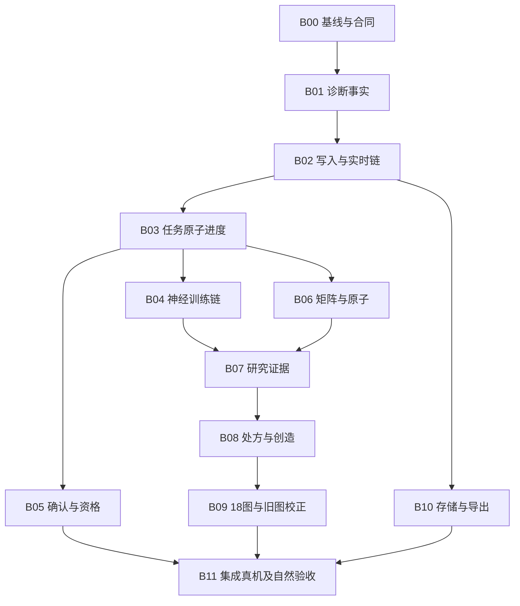
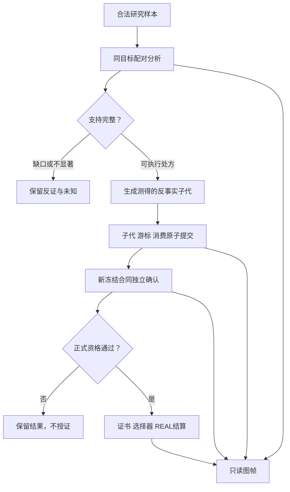
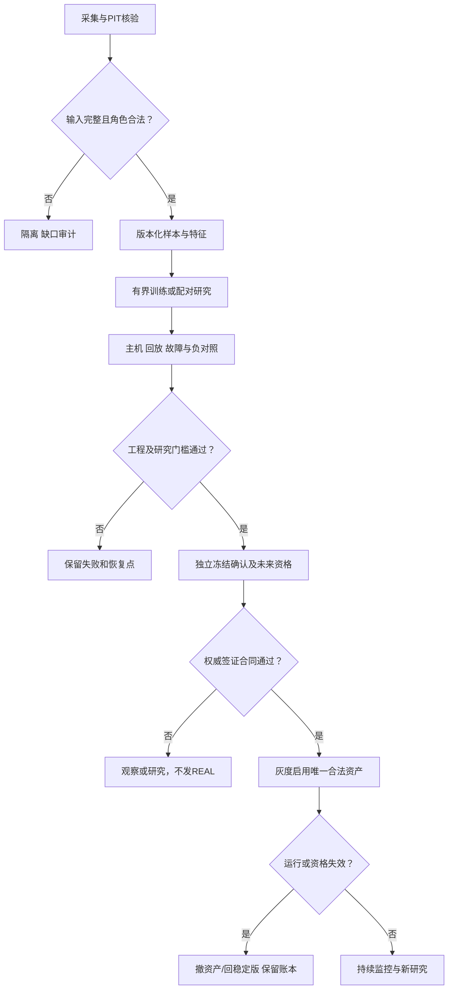

# STARCORE R30 最终返修优化施工方案

版本：R30-REPAIR-FINAL-20261101。基线源码：`b225ab204db043b347f9d76d6c5c1376fd9a2590`。本文件是可交给施工方执行的设计、代码补丁及验收合同；本轮没有修改远程仓库，没有构建或交付已返修APK。

## 1. 结论与施工边界

当前版本不能验收为“R30完整落实且已达到高胜率、高稳定、高品质”。问题包括诊断崩溃、写事务长锁、任务事实缺字段、神经训练尚未进入梯度更新、矩阵原件缺源、研究结果没有完整形成可消费处方，以及自然未来证据尚不足。已有运行、训练与研究能力应保留，不能把“某一神经路径梯度为0”扩大为“整个软件没有学习”。

本方案拆成**12个批次、60张项目卡**。保留并校正原29图，新增**18个研究图，分3组、每组6图，总计47图**。每个新图都有合法输入、计算方法、机器可读产物、实际算法消费者、对照与验收；不把“图能打开”算成“算法有用”。新增16个逻辑研究表合同，优先复用现有源，只增加6张必要物化表。

已准备11份顺序补丁，涉及28个文件，覆盖诊断、遥测、原子守卫、任务合同、神经预取与水位、确认状态、矩阵状态、研究配对分析、测得的反事实子代及工作台入口。**这些是关键实现的起点，不是60卡全部完成。** 每卡注明已预写范围与尚待实现内容，不能据此把软件状态批量填成DONE。

“完美”落实为：需求可追溯、每项有Owner、输入输出明确、同一逻辑提交原子、跨文件不互相覆盖、每个结论有证据、失败有恢复路径。无法保证随机系统中必然存在持续可利用优势；工程全部通过后，若自然证据不支持优势，就保留“质量未达标”，继续合法研究，不能降低门槛或补造成绩。

## 2. 输入、源码核对范围与证据等级

三份附件实际上只有两份独立内层快照：A为2026-11-01 09:12:29，B为11:13:22，时区均为+08:00；第三份与B的内层ZIP/hash/jobId重复，不能当第三时段趋势。内层SHA256：A=`3a1d8d0cce2bee39067261373cdfc08fe4d0b56f3a2655a11b7332ca7f13f104`；B=`2765d8db0283cf0ed588751e0997b7f8837cf993d12cc8c15cc3a22b0d5800ea`。

运行版本为577310107 / R30-FINAL-2026.10.31-107，包名`com.starcore.research.r13`，APK hash为`c414a664dec8a8c58f5e3f573f875e593a3c5d7c156b8df19e856bf5109c9a94`。仓库`gtt46461-star/starcore-public-build`的main是交付索引，不能直接把main对应树误认成设备运行源码；CURRENT_FINAL_PLAN指向上述b225基线。本轮已将该源码取到本地核对。

|审查层|本轮实际完成|不应据此声称|
|---|---|---|
|文件身份|主Java 1201文件，25,748,989字节；逐文件SHA256/blob SHA/行数|每行语义已经形式化证明|
|全量语法与调用扫描|24,318方法、312事务调用位置；0语法解析错误|Android类型检查、JNI链接、全路径语义通过|
|关键链语义审查|诊断、写队列/协调器、任务调度、神经训练、矩阵、确认/资格、图表、存储/导出|312事务点都是缺陷或其余文件完全无问题|
|修补源码验证|11补丁顺序git apply检查；叠加后1214 Java、24,374方法解析0错误|完整APK编译通过|
|主机验证|76核心检查；160000并发计数；诊断空探针修复+16旧报告字节一致；SQLite DDL/约束/回滚；6条写SQL绑定检查；遥测失败重试12+3=15|Android真SQLite/真机、全部模型数值一致、自然质量通过|
|尚缺证据|目标设备长测、Android完整构建与仪器测试；矩阵原库；具体手机诊断崩溃输入；全量自然冻结/资格原件|用源码存在替代实际运行|

证据标记统一为SOURCE_CONFIRMED、HOST_REPRODUCED、REPORT_OBSERVED、HYPOTHESIS_TO_MEASURE、MISSING_INPUT。项目卡的“问题”可能是已证实缺陷，也可能是明确待测风险；以下关键发现逐一注明，不把推测写成根因。

## 3. 当前问题、影响及正确修法

|问题与证据|当前结论|具体代码/修法|批次|
|---|---|---|---|
|诊断NullPointerException：手机报告可见；源码空探针主机可复现|`bestGainProbe`可返回null，`PR.get(null).gain`崩溃；手机原输入缺失，不能断言同一触发数据|`UpgradeDiagnosisSU2.capabilityRows`空值分支；`DiagnosisStoreSU2.report`分阶段错误链/输入hash|B01|
|旧44指标42缺数、1部分、1未部署，与其他章有实测事实不一致|检测报告本身的采集/投影链也要修，不能只要求更多文字|单一事实对象、R30注册表与每章映射；WRITER_HARD从M11纠正到M07|B01|
|后台writerHardViolations报告406；FTRL一次61,581ms、208次超硬限|有严重长锁；操作名不足以证明具体子段|`ResearchAdaptiveLearnerStoreR811`的编码/哈希已在事务外；测事务内尾校验、BLOB、触发器、`learnedWithinTransaction`归档；保持模型+学习回执原子|B02|
|遥测先rotate再写，失败catch未保留closed；record/rotate不同步|真实源码缺陷，会丢窗口或并发计数|短内存互斥+单飞pending窗口幂等重试；内存锁外才请求DB；不声称进程死亡前未落库数据无损|B02|
|request→freeze P95=25,511ms(n30/缺6)，observed→settled=14,987ms(n31/缺5)|实际慢，不是只看即时HEALTHY|唯一结算/outbox先提交，研究/解释/维护分片；不同事件实例与LIVE/BACKFILL时间线分开|B02|
|M05 30/36=83.33%；另一窗口936/1068=87.64%|不同窗口分别报告，不能拼接为一个覆盖率|全机会分母+合法弃权/故障缺口终态；不补赛前票|B02/B05|
|57任务全UNKNOWN：pending/last_committed_seq缺列|当前不具备可靠活性判定，不等于57任务都死了|typed progress分清工作游标/日历输入/提交时钟，主产物同事务写事实|B03|
|submit无限重试，部分evo先变内存后提交|存在worker饥饿与失败后内存领先风险，需逐Owner改造|prepared step、有限尝试、让出worker、commit后publish；不能只把submit改false|B03|
|神经路径28210物化样本、gradient/pretrain/online更新0，phase仍TRAIN|该路径仍在准备；无模型artifact/surface/call，不得称已学会|MATERIALIZE显示、输入/梯度/发布水位分列；≤64样本一次参数化预取；完整optimizer恢复与发布/消费链|B04|
|两确认DONE，verified=0、registered_at=0|可能是合法阴性结果；单看这三列不能判注册故障|读取result_json.reason；阴性/不足/阳性待注册三分支；只有阳性中断恢复注册|B05|
|4资格实验MISSING_OPPORTUNITY，最早3590193；pendingDrawOpen=0|开奖已到不等于资格机会链无缺口|对账freeze/opportunity/结算；无事前冻结只记缺口，不能回填成绩|B05|
|GateV2R29.ENABLED=false；实际签证为R27_GATE_V1|不能把V2旁路would_issue当正式门禁|`LiveShadowsR27.certify`/`CertificateGateR27`是当前权威；新合同需新登记、版本与连续alpha，不能直接改true|B05|
|20矩阵19原生源不可用、SU2零快照；static linkage=1|反射绑定成功不等于产出/消费/有效；未发现静态直调也不证明动态永远不调用|分开static/runtime/effect状态；修schema readiness、显式有界生产任务与消费/效益回执|B06|
|现有29图以聚合展示为主；verifiedGenerations=0|其中运行审计图有用，但不能自动作为学习训练集或创造引擎|逐图纠正角色、窗口、分母、模拟资金标签；18研究图以分析产物驱动机器消费者|B07–B09|
|目录约26.52GB；主库约9.03GB、快照8.32GB、新备份8.23GB、旧备份0.74GB|大头包括重复副本；不同采样时刻字节不能直接相减|按引用/恢复点治理快照、备份与归档，先普查再清理；不清App数据，不盲目分库|B10|

### 自然质量为什么仍不能通过

B的两条资格影子分别为21/61=34.426%与14/55=25.455%。普通Wilson描述区间约[23.75%,46.95%]与[15.81%,38.30%]；这不是处理多策略选择或可选停止后的正式保证。对应logE为−0.2101、−0.5782，远未到6.3035、5.7819；有效证书0，qualified0；两条证书记录均NOT_ISSUED。旧严格OOS应按448/1564=28.6445%，不能拿1667个结算样本作同一分母。

固定单位置K3若真实结果对1–10条件均匀，随机基线为30%；只有事前可利用结构才能提高条件命中。围号、矩阵、神经网络和更多搜索次数都不自动产生这种信息。本方案的研究产物用于发现、否证与独立检验结构。研究筛选越多，越需要保留完整实验族账本和独立验证，不能只展示最好曲线。

当前真实R27签证链包含ACT≥250、命中≥34%、ECE≤0.04、最差720块≥0.26、最长连败≤6及ABI/序贯/对照等合同，完整规则以源码为准。R30更完整质量目标必须明确接入权威链，不能把另一个未启用版本的目标说成当前已经在执行。自然质量不得以24/72小时固定截止承诺通过：低动作率、稳定块和正式序贯证据需要的自然期数可能远超工程工期。

## 4. 总体施工次序与跨文件协同



B10的普查/空间止损从B00后即可启动；涉及删除、迁移的执行须通过B02/B03引用和原子合同。B05与B04/B06可在接口冻结后并行设计；碰到同一Runtime/Schema/报告文件必须由一个集成Owner依序合并。B09可先做只读UI壳，但数据分析和真实消费者未完成前必须显示WAITING/BLOCKED，不能填模拟数据后验收“18图完成”。

### 文件动作的定义

MODIFY是对已有类做增量；REPLACE_METHOD仅替换卡指定方法；ADD是新增文件；VERIFY_AND_KEEP表示已有实现保留并复核，VERIFY_THEN_CONDITIONAL_MODIFY表示先取得阻塞证据再做限定改动；EXTEND_NEW_FILE表示接续早先批次新增的同一文件。原1201主Java文件全部列入FILE_ACTIONS.csv；未列为施工目标的文件标KEEP_NO_TARGETED_CHANGE，表示本轮不安排修改，**不表示语义全部证明无缺陷**。本轮无无条件删除整类/整库的决定。冗余输出或旧别名只能先弃用，再经真实调用/ABI/恢复路径核对另卡删除。

每卡包含：问题与证据、源文件及方法锚点/原hash、修改方式、步骤、测试、验收、回滚、前驱与共享文件Owner。源代码锚点均针对b225；实现后行号漂移使用方法名和blob/hash重新定位。对于拟新增方法或类，明确标ADD，不能假装原源码已有。多卡共改同一文件时，FILE_OWNERS.json给出顺序；同一个文件不允许并发覆盖式提交。

### 复杂并发的不变量

1. 每个研究逻辑步骤的artifact、游标、消费回执属于同一现有writer批次；任何SQL失败则全部回滚。不能在写队列内部按行数把一个逻辑事务切成多个可见提交。
2. 计算/模型编码/大查询/图缓存构建在writer外；事务内只复核fence/sourceRevision/截止/ABI并做有限提交。若确需stage，先验证内容hash，原子切发布指针，再让读者可见；stage不等于成功。
3. 原.before守卫不能被helper覆盖；新增guardBefore必须与原fence相与。已存在的直接赋值点逐一归属，不是增加一个API就自动安全。
4. prepared step只读不可变输入。BUSY返回RETRY_LATER并让出worker，内存不发布；SOURCE_CONFLICT丢弃计算重新准备；COMMITTED后才发布进度和模型。Evolution快照必须含RNG/pending/阶段等完整恢复状态。
5. 信封用CAS控制单飞；不得持有信封/遥测监视器再等待DB，不在writer中等待Future/UI/native训练。不让短内存互斥跨越磁盘IO。
6. 主链draw/结算/持久outbox在核心提交中唯一写入，提交后触发研究。SQLite提交成功但进程在回调前死亡，由持久stepId/outbox恢复，而非再学习一遍。
7. UI只读已经提交的分析帧，打开图不训练、不创建schema、不推进资格。所有读者使用lease、取消、输入版本与生命周期epoch。

## 5. “研究表”必须真的帮助创造

把数字画成图不会产生学习。真正可用的对象是：合法样本 → 可复算的分析 → 受约束处方 → 有类型的AST/算法子代 → 同一提交中的消费回执 → 新身份独立确认 → 正式资格 → 唯一REAL/结算。图只是这个对象的可视入口。



### 已预写的可执行闭环示例

以“一个原子组件是否拖累父策略”为第一条完整链。`PairedComponentStudyR30R1`实际调用原`ReplayEvaluatorR27.selectTraceWithProbabilities`，测父策略with组件和预先生成的without组件，比较相同位置/实际号码的十分类概率。归一化Brier为`0.5×Σ(p_k−1[y=k])²`，Δ=`loss_without−loss_with`。因此Δ<0代表with组件有害，可提出精确移除处方。

按预登记日历块计算研究描述区间，缺期/缺整块不出建议；固定尾余块按事先规则排除并披露；块大小、窗口、最低样本、损失和统计法进入analysisContractHash。区间不消除跨块相关或多次搜索偏差；预写t区间仅为探索描述，相关性诊断/块长敏感性与零信号对照仍须B07实现，不能作为正式授证统计量。

`DirectedResearchPolicyR30R1`只允许add/mix/sub的已测子节点替换，保留类型、范围、因果和父身份，计算结果必须与测得counterfactual hash完全一致。`ResearchStoreR30R1`原子写分析/测量/处方/R06帧；实际接入Evolution时，处方消费必须与子代入库、pending与游标放同一batch。失败不产生消费回执；重新执行不重复计自然样本。

完整evaluate函数便于定义和重放算法，**不得直接在实时任务执行整个历史回放**。B07-04要把它转换成可恢复有界分析任务：pin输入、预备反事实、按固定期片处理两条同状态回放、持久化完整回放状态与期块累加、完成后一次发布分析。若只保存损失和却丢在线bias/quantile ring/RNG，恢复后的轨迹将不一致，不能验收。

### 正式标签与研究反馈边界

TRAIN/SELECT/ONLINE_RESEARCH可以驱动处方；CONFIRM/FUTURE仅供冻结规则下的正式评估与只读展示，不能再用来调算子权重、训练模型、筛父代或选新窗口。SYNTHETIC只进入离线控制/恢复测试，不计自然成绩。R11确认图的阴性结果可展示；不得把同一正式确认结果回流成自适应选择奖励。需要后续学习的数据必须按预先登记的新研究角色/时间合同另行采集，不能静默把保留段改名再训练。

## 6. 18个研究图与16个逻辑表

下面逐对象列输入、计算、消费者与反证。详细字段合同见registries；有统计但无机器消费者的图只能算观察工具，有消费者但无独立效果证据的对象只能算研究功能。

### R01 多尺度结构状态与可用窗口

|项目|施工合同|
|---|---|
|图形|HEATMAP|
|输入|结构/位置/号码、availableAt、固定窗口、状态概率|
|分析|在预先固定的多尺度上计算频率/转移/熵；小样本向先验收缩，显示有效期数，不挑历史最好窗口|
|机读产物|STRUCTURE_STATE|
|消费者|StructureGeneratorRegistryR30；生成合法结构候选与窗口处方|
|反证与验收|移除结构条件的同期对照；换窗口须新分析合同|
|更新及边界|新开奖后有界片；每图≤120单元，余项分页|
|实施卡|B07证据/有界任务；B08对应创造卡；B09渲染。R06部分核心已预写，其余须真实实现。|

### R02 结构预测与下一期落地误差

|项目|施工合同|
|---|---|
|图形|LINES|
|输入|事前结构概率、预测hash、真实标签、冻结时刻|
|分析|事前预测与事后标签按期配对；对同一结构结果计算Brier/对数损失与混淆|
|机读产物|STRUCTURE_FORECAST_ERROR|
|消费者|FailureProfileR30；把可解释失败簇交给研究提案|
|反证与验收|没有事前预测即缺口，禁止用结算结果重造预测|
|更新及边界|结算后增量；按预先固定期块聚合|
|实施卡|B07证据/有界任务；B08对应创造卡；B09渲染。R06部分核心已预写，其余须真实实现。|

### R03 号码位置兼容与跨位结构

|项目|施工合同|
|---|---|
|图形|GRAPH|
|输入|严格滞后跨位特征、源期、位置对、兼容支持数|
|分析|条件关联/兼容强度加收缩；先按日历期聚类，避免10位置算10个独立期|
|机读产物|POSITION_COMPATIBILITY|
|消费者|IdeaI04CrossPositionR27；选择有支持的跨位输入或屏蔽负贡献边|
|反证与验收|移除该输入的同目标配对损失；同期其他位置真实值不可作事前输入|
|更新及边界|每固定研究窗口；边≤120|
|实施卡|B07证据/有界任务；B08对应创造卡；B09渲染。R06部分核心已预写，其余须真实实现。|

### R04 多位置围号交集与缩减证据

|项目|施工合同|
|---|---|
|图形|STACK|
|输入|各集合事前成员、位置、交集、支持域、目标K3|
|分析|按固定候选合并/相交规则量化候选缩减和覆盖损失；输出单位置固定K3或弃权|
|机读产物|SET_INTERSECTION_SUPPORT|
|消费者|SetIntersectionPolicyR30；形成可执行集合策略AST|
|反证与验收|与单集合/随机同大小集对照；交集过小不补凑3个|
|更新及边界|每冻结研究窗口；分层展示候选数/支持期|
|实施卡|B07证据/有界任务；B08对应创造卡；B09渲染。R06部分核心已预写，其余须真实实现。|

### R05 失败簇到假设到可执行子代

|项目|施工合同|
|---|---|
|图形|GRAPH|
|输入|failureCluster、机制、提案AST、编译结果、子代hash|
|分析|按预登记错误特征聚类，专家提案必须可转为有类型AST并通过PIT/成本检查|
|机读产物|FAILURE_PRESCRIPTION|
|消费者|ExpertProposalsR27；把具体失败变成可重放的研究子代|
|反证与验收|文本、记录数、解释长度不算产出；错类型/无子代无成功边|
|更新及边界|每提案提交后|
|实施卡|B07证据/有界任务；B08对应创造卡；B09渲染。R06部分核心已预写，其余须真实实现。|

### R06 原子条件边际贡献

|项目|施工合同|
|---|---|
|图形|BAR+CI|
|输入|with/without十分类概率、同一真实数、日历期、组件路径|
|分析|Δ=归一化多分类Brier(without)−Brier(with)；固定期块均值及描述性区间；保留缺块/尾块|
|机读产物|ATOM_PAIRED_GAIN|
|消费者|MutationOpsR27；负贡献有支持时发PRUNE_COMPONENT，正贡献仅候选确认|
|反证与验收|完整测得的反事实必须与实际子代hash相同；不能比较不同K3事件的二元Brier|
|更新及边界|每研究分析run；≤64梯度/受限回放片|
|实施卡|B07证据/有界任务；B08对应创造卡；B09渲染。R06部分核心已预写，其余须真实实现。|

### R07 分子协同与冗余贡献

|项目|施工合同|
|---|---|
|图形|HEATMAP|
|输入|无组件/单A/单B/AB四种同目标输出、成本|
|分析|协同=Gain(AB)−Gain(A)−Gain(B)，与冗余和复杂度并列；分块配对|
|机读产物|MOLECULE_SYNERGY|
|消费者|DerivedAtomR27；构造有互补证据的组合原子，拒绝无益复杂化|
|反证与验收|同预算单体/组合对照；正式确认独立，不能用训练协同授证|
|更新及边界|低频有界研究批|
|实施卡|B07证据/有界任务；B08对应创造卡；B09渲染。R06部分核心已预写，其余须真实实现。|

### R08 思路族行为差异与机制覆盖

|项目|施工合同|
|---|---|
|图形|GRAPH|
|输入|固定probe集、输出分布、机制标签、行为指纹|
|分析|固定probe行为距离、同错误重合与机制覆盖；随机换名字不算创新|
|机读产物|BEHAVIOR_DIVERSITY|
|消费者|BirthGateR27；行为去重和保留多样候选|
|反证与验收|近同AST/异名同结果/新机制真差异三个反证；多样不等盈利|
|更新及边界|每候选出生时增量|
|实施卡|B07证据/有界任务；B08对应创造卡；B09渲染。R06部分核心已预写，其余须真实实现。|

### R09 专家处方落地与归因

|项目|施工合同|
|---|---|
|图形|BAR|
|输入|专家ID、proposal、AST、admission、child、研究损失|
|分析|按可执行提案率、有效覆盖、同期gain/成本分别归因；不把一份提案复制多个成功|
|机读产物|EXPERT_EXECUTABLE_CREDIT|
|消费者|ExpertProposalsR27；研究预算与专家路由调度|
|反证与验收|相同失败输入/预算的盲化消融，保留负提案|
|更新及边界|每研究批；正式确认结果只作只读显示|
|实施卡|B07证据/有界任务；B08对应创造卡；B09渲染。R06部分核心已预写，其余须真实实现。|

### R10 变异算子增益与计算成本

|项目|施工合同|
|---|---|
|图形|LINES|
|输入|算子、父子、配对增益、CPU/内存/有效提交|
|分析|按预先固定成本桶绘制收益和成功率，或新增真正XY renderer；不能用索引假称连续成本轴|
|机读产物|OPERATOR_GAIN_COST|
|消费者|EvolutionLoopR27；只用研究角色证据调整opWeights并保留探索下限|
|反证与验收|均匀预算或旧权重对照；多次筛选成本写进实验族账本|
|更新及边界|每固定研究预算窗口|
|实施卡|B07证据/有界任务；B08对应创造卡；B09渲染。R06部分核心已预写，其余须真实实现。|

### R11 父子同期配对与独立确认

|项目|施工合同|
|---|---|
|图形|LINE+CI|
|输入|父子冻结身份、相同期预测、confirm窗口/result reason|
|分析|分开研究配对曲线与独立冻结确认终态；负结果是合法研究结果|
|机读产物|PARENT_CHILD_PAIRED|
|消费者|FrozenConfirmationR30；提交独立确认；正式结果不回流自适应选父/调算子|
|反证与验收|DONE verified=0不能自动视为故障；仅verified=1注册未完成走恢复|
|更新及边界|确认每批提交后；展示只读|
|实施卡|B07证据/有界任务；B08对应创造卡；B09渲染。R06部分核心已预写，其余须真实实现。|

### R12 融合互补与共同失败区域

|项目|施工合同|
|---|---|
|图形|HEATMAP|
|输入|父策略概率、同周期错误、融合权重、候选身份|
|分析|同目标残差/错误相关与盲化融合收益；训练拟合权重、SELECT评估，不用确认段拟合|
|机读产物|FUSION_COMPLEMENTARITY|
|消费者|FusionOpsR27；生成新融合身份的新资产候选|
|反证与验收|均匀融合/最佳单体/简单模型对照；不得继承父证书与alpha|
|更新及边界|每融合研究批|
|实施卡|B07证据/有界任务；B08对应创造卡；B09渲染。R06部分核心已预写，其余须真实实现。|

### R13 置信度失准与支持域风险

|项目|施工合同|
|---|---|
|图形|RELIABILITY|
|输入|prior拟合截止、预测目标、箱count、hit、prob、reference|
|分析|固定箱或预登记分箱的ECE/BSS；二元K3和十分类目标分开；域外拒绝|
|机读产物|CALIBRATION_SUPPORT|
|消费者|CalibrationRowsR27；冻结可支持的校准器或降低动作范围|
|反证与验收|原概率/校准概率同期proper score，去掉难样本不算改善|
|更新及边界|prior-only滚动；按期块/箱分页|
|实施卡|B07证据/有界任务；B08对应创造卡；B09渲染。R06部分核心已预写，其余须真实实现。|

### R14 梯度到概率面到策略消费

|项目|施工合同|
|---|---|
|图形|GRAPH|
|输入|dataset、materialized、gradient、artifact、surface、call、predraw|
|分析|逐键连接输入水位、实际梯度水位、模型字节hash、发布ABI和消费者冻结回执|
|机读产物|MODEL_CONSUMPTION_CHAIN|
|消费者|IdeaI08NeuralRepresentationR27；阻断无合法模型的策略，证明模型被实际使用|
|反证与验收|仅有模型文件不够；拿掉模型面后输出差异与实际调用回执需一致|
|更新及边界|每训练片/发布/冻结提交后|
|实施卡|B07证据/有界任务；B08对应创造卡；B09渲染。R06部分核心已预写，其余须真实实现。|

### R15 漂移、遗忘与回放价值

|项目|施工合同|
|---|---|
|图形|LINES|
|输入|固定窗口分布、旧/新模型相同样本输出、回放配额|
|分析|PSI/分布距离仅报警，旧新模型配对损失及旧场景保留性能作决策；阈值预登记|
|机读产物|DRIFT_REPLAY_VALUE|
|消费者|AtomNetRuntimeR30；分配合法研究回放/发起重新训练与回滚候选|
|反证与验收|无回放/固定回放对照；漂移不等真实可预测，也不自动重置资格|
|更新及边界|每固定输入批；不按UI打开触发|
|实施卡|B07证据/有界任务；B08对应创造卡；B09渲染。R06部分核心已预写，其余须真实实现。|

### R16 研究探索预算与有效产出

|项目|施工合同|
|---|---|
|图形|STACK|
|输入|任务/角色、CPU、队列等待、真实commit、proposal和admitted child|
|分析|有效研究产出/CPU秒、积压与公平服务份额并列；统计无提交忙转|
|机读产物|RESEARCH_BUDGET|
|消费者|ResearchPoolR27；在资源上限内调研究配额，不侵占实时deadline|
|反证与验收|同预算调度对照，prepared重试不重复计产出；保留探索份额|
|更新及边界|每分钟聚合，调度合同固定周期更新|
|实施卡|B07证据/有界任务；B08对应创造卡；B09渲染。R06部分核心已预写，其余须真实实现。|

### R17 失败机制记忆与重复消耗

|项目|施工合同|
|---|---|
|图形|GRAPH|
|输入|机制hash、相同条件、反证、拒绝/复试原因、成本|
|分析|反证聚类与重复消耗图；输入/条件改变后允许有理由复试，不永久杀死整个家族|
|机读产物|FAILED_MECHANISM_MEMORY|
|消费者|EvolutionLoopR27；避免同一失败换名重复搜索，产生新机制假设|
|反证与验收|旧冠军/保护族不被误删；同样反例使重复CPU减少|
|更新及边界|每研究失败提交后|
|实施卡|B07证据/有界任务；B08对应创造卡；B09渲染。R06部分核心已预写，其余须真实实现。|

### R18 研究处方到主链效果全链

|项目|施工合同|
|---|---|
|图形|GRAPH|
|输入|run→proposal→child→confirm→experiment→certificate→selector→REAL→settlement|
|分析|按真实外键/hash/版本连链；每段有成功、失败、未知，主链收益使用真实账本|
|机读产物|END_TO_END_RECEIPTS|
|消费者|DecisionGateEngine；定位研究何处失效，提供最终贡献归因|
|反证与验收|直接研究→REAL、借旧证书、缺结算仍说盈利均失败；无自然资产则0|
|更新及边界|每关键提交后物化；只读渲染|
|实施卡|B07证据/有界任务；B08对应创造卡；B09渲染。R06部分核心已预写，其余须真实实现。|


### 16个逻辑研究表

|ID/表|必要字段|计算与质量|真实来源|更新|用途|
|---|---|---|---|---|---|
|T01 数据与标签血缘|dataset_hash,issue,available_at,label_at,role,revision,input_hash|迟到率=晚于冻结标签数/到达标签数；PIT违规单列|采集/标签现有表与analysis_run|每输入提交|训练合法性/复现|
|T02 样本特征支持域|feature/ABI,窗口,缺失/finite/支持数,分布版本|null_rate=缺失/应有；多位置不作独立期|既有FeatureCache/输入样本|每不可变输入批|特征过滤与域外拒绝|
|T03 事前预测与结构落地|policy,target,prob_vector,structure,freeze_hash,actual|同目标proper loss；预测必须先于标签|原predraw/冻结+标签只读join|每结算|R01–R04|
|T04 失败机制样本|failure_key,role,condition,expected,observed,cost|失败覆盖数/合法应测期；机制hash去重|既有failure与research_measure|每研究失败|R02/R05/R17|
|T05 原子配对贡献|run,component,without_hash,期块,Δ,CI,n|Δ=L_without−L_with；同一期同一目标|research_measure(kind=ATOM_PAIRED_GAIN)|每分析run|测得移除处方|
|T06 分子协同与复杂度|A,B,AB,none,synergy,cost,blocks|Synergy=Gain_AB−Gain_A−Gain_B|research_measure(kind=MOLECULE_SYNERGY)|每组合研究批|R07组合/冗余修剪|
|T07 族与行为指纹|family,mechanism,probe_hash,behavior_hash,diversity|重复率=同probe近同输出/新候选；机制覆盖|原family/genome+research_measure|每候选|R08行为去重|
|T08 专家到AST处方|expert,proposal,parent,child,admission,reason|可执行落地率=合法AST子代/提案；不计文本条数|proposal+consume+原policy|每提案/消费|R05/R09|
|T09 算子与父子预算|operator,parent,child,cpu,paired_gain,window|效益与CPU分列，固定成本桶；不造综合神分|research_measure+原generation|每代真实提交|R10研究预算|
|T10 融合互补证据|parents,weights_fit_cutoff,error_corr,child,new_contract|同目标残差相关；Δ_fused vs same-budget baseline|原fusion+research_measure|每融合候选|R12新身份融合|
|T11 神经训练与消费链|input_boundary,materialized,grad_visits,trained_through,artifact,surface,call|计数按position sample/访问/独立期分列；模型消费率=合法调用/应调用|AtomNet/ModelSurface原表+run|每训练/发布/调用|R14/R15|
|T12 校准支持与风险|target,fit_cutoff,bin,n,mean_p,hit,BSS_ref|ECE=Σ(n_b/N)／mean_p−hit_b／；BSS=1−BS/BS_ref|原CalibrationRows与measure|每合法校准更新|R13与门禁支持|
|T13 确认/未来/资格证据|frozen_id,role,ACT,hit,logE,alpha,gateVersion,status,reason|hit/ACT、ACT/机会；区间仅描述；正式授证沿注册合同|原frozen_confirm/experiment/eprocess/certificate|每提交|R11/R18只读与授证|
|T14 研究任务活性与公平|task,work_unit,cursor,pending,oldest_input,commit_clock,cpu|积压年龄=当前日历期−最老pending期；无pending为null|task_progress+原调度遥测|同主产物batch|M11/M12/R16|
|T15 处方消费与增量效果|run,proposal,child,receipt,analysis_contract,followup|消费闭环率=唯一已消费/可消费；有效性另行独立评估|analysis_run/proposal/consume/chart_cache|每分析/消费原子提交|不留空心图/空心处方|
|T16 自然资产主链与资源成本|policy,certificate,selector,REAL,settlement,payout,cost,abstention|净结果=实际结算收入−实际成本；预测命中与经济收益分列|原唯一REAL/结算账本+消费链只读join|每实际结算|R18最终效果；无真实赔付不计算经济盈利|


所有表至少保留`run_id/dataset_hash/policy_hash/ABI/role/source_commit/source_revision/分析合同hash/窗口/时间/输入可用时刻/分母/缺失/状态/原件hash`。聚合表不能替代样本级训练输入。原始标签、概率向量、特征以及处方payload按schema和字节预算存放；只在图表帧中降采样，不能把降采样后的120点当训练全集。

新物理表仅`r30r1_analysis_run/research_measure/proposal/consume/chart_cache/task_progress`。20旧矩阵必须先接回真实原件；不在报告读取时创建同名空表遮住缺源。689张旧表的逐表快照清单保留在evidence，不能把表多当能力强。对没有样本级字段/可用时刻/标签血缘的统计表，标“观察可用，不能直接训练”。

## 7. 原29图与20矩阵逐项结论

原29图并非全无作用：性能、资格、覆盖和资源图可以解释运行阻断；但其中聚合图不能直接当深度学习原始样本。每张图都要给出用途、来源、当前证据、行/不行的层次、升级路径及对应卡。每个原图的完整索引在下面及evidence/29_chart_audit.csv；旧FIX编号通过60卡crosswalk映射，不丢原修复需求。

|原图ID/名称|来源|当前证据|评价与升级|施工卡|
|---|---|---|---|---|
|status 研究状态/同报告快照|ChartsRepositoryR27.headlineSnapshotR30；commonMetrics|有效证书0；当前研究状态可展示，不能代表资产有效|展示三条独立状态：服务、研究推进、质量；点击进入阻断链|FR-B00-01,FR-B01-03,FR-B01-04,FR-B01-05|
|p01_three_scores 三类成绩并列|ChartCacheR27.threeScores；replay_score/live_frozen/eprocess|两影子未来21/61和14/55；不宜用回放39–42%代替未来|并列每策略三个角色、ACT分母、独立期与选择偏差说明|FR-B00-01,FR-B01-03,FR-B01-04,FR-B01-05|
|p02_generation_holdout 每代冠军留出：主/打乱/随机|ChartCacheR27.generationHoldout；r27_generation|最近冠军线多数HOLDOUT_UNAVAILABLE；verifiedGenerations=0|新确认回执联结当前代，旧循环留出降为研究历史；不复用一段证据重复画改善|FR-B05-01,FR-B05-02|
|p03_evolution_events 每代进化事件|ChartCacheR27.evolutionEvents；r27_generation|有出生/淘汰事件，不是质量提升|事件联结operator、失败处方、可编译产物和后续确认结果|FR-B07-01,FR-B07-02,FR-B07-03,FR-B07-05,FR-B08-01,FR-B08-02,FR-B08-03,FR-B08-05|
|p04_seven_counters 进化七计数累计|ChartCacheR27.sevenCounters；generation/r26_evolution|最新窗口attempts5248、unique4970、verifiedImprovements0；不是总库189855|各计数写明统计轮和起止；增加有效资产/CPU成本，不把累计活动画成智慧|FR-B07-01,FR-B07-02,FR-B07-03,FR-B07-05,FR-B08-01,FR-B08-02,FR-B08-03,FR-B08-05|
|p05_lineage 父子谱系最近60条|ChartCacheR27.lineage；lineage/policy/replay|谱系有记录，确认提升未成立|关联父母、算子、行为差、确认段和拒绝原因；筛选旧证据不得授证|FR-B05-01,FR-B05-02|
|p06_idea_survival 思路族存活率|ChartCacheR27.ideaSurvival；r27_policy|当前幸存思路I11/I13/I16；仅研究存活|增加按族独立机制数、确认收益、成本；存活为0不直接宣判永远无信号|FR-B07-01,FR-B07-02,FR-B07-03,FR-B07-05,FR-B08-01,FR-B08-02,FR-B08-03,FR-B08-05|
|p07_funnel 淘汰漏斗|ChartCacheR27.funnel；generation/shadow/eprocess/certificate|有候选但qualified=0、ACTIVE证书0|每层分母和拒绝首因；点击未晋升原因；不能把记录出生当有效产出|FR-B00-04,FR-B05-02,FR-B05-04,FR-B07-05,FR-B11-03|
|p08_bss 深度学习A：累计BSS及区间|ChartCacheR27.bss；brier_pair FUTURE ATOMNET|新十位置模型尚无消费；旧ATOMNET/轮换位置数据不能冒充新模型|按ABI、model_hash、position分层；十位置按期聚类；少样本不画有效提升线|FR-B04-01,FR-B04-02|
|p09_rolling200 深度学习B：滚动200 Brier|ChartCacheR27.rolling；r27_brier_pair|波动图可诊断，当前不能证明新模型效果|增加固定窗口、噪声带来源、样本角色；不依曲线高低临时挑窗晋升|FR-B06-06,FR-B08-04|
|p10_train_holdout_loss 深度学习C：训练/留出损失|ChartCacheR27.trainHoldout；r27_atomnet_epoch|新模型epoch0、gradient0；尚无新训练曲线|拆预处理/梯度/验证阶段；训练与多分类/二元目标、ABI分别标注|FR-B04-01,FR-B04-02|
|p11_eprocess 序贯进度|ChartCacheR27.eprocess；r27_eprocess|2个ACTIVE仍ACCUMULATING；4实验缺期阻断|显示连续cursor、缺口ordinal、alpha、真实阈值；不只显示进度百分比|FR-B05-03|
|p12_mainline_weight 主链算法参与权重|ChartCacheR27.mainline；ResearchMainlineContributionAuditR922|没有已证明新资产进入主链；权重0应显示阻断原因|证书→selector→Gate→REAL→结算逐键追溯；不得强行补权重|FR-B00-04,FR-B02-05,FR-B05-04,FR-B05-05,FR-B11-03|
|p13_runtime_health 研究运行健康|ChartCacheR27.health；CPU/task/generation/wait/opportunity|57活性UNKNOWN、11未运行入口；CPU占比约47.9%不代表有效学习|显示pending、last_commit、期数滞后、依赖/等新期/无运行分类|FR-B03-01,FR-B03-02,FR-B03-03|
|p14_atom_scores 原子回放评分分布|ChartCacheR27.atoms；r27_atom_score|176评分行；贡献表部分样例下界负；目录数不是有效数|按原子机制与来源分层，接贡献表驱动生成采样；H_SELECT有效≠自然有效|FR-B06-03,FR-B06-04,FR-B07-01,FR-B07-03|
|p15_paired_improvement_r30 逐代配对提升/独立确认|ReportChartsR30.evolution；同报告快照|2确认DONE但verified0；已验证代数0|同时显示未绘制/证据复用/登记待办；配对原件可重算才画有效提升|FR-B05-01,FR-B05-02|
|p16_capability_coverage_r30 能力覆盖与阻塞|ReportChartsR30.capabilities；82对象注册|24家族16专家21思路1模型20矩阵；F23缺教师；effective未知|六层状态分别画；可执行和有效绝不合并|FR-B03-01,FR-B06-01,FR-B06-02,FR-B06-03,FR-B07-03|
|r83_algorithm_all 全部算法逐期实盘榜|ChartsRepositoryR83.r27AlgorithmBoard|观察池有1151独立期；不是全部REAL实盘|明确改称冻结影子/REAL分栏；记录全池与展示截取分母|FR-B01-05,FR-B09-01,FR-B09-02,FR-B09-03,FR-B09-04,FR-B09-05|
|r83_algorithm_rank 算法实盘排行榜|ChartsRepositoryR83.algorithmBoard|旧来源与新R27榜口径不同，不能跨榜挑最高|统一policy/learner身份、角色与窗口；样本不足不按裸命中率排第一|FR-B01-05,FR-B09-01,FR-B09-02,FR-B09-03,FR-B09-04,FR-B09-05|
|r83_best_curve 最佳算法累计命中|ChartsRepositoryR83.bestAlgorithmCurve|事后最佳选择存在幸存者偏差；本轮未证明选中版本事前固定|保存选择规则和选中时刻，事前固定冠军曲线与事后榜分开|FR-B01-05,FR-B09-01,FR-B09-02,FR-B09-03,FR-B09-04,FR-B09-05|
|r83_action_candles 出手资金K线|ChartsRepositoryR83.actionCandles；exploration与shadow join|源码读取探索动作+影子hit_label；不是实际REAL资金账|标明影子模拟资金；真实资金仅从REAL唯一结算读取实际赔率/成本|FR-B01-05,FR-B09-01,FR-B09-02,FR-B09-03,FR-B09-04,FR-B09-05|
|r83_all_hit 全部预测命中率走势|ChartsRepositoryR83.hitTrend(false)|全部预测与ACT不同分母，不能代替出手效果|显示冻结总量、合法样本、独立期、未结算与缺口|FR-B01-05,FR-B09-01,FR-B09-02,FR-B09-03,FR-B09-04,FR-B09-05|
|r83_act_hit 出手命中率走势|ChartsRepositoryR83.hitTrend(true)|ACT可能含旧影子/探索源；不等于REAL|角色过滤器由权威事件字段决定；同期与全日历覆盖并列|FR-B01-05,FR-B09-01,FR-B09-02,FR-B09-03,FR-B09-04,FR-B09-05|
|r83_number_candles 当前所选位置号码K线|ChartsRepositoryR83.numberCandles；最多600开奖|描述历史号码，K线形态不能直接称预测信号|仅作描述；若算法使用，改为过去窗口特征并经过T01/T02验证|FR-B01-05,FR-B09-01,FR-B09-02,FR-B09-03,FR-B09-04,FR-B09-05|
|r83_number_line 当前所选位置号码轨迹|ChartsRepositoryR83.numberLine；draws|可作数据排查，尚无独立预测收益证据|标注位置/期范围/断点；任何结构判断必须另立事前模型|FR-B01-05,FR-B09-01,FR-B09-02,FR-B09-03,FR-B09-04,FR-B09-05|
|r83_omission_heat 号码遗漏热力图|ChartsRepositoryR83.omissionHeat；draws|遗漏事实可计算，不能推出号码将补出|可用于研究特征，明确间隔与缺失区别；做增量贡献对照|FR-B06-03,FR-B06-04,FR-B07-01,FR-B07-03|
|r83_hot_cold 当前所选位置冷热号|ChartsRepositoryR83.hotCold；draws|频率描述有用，但冷热≠未来概率|窗口事前冻结；平滑/基率与置信度分列；不直接按热度授证|FR-B07-01,FR-B07-02,FR-B07-03,FR-B07-05,FR-B08-01,FR-B08-02,FR-B08-03,FR-B08-05|
|r83_calibration 预测概率校准|ChartsRepositoryR83.calibration；旧概率来源|新R27两项Q05失败，旧图来源不能互替|按目标事件、模型ABI、role合并索引；每bin支持与时间隔离可见|FR-B06-06,FR-B08-04|
|r83_brier20 短期波动参考：滚动20期Brier|ChartsRepositoryR83.networkBrier（R27加载时改名）|源码已降为参考；不能判断越学越准|保留参考标识，不自动影响selector或模型晋升|FR-B01-05,FR-B09-01,FR-B09-02,FR-B09-03,FR-B09-04,FR-B09-05|


20矩阵的维度/合法输入/测量/消费者必须分别登记。反射方法存在只算静态可调用。生产必须有输入hash、合法时刻、快照hash、checkpoint；消费必须有实际执行回执；效益必须有同预算消融。当前19个R930矩阵统一缺原生来源，SU2检查点为零，因此当前有效性全为UNKNOWN；不能把绑定100%写成20矩阵已生效。

|对象|设计维度/输入|分析产物及消费者|当前证据|效果验收|
|---|---|---|---|---|
|R930:EVIDENCE_TEACHER|teacher×target；合法教师冻结概率/ABI/支持|教师分歧及同目标损失；教师选择/解释|BLOCKED_SOURCE；R930_SNAPSHOT_SOURCE_UNAVAILABLE:SQLiteException；有效性UNKNOWN|去教师对照|
|R930:STUDENT_ERROR|student×error-condition；学生事前预测与标签|残差/错误簇及支持；失败驱动处方|BLOCKED_SOURCE；R930_SNAPSHOT_SOURCE_UNAVAILABLE:SQLiteException；有效性UNKNOWN|同条件残差下降|
|R930:FORWARD_REASONING|rule×premise；可执行规则与PIT前提|正向执行输出及轨迹；AST/推理提案|BLOCKED_SOURCE；R930_SNAPSHOT_SOURCE_UNAVAILABLE:SQLiteException；有效性UNKNOWN|类型/PIT与独立增益|
|R930:REVERSE_REASONING|target×premise；目标与历史可用前提|受约束反向候选，不读未来；新假设生成|BLOCKED_SOURCE；R930_SNAPSHOT_SOURCE_UNAVAILABLE:SQLiteException；有效性UNKNOWN|反向产物可正向复验|
|R930:COUNTERFACTUAL|component×context；精确with/without输出|同目标配对贡献；测得反事实子代|BLOCKED_SOURCE；R930_SNAPSHOT_SOURCE_UNAVAILABLE:SQLiteException；有效性UNKNOWN|与实际child hash一致|
|R930:FEEDBACK|state×settled-error；事前状态与结算回执|合法研究反馈，正式段隔离；研究更新|BLOCKED_SOURCE；R930_SNAPSHOT_SOURCE_UNAVAILABLE:SQLiteException；有效性UNKNOWN|角色隔离反证|
|R930:CONTRADICTION|claim×evidence；同口径主张/证据|矛盾分母/版本定位；拒绝冲突输入|BLOCKED_SOURCE；R930_SNAPSHOT_SOURCE_UNAVAILABLE:SQLiteException；有效性UNKNOWN|同一快照不矛盾|
|R930:TEACHER_DIVERSITY|teacher×teacher；固定probe教师输出|距离/相关/重复；保留互补教师|BLOCKED_SOURCE；R930_SNAPSHOT_SOURCE_UNAVAILABLE:SQLiteException；有效性UNKNOWN|异名同输出识别|
|R930:TEMPORAL_PRECEDENCE|source×target-time；availableAt与freezeAt|时序先后违规；PIT阻断|BLOCKED_SOURCE；R930_SNAPSHOT_SOURCE_UNAVAILABLE:SQLiteException；有效性UNKNOWN|任何未来边拒绝|
|R930:INVARIANCE|condition×transform；预声明保持语义变换|不变性误差与支持；鲁棒性筛选|BLOCKED_SOURCE；R930_SNAPSHOT_SOURCE_UNAVAILABLE:SQLiteException；有效性UNKNOWN|变换错误有反证|
|R930:CAUSAL_SUPPORT|mechanism×assumption；PIT条件与受控消融|因果支持分级，不把相关称因果；候选处方审查|BLOCKED_SOURCE；R930_SNAPSHOT_SOURCE_UNAVAILABLE:SQLiteException；有效性UNKNOWN|无干预只标关联|
|R930:COUNTER_EVIDENCE|hypothesis×counterexample；完整反例原件|反证强度/适用域；重复失败记忆|BLOCKED_SOURCE；R930_SNAPSHOT_SOURCE_UNAVAILABLE:SQLiteException；有效性UNKNOWN|不删不利结果|
|R930:RESIDUAL_MECHANISM|condition×residual；同目标残差及机制标签|剩余可解释结构；新机制候选|BLOCKED_SOURCE；R930_SNAPSHOT_SOURCE_UNAVAILABLE:SQLiteException；有效性UNKNOWN|简单基线与未来反证|
|R930:NUMBER_POSITION_COMPATIBILITY|number×position；严格滞后号码/位置特征|兼容支持与配对增益；跨位/集合AST|BLOCKED_SOURCE；R930_SNAPSHOT_SOURCE_UNAVAILABLE:SQLiteException；有效性UNKNOWN|不偷同期开奖其他位|
|R930:CROSS_POSITION_FLOW|position×lag；跨位滞后流|有方向滞后关联及消融；IdeaI04候选|BLOCKED_SOURCE；R930_SNAPSHOT_SOURCE_UNAVAILABLE:SQLiteException；有效性UNKNOWN|方向不等因果|
|R930:ACTION_UTILITY|action×outcome；合法冻结动作及真实结算|命中/频率/真实成本净结果分开；研究行动规则|BLOCKED_SOURCE；R930_SNAPSHOT_SOURCE_UNAVAILABLE:SQLiteException；有效性UNKNOWN|经济数据缺失不得报盈利|
|R930:ALGORITHM_COMPLEMENTARITY|algorithm×algorithm；同期残差与融合输出|互补与共同失败；新融合资产|BLOCKED_SOURCE；R930_SNAPSHOT_SOURCE_UNAVAILABLE:SQLiteException；有效性UNKNOWN|单体/均匀融合对照|
|R930:EVOLUTION_CREDIT|operator×child；proposal/child/CPU/role|研究贡献/成本及失败；研究预算分配|BLOCKED_SOURCE；R930_SNAPSHOT_SOURCE_UNAVAILABLE:SQLiteException；有效性UNKNOWN|正式标签不调预算|
|R930:RESOURCE_EFFICIENCY|task×resource；CPU/内存/队列/真实commit|有效产出/资源与饥饿；公平调度|BLOCKED_SOURCE；R930_SNAPSHOT_SOURCE_UNAVAILABLE:SQLiteException；有效性UNKNOWN|同预算对照|
|SU2:LEARNED_FACTOR_TEACHER_CHECKPOINT|checkpoint×factor；SU2真实保留因子检查点|恢复hash/输入水位/原产物；既有SU2教师适配|NOT_RUN；NO_RETAINED_PRODUCTION_SNAPSHOT；有效性UNKNOWN|无检查点保持未知|


82能力的原对象状态与689旧表清单随包保留。F01–F24、E01–E16、I00–I20、1神经对象、20矩阵合计82；统计可执行不等真实运行。F23原教师未绑定应修兼容/ABI，不用随机或无关教师占位。每能力统一六列：implemented、callable、inputAvailable、produced、consumed、effective；未知与零分开。

## 8. 动态验证、部署与回滚

研究实验先冻结输入/目标/角色/预算/分析参数，之后按时间向前评估，不随机混洗跨时间训练测试。历史训练标签只按availableAt接入；特征窗口、在线bias和校准拟合必须严格早于被评价结果。未来资格使用原预登记序贯合同，不以反复查看普通p值代替。

手机单一主链不宜做普通“用户随机AB”假设独立用户。工程对照可用隔离的相同输入回放和同设备同负载检查；研究效果用相同时间/同结果/同预算的配对消融。若实际试验必须跨时段分配，需事先冻结时间块、处理间隔与carryover规则；正式自然冠军仍走唯一资格/REAL链，不额外创建第二真实下注路径。日志和关键监控不设故意关闭的一组，使用合成故障注入和历史复现测检测/恢复效果。



```pseudo
prepare_step(input_pin, source_revision, lease_fence, role_contract)
if role_contract not allowed or label_available_after_freeze: reject_and_audit()
compute_one_bounded_slice_outside_writer()
batch = core_artifact + phase_cursor + typed_progress + required_receipts
batch.guard_before(original_fence AND same_source_revision AND compatible_ABI)
result = attempt_existing_single_writer(batch, bounded_attempt)
if RETRY: retain_prepared_step; publish_nothing(); yield_worker()
if CONFLICT: discard_prepared_step; reload_last_committed_state()
if COMMITTED: publish_immutable_state(); deliver_durable_outbox_idempotently()
# UI reads committed frames; never learns or certifies.
# Formal CONFIRM/FUTURE statistics never tune the research loop.
if wrong_REAL_or_PIT_violation_or_receipt_corruption: disable_new_asset_route_immediately()
if sustained_engineering_guardrail_failure: rollback_to_verified_checkpoint_with_compatible_schema()
# Poor research score is a valid negative result; do not roll back original labels or delete failures.
```

所有schema升级先做兼容性与恢复演练。代码回滚不等于降级数据库；旧读者不能理解新字段/新artifact时，恢复兼容发布指针，不直接DROP新表。发版前留上一可安装APK及其source/hash/签名与经过验证的数据恢复点。回滚、撤证、停止新处方是不同动作，分别留审计，已结算账不逆写。

## 9. 资源、风险、时间与阶段门

以下是施工估计，不是已承诺完成日期。以T0为基线可复编且接口合同冻结之日；一人周=5人日。Android/SQLite工程1人、算法/数据1–2人、测试/设备1人、集成Owner0.5人，可兼任但不能重复计人力。总开发验证约65–108人日，按3–4人有效投入约6–10周；原库缺失、构建环境或设备恢复问题会顺延。自然质量观察另计，不保证固定周数达标。

|批次|工程估计人日|优先级|前驱/可并行点|阶段出口|
|---|---:|---|---|---|
|B00|2–3|P0|先行；可并行存储普查|源码/签名/输入合同冻结|
|B01|3–5|P0|B00|诊断不崩、统一事实|
|B02|7–10|P0|B01；多文件一个提交Owner|实时与writer门槛、无半发布|
|B03|5–8|P0|B02|typed进度、恢复与公平服务|
|B04|5–8|P0/P1|B03，与B05/B06叶子并行|真实梯度、模型面与消费|
|B05|5–8|P0|B03；资格合同单Owner|确认分类、缺口、权威门禁|
|B06|6–10|P1|B03，原矩阵来源是关键依赖|20矩阵产出/消费事实|
|B07|6–10|P1|B04/B06接口就绪|分析→处方→消费原子链|
|B08|8–14|P1|B07|18图对应算法与真实创造消费者|
|B09|4–7|P1|B08；UI壳可提前|47图逐对象数据/状态/生命周期|
|B10|5–9|P0|普查提前；删除须B02/B03引用合同|空间可控、导出可恢复|
|B11|9–16|P0|其余批次集成|Android/真机工程验收；质量单列|

设备至少一台目标V2353A及一台隔离回归设备/模拟器；必须记录Android与厂商电池策略。主机建议16GB以上内存、足够容纳原库/安全副本/构建的磁盘，实际按测得大小预算，禁止空间不足时无限复制26GB目录。沿用端侧现有CPU/模型为基线，先测一次训练批的峰值内存/CPU/温度和吞吐再定GPU预算；没有模型/数据规模证据，不预订“2张GPU一个月”。若另做离线大模型训练，数据导出、角色隔离与端侧部署成本单列立项。

|风险|触发/依赖|措施与验收|
|---|---|---|
|源版本不一致|main索引漂移、APK不是b225|B00三身份互证；改动前重基线|
|缺原始来源|矩阵原库、诊断输入、完整result_json缺失|明确BLOCKED及补取路径；不空表/0值掩盖|
|事务语义破坏|分片、守卫覆盖、提交前发布|CAS/fence/原子回执、每片kill/BUSY故障验证|
|探索过拟合|大量族/窗口反复挑最好|完整实验账本、时间划分、零信号对照、独立新身份确认|
|反馈泄漏|正式未来/确认结果回调模型和算子|角色合同+读写隔离+反证用例|
|存储耗尽|8GB副本重复、引用不清|空间预检、快照job去重、校验后引用安全回收|
|安卓后台限制|息屏/强停/低内存|真机长测、持久任务恢复；无法控制强停时如实报缺口|
|目标无可利用结构|条件均匀/优势不稳定|研究可以得出阴性；不更改门槛制造合格|

阶段门：G0身份与合同；G1诊断事实；G2实时/原子/进度；G3神经矩阵原件和消费；G4研究处方与算法；G5图表和存储；G6Android/真机工程；G7自然质量。G6通过不自动G7通过，任一阶段不得以更换版本号代替证据。

## 10. 验收合同与交付物

|层级|验收内容|拒收条件|
|---|---|---|
|工程正确|每卡真实diff、无重复REAL/学习/消费、PIT违规0；完整Android/NDK/ABI构建与回归|只交文档/patch parse就声称APK完成；靠删功能过测|
|运行稳定|原R30指标逐44项取证；M03≤5s、M04≤1s、M05健康≥99.5%、关键write wait P95≤200ms；后台hold目标50ms、硬200ms；目标设备24h/72h|小样本/瞬时健康代替窗口；缺样本被算0；不同窗口拼分母|
|训练真实|物化、梯度访问、独立期、optimizer、artifact、面、消费逐键能复现|缓存样本量冒充训练量；零梯度显示权重已完成|
|研究实用|18图每个有分析原件和机器消费者；处方产生测得子代，消费与游标同提交；负对照不过度“进化”|填演示线；文字提案当策略；无产物/消费者却说有效|
|数据与存储|关键ID/角色/hash/PIT字段完整且合法；其他字段按契约阈值而非统一缺失5%；归档可恢复、总目录预算明确|删除保护证据/清App数据；只迁目录不计总盘|
|自然质量|按新/旧明确的权威合同逐Q01–Q08复核；ACT目标≥34%优先≥37%、动作频率目标≥15%但不补配额；稳定/校准/对照/序贯和资产数同时成立|回放、合成、重复期或同期开多位置虚增自然证据；无实际达标资产却说达到|
|交付完整|每批可安装检查点、最终APK/source/hash/签名、60卡状态、逐图/矩阵/能力解释、全部机读原件|源码与APK不符；未知项被批量标DONE|

质量目标的具体值沿原R30质量合同核对，不凭本方案简表替换完整门禁。命中率不是净经济收益；没有实际成本/赔付/结算，就不能验收经济盈利。没有真实合格资产时，质量产出数量必须为0。

交付目录包括主报告HTML、完整施工规格、12批README与60项目卡、对应关键源码/补丁、128个施工路径登记、1201主Java文件动作表与全方法索引、18图/16研究表/20矩阵合同、原29图/82能力/689旧表/57原卡/44指标对照、测试源码/实际日志、未完成项与恢复说明、SHA256清单。施工方逐卡填真实实现commit/测试/设备证据，最终交付需将原57卡和本60卡互相追溯。

## 11. 当前交付验证的准确含义

本轮已经运行主机验证并将日志放入verification。本机未配置可用Android SDK/Gradle/adb，不具备完整Android构建与V2353A运行条件；未把该范围写成通过。纯Java算法核心通过编译与行为测试，但依赖Android/SQLite/native/全策略运行时的新增类尚需B11真实类型检查和集成测试。诊断主机测试使用与报告渲染无关的受限适配器，不等于未测试的CommitteeSU2生产路径通过。

预写代码中，R06是实际配对分析和精确反事实例子，18图规格和只读入口已经给出；其他图的业务分析产物、Runtime任务与消费者仍由B07/B08卡实施。不允许把UI能显示18个WAITING面板当成研究功能全部完成。各卡under code目录提供可审阅完整目标文件，包含同批组合修改；实际应用以patches/SERIES.json为序，避免同文件多卡覆盖。

## 12. 方法依据与适用限制

时间顺序交叉验证需要避免训练未来、测试过去，且相邻样本相关不能按独立随机样本对待；参见[scikit-learn TimeSeriesSplit官方文档](https://scikit-learn.org/stable/modules/generated/sklearn.model_selection.TimeSeriesSplit.html)。大量策略搜索会增加回测过拟合风险，参见[Bailey等：The Probability of Backtest Overfitting](https://www.davidhbailey.com/dhbpapers/backtest-prob.pdf)。系统级隐式消费者、数据依赖与反馈环会造成机器学习维护债务，参见[Google Research：Hidden Technical Debt in Machine Learning Systems](https://research.google/pubs/hidden-technical-debt-in-machine-learning-systems/)。这些是方法依据，不是当前软件已获优势的证据；当前判断仍来自原报告与指定版本源码。

## 附录A：60张完整项目卡

以下卡的可独立施工版本在batches目录，关键目标源文件位于相应卡code目录；原方法行号针对固定基线。

### FR-B00-01 固定运行源码、方案和签名身份

优先级：P0。状态：设计交付，尚未Android/设备验收。原需求：FIX-01/FIX-21。

前驱：基线准备。同批之前卡涉及本卡相同文件时必须先集成；顺序见FILE_OWNERS。

#### 逐文件施工

##### `construction/r30-repair/BASELINE.json`

动作：**ADD**。施工范围：完整新增文件。

问题：main是交付索引，不能把main树当运行源码。

修改方式：记录b225ab2、sourceTree、APK hash、签名口径、当前57/44方案sha与设备报告jobId。

原方法锚点：类/字段/新增接口范围；原完整方法索引见source_audit/methods.jsonl。

基线SHA256：`NEW_FILE`。共享合并顺序：FR-B00-01。

##### `construction/r30-repair/SOURCE_AUDIT.json`

动作：**ADD**。施工范围：完整新增文件。

问题：源码存在与运行完成容易混淆。

修改方式：引用1201文件/24318方法/312事务点全量索引，逐项区分静态信号、复现缺陷、自然证据。

原方法锚点：类/字段/新增接口范围；原完整方法索引见source_audit/methods.jsonl。

基线SHA256：`NEW_FILE`。共享合并顺序：FR-B00-01。

#### 实施步骤

1. 锁定b225ab204db043b347f9d76d6c5c1376fd9a2590，核对CURRENT_FINAL_PLAN仍指向同版；后续源码漂移先重新对齐。
2. 记录两证书APK及当前设备证书，不迁密钥；先完成现有版本复编和基本启动验证。

#### 测试与反证

- 源码/报告/APK安装身份互证；基线复编失败给出原错误，不删除依赖绕过。

#### 验收

基线和哈希清单可复核；明确原APK、拟施工代码和目标设备三个身份。

#### 恢复与回滚

只恢复源码基线，不改设备旧数据。

#### 关键代码

本卡尚未给出完整生产实现；按本卡明确接口与测试施工。不能标“已完成”。

本卡剩余工作：所有不在上述顺序补丁中的步骤与调用方接入，以及Android类型检查、数据库迁移/故障注入、设备运行和效果验收。

#### 施工回执待填

实现commit：NOT_IMPLEMENTED。测试回执：待本卡真实执行。Android构建：NOT_RUN。设备：NOT_RUN。自然质量：NOT_PROVEN。本轮主机已验证范围另见verification。


### FR-B00-02 逐文件动作与跨文件所有权登记

优先级：P0。状态：设计交付，尚未Android/设备验收。原需求：FIX-22。

前驱：基线准备。同批之前卡涉及本卡相同文件时必须先集成；顺序见FILE_OWNERS。

#### 逐文件施工

##### `construction/r30-repair/FILE_OWNERS.json`

动作：**ADD**。施工范围：完整新增文件。

问题：共享Runtime/Schema/报告文件有并发覆盖风险。

修改方式：每个文件登记卡、方法范围、前驱、schemaOwner、读写Owner及验证出口。

原方法锚点：类/字段/新增接口范围；原完整方法索引见source_audit/methods.jsonl。

基线SHA256：`NEW_FILE`。共享合并顺序：FR-B00-02。

##### `construction/r30-repair/METHOD_CHANGE_MAP.json`

动作：**ADD**。施工范围：完整新增文件。

问题：泛称改引擎不能准确施工。

修改方式：对齐包内每卡file_action，带原方法行号和blob SHA；新增方法明确ADD。

原方法锚点：类/字段/新增接口范围；原完整方法索引见source_audit/methods.jsonl。

基线SHA256：`NEW_FILE`。共享合并顺序：FR-B00-02。

#### 实施步骤

1. 全1201Java文件已作语法/调用扫描；对关键链做语义审查并登记，不将静态未告警当成无缺陷。
2. RuntimeR27、SchemaR27、EvolutionLoopR27由每批一个集成Owner串行修改；其余无共享文件的叶子实现才可并行。

#### 测试与反证

- 所有MODIFY目标存在；所有方法锚点可定位；重复文件写者在同批有唯一合并顺序。

#### 验收

60卡所有源文件与方法可定位，新增文件不伪装成已有实现。

#### 恢复与回滚

恢复本卡登记元数据，不覆盖其他卡源码。

#### 关键代码

本卡尚未给出完整生产实现；按本卡明确接口与测试施工。不能标“已完成”。

本卡剩余工作：所有不在上述顺序补丁中的步骤与调用方接入，以及Android类型检查、数据库迁移/故障注入、设备运行和效果验收。

#### 施工回执待填

实现commit：NOT_IMPLEMENTED。测试回执：待本卡真实执行。Android构建：NOT_RUN。设备：NOT_RUN。自然质量：NOT_PROVEN。本轮主机已验证范围另见verification。


### FR-B00-03 保全历史训练和已有效功能

优先级：P0。状态：设计交付，尚未Android/设备验收。原需求：FIX-22。

前驱：基线准备。同批之前卡涉及本卡相同文件时必须先集成；顺序见FILE_OWNERS。

#### 逐文件施工

##### `construction/r30-repair/PROTECTED_BEHAVIOR.json`

动作：**ADD**。施工范围：完整新增文件。

问题：1832项有账本但复核回执0。

修改方式：把历史快速筛劣、PIT、唯一REAL/结算、原模型恢复、29图、覆盖安装列为保护项。

原方法锚点：类/字段/新增接口范围；原完整方法索引见source_audit/methods.jsonl。

基线SHA256：`NEW_FILE`。共享合并顺序：FR-B00-03。

##### `construction/r30-repair/LEGACY_1832_CROSSWALK.json`

动作：**ADD**。施工范围：完整新增文件。

问题：新功能可能静默挤掉旧能力。

修改方式：沿原1832/299逐项保留、适配或明确不适用；禁止批量写VERIFIED。

原方法锚点：类/字段/新增接口范围；原完整方法索引见source_audit/methods.jsonl。

基线SHA256：`NEW_FILE`。共享合并顺序：FR-B00-03。

#### 实施步骤

1. 用现有工具读取原保全ledger，冻结旧模型/教师/原子/训练输入的引用与恢复位置。
2. 已有历史筛劣与真实资产运行路径保持可用；改造前保存可复验基线。

#### 测试与反证

- 迁移/取消/重启后受保护artifact哈希和引用可恢复；旧高分不继承未证实Future。

#### 验收

每个受保护行为有基线和回归入口，未验证项保留未验证。

#### 恢复与回滚

还原对应旧实现和指针，不清模型或整个App数据。

#### 关键代码

本卡尚未给出完整生产实现；按本卡明确接口与测试施工。不能标“已完成”。

本卡剩余工作：所有不在上述顺序补丁中的步骤与调用方接入，以及Android类型检查、数据库迁移/故障注入、设备运行和效果验收。

#### 施工回执待填

实现commit：NOT_IMPLEMENTED。测试回执：待本卡真实执行。Android构建：NOT_RUN。设备：NOT_RUN。自然质量：NOT_PROVEN。本轮主机已验证范围另见verification。


### FR-B00-04 冻结研究角色、单位和资格合同

优先级：P0。状态：设计交付，尚未Android/设备验收。原需求：FIX-11/FIX-17。

前驱：基线准备。同批之前卡涉及本卡相同文件时必须先集成；顺序见FILE_OWNERS。

#### 逐文件施工

##### `construction/r30-repair/CONTRACTS.json`

动作：**ADD**。施工范围：完整新增文件。

问题：研究/确认/Future混用，工作游标被当日历期。

修改方式：固定角色、概率目标、单位、窗口、alpha连续性、热表与受保护引用合同。

原方法锚点：类/字段/新增接口范围；原完整方法索引见source_audit/methods.jsonl。

基线SHA256：`NEW_FILE`。共享合并顺序：FR-B00-04。

##### `construction/r30-repair/GATE_AUTHORITY.json`

动作：**ADD**。施工范围：完整新增文件。

问题：GateV2R29.ENABLED=false但报告可能把它当真实授权门禁。

修改方式：列出当前R27_GATE_V1真实签证链与R29_GATE_V2旁路评估，定义新合同启用的先决证据。

原方法锚点：类/字段/新增接口范围；原完整方法索引见source_audit/methods.jsonl。

基线SHA256：`NEW_FILE`。共享合并顺序：FR-B00-04。

#### 实施步骤

1. 冻结TRAIN/SELECT/ONLINE_RESEARCH/CONFIRM/FUTURE/SYNTHETIC语义；确认标签只展示，不回流共享优化。
2. 保留单位置固定K3；研究可多位置围号但最终动作不得改成多位置REAL。
3. 新资格合同若启用，只作用于重新登记的新实验；旧证据、旧alpha与旧证书合同不重写。

#### 测试与反证

- 跨角色读写反证；同一policy、gateVersion、selector、sourceABI逐键一致。

#### 验收

合同指纹和样本单位可复核；工程、研究与自然质量三个验收层独立。

#### 恢复与回滚

维持原Gate继续保护，关闭新合同路由而非关闭研究。

#### 关键代码

本卡尚未给出完整生产实现；按本卡明确接口与测试施工。不能标“已完成”。

本卡剩余工作：所有不在上述顺序补丁中的步骤与调用方接入，以及Android类型检查、数据库迁移/故障注入、设备运行和效果验收。

#### 施工回执待填

实现commit：NOT_IMPLEMENTED。测试回执：待本卡真实执行。Android构建：NOT_RUN。设备：NOT_RUN。自然质量：NOT_PROVEN。本轮主机已验证范围另见verification。


### FR-B01-01 修复诊断空探针空指针

优先级：P0。状态：设计交付，尚未Android/设备验收。原需求：FIX-02。

前驱：B00。同批之前卡涉及本卡相同文件时必须先集成；顺序见FILE_OWNERS。

#### 逐文件施工

##### `app/src/main/java/com/ethk3/novaonepro/strategyv2/UpgradeDiagnosisSU2.java`

动作：**MODIFY**。施工范围：capabilityRows。

问题：PR非空但所有gain为null时bestGainProbe返回null，PR.get(null).gain在770行崩溃。

修改方式：用bg!=null判断存在可评分探针；无增益时保留NA，不补0，不改原统计公式。

原方法锚点：UpgradeDiagnosisSU2.capabilityRows(Diagnosis D) L762–835

基线SHA256：`f1dbe7e4ab22a628bdae3a3ed67c4f3cbff97bb2aace5d5d77035f4ff39f598a`。共享合并顺序：FR-B01-01。

#### 实施步骤

1. 应用B01诊断补丁中的本文件hunk。
2. 将空探针、空快照、有效探针和损坏输入分别分类；原始手机输入缺失时不宣称已复现手机同一数据。

#### 测试与反证

- 空CONTMAT探针复现基线NPE，修后可导出；16份原诊断MD/JSON逐字节一致。

#### 验收

空探针不再崩溃、原有效输入输出保持一致。

#### 恢复与回滚

回退单hunk并保留可重放输入，不删探针。

#### 关键代码

顺序补丁：`patches/B01_diagnostic_truth.patch`。必须按SERIES顺序应用，一份跨文件补丁只应用一次。

已预写目标文件：`code/app/src/main/java/com/ethk3/novaonepro/strategyv2/UpgradeDiagnosisSU2.java`。它是本包关键补丁叠加后的组合目标，不是允许覆盖其他卡修改的单独发布文件。

### 可直接审阅的关键代码

空探针修复核心分支（完整目标在code目录）：

```java
String bg = bestGainProbe(PR);
if (bg != null) {
    ProbeSum measured = PR.get(bg);
    // 原row渲染使用measured.gain / measured.lo。
} else {
    row(rows, "C.probe", "na", NA, NA, NA, NA);
}
```

本卡剩余工作：所有不在上述顺序补丁中的步骤与调用方接入，以及Android类型检查、数据库迁移/故障注入、设备运行和效果验收。

#### 施工回执待填

实现commit：NOT_IMPLEMENTED。测试回执：待本卡真实执行。Android构建：NOT_RUN。设备：NOT_RUN。自然质量：NOT_PROVEN。本轮主机已验证范围另见verification。


### FR-B01-02 导出诊断失败阶段和错误链

优先级：P0。状态：设计交付，尚未Android/设备验收。原需求：FIX-02。

前驱：B00。同批之前卡涉及本卡相同文件时必须先集成；顺序见FILE_OWNERS。

#### 逐文件施工

##### `app/src/main/java/com/ethk3/novaonepro/strategyv2/DiagnosisStoreSU2.java`

动作：**MODIFY**。施工范围：report。

问题：当前catch仅输出异常类，无法定位parse/diagnose/render阶段。

修改方式：拆阶段，输出最多12个本产品栈帧与输入hash；不在报告读取时建表或生成诊断。

原方法锚点：DiagnosisStoreSU2.report(SQLiteDatabase db) L77–88

基线SHA256：`6586acdf994f47749c8ec5b6c62a121c188abebe16bf3c5451b32de11b22e407`。共享合并顺序：FR-B01-02。

#### 实施步骤

1. 应用report完整替换代码；读取原su2_diag_snapshot并保留不可变原件。
2. 报告JSON添加failureStage/errorChain/snapshotHash，文本显示首个产品栈；不输出凭据或整个模型payload。

#### 测试与反证

- 注入读取、解析、诊断、MD渲染、JSON渲染错误；导出其他章节仍可继续。

#### 验收

失败可指到具体阶段、文件方法与原输入，不再只有NullPointerException。

#### 恢复与回滚

保留只读错误降级；原诊断输入不变。

#### 关键代码

顺序补丁：`patches/B01_diagnostic_truth.patch`。必须按SERIES顺序应用，一份跨文件补丁只应用一次。

已预写目标文件：`code/app/src/main/java/com/ethk3/novaonepro/strategyv2/DiagnosisStoreSU2.java`。它是本包关键补丁叠加后的组合目标，不是允许覆盖其他卡修改的单独发布文件。

### 可直接审阅的关键代码

本卡剩余工作：所有不在上述顺序补丁中的步骤与调用方接入，以及Android类型检查、数据库迁移/故障注入、设备运行和效果验收。

#### 施工回执待填

实现commit：NOT_IMPLEMENTED。测试回执：待本卡真实执行。Android构建：NOT_RUN。设备：NOT_RUN。自然质量：NOT_PROVEN。本轮主机已验证范围另见verification。


### FR-B01-03 修正诊断指标映射

优先级：P0。状态：设计交付，尚未Android/设备验收。原需求：FIX-01。

前驱：B00。同批之前卡涉及本卡相同文件时必须先集成；顺序见FILE_OWNERS。

#### 逐文件施工

##### `app/src/main/java/com/ethk3/novaonepro/strategyv2/DiagnosisRulesR30.java`

动作：**MODIFY**。施工范围：rules。

问题：WRITER_HARD挂在M11训练新鲜度，实际是写事务治理。

修改方式：映射M07及后台写预算子项；M11只测最老训练积压；统计规则不得与授证绑定。

原方法锚点：DiagnosisRulesR30.rules() L25–124

基线SHA256：`0f4897401e2013603520431092a98bb5a5e5bf2018c7a5d398313f366100766f`。共享合并顺序：FR-B01-03。

#### 实施步骤

1. 应用单行映射补丁并逐条对照44指标元数据。
2. 对16条现有规则和新来源错误规则分别报覆盖，不用16条100%表示所有缺陷均覆盖。

#### 测试与反证

- 错误M11映射的回归输入应失败；writerHard>0同时定位operation及M07。

#### 验收

每条诊断指向正确指标、卡、代码和验证动作。

#### 恢复与回滚

恢复诊断投影版本，保留原测量。

#### 关键代码

顺序补丁：`patches/B01_diagnostic_truth.patch`。必须按SERIES顺序应用，一份跨文件补丁只应用一次。

已预写目标文件：`code/app/src/main/java/com/ethk3/novaonepro/strategyv2/DiagnosisRulesR30.java`。它是本包关键补丁叠加后的组合目标，不是允许覆盖其他卡修改的单独发布文件。

### 可直接审阅的关键代码

本卡剩余工作：所有不在上述顺序补丁中的步骤与调用方接入，以及Android类型检查、数据库迁移/故障注入、设备运行和效果验收。

#### 施工回执待填

实现commit：NOT_IMPLEMENTED。测试回执：待本卡真实执行。Android构建：NOT_RUN。设备：NOT_RUN。自然质量：NOT_PROVEN。本轮主机已验证范围另见verification。


### FR-B01-04 统一44指标与12章事实对象

优先级：P0。状态：设计交付，尚未Android/设备验收。原需求：FIX-01。

前驱：B00。同批之前卡涉及本卡相同文件时必须先集成；顺序见FILE_OWNERS。

#### 逐文件施工

##### `app/src/main/java/com/ethk3/novaonepro/strategyv2/MetricDefinitionsR29.java`

动作：**MODIFY**。施工范围：全部定义与版本适配。

问题：旧报告仍definitionVersion=R29.1和旧卡号。

修改方式：新增R30元数据适配层，旧原件只读保留，当前注册表唯一。

原方法锚点：类/字段/新增接口范围；原完整方法索引见source_audit/methods.jsonl。

基线SHA256：`167476e62079c1b1d2e04fb7a0014e64b60c0e8882d4b78cb6c75a2121f10d27`。共享合并顺序：FR-B01-04。

##### `app/src/main/java/com/ethk3/novaonepro/strategyv2/MetricEvaluatorR29.java`

动作：**MODIFY**。施工范围：全部评估方法。

问题：42项缺数与已有实测事实脱节。

修改方式：所有测量读取同一个捕获对象，缺失/失败/未部署分开，不用0替代null。

原方法锚点：类/字段/新增接口范围；原完整方法索引见source_audit/methods.jsonl。

基线SHA256：`af05db2d08e999cec9212a0e8fea6a1665bacf106be4508a657645516dc030ca`。共享合并顺序：FR-B01-04。

##### `app/src/main/java/com/ethk3/novaonepro/strategyv2/ReportR29.java`

动作：**MODIFY**。施工范围：全部章节投影。

问题：12章结构齐全但未逐功能解释。

修改方式：增加同一事实的当前状态、窗口、分母、阻断链和修补卡；旧章节标签明确历史。

原方法锚点：类/字段/新增接口范围；原完整方法索引见source_audit/methods.jsonl。

基线SHA256：`78a535358cd67b6694de10c5550068a0b50a2e5759f795069f864f12be40da7c`。共享合并顺序：FR-B01-04。

#### 实施步骤

1. 先构建统一MetricResult字段合同，再改投影，不能各章分别重算同一指标。
2. 把三态当前存活、窗口SLO、自然质量分列；Gate输入和影子摘要不同窗口必须列明。

#### 测试与反证

- 同快照44总表/12章/图表相同指标值及分母一致；没有数据保持null。

#### 验收

M32冲突为0，所有INCOMPLETE/UNKNOWN有具体取证动作。

#### 恢复与回滚

回退投影层，不重写历史评价结果。

#### 关键代码

本卡尚未给出完整生产实现；按本卡明确接口与测试施工。不能标“已完成”。

本卡剩余工作：所有不在上述顺序补丁中的步骤与调用方接入，以及Android类型检查、数据库迁移/故障注入、设备运行和效果验收。

#### 施工回执待填

实现commit：NOT_IMPLEMENTED。测试回执：待本卡真实执行。Android构建：NOT_RUN。设备：NOT_RUN。自然质量：NOT_PROVEN。本轮主机已验证范围另见verification。


### FR-B01-05 补齐逐图、逐矩阵、逐能力和前次报告对比

优先级：P1。状态：设计交付，尚未Android/设备验收。原需求：FIX-01/FIX-18。

前驱：B00。同批之前卡涉及本卡相同文件时必须先集成；顺序见FILE_OWNERS。

#### 逐文件施工

##### `app/src/main/java/com/ethk3/novaonepro/strategyv2/ReportSnapshotR30.java`

动作：**MODIFY**。施工范围：rowsets/metrics。

问题：旧限量字段省略结果原因，逐对象统计不足。

修改方式：导出对象总量、显示量、遗漏量、完整索引与原件位置；大字段采用hash引用。

原方法锚点：ReportSnapshotR30.metrics(Query q,long at) L86–106；ReportSnapshotR30.rowsets(Query q) L107–137

基线SHA256：`2dfb38a9bcb05d76cf5b72432dacd6428697d1a152ecf4aef53682deb9010360`。共享合并顺序：FR-B01-05 → FR-B03-02 → FR-B05-01。

##### `app/src/main/java/com/ethk3/novaonepro/strategyv2/ReportDataR27.java`

动作：**MODIFY**。施工范围：load/chaptersR30。

问题：摘要缺前次jobId对比。

修改方式：读取上次成功摘要，按同版本/同对象/同角色比较，重复jobId去重。

原方法锚点：ReportDataR27.load(SQLiteDatabase db) L20–79；ReportDataR27.chaptersR30(SQLiteDatabase db) L86–86

基线SHA256：`3ed5d7386cd13fb0c1ba22df214c5a3cbb9f9812bda00cb0a1ac0c3467182e9d`。共享合并顺序：FR-B01-05 → FR-B07-03 → FR-B09-05。

##### `construction/r30-repair/REPORT_OBJECT_SCHEMA.json`

动作：**ADD**。施工范围：完整新增文件。

问题：页面是否可开、算法是否有效混用。

修改方式：固定implemented/callable/inputAvailable/produced/consumed/effective六状态。

原方法锚点：类/字段/新增接口范围；原完整方法索引见source_audit/methods.jsonl。

基线SHA256：`NEW_FILE`。共享合并顺序：FR-B01-05。

#### 实施步骤

1. 29旧图、18新图、20矩阵、82能力分别逐对象输出，带代码与分析产物链接。
2. 96项检测执行率与产品通过率分开，别名缺陷按根因聚类。

#### 测试与反证

- 重复B快照不当第三时段；跨进程累计计数不直接相减；部分展示不替代全分母。

#### 验收

用户能从任何对象看到“现在行不行、缺什么、改哪里、如何验证”。

#### 恢复与回滚

保留旧摘要及新schema版本，不丢原报告。

#### 关键代码

本卡尚未给出完整生产实现；按本卡明确接口与测试施工。不能标“已完成”。

本卡剩余工作：所有不在上述顺序补丁中的步骤与调用方接入，以及Android类型检查、数据库迁移/故障注入、设备运行和效果验收。

#### 施工回执待填

实现commit：NOT_IMPLEMENTED。测试回执：待本卡真实执行。Android构建：NOT_RUN。设备：NOT_RUN。自然质量：NOT_PROVEN。本轮主机已验证范围另见verification。


### FR-B02-01 防止写锁遥测旋转丢数与失败丢窗口

优先级：P0。状态：设计交付，尚未Android/设备验收。原需求：FIX-04。

前驱：B01。同批之前卡涉及本卡相同文件时必须先集成；顺序见FILE_OWNERS。

#### 逐文件施工

##### `app/src/main/java/com/ethk3/novaonepro/strategyv2/WriterHoldLedgerR30.java`

动作：**MODIFY**。施工范围：record/rotate。

问题：record未与rotate同锁，窗口交换可漏记。

修改方式：只在数据库锁外的极短内存区同步record与rotate；不在该监视器下请求DB。

原方法锚点：WriterHoldLedgerR30.record(String operation,boolean critical,long waitMs,long holdMs,boolean failed) L63–85；WriterHoldLedgerR30.rotate() L164–169

基线SHA256：`799bb643c746f70f075b331b80256a487de62203510dc957cac7b84f11096965`。共享合并顺序：FR-B02-01。

##### `app/src/main/java/com/ethk3/novaonepro/strategyv2/HoldLedgerFlushR30.java`

动作：**MODIFY**。施工范围：maybeFlush。

问题：先rotate再写库，catch后未保留closed，注释所称重试不成立。

修改方式：使用单飞AtomicBoolean和一个有界pending快照；原窗口主键幂等重试；成功后才清pending。

原方法锚点：HoldLedgerFlushR30.maybeFlush(DbStore store) L26–46

基线SHA256：`59c7895e289ab4f273022dd914d5fa5f0d414bf197361592a6e9ef45ce194c7f`。共享合并顺序：FR-B02-01。

#### 实施步骤

1. 应用B02遥测补丁。
2. 区分进程内重试保全与进程死亡窗口未知；不能宣称未落库遥测可跨进程无损。
3. 开口分位桶显示>30000ms，不把Long.MAX_VALUE当真实耗时；窗口汇总用直方图合同。

#### 测试与反证

- 16万次并发record/rotate总数无损；首次DB写拒绝后重试保留原12条和新3条；主线程和DB锁顺序不反转。

#### 验收

遥测重试不丢数/重复计数，开口桶不显示9e18ms。

#### 恢复与回滚

保留pending原件，撤回展示/刷新调度，不清历史遥测。

#### 关键代码

顺序补丁：`patches/B02_writer_telemetry_retry.patch`。必须按SERIES顺序应用，一份跨文件补丁只应用一次。

已预写目标文件：`code/app/src/main/java/com/ethk3/novaonepro/strategyv2/WriterHoldLedgerR30.java`。它是本包关键补丁叠加后的组合目标，不是允许覆盖其他卡修改的单独发布文件。

已预写目标文件：`code/app/src/main/java/com/ethk3/novaonepro/strategyv2/HoldLedgerFlushR30.java`。它是本包关键补丁叠加后的组合目标，不是允许覆盖其他卡修改的单独发布文件。

### 可直接审阅的关键代码

`app/src/main/java/com/ethk3/novaonepro/strategyv2/WriterHoldLedgerR30.java`（关键组合目标；集成限制见上）：

```java
package com.ethk3.novaonepro.strategyv2;

import java.util.ArrayList;
import java.util.Collections;
import java.util.Comparator;
import java.util.LinkedHashMap;
import java.util.List;
import java.util.Map;
import java.util.concurrent.ConcurrentHashMap;
import java.util.concurrent.atomic.AtomicLong;
import java.util.concurrent.atomic.AtomicLongArray;

/**
 * R30-B01-01 写锁等待/持有时长账本（纯Java，无Android依赖，可HOST测试）。
 *
 * 每一次经过 DatabaseCoordinator 唯一写锁的写操作，在释放锁之后调用一次 {@link #record}。
 * 账本只做内存累计，不写库、不抛异常、不阻塞调用方；落库由 HoldLedgerFlushR30 每60秒一次短事务完成。
 *
 * 分桶：0,1,2,5,10,20,50,100,200,500,1000,2000,5000,10000,30000,+inf 毫秒（16桶），
 * 分位数取桶上界（保守估计，不会把慢的写成快的）。
 */
public final class WriterHoldLedgerR30 {
    public static final String VERSION = "R30_WRITER_HOLD_LEDGER_V1";
    /** 后台写事务持有写锁的目标上限；超过即记 overBudget，用于B01切片清单。 */
    public static final long BACKGROUND_HOLD_BUDGET_MS = 50L;
    /** 后台写事务硬上限；超过记 overHard，B01验收要求24h内此类为0。 */
    public static final long BACKGROUND_HOLD_HARD_MS = 200L;
    static final long[] BOUNDS = {0, 1, 2, 5, 10, 20, 50, 100, 200, 500, 1000, 2000, 5000, 10000, 30000, Long.MAX_VALUE};
    private static final int MAX_OPERATIONS = 512;
    private static final String OVERFLOW = "__OTHER__";

    private WriterHoldLedgerR30() {}

    public static final class Stat {
        public final String operation;
        public final boolean critical;
        final AtomicLong count = new AtomicLong();
        final AtomicLong holdSum = new AtomicLong();
        final AtomicLong holdMax = new AtomicLong();
        final AtomicLong waitSum = new AtomicLong();
        final AtomicLong waitMax = new AtomicLong();
        final AtomicLong overBudget = new AtomicLong();
        final AtomicLong overHard = new AtomicLong();
        final AtomicLong failures = new AtomicLong();
        final AtomicLongArray holdHist = new AtomicLongArray(BOUNDS.length);
        final AtomicLongArray waitHist = new AtomicLongArray(BOUNDS.length);
        Stat(String operation, boolean critical) { this.operation = operation; this.critical = critical; }
        public long count() { return count.get(); }
        public long holdMax() { return holdMax.get(); }
        public long waitMax() { return waitMax.get(); }
        public long overBudget() { return overBudget.get(); }
        public long overHard() { return overHard.get(); }
        public long failures() { return failures.get(); }
        public long holdP(double q) { return percentile(holdHist, q); }
        public long waitP(double q) { return percentile(waitHist, q); }
        public double holdMean() { long n = count.get(); return n == 0 ? 0 : holdSum.get() / (double) n; }
    }

    private static final ConcurrentHashMap<String, Stat> STATS = new ConcurrentHashMap<>();
    private static final AtomicLong WINDOW_START_MS = new AtomicLong(System.currentTimeMillis());

    /** 调用方：DatabaseCoordinator.runWrite 的 finally（已释放写锁之后）。任何异常都被吞掉，诊断不能改变业务结果。 */
    public static synchronized void record(String operation, boolean critical, long waitMs, long holdMs, boolean failed) {
        try {
            String key = normalize(operation, critical);
            Stat s = STATS.get(key);
            if (s == null) {
                if (STATS.size() >= MAX_OPERATIONS) key = (critical ? "C|" : "B|") + OVERFLOW;
                s = STATS.computeIfAbsent(key, k -> new Stat(k.substring(2), k.charAt(0) == 'C'));
            }
            long hold = Math.max(0L, holdMs), wait = Math.max(0L, waitMs);
            s.count.incrementAndGet();
            s.holdSum.addAndGet(hold);
            s.waitSum.addAndGet(wait);
            max(s.holdMax, hold);
            max(s.waitMax, wait);
            s.holdHist.incrementAndGet(bucket(hold));
            s.waitHist.incrementAndGet(bucket(wait));
            if (failed) s.failures.incrementAndGet();
            if (!critical && hold > BACKGROUND_HOLD_BUDGET_MS) s.overBudget.incrementAndGet();
            if (!critical && hold > BACKGROUND_HOLD_HARD_MS) s.overHard.incrementAndGet();
        } catch (RuntimeException ignored) {
            // 诊断失败不能影响写入结果。
        }
    }

    static String normalize(String operation, boolean critical) {
        String op = operation == null ? "" : operation;
        if (op.length() > 64) op = op.substring(0, 64);
        StringBuilder b = new StringBuilder(op.length() + 2).append(critical ? "C|" : "B|");
        for (int i = 0; i < op.length(); i++) {
            char c = op.charAt(i);
            b.append(Character.isLetterOrDigit(c) || c == '_' || c == '-' || c == '.' ? c : '_');
        }
        return b.toString();
    }

    static int bucket(long ms) {
        for (int i = 0; i < BOUNDS.length; i++) if (ms <= BOUNDS[i]) return i;
        return BOUNDS.length - 1;
    }

    static long percentile(AtomicLongArray hist, double q) {
        long total = 0;
        for (int i = 0; i < hist.length(); i++) total += hist.get(i);
        if (total == 0) return -1L;
        long rank = (long) Math.ceil(Math.max(0.0, Math.min(1.0, q)) * total);
        if (rank < 1) rank = 1;
        long seen = 0;
        for (int i = 0; i < hist.length(); i++) {
            seen += hist.get(i);
            if (seen >= rank) return BOUNDS[i];
        }
        return BOUNDS[BOUNDS.length - 1];
    }

    private static void max(AtomicLong target, long value) {
        long cur;
        while (value > (cur = target.get()) && !target.compareAndSet(cur, value)) { /* retry */ }
    }

    /** 当前窗口所有操作的快照（按 holdMax 降序）。 */
    public static List<Stat> snapshot() {
        List<Stat> out = new ArrayList<>(STATS.values());
        Collections.sort(out, new Comparator<Stat>() {
            @Override public int compare(Stat a, Stat b) {
                int c = Long.compare(b.holdMax(), a.holdMax());
                return c != 0 ? c : a.operation.compareTo(b.operation);
            }
        });
        return out;
    }

    /** B01切片清单：后台操作中 holdMax 超过预算的，按超限次数排序。 */
    public static List<Stat> offenders() {
        List<Stat> out = new ArrayList<>();
        for (Stat s : snapshot()) if (!s.critical && s.overBudget() > 0) out.add(s);
        Collections.sort(out, new Comparator<Stat>() {
            @Override public int compare(Stat a, Stat b) {
                int c = Long.compare(b.overHard(), a.overHard());
                if (c != 0) return c;
                c = Long.compare(b.overBudget(), a.overBudget());
                return c != 0 ? c : a.operation.compareTo(b.operation);
            }
        });
        return out;
    }

    /** 关键业务写（抓取/结算/冻结/决策）等待写锁的P95，M07验收用。无样本返回-1，不得写成0。 */
    public static long criticalWaitP95() {
        AtomicLongArray merged = new AtomicLongArray(BOUNDS.length);
        boolean any = false;
        for (Stat s : STATS.values()) {
            if (!s.critical) continue;
            any = true;
            for (int i = 0; i < BOUNDS.length; i++) merged.addAndGet(i, s.waitHist.get(i));
        }
        return any ? percentile(merged, 0.95) : -1L;
    }

    public static long windowStartMs() { return WINDOW_START_MS.get(); }

    /** 每次持久化之后开启新窗口；返回被关闭窗口的快照。 */
    public static synchronized List<Stat> rotate() {
        List<Stat> closed = snapshot();
        STATS.clear();
        WINDOW_START_MS.set(System.currentTimeMillis());
        return closed;
    }

    /** 报告/诊断用的稳定结构；值未知时为 null。 */
    public static Map<String, Object> toMap(Stat s) {
        Map<String, Object> m = new LinkedHashMap<>();
        m.put("operation", s.operation);
        m.put("critical", s.critical);
        m.put("count", s.count());
        m.put("holdP50", nullIfNone(s.holdP(0.50)));
        m.put("holdP95", nullIfNone(s.holdP(0.95)));
        m.put("holdP99", nullIfNone(s.holdP(0.99)));
        m.put("holdMax", s.holdMax());
        m.put("waitP95", nullIfNone(s.waitP(0.95)));
        m.put("waitMax", s.waitMax());
        m.put("overBudget50ms", s.overBudget());
        m.put("overHard200ms", s.overHard());
        m.put("failures", s.failures());
        return m;
    }

    private static Long nullIfNone(long v) { return v < 0 ? null : v; }

    /** 仅测试使用。 */
    static void resetForTest() { STATS.clear(); WINDOW_START_MS.set(System.currentTimeMillis()); }
}

```

`app/src/main/java/com/ethk3/novaonepro/strategyv2/HoldLedgerFlushR30.java`（关键组合目标；集成限制见上）：

```java
package com.ethk3.novaonepro.strategyv2;

import android.database.Cursor;
import android.database.sqlite.SQLiteDatabase;
import com.ethk3.novaonepro.DbStore;
import java.util.List;

/**
 * R30-B01-02 写锁账本落库：每 60 秒最多一次，一个后台短事务（≤ 512 行）。
 * 调用点（唯一）：ResearchPoolR27.recordThreadCpu(...) 末尾 writes.flush() 之后一行：HoldLedgerFlushR30.maybeFlush(store);
 * 失败只记日志并保留内存窗口到下一次，不影响研究线程。
 */
public final class HoldLedgerFlushR30 {
    public static final long PERIOD_MS = 60_000L;
    public static final long RETAIN_MS = 7L * 24 * 3600_000L;
    public static final String DDL = "CREATE TABLE IF NOT EXISTS r30_writer_hold(window_start INTEGER NOT NULL,window_end INTEGER NOT NULL,"
            + "operation TEXT NOT NULL,critical INTEGER NOT NULL,count INTEGER NOT NULL,hold_p50 INTEGER,hold_p95 INTEGER,hold_p99 INTEGER,"
            + "hold_max INTEGER NOT NULL,wait_p95 INTEGER,wait_max INTEGER NOT NULL,over_budget INTEGER NOT NULL,over_hard INTEGER NOT NULL,"
            + "failures INTEGER NOT NULL,PRIMARY KEY(window_start,operation,critical))";
    public static final String INSERT = "INSERT OR REPLACE INTO r30_writer_hold(window_start,window_end,operation,critical,count,hold_p50,hold_p95,hold_p99,"
            + "hold_max,wait_p95,wait_max,over_budget,over_hard,failures) VALUES(?,?,?,?,?,?,?,?,?,?,?,?,?,?)";
    public static final String PRUNE = "DELETE FROM r30_writer_hold WHERE window_end<?";
    private static volatile long lastFlush;
    private static final java.util.concurrent.atomic.AtomicBoolean FLUSHING=new java.util.concurrent.atomic.AtomicBoolean();
    private static volatile Pending pending;
    private static final class Pending {
        final long start,end;final List<WriterHoldLedgerR30.Stat> rows;
        Pending(long start,long end,List<WriterHoldLedgerR30.Stat> rows){this.start=start;this.end=end;this.rows=rows;}
    }
    private HoldLedgerFlushR30() {}

    public static void maybeFlush(DbStore store) {
        long now=System.currentTimeMillis();
        if(now-lastFlush<PERIOD_MS||!FLUSHING.compareAndSet(false,true))return;
        try {
            if(now-lastFlush<PERIOD_MS)return;
            lastFlush=now;
            if(pending==null){long start=WriterHoldLedgerR30.windowStartMs();List<WriterHoldLedgerR30.Stat> rows=WriterHoldLedgerR30.rotate();if(rows.isEmpty())return;pending=new Pending(start,now,rows);}
            final Pending closed=pending;
            store.coordinatorForResearchR952().runAtomicWriteOrThrowF01("R30_WRITER_HOLD_FLUSH",db->{
                db.execSQL(DDL);
                for(WriterHoldLedgerR30.Stat s:closed.rows)db.execSQL(INSERT,new Object[]{closed.start,closed.end,s.operation,s.critical?1:0,s.count(),nz(s.holdP(0.5)),nz(s.holdP(0.95)),nz(s.holdP(0.99)),s.holdMax(),nz(s.waitP(0.95)),s.waitMax(),s.overBudget(),s.overHard(),s.failures()});
                db.execSQL(PRUNE,new Object[]{closed.end-RETAIN_MS});return 0;
            });
            pending=null; // ONLY after a successful atomic write; retry keeps the same idempotent window key.
        }catch(RuntimeException busy){android.util.Log.w("STARCORE_R30","writer hold ledger pending retained",busy);}
        finally{FLUSHING.set(false);}
    }

    private static Long nz(long v) { return v < 0 ? null : v; }

    /** 报告第3章：最近24小时后台超时操作（按超硬限次数降序，最多50行）。 */
    public static final String REPORT_TOP =
            "SELECT operation,sum(count),max(hold_max),max(hold_p95),sum(over_budget),sum(over_hard) FROM r30_writer_hold "
            + "WHERE critical=0 AND window_end>=? GROUP BY operation HAVING sum(over_budget)>0 ORDER BY sum(over_hard) DESC,sum(over_budget) DESC LIMIT 50";
    /** 报告第3章：关键业务写等待（M07）。 */
    public static final String REPORT_CRITICAL =
            "SELECT operation,sum(count),max(wait_p95),max(wait_max),max(hold_max) FROM r30_writer_hold WHERE critical=1 AND window_end>=? GROUP BY operation ORDER BY max(wait_p95) DESC";

    public static long overHardSince(SQLiteDatabase ro, long since) {
        try (Cursor c = ro.rawQuery("SELECT coalesce(sum(over_hard),0) FROM r30_writer_hold WHERE critical=0 AND window_end>=?", new String[] {Long.toString(since)})) {
            return c.moveToFirst() ? c.getLong(0) : -1L;
        } catch (RuntimeException missingTable) { return -1L; }
    }
}

```

本卡剩余工作：所有不在上述顺序补丁中的步骤与调用方接入，以及Android类型检查、数据库迁移/故障注入、设备运行和效果验收。

#### 施工回执待填

实现commit：NOT_IMPLEMENTED。测试回执：待本卡真实执行。Android构建：NOT_RUN。设备：NOT_RUN。自然质量：NOT_PROVEN。本轮主机已验证范围另见verification。


### FR-B02-02 定位并优化FTRL事务内慢点

优先级：P0。状态：设计交付，尚未Android/设备验收。原需求：FIX-04。

前驱：B01。同批之前卡涉及本卡相同文件时必须先集成；顺序见FILE_OWNERS。

#### 逐文件施工

##### `app/src/main/java/com/ethk3/novaonepro/ResearchAdaptiveLearnerStoreR811.java`

动作：**MODIFY**。施工范围：updateFromStrictOos/tailMatchesPreState/targetCompatible/matches。

问题：61.581秒长锁；编码已在锁外，不能重复提出无效搬移。

修改方式：给事务内读尾/查重/BLOB插入/事件钩子分段计时；用真实EXPLAIN检查索引；原artifact+learned原子性保留。

原方法锚点：ResearchAdaptiveLearnerStoreR811.updateFromStrictOos(DbStore store,String targetIssue) L29–190；ResearchAdaptiveLearnerStoreR811.tailMatchesPreState(SQLiteDatabase db,String targetIssue,String expectedPreStateHash) L351–370；ResearchAdaptiveLearnerStoreR811.targetCompatible(SQLiteDatabase db,String artifactType,String issue,String expectedHash) L373–388；ResearchAdaptiveLearnerStoreR811.matches(SQLiteDatabase db,ResearchArtifactCodecR811.Artifact artifact,String hash) L390–411

基线SHA256：`5269face2938d4a6d9bc38b9cc76eb34d33838fb487b8bc7955604162d00f0e1`。共享合并顺序：FR-B02-02。

##### `app/src/main/java/com/ethk3/novaonepro/RuntimeEventHooksR926.java`

动作：**MODIFY**。施工范围：learnedWithinTransaction。

问题：事务内串接事件与Batch34归档可能放大写量。

修改方式：检查事件写和触发器级联，核心学习回执在本事务；可重算展示外移outbox，不把核心证据拆成两提交。

原方法锚点：RuntimeEventHooksR926.learnedWithinTransaction(SQLiteDatabase db,String issue,String source,String learningIdentity,String preStateHash,String postStateHash,String trainedUntil,String detail) L157–204

基线SHA256：`80f44f57d23d3363c9c1c78ad829bc152efad4cbce4727d63b288f81c5b55b63`。共享合并顺序：FR-B02-02。

##### `app/src/main/java/com/ethk3/novaonepro/Batch34RuntimeRepositoryR930.java`

动作：**MODIFY**。施工范围：全部learned写入链。

问题：可能存在重复归档和大payload修订。

修改方式：按learningIdentity去重并记录字节/影响行；payload引用化需保存原字节及哈希。

原方法锚点：类/字段/新增接口范围；原完整方法索引见source_audit/methods.jsonl。

基线SHA256：`b3f3fd52aa087bee98b5a934861504f0ae045202f87a76f3a2d2a09fc910453b`。共享合并顺序：FR-B02-02。

#### 实施步骤

1. 必须用实际大库与模型测出最慢子段，不能凭operation名字归因。
2. 先加/复用匹配查询索引并测读写代价；若大blob确为瓶颈，再设计stage/CAS发布且原读者兼容。
3. 不拆掉B09 atomic linear学习合同。

#### 测试与反证

- 同输入、同模型、同并发下长锁复测；原件checksum与唯一学习回执一致；回滚/磁盘满不产生半个学习状态。

#### 验收

后台hold目标50ms硬200ms，关键wait P95≤200ms；若仍失败，保留准确原因。

#### 恢复与回滚

恢复原发布指针与artifact加载路径，不回滚已结算账。

#### 关键代码

本卡尚未给出完整生产实现；按本卡明确接口与测试施工。不能标“已完成”。

本卡剩余工作：所有不在上述顺序补丁中的步骤与调用方接入，以及Android类型检查、数据库迁移/故障注入、设备运行和效果验收。

#### 施工回执待填

实现commit：NOT_IMPLEMENTED。测试回执：待本卡真实执行。Android构建：NOT_RUN。设备：NOT_RUN。自然质量：NOT_PROVEN。本轮主机已验证范围另见verification。


### FR-B02-03 移出旧结算解释与保留重计算

优先级：P0。状态：设计交付，尚未Android/设备验收。原需求：FIX-04/FIX-20。

前驱：B01。同批之前卡涉及本卡相同文件时必须先集成；顺序见FILE_OWNERS。

#### 逐文件施工

##### `app/src/main/java/com/ethk3/novaonepro/LegacyPredrawContextBridgeR915.java`

动作：**MODIFY**。施工范围：settleDraw/settlementInput。

问题：事务内读取、格式化Teacher大文本和计算解释hash。

修改方式：锁外准备不可变解释输入，短事务复核原predraw/draw/hash后唯一插入；原结算不等展示。

原方法锚点：LegacyPredrawContextBridgeR915.settleDraw(final DbStore store,final Models.Draw draw) L176–232；LegacyPredrawContextBridgeR915.settlementInput(SQLiteDatabase db,Models.Draw draw) L265–281

基线SHA256：`0f321dfaee7243dce171cf948099c6d2c84762023b8a4cde541092b998a54eee`。共享合并顺序：FR-B02-03。

##### `app/src/main/java/com/ethk3/novaonepro/strategyv2/RuntimeCoordinatorR26.java`

动作：**MODIFY**。施工范围：execute。

问题：R26_RETENTION把多个fold/prune放同一长事务。

修改方式：改成可恢复维护阶段，每片核心游标+结果原子；保留实时优先。

原方法锚点：RuntimeCoordinatorR26.execute(Claim c,BudgetTokenSU1 budget) L204–277

基线SHA256：`044b9b89c2e8bd62feeb9c1aad178f58bcac4572ec7f2469e48b95ac0a97e4f3`。共享合并顺序：FR-B02-03 → FR-B03-03 → FR-B03-05。

##### `app/src/main/java/com/ethk3/novaonepro/strategyv2/RetentionR26.java`

动作：**MODIFY**。施工范围：prune。

问题：全批多表DELETE/聚合不可界定。

修改方式：逐表有限键范围与阶段cursor，不按固定行数假设耗时；受保护引用不删。

原方法锚点：RetentionR26.prune(SQLiteDatabase db,long seq) L14–62

基线SHA256：`4c9d4b08cfb4da8c5740f2d88fced081a0810b18cb638c869b277938a044457f`。共享合并顺序：FR-B02-03 → FR-B10-02。

##### `app/src/main/java/com/ethk3/novaonepro/RetentionRulesSU2.java`

动作：**MODIFY**。施工范围：foldDecisions/pruneResearchGenomes。

问题：折叠与删除跨阶段可能双计或漏计。

修改方式：折叠幂等键+高水位与源删除在安全同事务；必须恢复原充分统计。

原方法锚点：RetentionRulesSU2.foldDecisions(SQLiteDatabase db,long currentSequence,long now) L27–49；RetentionRulesSU2.pruneResearchGenomes(SQLiteDatabase db) L51–56

基线SHA256：`5103bf93069ef8780753562c303df0af674fb192dc385f123d4dcc1207514211`。共享合并顺序：FR-B02-03。

#### 实施步骤

1. 使用准备/复核/提交协议，解释展示与核心结算Owner分开。
2. 维护每次最多一个有界片；取消后保留阶段，不整段重跑产生重复增量。

#### 测试与反证

- 相同issue解释首次写哈希一致；维护中断任意片后汇总总量与不中断一致。

#### 验收

R919/R26头部超限消除；保护资产、历史统计不丢失。

#### 恢复与回滚

停止新维护片，原统计/源行引用仍可恢复。

#### 关键代码

本卡尚未给出完整生产实现；按本卡明确接口与测试施工。不能标“已完成”。

本卡剩余工作：所有不在上述顺序补丁中的步骤与调用方接入，以及Android类型检查、数据库迁移/故障注入、设备运行和效果验收。

#### 施工回执待填

实现commit：NOT_IMPLEMENTED。测试回执：待本卡真实执行。Android构建：NOT_RUN。设备：NOT_RUN。自然质量：NOT_PROVEN。本轮主机已验证范围另见verification。


### FR-B02-04 实时事件身份和时间线校正

优先级：P0。状态：设计交付，尚未Android/设备验收。原需求：FIX-05。

前驱：B01。同批之前卡涉及本卡相同文件时必须先集成；顺序见FILE_OWNERS。

#### 逐文件施工

##### `app/src/main/java/com/ethk3/novaonepro/strategyv2/IssueTimelineR30.java`

动作：**MODIFY**。施工范围：Row/elapsed/summarize。

问题：80,042,119ms异常分段可能混历史/实时事件。

修改方式：添加事件模式/实例合同，LIVE/BACKFILL/REPLAY分开；跨boot、负差、重复实例单列。

原方法锚点：IssueTimelineR30$Row.<init>(String issue) L80–80；IssueTimelineR30$Row.set(Stage s,Long wallMs,Long monoMs,String bootId) L81–81；IssueTimelineR30$Row.wall(Stage s) L82–82；IssueTimelineR30$Row.elapsed(Stage from,Stage to) L84–89；IssueTimelineR30$Row.freezeMarginMs() L91–94；IssueTimelineR30.summarize(List<Row> rows) L98–135

基线SHA256：`5f14a140b4dc25f3d140898b8832f592fa1bfb55bd67b92fb00753c002083e57`。共享合并顺序：FR-B02-04。

##### `app/src/main/java/com/ethk3/novaonepro/strategyv2/IssueTimelineWriterR30.java`

动作：**MODIFY**。施工范围：全部阶段写入。

问题：仅issue首次时间可能跨实例串接。

修改方式：绑定原始trace/boot实例，合法第一次到达且同事件求差；保留墙钟对账。

原方法锚点：类/字段/新增接口范围；原完整方法索引见source_audit/methods.jsonl。

基线SHA256：`749edbe39db2e191143622041cd32a53dfafe7b69bd6171efc27cab8202a807a`。共享合并顺序：FR-B02-04。

##### `app/src/main/java/com/ethk3/novaonepro/AutoFetchService.java`

动作：**MODIFY**。施工范围：全部抓取/倒计时触发路径。

问题：写拒绝与倒计时恢复不清晰。

修改方式：抓取单飞、1s计划节拍与失败退避分列；倒计时用单调钟校正原截止，不在UI驱动后台真相。

原方法锚点：类/字段/新增接口范围；原完整方法索引见source_audit/methods.jsonl。

基线SHA256：`d00a7fed6e3a74ef8b6471893c3a4c508e27210277d959165b04a17a24f6a59c`。共享合并顺序：FR-B02-04 → FR-B02-05 → FR-B03-05。

#### 实施步骤

1. 每期串起response、validation、drawCommit、settlement、nextFreeze。
2. 抓取阶段错误不累加成丢期数，网络耗时与写锁等待分别报告。

#### 测试与反证

- 历史回补/实时并存、改墙钟、跨进程/boot、重复响应、断网恢复；不剪裁异常来达标。

#### 验收

时差语义正确，异常有来源；M03/M04按受支持真实LIVE样本重测。

#### 恢复与回滚

恢复旧时间线原件，撤回新投影不改已冻结预测。

#### 关键代码

本卡尚未给出完整生产实现；按本卡明确接口与测试施工。不能标“已完成”。

本卡剩余工作：所有不在上述顺序补丁中的步骤与调用方接入，以及Android类型检查、数据库迁移/故障注入、设备运行和效果验收。

#### 施工回执待填

实现commit：NOT_IMPLEMENTED。测试回执：待本卡真实执行。Android构建：NOT_RUN。设备：NOT_RUN。自然质量：NOT_PROVEN。本轮主机已验证范围另见verification。


### FR-B02-05 关键落库、结算和下一期冻结的幂等贯通

优先级：P0。状态：设计交付，尚未Android/设备验收。原需求：FIX-05/FIX-17。

前驱：B01。同批之前卡涉及本卡相同文件时必须先集成；顺序见FILE_OWNERS。

#### 逐文件施工

##### `app/src/main/java/com/ethk3/novaonepro/DatabaseCoordinator.java`

动作：**MODIFY**。施工范围：runWrite/runTransaction。

问题：多个旧写者与实时deadline竞争。

修改方式：关键写优先名单按实测操作复核，事务内禁等待/训练；失败必须回传可重试原因。

原方法锚点：DatabaseCoordinator.runWrite(String operation,WriteCallable<T> task,T fallback) L610–737；DatabaseCoordinator.runWrite(String operation,final WriteRunnable task) L862–874；DatabaseCoordinator.runTransaction(final String operation,final String targetIssue,final String idempotencyKey,final TransactionCallable<T> task,final T fallback) L885–910

基线SHA256：`a9ed86a1cba55d43ee77e44fb639209aabfe20bdcd44ce0813699dfecbd1990f`。共享合并顺序：FR-B02-05。

##### `app/src/main/java/com/ethk3/novaonepro/BusinessReconcilerR36.java`

动作：**MODIFY**。施工范围：全部对账/投递。

问题：抓取成功不等结算和训练投递成功。

修改方式：主提交中唯一结算/持久outbox/时间线水位，提交后触发下一期。

原方法锚点：类/字段/新增接口范围；原完整方法索引见source_audit/methods.jsonl。

基线SHA256：`4ce6fef13c1df306b01aeee4757de1c423c71d87ba4ec3fc206b14d29cf7ada1`。共享合并顺序：FR-B02-05。

##### `app/src/main/java/com/ethk3/novaonepro/SettlementEngine.java`

动作：**MODIFY**。施工范围：全部正式结算入口。

问题：可能被解释/研究旁支拖累。

修改方式：保持唯一结算Owner和已冻结对象幂等；无原冻结记审计缺失，不补赛前票。

原方法锚点：类/字段/新增接口范围；原完整方法索引见source_audit/methods.jsonl。

基线SHA256：`38eb92ae71a0e09ee4bb7b3252a5c0ec2b51022e4dc5e5b18d8c0330ac85ecb0`。共享合并顺序：FR-B02-05 → FR-B05-05。

##### `app/src/main/java/com/ethk3/novaonepro/strategyv2/RuntimeR27.java`

动作：**MODIFY**。施工范围：LiveTask。

问题：下一期冻结可能在研究重计算之后错过窗口。

修改方式：只消费已准备的不可变候选，源revision+截止+ABI在短提交复核。

原方法锚点：RuntimeR27$LiveTask.id() L250–250；RuntimeR27$LiveTask.step(ResearchPoolR27.Worker w) L251–262

基线SHA256：`ce5740d0d39e3e7f1ec6824614348713ee258535a92b8a46a600e4a423c71d2b`。共享合并顺序：FR-B02-05 → FR-B03-04 → FR-B04-05 → FR-B06-02 → FR-B07-04。

##### `app/src/main/java/com/ethk3/novaonepro/strategyv2/FetchBackoffR30.java`

动作：**VERIFY_AND_KEEP**。施工范围：tryBegin/end/nextDelayMs。

问题：原单飞与退避已有实现；长延迟不能直接归因为抓取节奏。

修改方式：保留1/2/4/8/15s退避与4s超时合同，核对所有请求路径finally释放；仅发现违规才增量修补。

原方法锚点：FetchBackoffR30.tryBegin() L28–32；FetchBackoffR30.end(boolean success) L34–37；FetchBackoffR30.nextDelayMs(boolean haveCurrentDraw,long msUntilNextDeadline) L44–53

基线SHA256：`afeca954fe4a40bbcba05ffcd0a9624636cf7580c84eda771070850916b0cdfd`。共享合并顺序：FR-B02-05。

##### `app/src/main/java/com/ethk3/novaonepro/AutoFetchService.java`

动作：**MODIFY**。施工范围：fetchLoop/抓取finally。

问题：抓取、补抓、后台重启可能共享在途状态。

修改方式：逐入口核对FETCH_R30并只保留一个实际请求Owner；记录请求/成功/提交/outbox不同阶段，不改健康节奏。

原方法锚点：类/字段/新增接口范围；原完整方法索引见source_audit/methods.jsonl。

基线SHA256：`d00a7fed6e3a74ef8b6471893c3a4c508e27210277d959165b04a17a24f6a59c`。共享合并顺序：FR-B02-04 → FR-B02-05 → FR-B03-05。

#### 实施步骤

1. 先保证核心draw/settlement/outbox，再逐个旁支；跨文件不增加第二真实结算Owner。
2. 每期有REAL/SHADOW/合法弃权/故障缺口明确终态，影子每期覆盖纳入全分母。

#### 测试与反证

- 重复/乱序开奖、事务回滚、边界截止、服务重启；同issue REAL与结算最多一次。

#### 验收

M03≤5s/M04≤1s，M05健康场景≥99.5%；小窗口不冒充24h验收。

#### 恢复与回滚

撤新候选路由，保留既有合法主链与全部结算账。

#### 关键代码

本卡尚未给出完整生产实现；按本卡明确接口与测试施工。不能标“已完成”。

本卡剩余工作：所有不在上述顺序补丁中的步骤与调用方接入，以及Android类型检查、数据库迁移/故障注入、设备运行和效果验收。

#### 施工回执待填

实现commit：NOT_IMPLEMENTED。测试回执：待本卡真实执行。Android构建：NOT_RUN。设备：NOT_RUN。自然质量：NOT_PROVEN。本轮主机已验证范围另见verification。


### FR-B02-06 跨文件批次原子性与组合守卫

优先级：P0。状态：设计交付，尚未Android/设备验收。原需求：FIX-04/FIX-19。

前驱：B01。同批之前卡涉及本卡相同文件时必须先集成；顺序见FILE_OWNERS。

#### 逐文件施工

##### `app/src/main/java/com/ethk3/novaonepro/strategyv2/ResearchWriteQueueR27.java`

动作：**MODIFY**。施工范围：Batch/submit/execute。

问题：before字段可被后续helper覆盖；整逻辑batch不能内部切成独立提交。

修改方式：新增guardBefore组合API；保存原fence再附加source/消费守卫；只在任务计算边界分片。

原方法锚点：ResearchWriteQueueR27$Batch.add(String sql,Object... args) L35–35；ResearchWriteQueueR27$Batch.isEmpty() L36–36；ResearchWriteQueueR27.submit(String operation,Batch batch,java.util.function.BooleanSupplier cancelled) L46–46；ResearchWriteQueueR27.submit(String operation,Batch batch,java.util.function.BooleanSupplier cancelled,boolean freezeWrite) L50–73；ResearchWriteQueueR27.execute(SQLiteDatabase db,Batch batch,String operation) L80–85

基线SHA256：`83540cb7d111b76a31f00e38f41bb27a836af54a348700439fa55deb4536de54`。共享合并顺序：FR-B02-06。

##### `app/src/main/java/com/ethk3/novaonepro/strategyv2/CommitEnvelopeR30R1.java`

动作：**ADD**。施工范围：完整新增类。

问题：提交失败时内存状态可能领先落库游标。

修改方式：用CAS单飞信封，RETRY不发布、SOURCE_CONFLICT丢计算重建；已提交状态防御复制。

原方法锚点：类/字段/新增接口范围；原完整方法索引见source_audit/methods.jsonl。

基线SHA256：`NEW_FILE`。共享合并顺序：FR-B02-06。

##### `app/src/main/java/com/ethk3/novaonepro/strategyv2/ResearchContractR30R1.java`

动作：**ADD**。施工范围：完整新增类。

问题：跨模块输入、角色与revision身份不够明确。

修改方式：不可变输入合同，role/窗口/source/ABI参与hash，未来及确认数据不得驱动研究处方。

原方法锚点：类/字段/新增接口范围；原完整方法索引见source_audit/methods.jsonl。

基线SHA256：`NEW_FILE`。共享合并顺序：FR-B02-06。

#### 实施步骤

1. 应用B02守卫补丁；逐个核对旧.before赋值的最终Owner，不能只改API不改调用。
2. SQL、artifact、游标、消费回执属于一个逻辑提交；大对象需stage+发布合同，不在队列按500行强拆。

#### 测试与反证

- 原fence失败、新guard失败、源revision改变、异常重试、两个线程并发提交；未提交状态不可见。

#### 验收

原子性、幂等和守卫没有被跨文件helper覆盖；每阶段只有一个可见发布点。

#### 恢复与回滚

关闭新信封路由，恢复最后成功提交状态，不重复消耗标签。

#### 关键代码

顺序补丁：`patches/B02_atomic_step_guards.patch`。必须按SERIES顺序应用，一份跨文件补丁只应用一次。

已预写目标文件：`code/app/src/main/java/com/ethk3/novaonepro/strategyv2/ResearchWriteQueueR27.java`。它是本包关键补丁叠加后的组合目标，不是允许覆盖其他卡修改的单独发布文件。

已预写目标文件：`code/app/src/main/java/com/ethk3/novaonepro/strategyv2/CommitEnvelopeR30R1.java`。它是本包关键补丁叠加后的组合目标，不是允许覆盖其他卡修改的单独发布文件。

已预写目标文件：`code/app/src/main/java/com/ethk3/novaonepro/strategyv2/ResearchContractR30R1.java`。它是本包关键补丁叠加后的组合目标，不是允许覆盖其他卡修改的单独发布文件。

### 可直接审阅的关键代码

`app/src/main/java/com/ethk3/novaonepro/strategyv2/ResearchWriteQueueR27.java`（关键组合目标；集成限制见上）：

```java
package com.ethk3.novaonepro.strategyv2;

import android.database.sqlite.SQLiteDatabase;
import com.ethk3.novaonepro.*;
import java.util.ArrayList;
import java.util.List;

/** Research batch boundary. A batch's CAS, outputs and cursor are ONE transaction, including batches over 500
 * statements. Callers must prepare bounded slices before submitting; splitting a logical batch inside this queue
 * exposed partial model state and let a retry apply non-idempotent increments twice. R29-005's independent database
 * cutover is still pending: this correctness fix deliberately retains the existing writer and its pressure guard. */
public final class ResearchWriteQueueR27 {
    public static final int MAX_ROWS = 500; public static final long MAX_CHUNK_MS = 20, MAX_WAIT_MS = 200, DEADLINE_GUARD_MS = 5000;
    private final DbStore store; private volatile long nextDeadline;
    interface AtomicWriter { void write(String operation, Batch batch); }
    private final AtomicWriter writer;
    private final java.util.function.BooleanSupplier critical;
    private long hourStart, submits, longWaits, maxWait, requeues;

    public ResearchWriteQueueR27(DbStore store) {
        this.store = store; this.critical = ResearchWriteQueueR27::p0Writing;
        this.writer = (operation, batch) -> store.coordinatorForResearchR952().runAtomicWriteOrThrowF01(
                "R27_" + operation, db -> { execute(db, batch, operation); return 0; });
    }
    // Same production submit path with a transactional test sink, without an Android process/DbStore.
    ResearchWriteQueueR27(AtomicWriter writer, java.util.function.BooleanSupplier critical) {
        this.store = null; this.writer = writer; this.critical = critical;
    }

    /** One prepared statement and its bind arguments. */
    public static final class Op { final String sql; final Object[] args; public Op(String sql, Object... args) { this.sql = sql; this.args = args; } }
    /** A batch built in memory; optional callback runs first inside the same transaction (fence checks, CAS). */
    public static final class Batch {
        public final List<Op> ops = new ArrayList<>(); public DatabaseCoordinator.WriteCallable<Integer> before, after;
        public Batch add(String sql, Object... args) { ops.add(new Op(sql, args)); return this; }
        public boolean isEmpty() { return ops.isEmpty() && before == null && after == null; }
        /** Compose preconditions; a later helper must not overwrite the original fence. */
        public Batch guardBefore(DatabaseCoordinator.WriteCallable<Integer> guard) {
            if(guard==null)throw new IllegalArgumentException("R30_BATCH_GUARD_REQUIRED");
            final DatabaseCoordinator.WriteCallable<Integer> prior=before;
            before=db->{if(prior!=null){Integer r=prior.call(db);if(r==null||r!=0)return r;}return guard.call(db);};return this;
        }
    }

    public void setNextDeadline(long wallMs) { nextDeadline = wallMs; }
    public long nextDeadline() { return nextDeadline; }
    public boolean freezeWindow(long now) { long d = nextDeadline; return d > 0 && now < d && d - now < DEADLINE_GUARD_MS; }
    public static boolean p0Writing() { return SettlementExecutionGateR819.isActive() || RealtimePressureGateR811.hasActiveCriticalWork(); }

    /** Blocks the calling research thread for at most 200 ms per attempt; returns false if it had to re-queue
     * (the caller keeps the batch and retries on its next slice). */
    public boolean submit(String operation, Batch batch, java.util.function.BooleanSupplier cancelled) { return submit(operation, batch, cancelled, false); }

    /** @param freezeWrite the R27 live freeze itself: exempt from the deadline guard (it is the work the guard protects),
     *                     still yields to P0 settlement for at most 200 ms. */
    public boolean submit(String operation, Batch batch, java.util.function.BooleanSupplier cancelled, boolean freezeWrite) {
        if (batch.isEmpty()) return true;
        long start = System.nanoTime();
        while (critical.getAsBoolean() || (!freezeWrite && freezeWindow(System.currentTimeMillis()))) {
            long waited=(System.nanoTime()-start)/1_000_000L;
            if (cancelled.getAsBoolean()) { stat(waited,true); return false; }
            long remaining=MAX_WAIT_MS-waited;
            if (remaining<=0) { stat(waited,true); return false; }
            // Yield outside the writer and bound the last sleep by the unchanged 200ms allowance.
            try { Thread.sleep(Math.min(4L,remaining)); }
            catch (InterruptedException interrupted) { Thread.currentThread().interrupt();stat((System.nanoTime()-start)/1_000_000L,true);return false; }
        }
        long waited=(System.nanoTime()-start)/1_000_000L,remaining=MAX_WAIT_MS-waited;
        if (cancelled.getAsBoolean() || remaining<=0) { stat(waited,true);return false; }
        // Gate waiting consumes the same allowance as acquiring the existing writer; never grant another 250ms.
        try (DatabaseCoordinator.WriterDeadlineScopeCP3 deadline=store==null?null:DatabaseCoordinator.withWriterDeadlineCP3(TimeSourceR811.monoNowMs()+remaining)) {
            writer.write(operation, batch);
        } catch (IllegalStateException failure) {
            if (!writerBusy(failure)) throw failure;
            stat((System.nanoTime()-start)/1_000_000L,true); return false;
        }
        stat(waited, false);
        return true;
    }

    /** In-memory counters from actual submit attempts; health flush keeps the existing durable hourly format. */
    public synchronized java.util.Map<String,Object> waitSnapshotR30(){
        java.util.Map<String,Object> out=new java.util.LinkedHashMap<>();out.put("hourStart",hourStart);out.put("submits",submits);out.put("rejectedOrRequeued",requeues);out.put("waitsAtLeast200ms",longWaits);out.put("maxObservedGateOrRejectedAttemptMs",maxWait);out.put("maxWaitAllowanceMs",MAX_WAIT_MS);return java.util.Collections.unmodifiableMap(out);
    }

    static void execute(SQLiteDatabase db, Batch batch, String operation) throws Exception {
        if (!db.inTransaction()) throw new IllegalStateException("R29_BATCH_TRANSACTION_REQUIRED");
        if (batch.before != null) require(batch.before.call(db), operation);
        exec(db, batch);
        if (batch.after != null) require(batch.after.call(db), operation);
    }
    private static void require(Integer ok, String operation) {
        if (ok != null && ok < 0) throw new IllegalStateException("R27_WRITE_PRECONDITION:" + operation);
    }

    /** True when the failure is the single writer being busy (deadline/interrupt), as opposed to a real write error. */
    static boolean writerBusy(Throwable failure) {
        for (Throwable t = failure; t != null; t = t.getCause()) {
            String m = String.valueOf(t.getMessage());
            if (m.contains("CP3_DB_BUSY_") || t instanceof InterruptedException || t instanceof android.database.sqlite.SQLiteDatabaseLockedException) return true;
            if (t.getCause() == t) break;
        }
        return false;
    }

    private synchronized void stat(long waited, boolean requeued) {
        long hour = System.currentTimeMillis() / 3_600_000L * 3_600_000L;
        if (hour != hourStart) { flush(); hourStart = hour; submits = longWaits = maxWait = requeues = 0; }
        submits++; if (waited >= MAX_WAIT_MS) longWaits++; maxWait = Math.max(maxWait, waited); if (requeued) requeues++;
    }
    /** Persists the hourly write-wait counters (called by the health task). */
    public synchronized void flush() {
        if (hourStart == 0 || store == null) return;
        final long h = hourStart, s = submits, w = longWaits, m = maxWait, r = requeues;
        try {
            store.coordinatorForResearchR952().runAtomicWriteOrThrowF01("R27_WRITE_WAIT", db -> {
                // minSdk 21: no UPSERT (SQLite < 3.24 on old devices).
                db.execSQL("INSERT OR IGNORE INTO r27_write_wait(hour_start) VALUES(?)", new Object[] {h});
                db.execSQL("UPDATE r27_write_wait SET submits=?,waits_over_200ms=?,max_wait_ms=max(max_wait_ms,?),requeues=? WHERE hour_start=?", new Object[] {s, w, m, r, h});
                return 0;
            });
        } catch (RuntimeException busy) { android.util.Log.w("STARCORE_R27", "write-wait receipt deferred", busy); }
    }

    static void exec(SQLiteDatabase db, Batch b) { for (Op op : b.ops) db.execSQL(op.sql, op.args); }
}

```

`app/src/main/java/com/ethk3/novaonepro/strategyv2/CommitEnvelopeR30R1.java`（关键组合目标；集成限制见上）：

```java
package com.ethk3.novaonepro.strategyv2;

/** One prepared logical step. Caller publishes only the state returned after atomic commit success. */
public final class CommitEnvelopeR30R1 {
    public enum Outcome { COMMITTED, RETRY_LATER, SOURCE_CONFLICT }
    public interface AtomicSink { Outcome commit(String stepId,long fence,long revision,byte[] immutableNextState); }
    private final String id;private final long fence,revision;private final byte[] next;
    private final java.util.concurrent.atomic.AtomicInteger state=new java.util.concurrent.atomic.AtomicInteger();
    public CommitEnvelopeR30R1(String id,long fence,long revision,byte[] next){
        this.id=ResearchContractR30R1.sha(id);if(fence<0||revision<0||next==null)throw new IllegalArgumentException("STEP_FENCE");
        this.fence=fence;this.revision=revision;this.next=next.clone();
    }
    public Outcome attempt(AtomicSink sink){
        int current=state.get();if(current==2)return Outcome.COMMITTED;if(current==3)return Outcome.SOURCE_CONFLICT;
        if(!state.compareAndSet(0,1))return Outcome.RETRY_LATER;
        try {
            Outcome result=java.util.Objects.requireNonNull(sink.commit(id,fence,revision,next.clone()));
            state.set(result==Outcome.COMMITTED?2:result==Outcome.SOURCE_CONFLICT?3:0);return result;
        } catch(RuntimeException|Error failure){state.set(0);throw failure;}
    }
    public byte[] publishedState(){if(state.get()!=2)throw new IllegalStateException("UNCOMMITTED_STATE");return next.clone();}
    public String id(){return id;}
}

```

`app/src/main/java/com/ethk3/novaonepro/strategyv2/ResearchContractR30R1.java`（关键组合目标；集成限制见上）：

```java
package com.ethk3.novaonepro.strategyv2;

import java.nio.charset.StandardCharsets;
import java.security.MessageDigest;
import java.util.Objects;

/** Immutable research identity. This object can never grant REAL authority. */
public final class ResearchContractR30R1 {
    public enum Role { TRAIN, SELECT, ONLINE_RESEARCH, CONFIRM, FUTURE, SYNTHETIC }
    public final String datasetHash, policyHash, abi, sourceCommit, inputHash;
    public final Role role;
    public final long fromOrdinal, throughOrdinal, availableAt, sourceRevision;

    public ResearchContractR30R1(String dataset, String policy, String abi, String source,
            String input, Role role, long from, long through, long available, long revision) {
        this.datasetHash=sha(dataset); this.policyHash=sha(policy); this.inputHash=sha(input);
        if(abi==null||abi.isEmpty()||source==null||!source.matches("[0-9a-f]{40}"))
            throw new IllegalArgumentException("RESEARCH_IDENTITY");
        if(from<0||through<from||available<0||revision<0)throw new IllegalArgumentException("RESEARCH_BOUNDARY");
        this.abi=abi;sourceCommit=source;this.role=Objects.requireNonNull(role);
        fromOrdinal=from;throughOrdinal=through;availableAt=available;sourceRevision=revision;
    }
    public void requireAdvice(long targetOrdinal,long preparedAt) {
        if(role!=Role.TRAIN&&role!=Role.SELECT&&role!=Role.ONLINE_RESEARCH)
            throw new IllegalStateException("FORMAL_OR_SYNTHETIC_LABELS_CANNOT_DRIVE_RESEARCH_ADVICE");
        if(throughOrdinal>=targetOrdinal||availableAt>preparedAt)
            throw new IllegalStateException("RESEARCH_ADVICE_PIT");
    }
    public String key(String consumerVersion) {
        if(consumerVersion==null||consumerVersion.isEmpty())throw new IllegalArgumentException("CONSUMER_VERSION");
        return hash(datasetHash+'|'+policyHash+'|'+abi+'|'+sourceCommit+'|'+inputHash+'|'+role.name()
                +'|'+fromOrdinal+'|'+throughOrdinal+'|'+availableAt+'|'+sourceRevision+'|'+consumerVersion);
    }
    public static String sha(String s){if(s==null||!s.matches("[0-9a-f]{64}"))throw new IllegalArgumentException("SHA256_REQUIRED");return s;}
    public static String hash(String s){try{byte[] b=MessageDigest.getInstance("SHA-256").digest(s.getBytes(StandardCharsets.UTF_8));StringBuilder x=new StringBuilder();for(byte v:b)x.append(String.format(java.util.Locale.ROOT,"%02x",v&255));return x.toString();}catch(java.security.NoSuchAlgorithmException e){throw new AssertionError(e);}}
}

```

本卡剩余工作：所有不在上述顺序补丁中的步骤与调用方接入，以及Android类型检查、数据库迁移/故障注入、设备运行和效果验收。

#### 施工回执待填

实现commit：NOT_IMPLEMENTED。测试回执：待本卡真实执行。Android构建：NOT_RUN。设备：NOT_RUN。自然质量：NOT_PROVEN。本轮主机已验证范围另见verification。


### FR-B03-01 唯一schemaOwner增加研究物化表

优先级：P0。状态：设计交付，尚未Android/设备验收。原需求：FIX-03/FIX-12。

前驱：B02。同批之前卡涉及本卡相同文件时必须先集成；顺序见FILE_OWNERS。

#### 逐文件施工

##### `app/src/main/java/com/ethk3/novaonepro/strategyv2/SchemaR27.java`

动作：**MODIFY**。施工范围：ensure。

问题：新增研究表不能由报告/页面临时创建。

修改方式：在既有唯一writer里幂等执行ResearchSchemaR30R1.DDL，迁移前后校验。

原方法锚点：SchemaR27.ensure(SQLiteDatabase db) L73–98

基线SHA256：`a9be5a2b116922f478554fff3e0d990ff53e433d278e0bd94118458a2d0cc305`。共享合并顺序：FR-B03-01 → FR-B10-04。

##### `app/src/main/java/com/ethk3/novaonepro/strategyv2/ResearchSchemaR30R1.java`

动作：**ADD**。施工范围：完整新增类。

问题：需要分析产物/处方/消费/图缓存/任务事实的最少物理存储。

修改方式：只新增6表+索引/不可变消费触发器；16逻辑视图复用原表，不额外造16套真相。

原方法锚点：类/字段/新增接口范围；原完整方法索引见source_audit/methods.jsonl。

基线SHA256：`NEW_FILE`。共享合并顺序：FR-B03-01。

#### 实施步骤

1. 应用B03 schema补丁，旧库已有行不清理。
2. schema readiness先于任何新任务/新页面；失败维持BLOCKED_SCHEMA，不能在readonly中补表。

#### 测试与反证

- 连续执行两次DDL、升级中断、老库、磁盘满；SQLite完整性及原行数不变。

#### 验收

新表幂等可恢复且只有一个schema writer。

#### 恢复与回滚

保持原schema和原数据可用；新增表停止消费，不DROP保护数据。

#### 关键代码

顺序补丁：`patches/B03_typed_progress_schema.patch`。必须按SERIES顺序应用，一份跨文件补丁只应用一次。

已预写目标文件：`code/app/src/main/java/com/ethk3/novaonepro/strategyv2/SchemaR27.java`。它是本包关键补丁叠加后的组合目标，不是允许覆盖其他卡修改的单独发布文件。

已预写目标文件：`code/app/src/main/java/com/ethk3/novaonepro/strategyv2/ResearchSchemaR30R1.java`。它是本包关键补丁叠加后的组合目标，不是允许覆盖其他卡修改的单独发布文件。

### 可直接审阅的关键代码

`app/src/main/java/com/ethk3/novaonepro/strategyv2/ResearchSchemaR30R1.java`（关键组合目标；集成限制见上）：

```java
package com.ethk3.novaonepro.strategyv2;

/** Additive DDL only. Invoke from SchemaR27.ensure's existing writer, never from a report read. */
public final class ResearchSchemaR30R1 {
    private ResearchSchemaR30R1(){}
    public static final int REVISION=1;
    public static final String[] DDL={
      "CREATE TABLE IF NOT EXISTS r30r1_analysis_run(run_id TEXT PRIMARY KEY,dataset_hash TEXT NOT NULL,policy_hash TEXT NOT NULL,role TEXT NOT NULL CHECK(role IN ('TRAIN','SELECT','ONLINE_RESEARCH','CONFIRM','FUTURE','SYNTHETIC')),source_commit TEXT NOT NULL,source_revision INTEGER NOT NULL,from_ordinal INTEGER NOT NULL,through_ordinal INTEGER NOT NULL,contract_hash TEXT NOT NULL,status TEXT NOT NULL,summary_json TEXT NOT NULL,recorded_at INTEGER NOT NULL,CHECK(from_ordinal<=through_ordinal))",
      "CREATE TABLE IF NOT EXISTS r30r1_research_measure(run_id TEXT NOT NULL,measure_key TEXT NOT NULL,kind TEXT NOT NULL,parent_hash TEXT NOT NULL,block_id TEXT NOT NULL,from_ordinal INTEGER NOT NULL,to_ordinal INTEGER NOT NULL,evaluated_calendar_issues INTEGER NOT NULL CHECK(evaluated_calendar_issues>=0),mean_gain REAL,lower95 REAL,upper95 REAL,payload_json TEXT NOT NULL,PRIMARY KEY(run_id,measure_key),FOREIGN KEY(run_id) REFERENCES r30r1_analysis_run(run_id),CHECK(from_ordinal<=to_ordinal),CHECK(lower95 IS NULL OR upper95 IS NULL OR lower95<=upper95))",
      "CREATE TABLE IF NOT EXISTS r30r1_proposal(proposal_id TEXT PRIMARY KEY,run_id TEXT NOT NULL,parent_hash TEXT NOT NULL,kind TEXT NOT NULL,payload_json TEXT NOT NULL,payload_hash TEXT NOT NULL,state TEXT NOT NULL CHECK(state IN ('READY','CONSUMED','REJECTED','STALE')),reason TEXT NOT NULL,created_at INTEGER NOT NULL,FOREIGN KEY(run_id) REFERENCES r30r1_analysis_run(run_id))",
      "CREATE TABLE IF NOT EXISTS r30r1_consume(proposal_id TEXT PRIMARY KEY,child_policy_hash TEXT NOT NULL,source_generation INTEGER NOT NULL,consumer_version TEXT NOT NULL,receipt_hash TEXT NOT NULL,consumed_at INTEGER NOT NULL,FOREIGN KEY(proposal_id) REFERENCES r30r1_proposal(proposal_id))",
      "CREATE TABLE IF NOT EXISTS r30r1_chart_cache(view_id TEXT NOT NULL,frame_id TEXT NOT NULL,run_id TEXT NOT NULL,payload_json TEXT NOT NULL,payload_hash TEXT NOT NULL,updated_at INTEGER NOT NULL,PRIMARY KEY(view_id,frame_id),FOREIGN KEY(run_id) REFERENCES r30r1_analysis_run(run_id))",
      "CREATE TABLE IF NOT EXISTS r30r1_task_progress(task_id TEXT PRIMARY KEY,owner_version TEXT NOT NULL,work_unit TEXT NOT NULL,work_cursor INTEGER NOT NULL,known_latest INTEGER NOT NULL,pending INTEGER,oldest_pending_ordinal INTEGER,last_commit_clock_ordinal INTEGER,completed_input_ordinal INTEGER,fence INTEGER NOT NULL,session_id TEXT NOT NULL,updated_at INTEGER NOT NULL,CHECK(work_cursor>=0 AND known_latest>=work_cursor),CHECK(pending IS NULL OR pending>=0))",
      "CREATE INDEX IF NOT EXISTS r30r1_proposal_ready ON r30r1_proposal(state,created_at,proposal_id)",
      "CREATE INDEX IF NOT EXISTS r30r1_measure_parent ON r30r1_research_measure(parent_hash,kind,from_ordinal)",
      "CREATE INDEX IF NOT EXISTS r30r1_chart_latest ON r30r1_chart_cache(view_id,updated_at DESC)",
      "CREATE TRIGGER IF NOT EXISTS r30r1_consume_immutable BEFORE UPDATE ON r30r1_consume BEGIN SELECT RAISE(ABORT,'RESEARCH_CONSUMPTION_IMMUTABLE'); END"
    };
}

```

本卡剩余工作：所有不在上述顺序补丁中的步骤与调用方接入，以及Android类型检查、数据库迁移/故障注入、设备运行和效果验收。

#### 施工回执待填

实现commit：NOT_IMPLEMENTED。测试回执：待本卡真实执行。Android构建：NOT_RUN。设备：NOT_RUN。自然质量：NOT_PROVEN。本轮主机已验证范围另见verification。


### FR-B03-02 57任务分清工作单位与日历新鲜度

优先级：P0。状态：设计交付，尚未Android/设备验收。原需求：FIX-03。

前驱：B02。同批之前卡涉及本卡相同文件时必须先集成；顺序见FILE_OWNERS。

#### 逐文件施工

##### `app/src/main/java/com/ethk3/novaonepro/strategyv2/TaskProgressR30R1.java`

动作：**ADD**。施工范围：完整新增类。

问题：phase/gen/policy游标被当开奖序号会产生错误滞后。

修改方式：区分workCursor、knownLatest、pending、oldestPendingOrdinal、commitClockOrdinal；M11与M12不同。

原方法锚点：类/字段/新增接口范围；原完整方法索引见source_audit/methods.jsonl。

基线SHA256：`NEW_FILE`。共享合并顺序：FR-B03-02。

##### `app/src/main/java/com/ethk3/novaonepro/strategyv2/RuntimeReportR26.java`

动作：**MODIFY**。施工范围：taskLivenessR30。

问题：schema无pending/last_committed_seq导致全UNKNOWN。

修改方式：改读新typed progress来源；旧字段缺失保持未知，不能统一max(cursor差)推断。

原方法锚点：RuntimeReportR26.taskLivenessR30(SQLiteDatabase db) L161–181

基线SHA256：`61358ab2b73ca5ba7b9a27146091d5b0fbb45724d6b5508b5bb70b8e89529610`。共享合并顺序：FR-B03-02。

##### `app/src/main/java/com/ethk3/novaonepro/strategyv2/ReportSnapshotR30.java`

动作：**MODIFY**。施工范围：taskLiveness/rowsets。

问题：只读不存在字段，57项无可判事实。

修改方式：连接typed task事实与Owner表，逐任务报告单位、依赖与源时间。

原方法锚点：ReportSnapshotR30.rowsets(Query q) L107–137；ReportSnapshotR30.taskLiveness(Object raw,String latest,Object total) L148–151

基线SHA256：`2dfb38a9bcb05d76cf5b72432dacd6428697d1a152ecf4aef53682deb9010360`。共享合并顺序：FR-B01-05 → FR-B03-02 → FR-B05-01。

#### 实施步骤

1. r27-evolution使用PHASE，atomnet使用POSITION_SAMPLE，ABI/校准用POLICY，chart/health用TIME_TICK。
2. 57原入口逐项标ACTIVE/DELEGATED/BLOCKED/WAITING，委托项指向实际Owner。

#### 测试与反证

- phase18460与calendar1200不相减；等新输入无误报；有pending五期不提交告警；最老训练源滞后单列。

#### 验收

活跃任务事实可判或逐对象说明缺源；不把UNKNOWN计健康0。

#### 恢复与回滚

退回只读UNKNOWN而非猜测；原任务继续运行。

#### 关键代码

顺序补丁：`patches/B03_typed_progress_schema.patch`。必须按SERIES顺序应用，一份跨文件补丁只应用一次。

已预写目标文件：`code/app/src/main/java/com/ethk3/novaonepro/strategyv2/TaskProgressR30R1.java`。它是本包关键补丁叠加后的组合目标，不是允许覆盖其他卡修改的单独发布文件。

### 可直接审阅的关键代码

`app/src/main/java/com/ethk3/novaonepro/strategyv2/TaskProgressR30R1.java`（关键组合目标；集成限制见上）：

```java
package com.ethk3.novaonepro.strategyv2;

/** Work cursor, source watermark and commit clock are different units. */
public final class TaskProgressR30R1 {
    public enum Unit { ISSUE, POSITION_SAMPLE, GENERATION, PHASE, POLICY, TIME_TICK }
    public enum State { UNKNOWN, BLOCKED_DEPENDENCY, IDLE_WAITING_INPUT, RUNNING, BACKLOG, STALLED }
    public final Unit unit;public final long cursor,latest,pending,oldestPendingOrdinal,commitClockOrdinal;
    public TaskProgressR30R1(Unit unit,long cursor,long latest,long pending,long oldest,long committedClock){
        this.unit=java.util.Objects.requireNonNull(unit);this.cursor=cursor;this.latest=latest;this.pending=pending;oldestPendingOrdinal=oldest;commitClockOrdinal=committedClock;
        if(cursor<0||latest<cursor||pending<0||oldest< -1||committedClock< -1)throw new IllegalArgumentException("TASK_PROGRESS_UNITS");
        if(pending==0&&oldest!=-1)throw new IllegalArgumentException("TASK_EMPTY_HAS_OLDEST");
    }
    public State state(long observedCalendarOrdinal,boolean dependency,boolean running){
        if(dependency)return State.BLOCKED_DEPENDENCY;
        if(pending==0)return State.IDLE_WAITING_INPUT;
        if(commitClockOrdinal<0||observedCalendarOrdinal<commitClockOrdinal)return State.UNKNOWN;
        if(observedCalendarOrdinal-commitClockOrdinal>=5)return State.STALLED;
        return running?State.RUNNING:State.BACKLOG;
    }
    public Long oldestLag(long observedCalendarOrdinal){return pending==0?null:oldestPendingOrdinal<0||observedCalendarOrdinal<oldestPendingOrdinal?null:observedCalendarOrdinal-oldestPendingOrdinal;}
}

```

本卡剩余工作：所有不在上述顺序补丁中的步骤与调用方接入，以及Android类型检查、数据库迁移/故障注入、设备运行和效果验收。

#### 施工回执待填

实现commit：NOT_IMPLEMENTED。测试回执：待本卡真实执行。Android构建：NOT_RUN。设备：NOT_RUN。自然质量：NOT_PROVEN。本轮主机已验证范围另见verification。


### FR-B03-03 任务提交与真实进度原子记录

优先级：P0。状态：设计交付，尚未Android/设备验收。原需求：FIX-03。

前驱：B02。同批之前卡涉及本卡相同文件时必须先集成；顺序见FILE_OWNERS。

#### 逐文件施工

##### `app/src/main/java/com/ethk3/novaonepro/strategyv2/ResearchPoolR27.java`

动作：**MODIFY**。施工范围：record/loop。

问题：事后另写任务receipt可能BUSY失败，不能视为主任务提交事实。

修改方式：主产物batch内写typed progress；record仅写调度/错误观测；失败不提前刷新完成水位。

原方法锚点：ResearchPoolR27.loop(Worker w) L86–118；ResearchPoolR27.record(String id,Outcome o,Throwable failure) L137–163

基线SHA256：`e80ba04df767f5130b537c3aa70fa5f50a9c9f4cc1b5bd309ca13815b0a85f05`。共享合并顺序：FR-B03-03 → FR-B03-04 → FR-B03-05 → FR-B07-04 → FR-B08-05。

##### `app/src/main/java/com/ethk3/novaonepro/strategyv2/RuntimeCoordinatorR26.java`

动作：**MODIFY**。施工范围：execute/任务提交路径。

问题：不同任务游标与源时间混在一列。

修改方式：各任务返回明确ProgressFacts，只有本批产物提交才更新完成源/commitClock。

原方法锚点：RuntimeCoordinatorR26.execute(Claim c,BudgetTokenSU1 budget) L204–277

基线SHA256：`044b9b89c2e8bd62feeb9c1aad178f58bcac4572ec7f2469e48b95ac0a97e4f3`。共享合并顺序：FR-B02-03 → FR-B03-03 → FR-B03-05。

##### `app/src/main/java/com/ethk3/novaonepro/strategyv2/ResearchStoreR30R1.java`

动作：**ADD**。施工范围：拟增任务事实追加接口。

问题：新的研究任务同样需绑定真实提交。

修改方式：新增任务事实helper必须组合原before，不覆盖原lease/fence。

原方法锚点：类/字段/新增接口范围；原完整方法索引见source_audit/methods.jsonl。

基线SHA256：`NEW_FILE`。共享合并顺序：FR-B03-03 → FR-B07-02 → FR-B07-04 → FR-B07-05 → FR-B08-05。

#### 实施步骤

1. 每个任务先登记单位/输入语义，再接入产物同事务更新；禁止增加空心心跳来伪造进度。
2. B07将继续扩展同一个新Store文件；本批只添加任务事实接口，B07增量合并。

#### 测试与反证

- 产物提交失败但调度receipt成功时不能显示训练完成；跨进程重启恢复pending。

#### 验收

任务完成事实由相同提交产生，调度记录与产物水位可对账。

#### 恢复与回滚

保留旧产物和typed事实版本，不双写两个权威游标。

#### 关键代码

本卡尚未给出完整生产实现；按本卡明确接口与测试施工。不能标“已完成”。

本卡剩余工作：所有不在上述顺序补丁中的步骤与调用方接入，以及Android类型检查、数据库迁移/故障注入、设备运行和效果验收。

#### 施工回执待填

实现commit：NOT_IMPLEMENTED。测试回执：待本卡真实执行。Android构建：NOT_RUN。设备：NOT_RUN。自然质量：NOT_PROVEN。本轮主机已验证范围另见verification。


### FR-B03-04 有界重试和状态发布协议

优先级：P0。状态：设计交付，尚未Android/设备验收。原需求：FIX-19/FIX-04。

前驱：B02。同批之前卡涉及本卡相同文件时必须先集成；顺序见FILE_OWNERS。

#### 逐文件施工

##### `app/src/main/java/com/ethk3/novaonepro/strategyv2/RuntimeR27.java`

动作：**MODIFY**。施工范围：submit/EvolutionTask/DatasetTask/AtomNetTask。

问题：submit while循环可长期占研究worker；evo先变内存再提交有失败恢复风险。

修改方式：逐任务使用CommitEnvelope保存prepared step；一次提交预算200ms后返回RETRY；失败恢复同一原始状态，成功才发布。

原方法锚点：RuntimeR27.submit(ResearchPoolR27.Worker w,String op,ResearchWriteQueueR27.Batch b) L57–59；RuntimeR27$DatasetTask.id() L63–63；RuntimeR27$DatasetTask.step(ResearchPoolR27.Worker w) L64–81；RuntimeR27$EvolutionTask.id() L86–86；RuntimeR27$EvolutionTask.step(ResearchPoolR27.Worker w) L87–125；RuntimeR27$AtomNetTask.id() L343–343；RuntimeR27$AtomNetTask.step(ResearchPoolR27.Worker w) L344–344

基线SHA256：`ce5740d0d39e3e7f1ec6824614348713ee258535a92b8a46a600e4a423c71d2b`。共享合并顺序：FR-B02-05 → FR-B03-04 → FR-B04-05 → FR-B06-02 → FR-B07-04。

##### `app/src/main/java/com/ethk3/novaonepro/strategyv2/ResearchPoolR27.java`

动作：**MODIFY**。施工范围：loop/next。

问题：一个任务写重试可饿死其他任务。

修改方式：重试记notBefore且让出worker；prepared step有界，取消/源冲突可恢复。

原方法锚点：ResearchPoolR27.loop(Worker w) L86–118；ResearchPoolR27.next() L123–134

基线SHA256：`e80ba04df767f5130b537c3aa70fa5f50a9c9f4cc1b5bd309ca13815b0a85f05`。共享合并顺序：FR-B03-03 → FR-B03-04 → FR-B03-05 → FR-B07-04 → FR-B08-05。

#### 实施步骤

1. 不能把submit简单改成return false让旧调用者继续发布；必须先逐Owner改成提交后发布。
2. Evolution恢复完整snapshot+RNG+pending列表；dataset/cache绑定同一版本；AtomNet原copy-before-compute保留。

#### 测试与反证

- 每个阶段注入BUSY/取消/SQLite异常后与不中断轨迹一致；其他活跃任务持续获服务。

#### 验收

单次worker占用有界、重复学习0、失败不跳阶段。

#### 恢复与回滚

恢复最近成功数据库快照，不保留领先内存状态。

#### 关键代码

本卡尚未给出完整生产实现；按本卡明确接口与测试施工。不能标“已完成”。

本卡剩余工作：所有不在上述顺序补丁中的步骤与调用方接入，以及Android类型检查、数据库迁移/故障注入、设备运行和效果验收。

#### 施工回执待填

实现commit：NOT_IMPLEMENTED。测试回执：待本卡真实执行。Android构建：NOT_RUN。设备：NOT_RUN。自然质量：NOT_PROVEN。本轮主机已验证范围另见verification。


### FR-B03-05 公平持续运行与息屏任务恢复

优先级：P1。状态：设计交付，尚未Android/设备验收。原需求：FIX-19/FIX-21。

前驱：B02。同批之前卡涉及本卡相同文件时必须先集成；顺序见FILE_OWNERS。

#### 逐文件施工

##### `app/src/main/java/com/ethk3/novaonepro/strategyv2/RuntimeCoordinatorR26.java`

动作：**MODIFY**。施工范围：任务优先级/claim。

问题：不能用缺字段推断卡住并盲目提升。

修改方式：基于typed pending/依赖分派，实时优先且研究有最小服务份额。

原方法锚点：RuntimeCoordinatorR26.claim() L97–120

基线SHA256：`044b9b89c2e8bd62feeb9c1aad178f58bcac4572ec7f2469e48b95ac0a97e4f3`。共享合并顺序：FR-B02-03 → FR-B03-03 → FR-B03-05。

##### `app/src/main/java/com/ethk3/novaonepro/strategyv2/ResearchPoolR27.java`

动作：**MODIFY**。施工范围：narrow/next/start/close。

问题：有CPU占用不代表有效服务。

修改方式：统计有效提交/CPU成本，热/资源限制明示；不忙等、不仅充电闲时运行。

原方法锚点：ResearchPoolR27.start() L75–84；ResearchPoolR27.narrow(long now) L121–121；ResearchPoolR27.next() L123–134；ResearchPoolR27.close() L191–199

基线SHA256：`e80ba04df767f5130b537c3aa70fa5f50a9c9f4cc1b5bd309ca13815b0a85f05`。共享合并顺序：FR-B03-03 → FR-B03-04 → FR-B03-05 → FR-B07-04 → FR-B08-05。

##### `app/src/main/java/com/ethk3/novaonepro/AutoFetchService.java`

动作：**MODIFY**。施工范围：生命周期/看门狗入口。

问题：重启请求多、实际恢复和缺口不透明。

修改方式：恢复持久任务与租约，退出/强停缺口审计；厂商强停不伪装能后台一直跑。

原方法锚点：类/字段/新增接口范围；原完整方法索引见source_audit/methods.jsonl。

基线SHA256：`d00a7fed6e3a74ef8b6471893c3a4c508e27210277d959165b04a17a24f6a59c`。共享合并顺序：FR-B02-04 → FR-B02-05 → FR-B03-05。

#### 实施步骤

1. 调度研究优先级不依赖正式确认结果；预算只用研究角色证据。
2. 长时间WAIT_INPUT不误报；长期pending没提交按五期告警。

#### 测试与反证

- 前台/息屏/切后台/进程杀死/低内存回收；已投递任务最终唯一完成。

#### 验收

原活跃能力持续有真实提交，所有缺口可解释。

#### 恢复与回滚

回退公平队列版本，保留所有outbox与租约证据。

#### 关键代码

本卡尚未给出完整生产实现；按本卡明确接口与测试施工。不能标“已完成”。

本卡剩余工作：所有不在上述顺序补丁中的步骤与调用方接入，以及Android类型检查、数据库迁移/故障注入、设备运行和效果验收。

#### 施工回执待填

实现commit：NOT_IMPLEMENTED。测试回执：待本卡真实执行。Android构建：NOT_RUN。设备：NOT_RUN。自然质量：NOT_PROVEN。本轮主机已验证范围另见verification。


### FR-B04-01 神经预处理、梯度、发布水位分列

优先级：P0。状态：设计交付，尚未Android/设备验收。原需求：FIX-07。

前驱：B03。同批之前卡涉及本卡相同文件时必须先集成；顺序见FILE_OWNERS。

#### 逐文件施工

##### `app/src/main/java/com/ethk3/novaonepro/strategyv2/AtomNetSessionR30.java`

动作：**MODIFY**。施工范围：Samples/work/report。

问题：TRAIN标签掩盖仍在MATERIALIZE；trainedThrough可只是输入边界。

修改方式：增加displayPhase、inputBoundary、weightsTrainedThrough/publicationReady和明确计数scope；不破坏旧codec字段。

原方法锚点：AtomNetSessionR30$Samples.get(int sample) L11–11；AtomNetSessionR30.work(Samples samples) L40–70；AtomNetSessionR30.report() L110–120

基线SHA256：`bea4b2c349b9f2342dbfdcbf3890c25896204c663378536b22efa32d67c5f35a`。共享合并顺序：FR-B04-01 → FR-B04-02 → FR-B04-03。

#### 实施步骤

1. 应用B04补丁中的Session hunk；旧trainedThrough保留兼容但标明旧语义。
2. 训练是否进步同时记录数据、梯度、验证、发布四个阶段；不能凭样本准备数显示变强。

#### 测试与反证

- 初始缓存→首梯度→首epoch→ONLINE全过程；旧checkpoint恢复不失位置游标。

#### 验收

梯度0时不得显示权重训练完成；每期10位置的独立样本与重复访问分开。

#### 恢复与回滚

恢复旧显示适配器和兼容codec，保留新字段版本。

#### 关键代码

顺序补丁：`patches/B04_neural_prefetch_and_truth.patch`。必须按SERIES顺序应用，一份跨文件补丁只应用一次。

已预写目标文件：`code/app/src/main/java/com/ethk3/novaonepro/strategyv2/AtomNetSessionR30.java`。它是本包关键补丁叠加后的组合目标，不是允许覆盖其他卡修改的单独发布文件。

### 可直接审阅的关键代码

本卡剩余工作：所有不在上述顺序补丁中的步骤与调用方接入，以及Android类型检查、数据库迁移/故障注入、设备运行和效果验收。

#### 施工回执待填

实现commit：NOT_IMPLEMENTED。测试回执：待本卡真实执行。Android构建：NOT_RUN。设备：NOT_RUN。自然质量：NOT_PROVEN。本轮主机已验证范围另见verification。


### FR-B04-02 单批64样本预取与输入完整性

优先级：P1。状态：设计交付，尚未Android/设备验收。原需求：FIX-07/FIX-09。

前驱：B03。同批之前卡涉及本卡相同文件时必须先集成；顺序见FILE_OWNERS。

#### 逐文件施工

##### `app/src/main/java/com/ethk3/novaonepro/strategyv2/AtomNetStoreR30.java`

动作：**MODIFY**。施工范围：samples。

问题：每样本一个Cursor，64梯度批可能产生64次查询。

修改方式：一个参数化IN查询预取当前≤64索引，检查形状/finite/缺失；保留函数式Samples兼容。

原方法锚点：AtomNetStoreR30.samples(SQLiteDatabase ro,AtomNetSessionR30 session) L42–50

基线SHA256：`4b85f94c340b6db861e3a9698444ffb21b82edac34ad11bafb0639152b13b61d`。共享合并顺序：FR-B04-02。

##### `app/src/main/java/com/ethk3/novaonepro/strategyv2/AtomNetSessionR30.java`

动作：**MODIFY**。施工范围：work。

问题：训练/评估/FILL依赖逐个样本查询。

修改方式：每个真实计算批前调用prefetch，计算全部在writer外；不无界缓存全部历史特征。

原方法锚点：AtomNetSessionR30.work(Samples samples) L40–70

基线SHA256：`bea4b2c349b9f2342dbfdcbf3890c25896204c663378536b22efa32d67c5f35a`。共享合并顺序：FR-B04-01 → FR-B04-02 → FR-B04-03。

#### 实施步骤

1. 应用B04 Store与Session联合补丁，必须一起编译。
2. 只读同一个不可变dataset_hash；缺样本在更新前拒绝；预取顺序不改变训练shuffle/RNG。

#### 测试与反证

- 同样本逐个读取与批量读取更新字节一致；64索引只开一Cursor；缺一行/错blob/NaN拒绝。

#### 验收

吞吐提升可实测，数值/更新顺序不变、内存有界。

#### 恢复与回滚

恢复Samples默认prefetch空实现与旧loader，不清样本。

#### 关键代码

顺序补丁：`patches/B04_neural_prefetch_and_truth.patch`。必须按SERIES顺序应用，一份跨文件补丁只应用一次。

已预写目标文件：`code/app/src/main/java/com/ethk3/novaonepro/strategyv2/AtomNetStoreR30.java`。它是本包关键补丁叠加后的组合目标，不是允许覆盖其他卡修改的单独发布文件。

已预写目标文件：`code/app/src/main/java/com/ethk3/novaonepro/strategyv2/AtomNetSessionR30.java`。它是本包关键补丁叠加后的组合目标，不是允许覆盖其他卡修改的单独发布文件。

### 可直接审阅的关键代码

`app/src/main/java/com/ethk3/novaonepro/strategyv2/AtomNetStoreR30.java`（关键组合目标；集成限制见上）：

```java
package com.ethk3.novaonepro.strategyv2;

import android.database.Cursor;
import android.database.sqlite.SQLiteDatabase;
import java.io.*;
import java.util.*;
import java.util.zip.*;

/** Additive, source-keyed input cache and versioned learner state on the existing database/writer. */
public final class AtomNetStoreR30 {
    private AtomNetStoreR30(){}
    public static final String[] DDL={
        "CREATE TABLE IF NOT EXISTS r30_atomnet_forecast(target_issue TEXT NOT NULL,position INTEGER NOT NULL,model_hash TEXT NOT NULL,trained_through_ordinal INTEGER NOT NULL,p_class_json TEXT NOT NULL,p_hit REAL NOT NULL,frozen_at INTEGER NOT NULL,deadline_at INTEGER NOT NULL,PRIMARY KEY(target_issue,position))",
        "CREATE TABLE IF NOT EXISTS r30_atomnet_dataset(dataset_hash TEXT PRIMARY KEY,payload BLOB NOT NULL,payload_hash TEXT NOT NULL,recorded_at INTEGER NOT NULL)",
        "CREATE TABLE IF NOT EXISTS r30_atomnet_sample(dataset_hash TEXT NOT NULL,sample_index INTEGER NOT NULL,issue TEXT NOT NULL,position INTEGER NOT NULL,features BLOB NOT NULL,hit INTEGER NOT NULL,number_class INTEGER NOT NULL,PRIMARY KEY(dataset_hash,sample_index))"
    };
    public static void dataset(ResearchWriteQueueR27.Batch b,ReplayDatasetR27 data,long now){
        try{
            ByteArrayOutputStream bytes=new ByteArrayOutputStream();
            try(DataOutputStream o=new DataOutputStream(new GZIPOutputStream(bytes))){o.writeInt(data.size());for(int i=0;i<data.size();i++){o.writeUTF(data.issues[i]);o.writeLong(data.ordinals[i]);for(int n:data.draws[i])o.writeByte(n);}}
            byte[] blob=bytes.toByteArray();b.add("INSERT OR IGNORE INTO r30_atomnet_dataset VALUES(?,?,?,?)",data.datasetHash,blob,StatsR27.sha256(blob),now);
        }catch(IOException e){throw new IllegalStateException("R30_TRAIN_DATASET_ENCODE",e);}
    }
    public static ReplayDatasetR27 dataset(SQLiteDatabase ro,String hash){
        try(Cursor c=ro.rawQuery("SELECT payload,payload_hash FROM r30_atomnet_dataset WHERE dataset_hash=?",new String[]{hash})){
            if(!c.moveToFirst())throw new IllegalStateException("R30_TRAIN_DATASET_MISSING");byte[] bytes=c.getBlob(0);
            if(!StatsR27.sha256(bytes).equals(c.getString(1)))throw new IllegalStateException("R30_TRAIN_DATASET_CHECKSUM");
            try(DataInputStream d=new DataInputStream(new GZIPInputStream(new ByteArrayInputStream(bytes)))){
                int n=d.readInt();if(n<1||n>100_000)throw new IOException("rows");List<ReplayDatasetR27.Row> rows=new ArrayList<>();
                for(int i=0;i<n;i++){String issue=d.readUTF();long ordinal=d.readLong();int[] draw=new int[10];for(int p=0;p<10;p++)draw[p]=d.readUnsignedByte();rows.add(new ReplayDatasetR27.Row(issue,ordinal,draw));}
                ReplayDatasetR27 result=ReplayDatasetR27.of(rows);if(d.read()!=-1||!result.datasetHash.equals(hash))throw new IOException("content hash");return result;
            }catch(IOException e){throw new IllegalStateException("R30_TRAIN_DATASET_DECODE",e);}
        }
    }
    static byte[] features(double[] x){
        try{ByteArrayOutputStream bytes=new ByteArrayOutputStream();DataOutputStream o=new DataOutputStream(bytes);for(double v:x)o.writeDouble(v);o.close();return bytes.toByteArray();}
        catch(IOException e){throw new IllegalStateException(e);}
    }
    public static void sample(ResearchWriteQueueR27.Batch b,String dataset,int index,String issue,int position,double[] x,int y,int cls){
        b.add("INSERT OR IGNORE INTO r30_atomnet_sample VALUES(?,?,?,?,?,?,?)",dataset,index,issue,position,features(x),y,cls);
    }
    public static AtomNetSessionR30.Samples samples(SQLiteDatabase ro,AtomNetSessionR30 session){
        return new AtomNetSessionR30.Samples(){
            final Map<Integer,AtomNetTrainerR27.Sample> prepared=new HashMap<>();
            public void prefetch(int[] indices){
                if(indices.length>64)throw new IllegalArgumentException("R30_SAMPLE_PREFETCH_BOUND");
                prepared.clear();if(indices.length==0)return;
                LinkedHashSet<Integer> unique=new LinkedHashSet<>();for(int i:indices){if(i<0)throw new IllegalArgumentException("R30_SAMPLE_INDEX");unique.add(i);}
                StringBuilder sql=new StringBuilder("SELECT sample_index,issue,position,features,hit,number_class FROM r30_atomnet_sample WHERE dataset_hash=? AND sample_index IN (");
                String[] args=new String[unique.size()+1];args[0]=session.datasetHash;int at=1;
                for(int i:unique){if(at>1)sql.append(',');sql.append('?');args[at++]=Integer.toString(i);}sql.append(')');
                try(Cursor c=ro.rawQuery(sql.toString(),args)){while(c.moveToNext())prepared.put(c.getInt(0),decode(c));}
                if(prepared.size()!=unique.size())throw new IllegalStateException("R30_TRAIN_SAMPLE_MISSING_IN_PREFETCH");
            }
            AtomNetTrainerR27.Sample decode(Cursor c){
                byte[] blob=c.getBlob(3);if(blob.length!=session.input*8)throw new IllegalStateException("R30_TRAIN_SAMPLE_SHAPE");
                double[] x=new double[session.input];try(DataInputStream in=new DataInputStream(new ByteArrayInputStream(blob))){for(int i=0;i<x.length;i++){x[i]=in.readDouble();if(!Double.isFinite(x[i]))throw new IllegalStateException("R30_TRAIN_SAMPLE_NONFINITE");}}
                catch(IOException e){throw new IllegalStateException(e);}
                return new AtomNetTrainerR27.Sample(x,c.getInt(4),c.getInt(5),AtomNetSessionR30.eventKey(c.getString(1),c.getInt(2)));
            }
            public AtomNetTrainerR27.Sample get(int index){
                AtomNetTrainerR27.Sample s=prepared.get(index);if(s==null){prefetch(new int[]{index});s=prepared.get(index);}return s;
            }
        };
    }

    public static AtomNetSessionR30 restore(SQLiteDatabase ro){
        try(Cursor c=ro.rawQuery("SELECT feature_abi,state_hash,artifact,dataset_hash,trained_through FROM r29_model_checkpoint WHERE owner=?",new String[]{AtomNetSessionR30.OWNER})){
            if(!c.moveToFirst())return null;if(!AtomNetSessionR30.ABI.equals(c.getString(0)))throw new IllegalStateException("R30_TRAIN_FEATURE_ABI");
            AtomNetSessionR30 state=AtomNetSessionR30.decode(c.getBlob(2),c.getString(1));
            if(!state.datasetHash.equals(c.getString(3))||!(state.completeIssue.isEmpty()?state.observedThrough:state.trainedThrough()).equals(c.getString(4)))throw new IllegalStateException("R30_TRAIN_CHECKPOINT_CURSOR");return state;
        }
    }
    public static void checkpoint(ResearchWriteQueueR27.Batch b,AtomNetSessionR30 state,long now){
        byte[] bytes=state.encode();
        b.add("INSERT OR REPLACE INTO r29_model_checkpoint(owner,feature_abi,dataset_hash,trained_through,state_hash,artifact,updated_at) VALUES(?,?,?,?,?,?,?)",AtomNetSessionR30.OWNER,AtomNetSessionR30.ABI,state.datasetHash,state.completeIssue.isEmpty()?state.observedThrough:state.trainedThrough(),StatsR27.sha256(bytes),bytes,now);
        b.add("INSERT OR REPLACE INTO r27_chart_cache(panel_id,key,payload_json,updated_at) VALUES('atomnet','ten-position-r30',?,?)",JsonR27.write(state.report()),now);
        for(AtomNetTrainerR27.Epoch e:state.receipts)b.add("INSERT OR IGNORE INTO r27_atomnet_epoch VALUES(?,?,?,?,?,?)","R30_"+state.datasetHash.substring(0,16),e.epoch,e.split,Double.isFinite(e.logloss)?e.logloss:null,Double.isFinite(e.brier)?e.brier:null,now);
    }
}

```

本卡剩余工作：所有不在上述顺序补丁中的步骤与调用方接入，以及Android类型检查、数据库迁移/故障注入、设备运行和效果验收。

#### 施工回执待填

实现commit：NOT_IMPLEMENTED。测试回执：待本卡真实执行。Android构建：NOT_RUN。设备：NOT_RUN。自然质量：NOT_PROVEN。本轮主机已验证范围另见verification。


### FR-B04-03 完整优化器续训及标签隔离

优先级：P0。状态：设计交付，尚未Android/设备验收。原需求：FIX-09。

前驱：B03。同批之前卡涉及本卡相同文件时必须先集成；顺序见FILE_OWNERS。

#### 逐文件施工

##### `app/src/main/java/com/ethk3/novaonepro/strategyv2/AtomNetSessionR30.java`

动作：**MODIFY**。施工范围：encode/decode/online。

问题：不能只凭checkpoint存在判全状态恢复。

修改方式：原Adam/RNG/dropout/shuffle/replay/position/partialIssue一体保存并验证。

原方法锚点：AtomNetSessionR30.online(AtomNetTrainerR27.Sample sample,String issue,long ordinal,int position) L96–105；AtomNetSessionR30.encode() L121–133；AtomNetSessionR30.decode(byte[] bytes,String hash) L134–150

基线SHA256：`bea4b2c349b9f2342dbfdcbf3890c25896204c663378536b22efa32d67c5f35a`。共享合并顺序：FR-B04-01 → FR-B04-02 → FR-B04-03。

##### `app/src/main/java/com/ethk3/novaonepro/strategyv2/ModelArtifactR29.java`

动作：**MODIFY**。施工范围：encode/decode。

问题：旧部分状态不可当完整续训成功。

修改方式：兼容原字节；缺字段保留旧对象并明确需重训，不静默初始化优化器。

原方法锚点：ModelArtifactR29.encode() L35–54；ModelArtifactR29.decode(byte[] bytes,String expectedHash) L56–87

基线SHA256：`6b3e6e79a23284a458eb218478aa3348b5c38466fad4a07aa00fc2eac6c5646b`。共享合并顺序：FR-B04-03。

##### `app/src/main/java/com/ethk3/novaonepro/strategyv2/AtomNetTrainerR27.java`

动作：**MODIFY**。施工范围：online/持有验证状态。

问题：EVAL_ONLINE_HOLD影响学习率/回滚，须明确是开发验证还是正式确认。

修改方式：改名标注DEVELOPMENT_VALIDATION；正式CONFIRM/FUTURE受保护标签不回流共享优化器。

原方法锚点：AtomNetTrainerR27.online(Sample s) L67–77

基线SHA256：`d55800da020e21ab3a514f8a23475c1c7130914203113d89c2a9579feb918d14`。共享合并顺序：FR-B04-03。

#### 实施步骤

1. 保持原codec ABI或明确新outer ABI并提供逐字节备份；角色改变不能只改字符串绕过守卫。
2. 中断P04/P09、shuffle中间、验证前后逐一复验。

#### 测试与反证

- 真实类连续运行vs每64样本decode恢复，后续更新一致；改确认标签不改研究输出。

#### 验收

注册容差内全状态一致、重复消费0、正式角色污染0。

#### 恢复与回滚

回到最近兼容完整artifact，旧原件保持可恢复。

#### 关键代码

本卡尚未给出完整生产实现；按本卡明确接口与测试施工。不能标“已完成”。

本卡剩余工作：所有不在上述顺序补丁中的步骤与调用方接入，以及Android类型检查、数据库迁移/故障注入、设备运行和效果验收。

#### 施工回执待填

实现commit：NOT_IMPLEMENTED。测试回执：待本卡真实执行。Android构建：NOT_RUN。设备：NOT_RUN。自然质量：NOT_PROVEN。本轮主机已验证范围另见verification。


### FR-B04-04 真实10×10概率面准备和发布

优先级：P1。状态：设计交付，尚未Android/设备验收。原需求：FIX-08。

前驱：B03。同批之前卡涉及本卡相同文件时必须先集成；顺序见FILE_OWNERS。

#### 逐文件施工

##### `app/src/main/java/com/ethk3/novaonepro/strategyv2/AtomNetRuntimeR30.java`

动作：**MODIFY**。施工范围：step/forecast。

问题：尚无已发布模型面，模型准备/冻结deadline容易混淆。

修改方式：只对ready模型发布不可变权重引用；trained/input/available时点和source revision统一。

原方法锚点：AtomNetRuntimeR30.step(RuntimeR27 rt,ResearchPoolR27.Worker w) L11–58；AtomNetRuntimeR30.forecast(ResearchPoolR27.Worker w,AtomNetSessionR30 state,ReplayDatasetR27 recent) L70–103

基线SHA256：`562ade6660d38a48a5dc831d550e8606c9befa6566168db404fabb86e7c054ba`。共享合并顺序：FR-B04-04 → FR-B08-04。

##### `app/src/main/java/com/ethk3/novaonepro/strategyv2/ModelSurfaceProviderR30.java`

动作：**MODIFY**。施工范围：predict。

问题：排名分数不能称概率。

修改方式：只接真实网络10类输出，验证归一化、target与可用时间；不能用均匀面冒充训练结果。

原方法锚点：ModelSurfaceProviderR30.predict(Pit pit,FrozenModelRef model) L38–44

基线SHA256：`6695fd26064f74e576d59f5a5a6da59fc8a48ac85208632b8ad007b25c30c019`。共享合并顺序：FR-B04-04。

##### `app/src/main/java/com/ethk3/novaonepro/strategyv2/ModelSurfaceStoreR30.java`

动作：**MODIFY**。施工范围：surface。

问题：artifact/surface必须同版本可追溯。

修改方式：原件及概率面原子提交，hash/ABI/源边界与发布水位一致。

原方法锚点：ModelSurfaceStoreR30.surface(ResearchWriteQueueR27.Batch b,ModelSurfaceProviderR30.Surface s,ModelSurfaceProviderR30.FrozenModelRef ref) L16–19

基线SHA256：`4a7605681eb69bfb4369bcfc1ede418de5fec9d13104dc54a3d25ced75c4938f`。共享合并顺序：FR-B04-04 → FR-B04-05 → FR-B08-04。

##### `app/src/main/java/com/ethk3/novaonepro/strategyv2/NumberRankerAdapterR30.java`

动作：**VERIFY_AND_KEEP**。施工范围：probabilities。

问题：NumberQ原方案已统一到真实number head，不能另造一套排名权重。

修改方式：保留直接pClass、finite/归一化校验与ReplayEvaluator排序；新面接入后逐位一致性回归。

原方法锚点：NumberRankerAdapterR30.probabilities(AtomNetR27 net,double[] inputs) L7–10；NumberRankerAdapterR30.probabilities(AtomNetR27.Out output) L11–17

基线SHA256：`8b8496861082ff777b168c0c7e20078dd976479b33c1d0cfcfcf6470a65d34c8`。共享合并顺序：FR-B04-04。

#### 实施步骤

1. 先完成历史预训练，再进入每期10位置在线阶段；输入迟到或模型过期明确BLOCKED。
2. 输出二元p_hit与number_class分布不同目标，不能互替。

#### 测试与反证

- 真实权重前向、错ABI/错target/迟到model/不足历史、source修改；校验sum与finite。

#### 验收

真实10位置面可复算，发布不领先成功训练提交。

#### 恢复与回滚

停新模型引用并保留最后合法面，不伪造可用概率。

#### 关键代码

本卡尚未给出完整生产实现；按本卡明确接口与测试施工。不能标“已完成”。

本卡剩余工作：所有不在上述顺序补丁中的步骤与调用方接入，以及Android类型检查、数据库迁移/故障注入、设备运行和效果验收。

#### 施工回执待填

实现commit：NOT_IMPLEMENTED。测试回执：待本卡真实执行。Android构建：NOT_RUN。设备：NOT_RUN。自然质量：NOT_PROVEN。本轮主机已验证范围另见verification。


### FR-B04-05 I08与策略冻结真实消费闭环

优先级：P1。状态：设计交付，尚未Android/设备验收。原需求：FIX-08。

前驱：B03。同批之前卡涉及本卡相同文件时必须先集成；顺序见FILE_OWNERS。

#### 逐文件施工

##### `app/src/main/java/com/ethk3/novaonepro/strategyv2/IdeaI08NeuralRepresentationR27.java`

动作：**MODIFY**。施工范围：generate/mutate。

问题：model_surface叶子可能因模型未就绪全部阻断。

修改方式：保留family旧能力，只有合法模型面可用时提案；缺依赖原因可查。

原方法锚点：IdeaI08NeuralRepresentationR27.generate(StatsR27.SplitMix r,IdeaFamilyR27.Context ctx) L12–17；IdeaI08NeuralRepresentationR27.mutate(PolicySpecR27 p,StatsR27.SplitMix r,IdeaFamilyR27.Context ctx) L18–20

基线SHA256：`5886c23344596855be4d8d6e39bd89b1a59e9e7a147fc02a8c61deeb9bdaaa53`。共享合并顺序：FR-B04-05。

##### `app/src/main/java/com/ethk3/novaonepro/strategyv2/ModelSurfaceStoreR30.java`

动作：**MODIFY**。施工范围：消费记录与report。

问题：0调用不能显示100%匹配。

修改方式：调用必须匹配真实policy/target/model/probability/frozen_at；统计0/0为null。

原方法锚点：ModelSurfaceStoreR30.report(SQLiteDatabase db) L77–87

基线SHA256：`4a7605681eb69bfb4369bcfc1ede418de5fec9d13104dc54a3d25ced75c4938f`。共享合并顺序：FR-B04-04 → FR-B04-05 → FR-B08-04。

##### `app/src/main/java/com/ethk3/novaonepro/strategyv2/FeatureCacheR27.java`

动作：**MODIFY**。施工范围：bindModelSurfaces/modelSurface。

问题：缓存可能把过期面混到新目标。

修改方式：键含模型、ABI、目标与源版本；历史重放只用时点合法冻结面。

原方法锚点：FeatureCacheR27.bindModelSurfaces(ModelSurfaceProviderR30.Source source) L19–19；FeatureCacheR27.modelSurface(int row,int position) L20–20

基线SHA256：`b0c3072c8c03cedbf9130bb47a365b504c41c0b4d58f8b251248b31e82d45552`。共享合并顺序：FR-B04-05 → FR-B08-02。

##### `app/src/main/java/com/ethk3/novaonepro/strategyv2/RuntimeR27.java`

动作：**MODIFY**。施工范围：LiveTask。

问题：真实模型消费必须与同一期冻结提交一致。

修改方式：消费回执和freeze同事务，缺面不自动补均匀值。

原方法锚点：RuntimeR27$LiveTask.id() L250–250；RuntimeR27$LiveTask.step(ResearchPoolR27.Worker w) L251–262

基线SHA256：`ce5740d0d39e3e7f1ec6824614348713ee258535a92b8a46a600e4a423c71d2b`。共享合并顺序：FR-B02-05 → FR-B03-04 → FR-B04-05 → FR-B06-02 → FR-B07-04。

#### 实施步骤

1. 按model_surface实际叶子位置计required_count，不用有一条调用就标全匹配。
2. 从真实消费到下一期结算/校准的来源链可追。

#### 测试与反证

- 一个/多个模型叶子、跨位置、重复冻结、过期面、缺artifact、相同概率错hash。

#### 验收

适用消费100%匹配或明确BLOCKED；自然得分另行验证。

#### 恢复与回滚

回退新叶子候选，原family预测/历史训练继续。

#### 关键代码

本卡尚未给出完整生产实现；按本卡明确接口与测试施工。不能标“已完成”。

本卡剩余工作：所有不在上述顺序补丁中的步骤与调用方接入，以及Android类型检查、数据库迁移/故障注入、设备运行和效果验收。

#### 施工回执待填

实现commit：NOT_IMPLEMENTED。测试回执：待本卡真实执行。Android构建：NOT_RUN。设备：NOT_RUN。自然质量：NOT_PROVEN。本轮主机已验证范围另见verification。


### FR-B05-01 确认负结果与不足结果准确展示

优先级：P0。状态：设计交付，尚未Android/设备验收。原需求：FIX-10。

前驱：B03。同批之前卡涉及本卡相同文件时必须先集成；顺序见FILE_OWNERS。

#### 逐文件施工

##### `app/src/main/java/com/ethk3/novaonepro/strategyv2/ConfirmationViewR30R1.java`

动作：**ADD**。施工范围：完整新增类。

问题：DONE/verified0可能是正常未胜对照，不能按登记故障处理。

修改方式：区分未计算、完成但证据不足、正常负结果、已验证待注册、已注册。

原方法锚点：类/字段/新增接口范围；原完整方法索引见source_audit/methods.jsonl。

基线SHA256：`NEW_FILE`。共享合并顺序：FR-B05-01。

##### `app/src/main/java/com/ethk3/novaonepro/strategyv2/ReportSnapshotR30.java`

动作：**MODIFY**。施工范围：rowsets confirmation。

问题：只导出verified看不到真实reason。

修改方式：限量导出result_json及其hash/引用，展示状态/原因与配对下界。

原方法锚点：ReportSnapshotR30.rowsets(Query q) L107–137

基线SHA256：`2dfb38a9bcb05d76cf5b72432dacd6428697d1a152ecf4aef53682deb9010360`。共享合并顺序：FR-B01-05 → FR-B03-02 → FR-B05-01。

#### 实施步骤

1. 应用B05补丁；只对verified=1且待登记的任务检查注册推进。
2. 现有两条DONE0先读原result.reason，若负结果如实保留，不改为通过。

#### 测试与反证

- 正常负结果、INSUFFICIENT、正结果等待slot、注册完成和旧代重复证据。

#### 验收

负结果不会被强改verified，也不会被无故反复重新确认。

#### 恢复与回滚

回退展示，不重算消耗过的确认预算。

#### 关键代码

顺序补丁：`patches/B05_confirmation_negative_evidence.patch`。必须按SERIES顺序应用，一份跨文件补丁只应用一次。

已预写目标文件：`code/app/src/main/java/com/ethk3/novaonepro/strategyv2/ConfirmationViewR30R1.java`。它是本包关键补丁叠加后的组合目标，不是允许覆盖其他卡修改的单独发布文件。

已预写目标文件：`code/app/src/main/java/com/ethk3/novaonepro/strategyv2/ReportSnapshotR30.java`。它是本包关键补丁叠加后的组合目标，不是允许覆盖其他卡修改的单独发布文件。

### 可直接审阅的关键代码

`app/src/main/java/com/ethk3/novaonepro/strategyv2/ConfirmationViewR30R1.java`（关键组合目标；集成限制见上）：

```java
package com.ethk3.novaonepro.strategyv2;

/** verified=false is not necessarily a malfunction: a completed negative control comparison is valid evidence. */
public final class ConfirmationViewR30R1 {
    private ConfirmationViewR30R1(){}
    public static String state(String taskState,String resultStatus,boolean verified,long registeredAt){
        if(!"DONE".equals(taskState))return "PENDING_COMPUTATION";
        if(!"COMPLETED".equals(resultStatus))return "COMPLETED_WITH_INSUFFICIENT_EVIDENCE";
        if(!verified)return "COMPLETED_NO_VERIFIED_IMPROVEMENT";
        return registeredAt>0?"VERIFIED_AND_REGISTERED":"VERIFIED_WAITING_REGISTRATION";
    }
}

```

本卡剩余工作：所有不在上述顺序补丁中的步骤与调用方接入，以及Android类型检查、数据库迁移/故障注入、设备运行和效果验收。

#### 施工回执待填

实现commit：NOT_IMPLEMENTED。测试回执：待本卡真实执行。Android构建：NOT_RUN。设备：NOT_RUN。自然质量：NOT_PROVEN。本轮主机已验证范围另见verification。


### FR-B05-02 确认原件、曝光预算与唯一注册

优先级：P0。状态：设计交付，尚未Android/设备验收。原需求：FIX-10/FIX-11。

前驱：B03。同批之前卡涉及本卡相同文件时必须先集成；顺序见FILE_OWNERS。

#### 逐文件施工

##### `app/src/main/java/com/ethk3/novaonepro/strategyv2/FrozenConfirmationR30.java`

动作：**MODIFY**。施工范围：evaluate/read。

问题：同块重复查询或语义改变不能重复授证。

修改方式：保持不可变包、原控制与readout；身份不符拒绝；结果仅由外部确认器产生。

原方法锚点：FrozenConfirmationR30.evaluate(Task task,EvalContextR27 ctx,HoldoutLedgerR27 ledger,Evidence evidence) L98–127；FrozenConfirmationR30.read(Task task,Policy policy,EvalContextR27 ctx,HoldoutLedgerR27 ledger,Evidence evidence) L129–145

基线SHA256：`b54600ee0d4e9974befa4eef61451f54c7185524462dbe284940fa576c107c27`。共享合并顺序：FR-B05-02。

##### `app/src/main/java/com/ethk3/novaonepro/strategyv2/FrozenConfirmationStoreR30.java`

动作：**MODIFY**。施工范围：freeze/complete/nextRegistration/register/generationReport。

问题：正结果注册/代际引用必须幂等，旧结果可能复用错代。

修改方式：确认完成/正结果注册各一步，原task_key唯一；旧代结果仅标历史，不计新改善。

原方法锚点：FrozenConfirmationStoreR30.freeze(ResearchWriteQueueR27.Batch batch,FrozenConfirmationR30.Task task,ReplayDatasetR27 data) L28–35；FrozenConfirmationStoreR30.complete(ResearchWriteQueueR27.Batch batch,FrozenConfirmationR30.Task task,FrozenConfirmationR30.Result result) L120–129；FrozenConfirmationStoreR30.nextRegistration(SQLiteDatabase ro) L130–134；FrozenConfirmationStoreR30.register(FrozenConfirmationR30.Task task,String abi,int cap) L135–148；FrozenConfirmationStoreR30.generationReport(ResearchWriteQueueR27.Batch batch,SQLiteDatabase ro,int generation,FrozenConfirmationR30.Task task,FrozenConfirmationR30.Result result) L151–176

基线SHA256：`6484b21c77c1f7872e0cc87ca5d8d56abb3150fe20e3abba9fdb2a796cdff4f5`。共享合并顺序：FR-B05-02。

##### `app/src/main/java/com/ethk3/novaonepro/strategyv2/ConfirmReadStoreR30.java`

动作：**MODIFY**。施工范围：全部确认预留/恢复方法。

问题：预留后死亡不等于允许再看。

修改方式：预留/结果恢复有明确缺失终态，未保留原outcome不能重看。

原方法锚点：类/字段/新增接口范围；原完整方法索引见source_audit/methods.jsonl。

基线SHA256：`dfe1f66ccb37d069629e363490b9064fe9b70a61f18346f06cf7cad1f98e3a26`。共享合并顺序：FR-B05-02。

#### 实施步骤

1. 确认与进化选择完全隔离；不让图表筛选结果回流H_CONFIRM。
2. 新选择器组合必须新确认，父证书不能继承。

#### 测试与反证

- 预留后杀进程、结果落库前后杀进程、错dataset/seed/generation、重复登记。

#### 验收

曝光不重复、有效正结果可登记、负结果完整保留。

#### 恢复与回滚

冻结新晋升，保留原confirm ledger与原包。

#### 关键代码

本卡尚未给出完整生产实现；按本卡明确接口与测试施工。不能标“已完成”。

本卡剩余工作：所有不在上述顺序补丁中的步骤与调用方接入，以及Android类型检查、数据库迁移/故障注入、设备运行和效果验收。

#### 施工回执待填

实现commit：NOT_IMPLEMENTED。测试回执：待本卡真实执行。Android构建：NOT_RUN。设备：NOT_RUN。自然质量：NOT_PROVEN。本轮主机已验证范围另见verification。


### FR-B05-03 资格缺期4实验逐项恢复或封段

优先级：P0。状态：设计交付，尚未Android/设备验收。原需求：FIX-06。

前驱：B03。同批之前卡涉及本卡相同文件时必须先集成；顺序见FILE_OWNERS。

#### 逐文件施工

##### `app/src/main/java/com/ethk3/novaonepro/strategyv2/QualificationInboxR29.java`

动作：**MODIFY**。施工范围：plan/推进与重建。

问题：连续前缀停在MISSING_OPPORTUNITY，等待新数据不能越过。

修改方式：导出逐实验缺口、原边界与恢复来源；仅恢复原始不可变predraw；无原件依原合同保守退役/封段。

原方法锚点：QualificationInboxR29.plan(SequentialQualificationR27.State s,List<Row> rows,long latestOrdinal,int max) L72–74；QualificationInboxR29.plan(SequentialQualificationR27.State s,List<Row> rows,long latestOrdinal,int max,long firstOrdinal) L75–105

基线SHA256：`31182b8628be76939303fe626485000891f933040b83b1e66865438ab02b15cd`。共享合并顺序：FR-B05-03。

##### `app/src/main/java/com/ethk3/novaonepro/strategyv2/LiveShadowsR27.java`

动作：**MODIFY**。施工范围：实时冻结/结算。

问题：所有日历机会必须有明确终态。

修改方式：原冻结/合法事前弃权/故障缺失分开，不能赛后补SKIP。

原方法锚点：类/字段/新增接口范围；原完整方法索引见source_audit/methods.jsonl。

基线SHA256：`0d150194fbb8d0758ef7501c7657eb5fdcaf02bbc3a7f96a39c1802451f04188`。共享合并顺序：FR-B05-03 → FR-B05-04 → FR-B06-06。

##### `app/src/main/java/com/ethk3/novaonepro/strategyv2/SequentialQualificationR27.java`

动作：**MODIFY**。施工范围：预算/累计状态。

问题：重新登记可能错误重置历史alpha。

修改方式：原e-process和预算永久连续；新实验身份与退役原因可追。

原方法锚点：类/字段/新增接口范围；原完整方法索引见source_audit/methods.jsonl。

基线SHA256：`a5634e3c2ef81cd11307d304ec86b7bf384488c71935180dd87b3aed81f29a9c`。共享合并顺序：FR-B05-03。

#### 实施步骤

1. 4实验含2控制和2ACTIVE逐项排查，不能把0 pendingDraw当成无缺口。
2. 同期开奖去重；恢复原件后重算连续前缀；无原件不伪造历史贡献。

#### 测试与反证

- 真原件恢复、确认缺原件、ACT缺开奖、冲突、重新启动；重建前后alpha一致。

#### 验收

每个阻断有具体处置且合法链持续推进；未处置不自动跳过。

#### 恢复与回滚

封存受影响链并保留证据，其余健康研究不受影响。

#### 关键代码

本卡尚未给出完整生产实现；按本卡明确接口与测试施工。不能标“已完成”。

本卡剩余工作：所有不在上述顺序补丁中的步骤与调用方接入，以及Android类型检查、数据库迁移/故障注入、设备运行和效果验收。

#### 施工回执待填

实现commit：NOT_IMPLEMENTED。测试回执：待本卡真实执行。Android构建：NOT_RUN。设备：NOT_RUN。自然质量：NOT_PROVEN。本轮主机已验证范围另见verification。


### FR-B05-04 对齐报告旁路门禁与实际签证合同

优先级：P0。状态：设计交付，尚未Android/设备验收。原需求：FIX-11/FIX-17。

前驱：B03。同批之前卡涉及本卡相同文件时必须先集成；顺序见FILE_OWNERS。

#### 逐文件施工

##### `app/src/main/java/com/ethk3/novaonepro/strategyv2/GateV2R29.java`

动作：**MODIFY**。施工范围：ENABLED/evaluate/evidence/record。

问题：ENABLED=false且只写would_issue，不能直接代表真实授证。

修改方式：报告明确旁路状态；修Gate输入窗口hash/分母与影子摘要对账；不得简单把常量改true。

原方法锚点：GateV2R29.evaluate(Evidence e) L85–138；GateV2R29.evidence(SQLiteDatabase ro,String id,long latestOrdinal) L157–182；GateV2R29.record(ResearchWriteQueueR27.Batch b,Evidence e,Verdict v) L185–188

基线SHA256：`9003fa5f3a2a36b1152df06ba652bf5b196d464a5447473adbc6a748c2ee6269`。共享合并顺序：FR-B05-04。

##### `app/src/main/java/com/ethk3/novaonepro/strategyv2/CertificateGateR27.java`

动作：**MODIFY**。施工范围：evaluate/choose。

问题：当前R27_GATE_V1是真实签证合同且有250 ACT/连败≤6等门槛。

修改方式：旧合同保持不可变；若采用新R30质量合同，新增版本化新实验证据绑定，不重写旧成绩。

原方法锚点：CertificateGateR27.evaluate(Evidence e) L31–45；CertificateGateR27.choose(List<Evidence> active) L52–61

基线SHA256：`067741d21f991118f9c659c38e2314fee21ce20d5c5323fa5f545150350cdb52`。共享合并顺序：FR-B05-04。

##### `app/src/main/java/com/ethk3/novaonepro/strategyv2/LiveShadowsR27.java`

动作：**MODIFY**。施工范围：certify。

问题：签证、主链选择与报告旁路可能不一致。

修改方式：以experiment绑定gateVersion选择唯一权威评估器，报告同时列inputHash/时刻/阈值。

原方法锚点：LiveShadowsR27.certify(RuntimeR27 rt,ResearchPoolR27.Worker w,long latestOrd) L206–251

基线SHA256：`0d150194fbb8d0758ef7501c7657eb5fdcaf02bbc3a7f96a39c1802451f04188`。共享合并顺序：FR-B05-03 → FR-B05-04 → FR-B06-06。

#### 实施步骤

1. 21/61摘要与V2 failing列表hitRate差异必须先对齐输入再判断实现问题。
2. 新合同生效需正/负对照与撤销测试；所有门禁成立才走真实链，不以达到点命中率越线授权。

#### 测试与反证

- 同证据两门禁并列，不混分母；旧证书在新合同下不自动有效；未注册新selector不得REAL。

#### 验收

质量合同、报告和真实签证明确一致，没有旁路报告假装已启用。

#### 恢复与回滚

停用新合同路由，保留原Gate及历史预算/证书。

#### 关键代码

本卡尚未给出完整生产实现；按本卡明确接口与测试施工。不能标“已完成”。

本卡剩余工作：所有不在上述顺序补丁中的步骤与调用方接入，以及Android类型检查、数据库迁移/故障注入、设备运行和效果验收。

#### 施工回执待填

实现commit：NOT_IMPLEMENTED。测试回执：待本卡真实执行。Android构建：NOT_RUN。设备：NOT_RUN。自然质量：NOT_PROVEN。本轮主机已验证范围另见verification。


### FR-B05-05 唯一REAL、撤销与真实结算隔离

优先级：P0。状态：设计交付，尚未Android/设备验收。原需求：FIX-17。

前驱：B03。同批之前卡涉及本卡相同文件时必须先集成；顺序见FILE_OWNERS。

#### 逐文件施工

##### `app/src/main/java/com/ethk3/novaonepro/DecisionGateEngine.java`

动作：**MODIFY**。施工范围：全部真实授权入口。

问题：新增研究/图表不能增加第二REAL路径。

修改方式：只消费当前有效证书、selector、冻结与源引用；所有首阻断和完整阻断导出。

原方法锚点：类/字段/新增接口范围；原完整方法索引见source_audit/methods.jsonl。

基线SHA256：`160d2203723ad2bb12c0165b98524bf400b2566861a0e86a978810fb6e4837d0`。共享合并顺序：FR-B05-05。

##### `app/src/main/java/com/ethk3/novaonepro/strategyv2/CertificateRevocationR30.java`

动作：**MODIFY**。施工范围：全部撤销传播。

问题：0撤销记录不等于撤销功能已通过。

修改方式：对依赖失效建受影响图，撤销到Gate拒绝有真实时延。

原方法锚点：类/字段/新增接口范围；原完整方法索引见source_audit/methods.jsonl。

基线SHA256：`8e3c79e8a3b9e8ce3bdb1955069285d1a4a43654ff04a5d3a9ad919f41fd6377`。共享合并顺序：FR-B05-05。

##### `app/src/main/java/com/ethk3/novaonepro/strategyv2/DecisionExplanationStoreR30.java`

动作：**MODIFY**。施工范围：全部解释落库。

问题：解释与原Gate允许/拒绝可能脱节。

修改方式：记录原Gate结果与各证据引用，不用解释对象自行授权。

原方法锚点：类/字段/新增接口范围；原完整方法索引见source_audit/methods.jsonl。

基线SHA256：`134f5991db92ae6ec7b4078edd55cad1a27389a28d841ce7e3834a3c09989a3c`。共享合并顺序：FR-B05-05。

##### `app/src/main/java/com/ethk3/novaonepro/SettlementEngine.java`

动作：**MODIFY**。施工范围：正式/影子统计边界。

问题：影子不能混入真实命中与资金。

修改方式：按原REAL唯一意向/结算键统计，影子模拟独立。

原方法锚点：类/字段/新增接口范围；原完整方法索引见source_audit/methods.jsonl。

基线SHA256：`38eb92ae71a0e09ee4bb7b3252a5c0ec2b51022e4dc5e5b18d8c0330ac85ecb0`。共享合并顺序：FR-B02-05 → FR-B05-05。

#### 实施步骤

1. 先用明确夹具正对照贯通合法路径，再等自然资产达标，不能用夹具代替自然资产。
2. 一目标期单位置固定K3真实意向唯一；撤销不得靠APK回滚替代。

#### 测试与反证

- 合法、过期、错ABI、错selector、无冻结、撤销、重复开奖/恢复。

#### 验收

合法闭环、非法全拒绝、真实/影子分开、撤销目标≤5s。

#### 恢复与回滚

撤销新资产引用，原合法结算不可改写。

#### 关键代码

本卡尚未给出完整生产实现；按本卡明确接口与测试施工。不能标“已完成”。

本卡剩余工作：所有不在上述顺序补丁中的步骤与调用方接入，以及Android类型检查、数据库迁移/故障注入、设备运行和效果验收。

#### 施工回执待填

实现commit：NOT_IMPLEMENTED。测试回执：待本卡真实执行。Android构建：NOT_RUN。设备：NOT_RUN。自然质量：NOT_PROVEN。本轮主机已验证范围另见verification。


### FR-B06-01 矩阵静态接线与运行效果分列

优先级：P1。状态：设计交付，尚未Android/设备验收。原需求：FIX-12。

前驱：B03。同批之前卡涉及本卡相同文件时必须先集成；顺序见FILE_OWNERS。

#### 逐文件施工

##### `app/src/main/java/com/ethk3/novaonepro/strategyv2/MatrixRegistryStoreR30.java`

动作：**MODIFY**。施工范围：report。

问题：20方法反射成功即TRACEABLE，而19来源不可读。

修改方式：应用补丁分staticBindingStatus/runtimeSnapshotStatus/qualityStatus，不把静态1当有效。

原方法锚点：MatrixRegistryStoreR30.report(SQLiteDatabase db) L10–33

基线SHA256：`6c7f105be669f7af85c71a1196ee75a7ae777a4b894cd7d4676f38caebf44cfb`。共享合并顺序：FR-B06-01。

##### `app/src/main/java/com/ethk3/novaonepro/strategyv2/MatrixRegistryR30.java`

动作：**MODIFY**。施工范围：Definition/all。

问题：多数algorithmConsumer只是PERSISTENCE_AND_DIAGNOSTICS。

修改方式：为每kind登记真实张量合同、生产事件、算法消费者，旧反射信息单独保留。

原方法锚点：MatrixRegistryR30$Definition.<init>(String id,String ns,String kind,String producer,String method,String consumer,List<String> methods,String table,String scope,String algorithm) L15–17；MatrixRegistryR30$Definition.json() L18–18；MatrixRegistryR30.all() L27–27

基线SHA256：`cc6a058d8b560dc4dc3229cfcc4c9d53af947274814091d0f6eba3952d5428ea`。共享合并顺序：FR-B06-01。

#### 实施步骤

1. 19个R930对象与1个SU2对象保持原id；不能用r952的237行冒充20矩阵成功。
2. 所有缺源/缺产出/缺消费/未证有效的原因分别显示。

#### 测试与反证

- 源表缺失、空表、有产出无消费、有消费无增益、静态方法缺失。

#### 验收

矩阵实际状态不会因方法存在被标成全部通过。

#### 恢复与回滚

回退投影版本，保留原矩阵与注册原件。

#### 关键代码

顺序补丁：`patches/B06_matrix_static_runtime_separation.patch`。必须按SERIES顺序应用，一份跨文件补丁只应用一次。

已预写目标文件：`code/app/src/main/java/com/ethk3/novaonepro/strategyv2/MatrixRegistryStoreR30.java`。它是本包关键补丁叠加后的组合目标，不是允许覆盖其他卡修改的单独发布文件。

### 可直接审阅的关键代码

`app/src/main/java/com/ethk3/novaonepro/strategyv2/MatrixRegistryStoreR30.java`（关键组合目标；集成限制见上）：

```java
package com.ethk3.novaonepro.strategyv2;

import android.database.Cursor;
import android.database.sqlite.SQLiteDatabase;
import java.util.*;

/** Read-only inventory over existing tables. Stored observations are not statistical validation. */
public final class MatrixRegistryStoreR30 {
    private MatrixRegistryStoreR30(){}
    public static Map<String,Object> report(SQLiteDatabase db){
        Map<String,Map<String,Object>> nativeRows=new HashMap<>();String nativeUnavailable=null,su2Unavailable=null;Map<String,Object> su2=null;
        try(Cursor c=db.rawQuery("SELECT kind,count(*),max(target_issue),max(frozen_at) FROM research_matrix_snapshot_r930 GROUP BY kind",null)){
            while(c.moveToNext()){Map<String,Object> m=new LinkedHashMap<>();m.put("retainedSnapshotCount",c.getLong(1));m.put("lastProducedIssue",c.isNull(2)?null:c.getString(2));m.put("lastProducedAt",c.isNull(3)?null:c.getLong(3));nativeRows.put(c.getString(0),m);}
        }catch(RuntimeException missing){nativeUnavailable="R930_SNAPSHOT_SOURCE_UNAVAILABLE:"+missing.getClass().getSimpleName();}
        try(Cursor c=db.rawQuery("SELECT count(*),max(checkpoint_sequence),max(updated_at) FROM su2_matrix_snapshot",null)){
            if(c.moveToFirst()){su2=new LinkedHashMap<>();su2.put("retainedSnapshotCount",c.getLong(0));su2.put("lastProducedCheckpoint",c.isNull(1)?null:c.getLong(1));su2.put("lastProducedAt",c.isNull(2)?null:c.getLong(2));su2.put("periodKind","SU2_CHECKPOINT_SEQUENCE");}
        }catch(RuntimeException missing){su2Unavailable="SU2_SNAPSHOT_SOURCE_UNAVAILABLE:"+missing.getClass().getSimpleName();}
        List<Object> rows=new ArrayList<>();long linked=0,recorded=0;
        for(MatrixRegistryR30.Definition d:MatrixRegistryR30.all()){
            Map<String,Object> r=d.json();boolean links=MatrixRegistryR30.declared(d.producerClass,d.producerMethod);for(String m:d.consumerMethods)links&=MatrixRegistryR30.declared(d.consumerClass,m);
            if(links)linked++;r.put("bindingsVerified",links);r.put("callableImplementation",links);
            Map<String,Object> observation=d.namespace.equals("SU2")?su2:nativeRows.get(d.kind);String unavailable=d.namespace.equals("SU2")?su2Unavailable:nativeUnavailable;
            if(observation!=null)r.putAll(observation);
            Long n;if(observation!=null)n=((Number)observation.get("retainedSnapshotCount")).longValue();else if(unavailable==null)n=0L;else n=null;
            r.put("retainedSnapshotCount",n);r.putIfAbsent("lastProducedIssue",null);r.putIfAbsent("lastProducedAt",null);
            r.put("evidenceState",n!=null&&n>0?"RECORDED_UNVALIDATED":unavailable!=null?"BLOCKED_SOURCE":"NOT_RUN");
            r.put("notProducedReason",unavailable!=null?unavailable:n!=null&&n>0?null:"NO_RETAINED_PRODUCTION_SNAPSHOT");
            r.put("bindingReason",links?null:"DECLARED_PRODUCER_OR_CONSUMER_METHOD_UNAVAILABLE");r.put("qualityEffective",null);
            if(n!=null&&n>0)recorded++;rows.add(r);
        }
        Map<String,Object> result=new LinkedHashMap<>();result.put("rows",rows);result.put("registeredObjects",(long)rows.size());result.put("r930NativeKinds",19L);result.put("su2FactorTeacherBundles",1L);result.put("verifiedBindings",linked);result.put("traceableRatio",linked/(double)rows.size());result.put("objectsWithRetainedSnapshots",recorded);
        result.put("staticBindingStatus",linked==rows.size()?"TRACEABLE":"UNVERIFIED_BINDINGS");
        result.put("runtimeSnapshotStatus",nativeUnavailable!=null||su2Unavailable!=null?"BLOCKED_SOURCE":recorded==0?"NO_RETAINED_PRODUCTION":"RECORDED_UNVALIDATED");
        result.put("qualityStatus","UNKNOWN_NOT_VALIDATED");
        result.put("status",nativeUnavailable!=null||su2Unavailable!=null?"BLOCKED_SOURCE":recorded==rows.size()?"RECORDED_UNVALIDATED":"INCOMPLETE_PRODUCTION");
        result.put("scope","EXISTING_MATRIX_OBJECTS_AND_RETAINED_WATERMARKS");return result;
    }
}

```

本卡剩余工作：所有不在上述顺序补丁中的步骤与调用方接入，以及Android类型检查、数据库迁移/故障注入、设备运行和效果验收。

#### 施工回执待填

实现commit：NOT_IMPLEMENTED。测试回执：待本卡真实执行。Android构建：NOT_RUN。设备：NOT_RUN。自然质量：NOT_PROVEN。本轮主机已验证范围另见verification。


### FR-B06-02 恢复矩阵唯一schema与真实生产入口

优先级：P1。状态：设计交付，尚未Android/设备验收。原需求：FIX-12。

前驱：B03。同批之前卡涉及本卡相同文件时必须先集成；顺序见FILE_OWNERS。

#### 逐文件施工

##### `app/src/main/java/com/ethk3/novaonepro/ResearchEvolutionStoreR930.java`

动作：**MODIFY**。施工范围：ensureSchema/putSnapshot。

问题：源代码有建表/存储，但全树未找到外部直接静态生产调用。

修改方式：补明确的schemaOwner及生产调度入口，不在报告中补空表；putSnapshot通过现有writer。

原方法锚点：ResearchEvolutionStoreR930.ensureSchema(final DbStore store) L41–57；ResearchEvolutionStoreR930.putSnapshot(final DbStore store,final MatrixSnapshotFeedbackR930.CommonSnapshot snapshot,final long nowMs) L211–264

基线SHA256：`078a9b99c445a6e414b9e1e7358556ab0b3dbe42195e4268422ed207b00f45db`。共享合并顺序：FR-B06-02。

##### `app/src/main/java/com/ethk3/novaonepro/MatrixSnapshotFeedbackR930.java`

动作：**MODIFY**。施工范围：CommonSnapshot/FrozenMatrix/CaptureRecord。

问题：19类型张量不能用一种统计数组换名生成。

修改方式：每kind维度/输入/PIT/hash/可用性合同；无合法来源保持BLOCKED。

原方法锚点：MatrixSnapshotFeedbackR930$FrozenMatrix.<init>(MatrixKind kind,String targetIssue,String maxSourceIssue,long frozenAtMs,String inputStage,String graphHash,String inputHash,String modelHash,List<MatrixCell> cells) L108–145；MatrixSnapshotFeedbackR930$FrozenMatrix.cell(int row,int column) L147–147；MatrixSnapshotFeedbackR930$FrozenMatrix.valuesWithMissingAsZero() L149–155；MatrixSnapshotFeedbackR930$FrozenMatrix.presentCells() L157–163；MatrixSnapshotFeedbackR930$CaptureRecord.<init>(CaptureStage stage,String targetIssue,String maxSourceIssue,long frozenAtMs,String freezeHash,String inputHash,int expectedRows,int capturedRows,int missingRows,long costNs,String payloadHash) L180–204；MatrixSnapshotFeedbackR930$CaptureRecord.complete() L206–206；MatrixSnapshotFeedbackR930$CaptureRecord.coverage() L207–207；MatrixSnapshotFeedbackR930$CommonSnapshot.<init>(String targetIssue,String maxSourceIssue,long frozenAtMs,String graphHash,String inputHash,String bundleHash,CaptureBundle capture,List<FrozenMatrix> matrices,Set<MatrixKind> requiredKinds) L270–325；MatrixSnapshotFeedbackR930$CommonSnapshot.require(MatrixKind kind) L327–331

基线SHA256：`a9eb46502a37701aa9f152b9e5614f94b74484537080cfd7b529fc1bcffb81fb`。共享合并顺序：FR-B06-02 → FR-B06-03。

##### `app/src/main/java/com/ethk3/novaonepro/strategyv2/RuntimeR27.java`

动作：**MODIFY**。施工范围：新增MatrixProductionTask及注册点。

问题：旧矩阵无持续生产Owner。

修改方式：按事件类型注册有界生产任务，实时预测不等大矩阵；依赖缺失有具体原因。

原方法锚点：类/字段/新增接口范围；原完整方法索引见source_audit/methods.jsonl。

基线SHA256：`ce5740d0d39e3e7f1ec6824614348713ee258535a92b8a46a600e4a423c71d2b`。共享合并顺序：FR-B02-05 → FR-B03-04 → FR-B04-05 → FR-B06-02 → FR-B07-04。

#### 实施步骤

1. 参考20矩阵计算合同清单逐类接原源；动态反射可能不在静态索引中，需运行回执证明实际调用。
2. 输入、计算锁外，快照与cursor短事务提交；不双写原Root与独立库。

#### 测试与反证

- 每kind合法/缺依赖/错时点/恢复场景；源revision变化不发布过期张量。

#### 验收

每活跃kind有真实生产回执，未启用kind有可定位依赖；不空造20行。

#### 恢复与回滚

停新任务，原源/注册/模型引用保持可恢复。

#### 关键代码

本卡尚未给出完整生产实现；按本卡明确接口与测试施工。不能标“已完成”。

本卡剩余工作：所有不在上述顺序补丁中的步骤与调用方接入，以及Android类型检查、数据库迁移/故障注入、设备运行和效果验收。

#### 施工回执待填

实现commit：NOT_IMPLEMENTED。测试回执：待本卡真实执行。Android构建：NOT_RUN。设备：NOT_RUN。自然质量：NOT_PROVEN。本轮主机已验证范围另见verification。


### FR-B06-03 矩阵真实消费与反事实效果验证

优先级：P1。状态：设计交付，尚未Android/设备验收。原需求：FIX-12/FIX-13。

前驱：B03。同批之前卡涉及本卡相同文件时必须先集成；顺序见FILE_OWNERS。

#### 逐文件施工

##### `app/src/main/java/com/ethk3/novaonepro/MatrixSnapshotFeedbackR930.java`

动作：**MODIFY**。施工范围：settle/FeedbackState。

问题：存储/展示不等算法消费。

修改方式：对教师、误差、跨位、动作效用等建立具体消费与变化记录；只影响合法下一期研究。

原方法锚点：MatrixSnapshotFeedbackR930.settle(CommonSnapshot snapshot,SettlementLabel label,String effectiveFromIssue) L406–452；MatrixSnapshotFeedbackR930$FeedbackState.<init>(String stateId,String trainedUntilIssue,int updates,double[][] fast,double[][] slow) L462–476；MatrixSnapshotFeedbackR930$FeedbackState.initial(String stateId) L478–481；MatrixSnapshotFeedbackR930$FeedbackState.update(FeedbackDelta delta,double fastRate,double slowRate) L483–502；MatrixSnapshotFeedbackR930$FeedbackState.correction(int row,int column,String targetIssue) L504–510

基线SHA256：`a9eb46502a37701aa9f152b9e5614f94b74484537080cfd7b529fc1bcffb81fb`。共享合并顺序：FR-B06-02 → FR-B06-03。

##### `app/src/main/java/com/ethk3/novaonepro/strategyv2/MatrixSnapshotSU2.java`

动作：**MODIFY**。施工范围：capture/support。

问题：因子/教师checkpoint与日历期不同。

修改方式：保留checkpoint序列身份、inputThrough和可用时间，不伪装目标期。

原方法锚点：MatrixSnapshotSU2$Factor.support(AtomStreamSU2 stream,int position,int mask) L16–24；MatrixSnapshotSU2.capture(CommitteeSU2 committee,ModelReplaySU2.Library lib,long through) L39–65；MatrixSnapshotSU2.support(List<Factor> factors,AtomStreamSU2 stream,int position,int mask) L71–71

基线SHA256：`11c7ac43bcf44fe7c4068139438cbc7ddd304ad5f08fc3b33649882ecba762a7`。共享合并顺序：FR-B06-03。

##### `app/src/main/java/com/ethk3/novaonepro/strategyv2/MatrixStoreSU2.java`

动作：**MODIFY**。施工范围：save/maintain/report。

问题：SU2快照0时可能没有可用genome或未运行。

修改方式：逐项解释缺genome/缺训练/缺source；生产→support消费→结算评分可联结。

原方法锚点：MatrixStoreSU2.save(SQLiteDatabase db,String key,long through,MatrixSnapshotSU2.Data data,long now) L13–17；MatrixStoreSU2.maintain(DbStore store,String target) L19–54；MatrixStoreSU2.report(SQLiteDatabase db) L57–73

基线SHA256：`0c54a6e6e0de3ec6f4ec6a2b292bf75731641a2bed7aac4c431d876d7c28fb3a`。共享合并顺序：FR-B06-03。

#### 实施步骤

1. 各矩阵输出映射T04/T05/T06/T09等实际研究动作，不能全部只写报告。
2. 因果/反事实矩阵只给有对照的研究证据，相关性不标因果已证明。

#### 测试与反证

- 移除各矩阵的配对对照，实际消费者引用和策略变更回执；负结果保留。

#### 验收

产出/消费/变化/增益四层齐全或明确未知，未证收益不标effective。

#### 恢复与回滚

撤新消费路由，原矩阵数据和旧有效算法保留。

#### 关键代码

本卡尚未给出完整生产实现；按本卡明确接口与测试施工。不能标“已完成”。

本卡剩余工作：所有不在上述顺序补丁中的步骤与调用方接入，以及Android类型检查、数据库迁移/故障注入、设备运行和效果验收。

#### 施工回执待填

实现commit：NOT_IMPLEMENTED。测试回执：待本卡真实执行。Android构建：NOT_RUN。设备：NOT_RUN。自然质量：NOT_PROVEN。本轮主机已验证范围另见verification。


### FR-B06-04 原子/分子目录到可执行贡献闭环

优先级：P1。状态：设计交付，尚未Android/设备验收。原需求：FIX-13。

前驱：B03。同批之前卡涉及本卡相同文件时必须先集成；顺序见FILE_OWNERS。

#### 逐文件施工

##### `app/src/main/java/com/ethk3/novaonepro/strategyv2/AtomWorldR27.java`

动作：**MODIFY**。施工范围：atomsStep/derivedStep。

问题：25350目录原子/176评分/46465分子属于不同集合。

修改方式：用namespace与compiled/inputAvailable/consumed区分，不强行要求数量相等。

原方法锚点：AtomWorldR27.atomsStep(RuntimeR27 rt,ResearchPoolR27.Worker w) L19–39

基线SHA256：`64e3ffeb3e3861f85898b0d6cb1987ddc514fb93aede70af657ec1043b6ffcce`。共享合并顺序：FR-B06-04。

##### `app/src/main/java/com/ethk3/novaonepro/strategyv2/AtomScoreR27.java`

动作：**MODIFY**。施工范围：贡献评分。

问题：研究段得分与未来有效性混淆。

修改方式：同日历期/同目标的加入移除配对；输出分块区间与成本，角色明示。

原方法锚点：类/字段/新增接口范围；原完整方法索引见source_audit/methods.jsonl。

基线SHA256：`ffa0ebbfe2cf9a23a0fb8633972caf39cbea31096f2987e186a7e350f87b8ac1`。共享合并顺序：FR-B06-04。

##### `app/src/main/java/com/ethk3/novaonepro/strategyv2/DerivedAtomR27.java`

动作：**MODIFY**。施工范围：生成和评分。

问题：组合数量不等协同增益。

修改方式：对分子与单体同窗比较，测冗余与复杂度；新生与旧受保护引用分开。

原方法锚点：类/字段/新增接口范围；原完整方法索引见source_audit/methods.jsonl。

基线SHA256：`14c80bb47e46c309a53e82e280f5523b5313ee753388a6cb15a4e2313394964e`。共享合并顺序：FR-B06-04。

#### 实施步骤

1. 保留历史快速筛劣；无效对象停止新优先采样但旧依赖不删除。
2. 新组件必须通过类型/PIT/shape/预算合同，不任意数学式当策略。

#### 测试与反证

- 有益/无效/有害/缺失/重复组件；移除对照的目标一致。

#### 验收

原子贡献实际改变下一代研究输入，且有新子代和验证回执。

#### 恢复与回滚

回退采样分布，原目录与模型依赖不丢。

#### 关键代码

本卡尚未给出完整生产实现；按本卡明确接口与测试施工。不能标“已完成”。

本卡剩余工作：所有不在上述顺序补丁中的步骤与调用方接入，以及Android类型检查、数据库迁移/故障注入、设备运行和效果验收。

#### 施工回执待填

实现commit：NOT_IMPLEMENTED。测试回执：待本卡真实执行。Android构建：NOT_RUN。设备：NOT_RUN。自然质量：NOT_PROVEN。本轮主机已验证范围另见verification。


### FR-B06-05 82能力与原教师F23恢复

优先级：P1。状态：设计交付，尚未Android/设备验收。原需求：FIX-16。

前驱：B03。同批之前卡涉及本卡相同文件时必须先集成；顺序见FILE_OWNERS。

#### 逐文件施工

##### `app/src/main/java/com/ethk3/novaonepro/strategyv2/CapabilityRegistryR30.java`

动作：**MODIFY**。施工范围：all。

问题：可执行/受阻/有效状态未分清。

修改方式：逐对象定义运行入口与数据依赖，统计有效性单独给证据。

原方法锚点：CapabilityRegistryR30.all() L19–34

基线SHA256：`70ef6e0bc66edd62cc3c9e43132951c851ed5e53ad329e467a4652371ed9dd67`。共享合并顺序：FR-B06-05。

##### `app/src/main/java/com/ethk3/novaonepro/strategyv2/CapabilityRegistryStoreR30.java`

动作：**MODIFY**。施工范围：report。

问题：缺少完整生产/消费水位。

修改方式：对82项读取真实回执，显示运行时长、源水位、产物数、质量支持。

原方法锚点：CapabilityRegistryStoreR30.report(SQLiteDatabase db) L13–52

基线SHA256：`33816a509e490cd5b2e4f36bf753a3f329be62f9016bb4c1c2ac1db2e5870ae7`。共享合并顺序：FR-B06-05。

##### `app/src/main/java/com/ethk3/novaonepro/strategyv2/FamilyRegistryR26.java`

动作：**MODIFY**。施工范围：bindLegacyTeacher/build。

问题：F23原教师未绑定。

修改方式：只接原教师合法输出和ABI，不用无关核/随机数占位；不可用保持具体BLOCKED。

原方法锚点：FamilyRegistryR26.bindLegacyTeacher(Map<String, String> binding,ModelReplaySU2.Adapter adapter) L9–9；FamilyRegistryR26.build(String id) L10–30

基线SHA256：`e9928ae9b578ff400439f9f98bde6b5f1b3f00cdbdb135ae486dbd50a877667a`。共享合并顺序：FR-B06-05。

#### 实施步骤

1. F01–24、E01–16、I00–20、1模型、20矩阵全部登记；数量正确不自动有效。
2. 同类重复机制聚类，但保留原已验证能力与可恢复对象。

#### 测试与反证

- 教师缺失/兼容/错ABI；82对象任何一个未知都不被汇总成有效0或100%。

#### 验收

用户能逐个看到已实现、可执行、是否运行、是否消费、是否有效。

#### 恢复与回滚

恢复原教师绑定或受阻状态，不删原有效功能。

#### 关键代码

本卡尚未给出完整生产实现；按本卡明确接口与测试施工。不能标“已完成”。

本卡剩余工作：所有不在上述顺序补丁中的步骤与调用方接入，以及Android类型检查、数据库迁移/故障注入、设备运行和效果验收。

#### 施工回执待填

实现commit：NOT_IMPLEMENTED。测试回执：待本卡真实执行。Android构建：NOT_RUN。设备：NOT_RUN。自然质量：NOT_PROVEN。本轮主机已验证范围另见verification。


### FR-B06-06 校准、概率目标和支持域

优先级：P1。状态：设计交付，尚未Android/设备验收。原需求：FIX-15。

前驱：B03。同批之前卡涉及本卡相同文件时必须先集成；顺序见FILE_OWNERS。

#### 逐文件施工

##### `app/src/main/java/com/ethk3/novaonepro/strategyv2/CalibrationRowsR27.java`

动作：**MODIFY**。施工范围：拟合与评估取行。

问题：两项ECE/BSS未达标，rolling必须严格早于被评价标签。

修改方式：prior-only校准，冻结拟合截止与支持范围；超支持域明确拒绝。

原方法锚点：类/字段/新增接口范围；原完整方法索引见source_audit/methods.jsonl。

基线SHA256：`0ad8ee0f426b6cf064b5c875dce3ca78930779f21b0708d7d84b3a04363b8461`。共享合并顺序：FR-B06-06 → FR-B08-04。

##### `app/src/main/java/com/ethk3/novaonepro/strategyv2/CalibrationR30.java`

动作：**MODIFY**。施工范围：全部指标计算。

问题：等宽/等质量ECE及BSS目标可能混淆。

修改方式：并列样本分母、支持箱覆盖、BSS参考与区间；二元K3和十分类分开。

原方法锚点：类/字段/新增接口范围；原完整方法索引见source_audit/methods.jsonl。

基线SHA256：`5e8dd87f1536d4e3e2bea135d6cd0b51ec5518960408cd40ba285c4d157a175a`。共享合并顺序：FR-B06-06。

##### `app/src/main/java/com/ethk3/novaonepro/strategyv2/LiveShadowsR27.java`

动作：**MODIFY**。施工范围：calibrate。

问题：校准拟合存在不等Q05通过。

修改方式：输出原概率与校准后概率对照；只用合法旧标签，不能追调正式确认段。

原方法锚点：LiveShadowsR27.calibrate(RuntimeR27 rt,ResearchPoolR27.Worker w) L312–349

基线SHA256：`0d150194fbb8d0758ef7501c7657eb5fdcaf02bbc3a7f96a39c1802451f04188`。共享合并顺序：FR-B05-03 → FR-B05-04 → FR-B06-06。

#### 实施步骤

1. 先修数据/目标/时序，再比较Platt/收缩等开发方案；复杂校准器不自动更好。
2. Q05仍按原R30门槛，不能靠换基率或删困难样本变成通过。

#### 测试与反证

- 完美/失准/小样本/域外/迟到标签/重复期；原始两策略可复算前后proper score。

#### 验收

时间违规0；达标才标校准合格，校准不等预测优势。

#### 恢复与回滚

恢复最后合法校准器或拒绝缺支持动作，保留原概率。

#### 关键代码

本卡尚未给出完整生产实现；按本卡明确接口与测试施工。不能标“已完成”。

本卡剩余工作：所有不在上述顺序补丁中的步骤与调用方接入，以及Android类型检查、数据库迁移/故障注入、设备运行和效果验收。

#### 施工回执待填

实现commit：NOT_IMPLEMENTED。测试回执：待本卡真实执行。Android构建：NOT_RUN。设备：NOT_RUN。自然质量：NOT_PROVEN。本轮主机已验证范围另见verification。


### FR-B07-01 机器可读研究证据和配对贡献核心

优先级：P1。状态：设计交付，尚未Android/设备验收。原需求：FIX-13/FIX-14。

前驱：B04, B06。同批之前卡涉及本卡相同文件时必须先集成；顺序见FILE_OWNERS。

#### 逐文件施工

##### `app/src/main/java/com/ethk3/novaonepro/strategyv2/ResearchGainR30R1.java`

动作：**ADD**。施工范围：完整新增类。

问题：多位置/多策略可能虚增独立样本，重复选窗造高分。

修改方式：日历期聚类、预先固定块、缺口/尾块披露；分析合同hash含块长/最小样本/统计法。

原方法锚点：类/字段/新增接口范围；原完整方法索引见source_audit/methods.jsonl。

基线SHA256：`NEW_FILE`。共享合并顺序：FR-B07-01。

##### `app/src/main/java/com/ethk3/novaonepro/strategyv2/ResearchAdviceR30R1.java`

动作：**ADD**。施工范围：完整新增类。

问题：图表只给统计，没有可执行处方。

修改方式：只有研究角色与完整支持的负贡献才生成PRUNE_COMPONENT；正贡献仅KEEP_FOR_CONFIRMATION。

原方法锚点：类/字段/新增接口范围；原完整方法索引见source_audit/methods.jsonl。

基线SHA256：`NEW_FILE`。共享合并顺序：FR-B07-01。

#### 实施步骤

1. 应用B07核心补丁；区间为研究描述用途，不能授REAL证书。
2. 计算with组件与without组件的同结果多分类Brier差，不能比较各自不同K3事件的二元Brier当成同一目标。

#### 测试与反证

- 重复期、错窗口、正式角色、缺块、尾块、零/正/负增益；更改分析参数必须改变合同身份。

#### 验收

真实分析结果能形成受约束处方；未知不出伪处方。

#### 恢复与回滚

停新处方产生，保留所有已提交研究原件。

#### 关键代码

顺序补丁：`patches/B07_paired_research_receipts.patch`。必须按SERIES顺序应用，一份跨文件补丁只应用一次。

已预写目标文件：`code/app/src/main/java/com/ethk3/novaonepro/strategyv2/ResearchGainR30R1.java`。它是本包关键补丁叠加后的组合目标，不是允许覆盖其他卡修改的单独发布文件。

已预写目标文件：`code/app/src/main/java/com/ethk3/novaonepro/strategyv2/ResearchAdviceR30R1.java`。它是本包关键补丁叠加后的组合目标，不是允许覆盖其他卡修改的单独发布文件。

### 可直接审阅的关键代码

`app/src/main/java/com/ethk3/novaonepro/strategyv2/ResearchGainR30R1.java`（关键组合目标；集成限制见上）：

```java
package com.ethk3.novaonepro.strategyv2;

import java.util.*;

/** Fixed, predeclared calendar blocks. Descriptive research evidence, never a certificate test. */
public final class ResearchGainR30R1 {
    private final long from, to; private final int blockSize,minimumBlocks,minimumIssues;
    private final TreeMap<Long,Double> differences=new TreeMap<>();
    public ResearchGainR30R1(long from,long to,int blockSize,int minBlocks,int minIssues){
        if(from<0||to<from||blockSize<1||minBlocks<2||minIssues<1)throw new IllegalArgumentException("GAIN_WINDOW");
        this.from=from;this.to=to;this.blockSize=blockSize;minimumBlocks=minBlocks;minimumIssues=minIssues;
    }
    public void add(long issueOrdinal,double baselineLoss,double candidateLoss){
        if(issueOrdinal<from||issueOrdinal>to||!Double.isFinite(baselineLoss)||!Double.isFinite(candidateLoss)
                ||baselineLoss<0||baselineLoss>1||candidateLoss<0||candidateLoss>1)throw new IllegalArgumentException("GAIN_OBSERVATION");
        // One calendar issue, already clustered over positions/components. Never count 100 cells as 100 issues.
        if(differences.putIfAbsent(issueOrdinal,baselineLoss-candidateLoss)!=null)
            throw new IllegalStateException("DUPLICATE_CALENDAR_ISSUE");
    }
    public static final class Estimate {
        public final long fromOrdinal,throughOrdinal;
        public final int blockSize,observedCalendarIssues,evaluatedIssues,completeBlocks,incompleteBlocks,incompleteFullBlocks,excludedTailIssues,missingIssues;
        public final Double meanBlockGain,lower95,upper95;
        public final String analysisContractHash;
        public final String status="DESCRIPTIVE_RESEARCH_ONLY";
        Estimate(long from,long to,int size,int minBlocks,int minIssues,int n,int evaluated,int blocks,int incomplete,int incompleteFull,int tail,int missing,Double mean,Double lower,Double upper){fromOrdinal=from;throughOrdinal=to;blockSize=size;observedCalendarIssues=n;evaluatedIssues=evaluated;completeBlocks=blocks;incompleteBlocks=incomplete;incompleteFullBlocks=incompleteFull;excludedTailIssues=tail;missingIssues=missing;meanBlockGain=mean;lower95=lower;upper95=upper;analysisContractHash=ResearchContractR30R1.hash("PAIRED_BLOCK_V1|"+from+'|'+to+'|'+size+'|'+minBlocks+'|'+minIssues+"|TAIL=EXCLUDE_FIXED_REMAINDER|LOSS=MULTICLASS_BRIER_HALF|STAT=MEAN_BLOCK_T95_DESCRIPTIVE");}
        public boolean supported(){return lower95!=null&&upper95!=null;}
    }
    public Estimate estimate(){
        List<Double> means=new ArrayList<>();int incomplete=0,incompleteFull=0,tail=0,completeIssues=0;
        for(long start=from;start<=to;){
            long remaining=to-start+1;int expected=(int)Math.min((long)blockSize,remaining);
            double sum=0;int n=0;for(int j=0;j<expected;j++){Double d=differences.get(start+j);if(d!=null){sum+=d;n++;}}
            // Partial final blocks are disclosed and excluded using the registered rule, never their score.
            if(expected==blockSize&&n==expected){means.add(sum/n);completeIssues+=n;}else {incomplete++;if(expected==blockSize)incompleteFull++;else tail=expected;}
            if(remaining<=blockSize)break;start+=blockSize;
        }
        long planned=to-from+1;int missing=(int)Math.min(Integer.MAX_VALUE,planned-differences.size());
        if(means.size()<minimumBlocks||completeIssues<minimumIssues)
            return new Estimate(from,to,blockSize,minimumBlocks,minimumIssues,differences.size(),completeIssues,means.size(),incomplete,incompleteFull,tail,missing,null,null,null);
        double mean=0;for(double x:means)mean+=x;mean/=means.size();double ss=0;for(double x:means)ss+=(x-mean)*(x-mean);
        double se=Math.sqrt(ss/(means.size()-1)/means.size()),t=critical95(means.size()-1);
        return new Estimate(from,to,blockSize,minimumBlocks,minimumIssues,differences.size(),completeIssues,means.size(),incomplete,incompleteFull,tail,missing,mean,mean-t*se,mean+t*se);
    }
    static double critical95(int df){double[] t={0,12.706,4.303,3.182,2.776,2.571,2.447,2.365,2.306,2.262,2.228,2.201,2.179,2.160,2.145,2.131,2.120,2.110,2.101,2.093,2.086,2.080,2.074,2.069,2.064,2.060,2.056,2.052,2.048,2.045,2.042};if(df<1)throw new IllegalArgumentException("DF");return df<t.length?t[df]:2.042;}
}

```

`app/src/main/java/com/ethk3/novaonepro/strategyv2/ResearchAdviceR30R1.java`（关键组合目标；集成限制见上）：

```java
package com.ethk3.novaonepro.strategyv2;

/** A research prescription requires measured evidence and never confers live eligibility. */
public final class ResearchAdviceR30R1 {
    public enum Action { NONE, PRUNE_COMPONENT, KEEP_FOR_CONFIRMATION }
    public final String proposalId,evidenceKey,parentPolicy,componentPath,reason,analysisContractHash;
    public final Action action;
    private ResearchAdviceR30R1(ResearchContractR30R1 c,String component,ResearchGainR30R1.Estimate e,Action action,String reason){
        analysisContractHash=e.analysisContractHash;evidenceKey=c.key("PAIRED_COMPONENT_ADVICE_V1|"+analysisContractHash);parentPolicy=c.policyHash;componentPath=component;this.action=action;this.reason=reason;
        proposalId=ResearchContractR30R1.hash(evidenceKey+'|'+component+'|'+action.name());
    }
    public static ResearchAdviceR30R1 component(ResearchContractR30R1 c,String component,ResearchGainR30R1.Estimate e,long target,long preparedAt){
        c.requireAdvice(target,preparedAt);if(component==null||!component.matches("root(?:/[0-9]+)*"))throw new IllegalArgumentException("COMPONENT_PATH");
        if(e.fromOrdinal!=c.fromOrdinal||e.throughOrdinal!=c.throughOrdinal)throw new IllegalArgumentException("GAIN_CONTRACT_WINDOW_MISMATCH");
        // estimate compares candidate-with-component to otherwise-identical baseline-without-component.
        if(!e.supported()||e.missingIssues>0||e.incompleteFullBlocks>0)return new ResearchAdviceR30R1(c,component,e,Action.NONE,"INSUFFICIENT_OR_INCOMPLETE_PAIRED_RESEARCH");
        if(e.upper95<0)return new ResearchAdviceR30R1(c,component,e,Action.PRUNE_COMPONENT,"COMPONENT_HARMFUL_IN_REGISTERED_RESEARCH_BLOCKS");
        if(e.lower95>0)return new ResearchAdviceR30R1(c,component,e,Action.KEEP_FOR_CONFIRMATION,"RESEARCH_GAIN_ONLY_REQUIRES_NEW_INDEPENDENT_CONFIRMATION");
        return new ResearchAdviceR30R1(c,component,e,Action.NONE,"PAIRED_RESEARCH_INTERVAL_CONTAINS_ZERO");
    }
}

```

本卡剩余工作：所有不在上述顺序补丁中的步骤与调用方接入，以及Android类型检查、数据库迁移/故障注入、设备运行和效果验收。

#### 施工回执待填

实现commit：NOT_IMPLEMENTED。测试回执：待本卡真实执行。Android构建：NOT_RUN。设备：NOT_RUN。自然质量：NOT_PROVEN。本轮主机已验证范围另见verification。


### FR-B07-02 分析、处方、消费和图缓存同事务

优先级：P1。状态：设计交付，尚未Android/设备验收。原需求：FIX-14/FIX-19。

前驱：B04, B06。同批之前卡涉及本卡相同文件时必须先集成；顺序见FILE_OWNERS。

#### 逐文件施工

##### `app/src/main/java/com/ethk3/novaonepro/strategyv2/ResearchStoreR30R1.java`

动作：**EXTEND_NEW_FILE**。施工范围：paired/consume。

问题：新增链路可能多writer或部分提交。

修改方式：分析run/measure/proposal/chart同一现有writer；消费与新子代/游标同batch；源revision/fence组合守卫。

原方法锚点：类/字段/新增接口范围；原完整方法索引见source_audit/methods.jsonl。

基线SHA256：`NEW_FILE`。共享合并顺序：FR-B03-03 → FR-B07-02 → FR-B07-04 → FR-B07-05 → FR-B08-05。

#### 实施步骤

1. 应用完整Store关键代码并合并B03任务事实接口，不用整文件覆盖其前序增量。
2. 角色/输入/candidate/分析合同hash进身份，proposal被消费一次；同一输入重复执行不增加自然样本。

#### 测试与反证

- 分析写成功但proposal写失败全回滚；消费后cursor失败全回滚；源版本冲突不发布。

#### 验收

输入→分析→处方→实际子代→消费回执可追溯，无半条链。

#### 恢复与回滚

冻结新proposal消费，不删证据或重置已消费状态。

#### 关键代码

顺序补丁：`patches/B07_paired_research_receipts.patch`。必须按SERIES顺序应用，一份跨文件补丁只应用一次。

已预写目标文件：`code/app/src/main/java/com/ethk3/novaonepro/strategyv2/ResearchStoreR30R1.java`。它是本包关键补丁叠加后的组合目标，不是允许覆盖其他卡修改的单独发布文件。

### 可直接审阅的关键代码

`app/src/main/java/com/ethk3/novaonepro/strategyv2/ResearchStoreR30R1.java`（关键组合目标；集成限制见上）：

```java
package com.ethk3.novaonepro.strategyv2;

import android.database.Cursor;
import android.database.sqlite.SQLiteDatabase;
import java.util.*;

/** One existing research writer commits the analytical result, proposal and cache frame together. */
public final class ResearchStoreR30R1 {
    private ResearchStoreR30R1(){}
    public static ResearchWriteQueueR27.Batch paired(ResearchContractR30R1 c,ResearchGainR30R1.Estimate e,
            ResearchAdviceR30R1 advice,String measuredCounterfactualJson,String measuredCounterfactualHash,long now){
        if(!advice.evidenceKey.equals(c.key("PAIRED_COMPONENT_ADVICE_V1|"+e.analysisContractHash)))throw new IllegalStateException("ANALYSIS_RECEIPT_IDENTITY");
        PolicySpecR27 without=PolicySpecR27.parse(measuredCounterfactualJson);
        if(!without.policyHash().equals(ResearchContractR30R1.sha(measuredCounterfactualHash)))throw new IllegalStateException("ANALYSIS_CANDIDATE_HASH");
        String run=c.key("PAIRED_COMPONENT_ANALYSIS_V1|"+e.analysisContractHash+'|'+advice.componentPath);Map<String,Object> summary=new LinkedHashMap<>();
        summary.put("status",e.status);summary.put("observedCalendarIssues",(long)e.observedCalendarIssues);summary.put("evaluatedIssues",(long)e.evaluatedIssues);summary.put("completeBlocks",(long)e.completeBlocks);summary.put("incompleteBlocks",(long)e.incompleteBlocks);summary.put("incompleteFullBlocks",(long)e.incompleteFullBlocks);summary.put("excludedTailIssues",(long)e.excludedTailIssues);summary.put("missingIssues",(long)e.missingIssues);summary.put("mean",e.meanBlockGain);summary.put("lower95",e.lower95);summary.put("upper95",e.upper95);
        ResearchWriteQueueR27.Batch b=new ResearchWriteQueueR27.Batch();
        b.guardBefore(db->SchemaR27.liveSourceRevision(db)==c.sourceRevision&&SchemaR27.liveSourceTriggersValid(db)?0:-1);
        b.add("INSERT OR IGNORE INTO r30r1_analysis_run VALUES(?,?,?,?,?,?,?,?,?,?,?,?)",run,c.datasetHash,c.policyHash,c.role.name(),c.sourceCommit,c.sourceRevision,c.fromOrdinal,c.throughOrdinal,e.analysisContractHash,"COMMITTED",JsonR27.write(summary),now);
        b.add("INSERT OR IGNORE INTO r30r1_research_measure VALUES(?,?,?,?,?,?,?,?,?,?,?,?)",run,advice.componentPath,"ATOM_PAIRED_GAIN",c.policyHash,"REGISTERED_CALENDAR_BLOCKS",c.fromOrdinal,c.throughOrdinal,e.evaluatedIssues,e.meanBlockGain,e.lower95,e.upper95,JsonR27.write(summary));
        if(advice.action==ResearchAdviceR30R1.Action.PRUNE_COMPONENT){Map<String,Object> p=new LinkedHashMap<>();p.put("componentPath",advice.componentPath);p.put("candidate",measuredCounterfactualJson);p.put("candidateHash",measuredCounterfactualHash);p.put("evidenceKey",advice.evidenceKey);
            String payload=JsonR27.write(p);b.add("INSERT OR IGNORE INTO r30r1_proposal VALUES(?,?,?,?,?,?,?,?,?)",advice.proposalId,run,c.policyHash,advice.action.name(),payload,ResearchContractR30R1.hash(payload),"READY",advice.reason,now);}
        Map<String,Object> frame=new LinkedHashMap<>(summary);frame.put("viewId","R06");frame.put("runId",run);frame.put("role",c.role.name());frame.put("parentHash",c.policyHash);frame.put("componentPath",advice.componentPath);frame.put("proposalId",advice.proposalId);frame.put("advice",advice.action.name());frame.put("reason",advice.reason);frame.put("researchOnly",true);
        String payload=JsonR27.write(frame),hash=ResearchContractR30R1.hash(payload);
        b.add("INSERT OR IGNORE INTO r30r1_chart_cache VALUES(?,?,?,?,?,?)","R06",hash,run,payload,hash,now);return b;
    }
    /** Invoke on the SAME batch that writes the child policy, pending generation and evolution cursor. */
    public static void consume(ResearchWriteQueueR27.Batch batch,String proposal,String child,int generation,String consumer,long now){
        ResearchContractR30R1.sha(proposal);ResearchContractR30R1.sha(child);
        batch.guardBefore(db->{try(Cursor c=db.rawQuery("SELECT state FROM r30r1_proposal WHERE proposal_id=?",new String[]{proposal})){return c.moveToFirst()&&"READY".equals(c.getString(0))?0:-1;}});
        String receipt=ResearchContractR30R1.hash(proposal+'|'+child+'|'+generation+'|'+consumer);
        batch.add("INSERT INTO r30r1_consume VALUES(?,?,?,?,?,?)",proposal,child,generation,consumer,receipt,now);
        batch.add("UPDATE r30r1_proposal SET state='CONSUMED' WHERE proposal_id=? AND state='READY'",proposal);
    }
}

```

本卡剩余工作：所有不在上述顺序补丁中的步骤与调用方接入，以及Android类型检查、数据库迁移/故障注入、设备运行和效果验收。

#### 施工回执待填

实现commit：NOT_IMPLEMENTED。测试回执：待本卡真实执行。Android构建：NOT_RUN。设备：NOT_RUN。自然质量：NOT_PROVEN。本轮主机已验证范围另见verification。


### FR-B07-03 16逻辑研究表适配现有来源

优先级：P1。状态：设计交付，尚未Android/设备验收。原需求：FIX-12/FIX-13/FIX-14。

前驱：B04, B06。同批之前卡涉及本卡相同文件时必须先集成；顺序见FILE_OWNERS。

#### 逐文件施工

##### `construction/r30-repair/RESEARCH_TABLE_CONTRACTS.json`

动作：**ADD**。施工范围：完整新增文件。

问题：不能新增16套互相矛盾的数据库真相。

修改方式：映射T01–T16到既有特征/预测/回执表和6个新物化表，固定字段/公式/单位/Owner。

原方法锚点：类/字段/新增接口范围；原完整方法索引见source_audit/methods.jsonl。

基线SHA256：`NEW_FILE`。共享合并顺序：FR-B07-03。

##### `app/src/main/java/com/ethk3/novaonepro/strategyv2/ReportDataR27.java`

动作：**MODIFY**。施工范围：query/load。

问题：当前统计查询与机器研究输入未区分。

修改方式：提供索引化只读视图，限量展示仍能链接完整机读来源。

原方法锚点：ReportDataR27.load(SQLiteDatabase db) L20–79；ReportDataR27.query(String id) L96–115

基线SHA256：`3ed5d7386cd13fb0c1ba22df214c5a3cbb9f9812bda00cb0a1ac0c3467182e9d`。共享合并顺序：FR-B01-05 → FR-B07-03 → FR-B09-05。

##### `app/src/main/java/com/ethk3/novaonepro/strategyv2/ResearchRetentionStoreR30.java`

动作：**MODIFY**。施工范围：受保护引用与新表保留登记。

问题：分析源被清理后无法复算或破坏未完成任务。

修改方式：把run/proposal/consume依赖加入保护图，未消费与正式证据引用不得删。

原方法锚点：类/字段/新增接口范围；原完整方法索引见source_audit/methods.jsonl。

基线SHA256：`5d3b1a97012b91001b57dde9aba14da807669ffa74db68ffad9d5f1b16c5fa27`。共享合并顺序：FR-B07-03 → FR-B10-02。

#### 实施步骤

1. 每个逻辑表有生产者、消费者、更新事件、角色、空值和验收。
2. 不从UI图上抄数字训练；训练器读取原机读向量/概率/误差与hash。

#### 测试与反证

- 随机抽取表中一行可追到输入与输出；清理未完成研究源必须被保护。

#### 验收

16表均有明确用途和运行责任，统计展示与算法数据同源。

#### 恢复与回滚

停新视图，保留原数据源与引用保护。

#### 关键代码

本卡尚未给出完整生产实现；按本卡明确接口与测试施工。不能标“已完成”。

本卡剩余工作：所有不在上述顺序补丁中的步骤与调用方接入，以及Android类型检查、数据库迁移/故障注入、设备运行和效果验收。

#### 施工回执待填

实现commit：NOT_IMPLEMENTED。测试回执：待本卡真实执行。Android构建：NOT_RUN。设备：NOT_RUN。自然质量：NOT_PROVEN。本轮主机已验证范围另见verification。


### FR-B07-04 研究任务分片、进度和恢复

优先级：P1。状态：设计交付，尚未Android/设备验收。原需求：FIX-19。

前驱：B04, B06。同批之前卡涉及本卡相同文件时必须先集成；顺序见FILE_OWNERS。

#### 逐文件施工

##### `app/src/main/java/com/ethk3/novaonepro/strategyv2/RuntimeR27.java`

动作：**MODIFY**。施工范围：新增ResearchStudyTask及注册点。

问题：新分析不能阻塞实时链或无限重算整段。

修改方式：每片一个准备单元/组件，缓存计算状态与源hash；按typed progress恢复。

原方法锚点：类/字段/新增接口范围；原完整方法索引见source_audit/methods.jsonl。

基线SHA256：`ce5740d0d39e3e7f1ec6824614348713ee258535a92b8a46a600e4a423c71d2b`。共享合并顺序：FR-B02-05 → FR-B03-04 → FR-B04-05 → FR-B06-02 → FR-B07-04。

##### `app/src/main/java/com/ethk3/novaonepro/strategyv2/ResearchPoolR27.java`

动作：**MODIFY**。施工范围：register/next。

问题：新增任务不得双Owner或独占worker。

修改方式：仅在schemaReady后注册一次，使用原研究线程池和writer，不创建第二自旋调度。

原方法锚点：ResearchPoolR27.register(Task t) L69–69；ResearchPoolR27.next() L123–134

基线SHA256：`e80ba04df767f5130b537c3aa70fa5f50a9c9f4cc1b5bd309ca13815b0a85f05`。共享合并顺序：FR-B03-03 → FR-B03-04 → FR-B03-05 → FR-B07-04 → FR-B08-05。

##### `app/src/main/java/com/ethk3/novaonepro/strategyv2/ResearchStoreR30R1.java`

动作：**EXTEND_NEW_FILE**。施工范围：研究任务cursor接口。

问题：处方分析失败后需从最后提交点恢复。

修改方式：增加run工作游标和输入pin；提交cursor与产物同事务。

原方法锚点：类/字段/新增接口范围；原完整方法索引见source_audit/methods.jsonl。

基线SHA256：`NEW_FILE`。共享合并顺序：FR-B03-03 → FR-B07-02 → FR-B07-04 → FR-B07-05 → FR-B08-05。

#### 实施步骤

1. ReplayEvaluator当前selectTrace是整段API；大窗口必须做有界runner/缓存状态，不在每片重放整个历史。
2. 向existing研究分片预算接入，预算超限返回prepared RETRY而非while占住线程。

#### 测试与反证

- 在任意组件/样本分片杀进程后与不中断产物一致；不得重复消耗确认标签。

#### 验收

分析持续有进展，旧训练/预测不被饿死，内存与每片耗时可控。

#### 恢复与回滚

撤新研究任务注册，已提交run/处方保留。

#### 关键代码

本卡尚未给出完整生产实现；按本卡明确接口与测试施工。不能标“已完成”。

本卡剩余工作：所有不在上述顺序补丁中的步骤与调用方接入，以及Android类型检查、数据库迁移/故障注入、设备运行和效果验收。

#### 施工回执待填

实现commit：NOT_IMPLEMENTED。测试回执：待本卡真实执行。Android构建：NOT_RUN。设备：NOT_RUN。自然质量：NOT_PROVEN。本轮主机已验证范围另见verification。


### FR-B07-05 反证控制与失败机制记忆

优先级：P1。状态：设计交付，尚未Android/设备验收。原需求：FIX-11/FIX-14。

前驱：B04, B06。同批之前卡涉及本卡相同文件时必须先集成；顺序见FILE_OWNERS。

#### 逐文件施工

##### `app/src/main/java/com/ethk3/novaonepro/strategyv2/NullPipelineSimulationR30.java`

动作：**MODIFY**。施工范围：step/summary/控制统计。

问题：2个全管线零误授证不能证明误授证率很低。

修改方式：扩大独立重复，记录分母、CI、预算和检出功效；与自然角色隔离。

原方法锚点：NullPipelineSimulationR30.step() L27–33；NullPipelineSimulationR30.summary() L76–94

基线SHA256：`b1ad335fc3a52a1e167f1b25af09529ce5b4556ae2cab9b57ad9132452f8510c`。共享合并顺序：FR-B07-05。

##### `app/src/main/java/com/ethk3/novaonepro/strategyv2/NullEvolutionR27.java`

动作：**MODIFY**。施工范围：控制流水线。

问题：控制计算量/筛选预算必须同池公平。

修改方式：使用同创造/选择流程与固定预算，明确合成不能授REAL。

原方法锚点：类/字段/新增接口范围；原完整方法索引见source_audit/methods.jsonl。

基线SHA256：`3c29e1be14827a021bfc59f8c9d2d0213418c29b113f600e0b63b033bc73cd3f`。共享合并顺序：FR-B07-05。

##### `app/src/main/java/com/ethk3/novaonepro/strategyv2/ResearchStoreR30R1.java`

动作：**EXTEND_NEW_FILE**。施工范围：反证/失败记忆视图。

问题：同一失败机制可能反复换名消耗资源。

修改方式：按机制/输入/角色/预算版本存反证，后续提案引用，不永久删除整个家族。

原方法锚点：类/字段/新增接口范围；原完整方法索引见source_audit/methods.jsonl。

基线SHA256：`NEW_FILE`。共享合并顺序：FR-B03-03 → FR-B07-02 → FR-B07-04 → FR-B07-05 → FR-B08-05。

#### 实施步骤

1. 空信号、标签打乱、已知34/37/40%合成优势分别检验机制。
2. 研究预算和正式alpha记录独立，不能因控制输赢选择性停止或隐藏失败。

#### 测试与反证

- 候选换名不绕过行为去重；合成结果不能进入自然样本和证书表。

#### 验收

Q08报告有效分母和不确定性；失败记忆实际减少重复消耗且保留可复验新机制。

#### 恢复与回滚

停止控制任务不影响真实观察；原模拟输出全部保留。

#### 关键代码

本卡尚未给出完整生产实现；按本卡明确接口与测试施工。不能标“已完成”。

本卡剩余工作：所有不在上述顺序补丁中的步骤与调用方接入，以及Android类型检查、数据库迁移/故障注入、设备运行和效果验收。

#### 施工回执待填

实现commit：NOT_IMPLEMENTED。测试回执：待本卡真实执行。Android构建：NOT_RUN。设备：NOT_RUN。自然质量：NOT_PROVEN。本轮主机已验证范围另见verification。


### FR-B08-01 原子剔除研究→精确子代的完整示范链

优先级：P1。状态：设计交付，尚未Android/设备验收。原需求：FIX-14。

前驱：B07。同批之前卡涉及本卡相同文件时必须先集成；顺序见FILE_OWNERS。

#### 逐文件施工

##### `app/src/main/java/com/ethk3/novaonepro/strategyv2/DirectedResearchPolicyR30R1.java`

动作：**ADD**。施工范围：完整新增类。

问题：按统计名字随意改AST无法证明测过同一个子代。

修改方式：预先生成明确counterfactual AST；只支持声明的add/mix/sub移除；hash完全一致才物化。

原方法锚点：类/字段/新增接口范围；原完整方法索引见source_audit/methods.jsonl。

基线SHA256：`NEW_FILE`。共享合并顺序：FR-B08-01。

##### `app/src/main/java/com/ethk3/novaonepro/strategyv2/PairedComponentStudyR30R1.java`

动作：**ADD**。施工范围：完整新增类。

问题：不同K3二元命中事件直接比较Brier会混目标。

修改方式：在H_SELECT对同位置同真实号码做归一化十分类Brier配对，产出处方和原始块。

原方法锚点：类/字段/新增接口范围；原完整方法索引见source_audit/methods.jsonl。

基线SHA256：`NEW_FILE`。共享合并顺序：FR-B08-01。

##### `app/src/main/java/com/ethk3/novaonepro/strategyv2/EvolutionLoopR27.java`

动作：**MODIFY**。施工范围：stepBirth/stepGate/snapshot/restore。

问题：新处方可能绕过出生门或确认反馈回流。

修改方式：只接受研究角色处方入待生队列，仍跑合同/行为/预算gate；消费receipt与pending/游标同提交。

原方法锚点：EvolutionLoopR27.stepBirth() L160–201；EvolutionLoopR27.stepGate() L203–232；EvolutionLoopR27.snapshot() L487–519；EvolutionLoopR27.restore(String json,Config cfg,FeatureCacheR27 cache,Sink sink,Clock clock) L521–563

基线SHA256：`1c574ba07ac91efd900d29ed1ff02fbe659b9edf149e9d3de29ed36a4fd80580`。共享合并顺序：FR-B08-01 → FR-B08-03 → FR-B08-05。

#### 实施步骤

1. 应用B08两新增类；先在任务外准备反事实，再按B07有界runner执行。
2. 正式确认只读展示，不进入stepBirth选择；每个处方有原parent、component和measured child hash。
3. 不能把样例整段evaluate直接放实时回调；接分片/预算后再启用全量。

#### 测试与反证

- 测过子代A但消费B必须拒绝；父代AST不变；非法移除/常量空壳拒绝；事务回滚不标CONSUMED。

#### 验收

至少一条真实“测量→处方→新AST→出生门→配对确认”链可复算；无收益仍如实失败。

#### 恢复与回滚

关闭新处方operator，保留原创造器、父代和历史筛劣。

#### 关键代码

顺序补丁：`patches/B08_measured_counterfactual_operator.patch`。必须按SERIES顺序应用，一份跨文件补丁只应用一次。

已预写目标文件：`code/app/src/main/java/com/ethk3/novaonepro/strategyv2/DirectedResearchPolicyR30R1.java`。它是本包关键补丁叠加后的组合目标，不是允许覆盖其他卡修改的单独发布文件。

已预写目标文件：`code/app/src/main/java/com/ethk3/novaonepro/strategyv2/PairedComponentStudyR30R1.java`。它是本包关键补丁叠加后的组合目标，不是允许覆盖其他卡修改的单独发布文件。

### 可直接审阅的关键代码

`app/src/main/java/com/ethk3/novaonepro/strategyv2/DirectedResearchPolicyR30R1.java`（关键组合目标；集成限制见上）：

```java
package com.ethk3.novaonepro.strategyv2;

import java.util.*;

/** Exact counterfactual candidate. It must be measured before any prescription may materialize it. */
public final class DirectedResearchPolicyR30R1 {
    private DirectedResearchPolicyR30R1(){}
    public static PolicySpecR27 withoutChild(PolicySpecR27 original,String path,int generation){
        if(path==null||!path.matches("root(?:/[0-9]+)+"))throw new IllegalArgumentException("PRUNING_PATH_REQUIRES_CHILD");
        PolicySpecR27 p=PolicySpecR27.parse(original.fullJson());String[] parts=path.split("/");
        PolicyAstR27.Node parent=p.ast;for(int i=1;i<parts.length-1;i++){int slot=Integer.parseInt(parts[i]);if(slot>=parent.kids.length)throw new IllegalArgumentException("PRUNING_PATH");parent=parent.kids[slot];}
        int slot=Integer.parseInt(parts[parts.length-1]);
        if(parent.kids.length!=2||slot>1||!(parent.op.equals("add")||parent.op.equals("mix")||parent.op.equals("sub")))
            throw new IllegalArgumentException("PRUNING_REQUIRES_DECLARED_ADDITIVE_COUNTERFACTUAL");
        PolicyAstR27.Node replacement=parent.kids[1-slot];
        if(parent.op.equals("sub")&&slot==0)replacement=PolicyAstR27.op("neg",replacement);
        List<PolicyAstR27.Node> nodes=PolicyAstR27.nodes(p.ast);int parentIndex=-1;
        for(int i=0;i<nodes.size();i++)if(nodes.get(i)==parent){parentIndex=i;break;}
        if(parentIndex<0)throw new IllegalStateException("PRUNING_PARENT_NOT_FOUND");
        PolicyAstR27.Node ast=PolicyAstR27.replace(p.ast,parentIndex,replacement);
        PolicyAstR27.type(ast);String bad=PolicyAstR27.rangeAndCausality(ast);if(bad!=null)throw new IllegalArgumentException(bad);
        PolicySpecR27 result=p.withAst(ast,new PolicySpecR27.Meta(p.meta==null?"I09":p.meta.idea,"MEASURED_PRUNE",Collections.singletonList(p.policyHash()),generation,0,"COUNTERFACTUAL_PREPARED:"+path));
        if(result.policyHash().equals(p.policyHash()))throw new IllegalArgumentException("PRUNING_NO_CHANGE");return result;
    }
    public static PolicySpecR27 materialize(ResearchAdviceR30R1 advice,ResearchContractR30R1 source,
            PolicySpecR27 original,String measuredCounterfactualJson,String measuredCounterfactualHash,int generation,long target,long preparedAt){
        source.requireAdvice(target,preparedAt);
        if(advice.action!=ResearchAdviceR30R1.Action.PRUNE_COMPONENT||!advice.parentPolicy.equals(original.policyHash())
                ||!advice.evidenceKey.equals(source.key("PAIRED_COMPONENT_ADVICE_V1|"+advice.analysisContractHash)))throw new IllegalStateException("PRUNING_EVIDENCE_IDENTITY");
        PolicySpecR27 child=PolicySpecR27.parse(measuredCounterfactualJson);
        PolicySpecR27 expected=withoutChild(original,advice.componentPath,generation);
        if(!child.policyHash().equals(ResearchContractR30R1.sha(measuredCounterfactualHash))||!child.policyHash().equals(expected.policyHash()))
            throw new IllegalStateException("UNMEASURED_COUNTERFACTUAL_SUBSTITUTION");
        return child.withMeta(new PolicySpecR27.Meta(child.meta==null?"I09":child.meta.idea,"MEASURED_PRUNE",Collections.singletonList(original.policyHash()),generation,0,"PROPOSAL:"+advice.proposalId+";"+advice.reason));
    }
}

```

`app/src/main/java/com/ethk3/novaonepro/strategyv2/PairedComponentStudyR30R1.java`（关键组合目标；集成限制见上）：

```java
package com.ethk3.novaonepro.strategyv2;

/** Complete H_SELECT analytical computation. Scheduling and the existing atomic writer remain external owners. */
public final class PairedComponentStudyR30R1 {
    public static final class Product {
        public final PolicySpecR27 counterfactual;public final ResearchGainR30R1.Estimate gain;public final ResearchAdviceR30R1 advice;
        Product(PolicySpecR27 p,ResearchGainR30R1.Estimate e,ResearchAdviceR30R1 a){counterfactual=p;gain=e;advice=a;}
    }
    private PairedComponentStudyR30R1(){}
    public static Product evaluate(ResearchContractR30R1 contract,PolicySpecR27 parent,String path,
            EvalContextR27 context,double frozenTemperature,int generation,int blockPeriods,long target,long preparedAt){
        contract.requireAdvice(target,preparedAt);
        if(contract.role!=ResearchContractR30R1.Role.SELECT||!contract.policyHash.equals(parent.policyHash())||!contract.datasetHash.equals(context.data.datasetHash))throw new IllegalArgumentException("STUDY_ROLE_OR_DATASET");
        int from=context.split.selectFrom,to=context.split.selectTo;
        if(from>=to||contract.fromOrdinal!=context.data.ordinals[from]||contract.throughOrdinal!=context.data.ordinals[to-1])throw new IllegalArgumentException("STUDY_REGISTERED_WINDOW");
        PolicySpecR27 without=DirectedResearchPolicyR30R1.withoutChild(parent,path,generation);
        ReplayEvaluatorR27.Trace with=ReplayEvaluatorR27.selectTraceWithProbabilities(parent,context,frozenTemperature);
        ReplayEvaluatorR27.Trace removed=ReplayEvaluatorR27.selectTraceWithProbabilities(without,context,frozenTemperature);
        ResearchGainR30R1 gain=new ResearchGainR30R1(contract.fromOrdinal,contract.throughOrdinal,blockPeriods,4,200);
        // Multiclass Brier pairs compare the same outcome even when the two policies choose different K3 sets.
        for(int t=from;t<to;t++){
            if(with.skipped[t]||removed.skipped[t]||with.probabilityRows[t]==null||removed.probabilityRows[t]==null)continue;
            double a=0,b=0;int actual=context.data.draws[t][parent.position-1]-1;
            for(int k=0;k<10;k++){double y=k==actual?1:0;a+=Math.pow(with.probabilityRows[t][k]-y,2);b+=Math.pow(removed.probabilityRows[t][k]-y,2);}
            // Divide by two: normalized 10-class Brier is bounded in [0,1]. Candidate=with component.
            gain.add(context.data.ordinals[t],b/2,a/2);
        }
        ResearchGainR30R1.Estimate e=gain.estimate();return new Product(without,e,ResearchAdviceR30R1.component(contract,path,e,target,preparedAt));
    }
}

```

本卡剩余工作：所有不在上述顺序补丁中的步骤与调用方接入，以及Android类型检查、数据库迁移/故障注入、设备运行和效果验收。

#### 施工回执待填

实现commit：NOT_IMPLEMENTED。测试回执：待本卡真实执行。Android构建：NOT_RUN。设备：NOT_RUN。自然质量：NOT_PROVEN。本轮主机已验证范围另见verification。


### FR-B08-02 短期结构、跨位与集合交集研究

优先级：P1。状态：设计交付，尚未Android/设备验收。原需求：FIX-14。

前驱：B07。同批之前卡涉及本卡相同文件时必须先集成；顺序见FILE_OWNERS。

#### 逐文件施工

##### `app/src/main/java/com/ethk3/novaonepro/strategyv2/StructureGeneratorRegistryR30.java`

动作：**MODIFY**。施工范围：六类generate/mutate。

问题：现有结构生成器不等发现了可用优势窗口。

修改方式：接结构研究状态和支持域；窗口选择用过去，下一期结构目标事前定义。

原方法锚点：StructureGeneratorRegistryR30$Generator.generate(StatsR27.SplitMix r,Context ctx) L17–21；StructureGeneratorRegistryR30$Generator.mutate(PolicySpecR27 parent,StatsR27.SplitMix r,Context ctx) L22–24

基线SHA256：`23df335435c8395f3995d7942bee8ad64c91d9d95f216491b06c543418059754`。共享合并顺序：FR-B08-02。

##### `app/src/main/java/com/ethk3/novaonepro/strategyv2/FeatureCacheR27.java`

动作：**MODIFY**。施工范围：regime/cross/crossCond/transition。

问题：历史描述标量不能当下一期结构概率。

修改方式：新增有语义的过去特征与可用时间，目标结构标签开奖后才可得。

原方法锚点：FeatureCacheR27.transition(int tp,int lag) L152–164；FeatureCacheR27.cross(int src,int lag) L167–172；FeatureCacheR27.crossCond(int src,int tp) L175–187；FeatureCacheR27.regime(int w) L225–234

基线SHA256：`b0c3072c8c03cedbf9130bb47a365b504c41c0b4d58f8b251248b31e82d45552`。共享合并顺序：FR-B04-05 → FR-B08-02。

##### `app/src/main/java/com/ethk3/novaonepro/strategyv2/SetIntersectionPolicyR30.java`

动作：**MODIFY**。施工范围：完整集合策略实现。

问题：交集过少可能被随机补号或无证据缩减。

修改方式：保留每次集合来源/支持/缩减损失，最终合法单位置K3或明确弃权。

原方法锚点：类/字段/新增接口范围；原完整方法索引见source_audit/methods.jsonl。

基线SHA256：`cbc7b889bfa617ee8fce4c40e58266560174f29cba05d96c0944aa4fcc9bdc37`。共享合并顺序：FR-B08-02。

##### `construction/r30-repair/STRUCTURE_STUDY_CONTRACT.json`

动作：**ADD**。施工范围：完整新增文件。

问题：准确无误抓窗口不能用后验选好段验证。

修改方式：固定coarse结构目标、8/32/128/512候选窗、训练/校准/前向验证、基线与失败条件。

原方法锚点：类/字段/新增接口范围；原完整方法索引见source_audit/methods.jsonl。

基线SHA256：`NEW_FILE`。共享合并顺序：FR-B08-02。

##### `app/src/main/java/com/ethk3/novaonepro/strategyv2/IdeaI13SelectorOnlyR27.java`

动作：**MODIFY**。施工范围：generate。

问题：新的状态研究不能绕过原选时选位确认。

修改方式：将研究支持域形成的新selector仍转为完整新policy身份，经原出生/行为/独立确认门。

原方法锚点：IdeaI13SelectorOnlyR27.generate(StatsR27.SplitMix r,IdeaFamilyR27.Context ctx) L12–20

基线SHA256：`2d55131e2500c725e0951dbc4604c743debe8f440ca0a58d66d194105cb7c5ad`。共享合并顺序：FR-B08-02。

##### `app/src/main/java/com/ethk3/novaonepro/strategyv2/SelectorPolicyR30.java`

动作：**VERIFY_AND_KEEP**。施工范围：combine/registeredRate。

问题：当前规则已有事前身份绑定，新研究接入不得借旧证书。

修改方式：保留H_SELECT估计率与QUANTILE/RANDOM执行语义，注册率与实际率分列；新组合重新确认。

原方法锚点：SelectorPolicyR30.combine(PolicySpecR27 base,int position,PolicySpecR27.Rule rule,double threshold,double rate,EvalContextR27 context,PolicySpecR27.Meta provenance) L10–36；SelectorPolicyR30.registeredRate(PolicySpecR27 spec) L39–42

基线SHA256：`8dc4e1af9778d6a0e7c840c89c30982ffa0c645a3570cce43700d841ede3c54b`。共享合并顺序：FR-B08-02。

#### 实施步骤

1. 实现R01–R04计算：粗结构分类/条件概率、下一期误差、跨位兼容、集合支持链。
2. 先比较简单平滑条件模型与原结构核；只有时间隔离proper score/配对效用改善才增加复杂度。
3. 多位置研究不放宽真实单位置K3，交集大小不足3必须按原弃权合同。

#### 测试与反证

- 改未来标签不改原窗口；对随机控制同预算跑；逐层缩减的覆盖与损失可复算。

#### 验收

结构输入/预测/消费者/下一期结果成闭环，不把冷热/遗漏图当预测证明。

#### 恢复与回滚

恢复原结构策略及弃权行为，保留研究原件。

#### 关键代码

本卡尚未给出完整生产实现；按本卡明确接口与测试施工。不能标“已完成”。

本卡剩余工作：所有不在上述顺序补丁中的步骤与调用方接入，以及Android类型检查、数据库迁移/故障注入、设备运行和效果验收。

#### 施工回执待填

实现commit：NOT_IMPLEMENTED。测试回执：待本卡真实执行。Android构建：NOT_RUN。设备：NOT_RUN。自然质量：NOT_PROVEN。本轮主机已验证范围另见verification。


### FR-B08-03 专家、家族、变异和融合的贡献反馈

优先级：P1。状态：设计交付，尚未Android/设备验收。原需求：FIX-14/FIX-16。

前驱：B07。同批之前卡涉及本卡相同文件时必须先集成；顺序见FILE_OWNERS。

#### 逐文件施工

##### `app/src/main/java/com/ethk3/novaonepro/strategyv2/ExpertProposalsR27.java`

动作：**MODIFY**。施工范围：propose。

问题：专家文字输出不等可执行策略。

修改方式：绑定失败簇→假设→AST→原子来源→原对子照；记录拒绝原因和后续贡献。

原方法锚点：ExpertProposalsR27.propose(String expert,IdeaFamilyR27.Context ctx,StatsR27.SplitMix r) L28–60

基线SHA256：`ac74623dbd5e33bb9e12c12beb7a5a772c8ef892096804eee738476e680d780d`。共享合并顺序：FR-B08-03。

##### `app/src/main/java/com/ethk3/novaonepro/strategyv2/MutationOpsR27.java`

动作：**MODIFY**。施工范围：mutate/attempt。

问题：随机常数变动不能算新机制。

修改方式：研究贡献决定合法剪枝/窗口/输入/结构候选，保留随机探索份额。

原方法锚点：MutationOpsR27.mutate(PolicySpecR27 parent,String op,StatsR27.SplitMix r,IdeaFamilyR27.Context ctx,Contribution contribution) L22–29；MutationOpsR27.attempt(PolicySpecR27 parent,String op,StatsR27.SplitMix r,IdeaFamilyR27.Context ctx,Contribution contribution,FailureProfileR30 profile) L31–123

基线SHA256：`e0e52e3d32507e60923fd2f30dc31518bda5eced41806ad08788b03908be7408`。共享合并顺序：FR-B08-03。

##### `app/src/main/java/com/ethk3/novaonepro/strategyv2/FusionOpsR27.java`

动作：**MODIFY**。施工范围：fuse。

问题：单体高分不等融合有益。

修改方式：用同错区域/覆盖重叠/独立增益选互补父代，组合新身份重新确认。

原方法锚点：FusionOpsR27.fuse(List<PolicySpecR27> archive,EvalContextR27 ctx,StatsR27.SplitMix r,int gen) L15–61

基线SHA256：`db000ad09e04120535c953325c47a97808f6328896ca048c5129164480699075`。共享合并顺序：FR-B08-03。

##### `app/src/main/java/com/ethk3/novaonepro/strategyv2/EvolutionLoopR27.java`

动作：**MODIFY**。施工范围：stepBirth/stepHalving/stepMigrateAblate。

问题：存活率和活动数不能代表变强。

修改方式：预算按研究贡献/多样性/成本，正式确认收益只用于晋升报告不回流共享选择。

原方法锚点：EvolutionLoopR27.stepBirth() L160–201；EvolutionLoopR27.stepHalving() L276–329；EvolutionLoopR27.stepMigrateAblate() L374–402

基线SHA256：`1c574ba07ac91efd900d29ed1ff02fbe659b9edf149e9d3de29ed36a4fd80580`。共享合并顺序：FR-B08-01 → FR-B08-03 → FR-B08-05。

##### `app/src/main/java/com/ethk3/novaonepro/strategyv2/IdeaFamilyR27.java`

动作：**MODIFY**。施工范围：族接口/研究提案合同。

问题：13业务思路族增强需要机读贡献接口，不能只扩大名字数量。

修改方式：为实际族实现保留原生成ABI，增加可选研究产物引用；每族列输入/新机制/子代/成本/反证，缺研究输入不伪造能力。

原方法锚点：类/字段/新增接口范围；原完整方法索引见source_audit/methods.jsonl。

基线SHA256：`bccf3298cdfe271ffab928486a098d2e952dcc4297dc56ee8bad2fe243f1f175`。共享合并顺序：FR-B08-03。

#### 实施步骤

1. 实现R05/R07–R12：失败处方、分子协同、行为簇、专家信用、算子成本、父子配对、融合互补。
2. 所有研究提案经原BirthGate，保证类型/PIT/时延/非重复；少数高质量冠军优于海量空壳。

#### 测试与反证

- 同名改常数不新增机制数；负贡献不晋升；融合不继承证书；持久谱系与子代hash一致。

#### 验收

每种创造动作都能追到研究依据和独立验证，未变强不能报verified。

#### 恢复与回滚

停新提案通道，不删除原有效族/专家/创造能力。

#### 关键代码

本卡尚未给出完整生产实现；按本卡明确接口与测试施工。不能标“已完成”。

本卡剩余工作：所有不在上述顺序补丁中的步骤与调用方接入，以及Android类型检查、数据库迁移/故障注入、设备运行和效果验收。

#### 施工回执待填

实现commit：NOT_IMPLEMENTED。测试回执：待本卡真实执行。Android构建：NOT_RUN。设备：NOT_RUN。自然质量：NOT_PROVEN。本轮主机已验证范围另见verification。


### FR-B08-04 校准、模型消费与漂移研究

优先级：P1。状态：设计交付，尚未Android/设备验收。原需求：FIX-08/FIX-09/FIX-15。

前驱：B07。同批之前卡涉及本卡相同文件时必须先集成；顺序见FILE_OWNERS。

#### 逐文件施工

##### `app/src/main/java/com/ethk3/novaonepro/strategyv2/CalibrationRowsR27.java`

动作：**MODIFY**。施工范围：研究支持域输出。

问题：单一ECE无法驱动有针对性的研究。

修改方式：输出按状态/置信度的失准与域外分布，收缩/重训处方限研究角色。

原方法锚点：类/字段/新增接口范围；原完整方法索引见source_audit/methods.jsonl。

基线SHA256：`0ad8ee0f426b6cf064b5c875dce3ca78930779f21b0708d7d84b3a04363b8461`。共享合并顺序：FR-B06-06 → FR-B08-04。

##### `app/src/main/java/com/ethk3/novaonepro/strategyv2/AtomNetRuntimeR30.java`

动作：**MODIFY**。施工范围：在线/回放状态报告。

问题：训练忙碌不等有效学习，遗忘可能损害旧能力。

修改方式：记录梯度→概率面→冻结调用及新旧状态分块得分；同源对照后才调研究回放/遗忘。

原方法锚点：类/字段/新增接口范围；原完整方法索引见source_audit/methods.jsonl。

基线SHA256：`562ade6660d38a48a5dc831d550e8606c9befa6566168db404fabb86e7c054ba`。共享合并顺序：FR-B04-04 → FR-B08-04。

##### `app/src/main/java/com/ethk3/novaonepro/strategyv2/ModelSurfaceStoreR30.java`

动作：**MODIFY**。施工范围：消费链证据。

问题：模型有checkpoint但没有实际调用时图仍可能好看。

修改方式：R14完整展示准备/训练/发布/消费/冻结/结算断点，不补调用。

原方法锚点：类/字段/新增接口范围；原完整方法索引见source_audit/methods.jsonl。

基线SHA256：`4a7605681eb69bfb4369bcfc1ede418de5fec9d13104dc54a3d25ced75c4938f`。共享合并顺序：FR-B04-04 → FR-B04-05 → FR-B08-04。

#### 实施步骤

1. 实现R13–R15；漂移由输入变化与proper score变化分开判断，不凭连输几期直接重置模型。
2. 正式确认/资格数据不能被工作台交互拿去调参。

#### 测试与反证

- 输入漂移无性能退化、性能退化无输入漂移、缺支持域、旧能力回退、错模型hash。

#### 验收

有证据驱动的合法研究处方，原有效模型不会因噪声被随意清空。

#### 恢复与回滚

恢复最后合法研究/模型配置，保留完整优化器状态。

#### 关键代码

本卡尚未给出完整生产实现；按本卡明确接口与测试施工。不能标“已完成”。

本卡剩余工作：所有不在上述顺序补丁中的步骤与调用方接入，以及Android类型检查、数据库迁移/故障注入、设备运行和效果验收。

#### 施工回执待填

实现commit：NOT_IMPLEMENTED。测试回执：待本卡真实执行。Android构建：NOT_RUN。设备：NOT_RUN。自然质量：NOT_PROVEN。本轮主机已验证范围另见verification。


### FR-B08-05 预算、失败记忆与端到端信用

优先级：P1。状态：设计交付，尚未Android/设备验收。原需求：FIX-14/FIX-19。

前驱：B07。同批之前卡涉及本卡相同文件时必须先集成；顺序见FILE_OWNERS。

#### 逐文件施工

##### `app/src/main/java/com/ethk3/novaonepro/strategyv2/ResearchPoolR27.java`

动作：**MODIFY**。施工范围：任务资源统计与分派。

问题：CPU占用高而有效产出为0无法指导优化。

修改方式：按独立机制有效出生/完成确认/成本记录研究预算，不把忙等计能力。

原方法锚点：类/字段/新增接口范围；原完整方法索引见source_audit/methods.jsonl。

基线SHA256：`e80ba04df767f5130b537c3aa70fa5f50a9c9f4cc1b5bd309ca13815b0a85f05`。共享合并顺序：FR-B03-03 → FR-B03-04 → FR-B03-05 → FR-B07-04 → FR-B08-05。

##### `app/src/main/java/com/ethk3/novaonepro/strategyv2/EvolutionLoopR27.java`

动作：**MODIFY**。施工范围：opWeights/familySurvivors/研究提案接口。

问题：反复失败机制可能持续换名消耗。

修改方式：行为簇与反证记忆影响新研究预算，探索份额固定且保护有效资产。

原方法锚点：类/字段/新增接口范围；原完整方法索引见source_audit/methods.jsonl。

基线SHA256：`1c574ba07ac91efd900d29ed1ff02fbe659b9edf149e9d3de29ed36a4fd80580`。共享合并顺序：FR-B08-01 → FR-B08-03 → FR-B08-05。

##### `app/src/main/java/com/ethk3/novaonepro/strategyv2/ResearchStoreR30R1.java`

动作：**EXTEND_NEW_FILE**。施工范围：预算/反证/端到端视图。

问题：贡献不能追到最终主链效果。

修改方式：R16–R18联结analysis→proposal→child→confirmation→experiment→certificate→REAL→settlement。

原方法锚点：类/字段/新增接口范围；原完整方法索引见source_audit/methods.jsonl。

基线SHA256：`NEW_FILE`。共享合并顺序：FR-B03-03 → FR-B07-02 → FR-B07-04 → FR-B07-05 → FR-B08-05。

#### 实施步骤

1. 所有统计分母有namespace/role/window；探索成本与正式质量收益分别报告。
2. “一代比一代强”落成冠军晋升合同，探索子代允许失败，生产冠军不能随意被劣质父代替换。

#### 测试与反证

- 反证重复机制降额而新机制仍获探索；没有证书时端到端图明确停在资格。

#### 验收

预算变化有消费回执，质量产出和失败都能解释，不承诺自然优势必出现。

#### 恢复与回滚

回退预算版本，保留每一份反证和资产引用。

#### 关键代码

本卡尚未给出完整生产实现；按本卡明确接口与测试施工。不能标“已完成”。

本卡剩余工作：所有不在上述顺序补丁中的步骤与调用方接入，以及Android类型检查、数据库迁移/故障注入、设备运行和效果验收。

#### 施工回执待填

实现commit：NOT_IMPLEMENTED。测试回执：待本卡真实执行。Android构建：NOT_RUN。设备：NOT_RUN。自然质量：NOT_PROVEN。本轮主机已验证范围另见verification。


### FR-B09-01 登记18个研究图的算法合同

优先级：P1。状态：设计交付，尚未Android/设备验收。原需求：FIX-18。

前驱：B08。同批之前卡涉及本卡相同文件时必须先集成；顺序见FILE_OWNERS。

#### 逐文件施工

##### `app/src/main/java/com/ethk3/novaonepro/strategyv2/ResearchGraphSpecsR30R1.java`

动作：**ADD**。施工范围：完整新增类。

问题：缺少图→分析算法→消费者→验收定义。

修改方式：R01–R18固定id/输入measure/consumer/verification，分3组每组6图。

原方法锚点：类/字段/新增接口范围；原完整方法索引见source_audit/methods.jsonl。

基线SHA256：`NEW_FILE`。共享合并顺序：FR-B09-01。

#### 实施步骤

1. 应用图合同补丁；每图对应研究数据合同和B08计算Owner。
2. 旧29图保留，18新图独立工作台；不把登记18个名字当18算法已运行。

#### 测试与反证

- 18唯一id、3×6组、每图消费者和验证字段完整；未产出显示具体等待项。

#### 验收

所有图都回答分析什么、怎样影响算法、如何验证收益。

#### 恢复与回滚

隐藏新入口不影响旧29图与后台研究。

#### 关键代码

顺序补丁：`patches/B09_research_graph_contracts.patch`。必须按SERIES顺序应用，一份跨文件补丁只应用一次。

已预写目标文件：`code/app/src/main/java/com/ethk3/novaonepro/strategyv2/ResearchGraphSpecsR30R1.java`。它是本包关键补丁叠加后的组合目标，不是允许覆盖其他卡修改的单独发布文件。

### 可直接审阅的关键代码

`app/src/main/java/com/ethk3/novaonepro/strategyv2/ResearchGraphSpecsR30R1.java`（关键组合目标；集成限制见上）：

```java
package com.ethk3.novaonepro.strategyv2;

import java.util.*;

/** Each view has a real analytical product and a named research consumer. No view itself mutates REAL state. */
public final class ResearchGraphSpecsR30R1 {
    public static final class Spec {
        public final String id,title,kind,measure,consumer,verification;public final int group;
        Spec(String id,String title,String kind,int group,String measure,String consumer,String verification){this.id=id;this.title=title;this.kind=kind;this.group=group;this.measure=measure;this.consumer=consumer;this.verification=verification;}
    }
    private static Spec s(String id,String title,String kind,int group,String measure,String consumer,String verification){return new Spec(id,title,kind,group,measure,consumer,verification);}
    public static final List<Spec> ALL=Collections.unmodifiableList(Arrays.asList(
      s("R01","多尺度结构状态与可用窗口","HEATMAP",0,"STRUCTURE_STATE","StructureGeneratorRegistryR30","固定窗口条件收益，禁止后验挑窗"),
      s("R02","结构预测与下一期落地误差","LINES",0,"STRUCTURE_FORECAST_ERROR","FailureProfileR30","事前结构概率与结算误差配对"),
      s("R03","号码位置兼容与跨位结构","GRAPH",0,"POSITION_COMPATIBILITY","IdeaI04CrossPositionR27","移除跨位输入的独立增益"),
      s("R04","多位置围号交集与缩减证据","STACK",0,"SET_INTERSECTION_SUPPORT","SetIntersectionPolicyR30","候选集合→单位置K3，支持不足弃权"),
      s("R05","失败簇→假设→可执行子代","GRAPH",0,"FAILURE_PRESCRIPTION","ExpertProposalsR27","实际子代hash与后续确认回执"),
      s("R06","原子条件边际贡献","BAR",0,"ATOM_PAIRED_GAIN","MutationOpsR27","同日历期分块配对及角色隔离"),
      s("R07","分子协同与冗余贡献","HEATMAP",1,"MOLECULE_SYNERGY","DerivedAtomR27","组合优于各单体且复杂度受控"),
      s("R08","思路族行为差异与机制覆盖","GRAPH",1,"BEHAVIOR_DIVERSITY","BirthGateR27","固定probe集行为hash及错误相关"),
      s("R09","专家处方落地与归因","BAR",1,"EXPERT_EXECUTABLE_CREDIT","ExpertProposalsR27","提案→AST→确认，文字不计产出"),
      s("R10","变异算子增益与计算成本","LINES",1,"OPERATOR_GAIN_COST","EvolutionLoopR27","研究算子预算改变及未来独立验证"),
      s("R11","父子同期配对收益与确认","LINE",1,"PARENT_CHILD_PAIRED","FrozenConfirmationR30","负结果保留，确认结果不回流进化选择"),
      s("R12","融合互补与共同失败区域","HEATMAP",1,"FUSION_COMPLEMENTARITY","FusionOpsR27","组合新身份新确认，不继承父证书"),
      s("R13","置信度失准与支持域风险","RELIABILITY",2,"CALIBRATION_SUPPORT","CalibrationRowsR27","prior-only拟合、域外拒绝、BSS并列"),
      s("R14","梯度→概率面→策略消费","GRAPH",2,"MODEL_CONSUMPTION_CHAIN","IdeaI08NeuralRepresentationR27","输入/梯度/发布水位及冻结消费逐键对应"),
      s("R15","状态漂移、遗忘与回放价值","LINES",2,"DRIFT_REPLAY_VALUE","AtomNetRuntimeR30","新旧模型同期评估及回滚对照"),
      s("R16","研究探索预算与有效产出","STACK",2,"RESEARCH_BUDGET","ResearchPoolR27","不忙等，按研究角色分配并保留探索份额"),
      s("R17","失败机制记忆与重复消耗","GRAPH",2,"FAILED_MECHANISM_MEMORY","EvolutionLoopR27","重复反证减少且有保护资产不被误淘汰"),
      s("R18","研究动作到主链效果全链","GRAPH",2,"END_TO_END_RECEIPTS","DecisionGateEngine","研究→新资产→资格→唯一REAL→结算，不跳门禁")
    ));
    private ResearchGraphSpecsR30R1(){}
    public static List<Spec> group(int group){if(group<0||group>2)throw new IllegalArgumentException("RESEARCH_GRAPH_GROUP");List<Spec>x=new ArrayList<>();for(Spec s:ALL)if(s.group==group)x.add(s);return Collections.unmodifiableList(x);}
}

```

本卡剩余工作：所有不在上述顺序补丁中的步骤与调用方接入，以及Android类型检查、数据库迁移/故障注入、设备运行和效果验收。

#### 施工回执待填

实现commit：NOT_IMPLEMENTED。测试回执：待本卡真实执行。Android构建：NOT_RUN。设备：NOT_RUN。自然质量：NOT_PROVEN。本轮主机已验证范围另见verification。


### FR-B09-02 有界图帧、张量切片与单快照读取

优先级：P1。状态：设计交付，尚未Android/设备验收。原需求：FIX-18。

前驱：B08。同批之前卡涉及本卡相同文件时必须先集成；顺序见FILE_OWNERS。

#### 逐文件施工

##### `app/src/main/java/com/ethk3/novaonepro/ResearchWorkbenchRepositoryR30R1.java`

动作：**ADD**。施工范围：完整新增类。

问题：同页多SELECT可能读不同提交，复杂图超120点会抛异常。

修改方式：单个SELECT读取本组六最新已提交frame；payload≤256KiB，点/边≤120；大矩阵按事前固定切片分页。

原方法锚点：类/字段/新增接口范围；原完整方法索引见source_audit/methods.jsonl。

基线SHA256：`NEW_FILE`。共享合并顺序：FR-B09-02。

##### `app/src/main/java/com/ethk3/novaonepro/ResearchVisualDataR82.java`

动作：**MODIFY**。施工范围：Panel/Dashboard传输合同。

问题：已有MAX_POINTS=120、MAX_EDGES=120、Dashboard40不能随意超过。

修改方式：保持边界或新增明确分页结构，不暴力加大上限；完整机读分析与展示截取分开。

原方法锚点：ResearchVisualDataR82$Panel.<init>(String page,String title,String kind,String source,String window,String note,String status,List<Point> points,List<Edge> edges,List<Double> refs,List<String> series) L43–47；ResearchVisualDataR82$Panel.<init>(String page,String title,String kind,String source,String window,long ignoredN,String note,String status,List<Point> points,List<Edge> edges) L48–50；ResearchVisualDataR82$Panel.<init>(String page,String title,String kind,String source,String window,String note,String status,List<Point> points,List<Edge> edges) L51–55；ResearchVisualDataR82$Dashboard.<init>(String page,String status,String asOfIssue,String exactCandidate,String candidateKey,String dataVersion,String sourceVersion,String note,List<Panel> panels) L61–63；ResearchVisualDataR82$Dashboard.<init>(String page,String status,String asOfIssue,String exactCandidate,String candidateKey,String dataVersion,String sourceVersion,String note,String snapshotId,long generatedAt,List<Panel> panels) L64–69

基线SHA256：`61ca338a1b28f98aedc290e518958feff0b401c4526ed44aaa08b81350bec280`。共享合并顺序：FR-B09-02。

##### `app/src/main/java/com/ethk3/novaonepro/ChartsRepositoryR27.java`

动作：**MODIFY**。施工范围：POINTS_PER_PAGE_R30。

问题：静态分页常量500与传输120上限不一致，存在潜在超限风险。

修改方式：改用MAX_POINTS；是否实际触发另用运行证据判断。

原方法锚点：类/字段/新增接口范围；原完整方法索引见source_audit/methods.jsonl。

基线SHA256：`e96455d47638b094bb12bc2c833a198709dbd303ab5821d749273608936c72bb`。共享合并顺序：FR-B09-02。

#### 实施步骤

1. R06预置帧读取实际配对贡献；其他帧必须由对应B08算法提交，不生成演示数据。
2. 图帧hash、run、dataset、role和输入水位明确；跨图窗口不同时禁止做同窗聚合结论。

#### 测试与反证

- 错hash/超字节/超点数/超边数/坏JSON/缺表/取消/并发更新；一图坏不关闭全页。

#### 验收

有界、可取消、来源一致且不误称已有效。

#### 恢复与回滚

回退新reader，分析原件与旧图继续。

#### 关键代码

顺序补丁：`patches/B09_research_graph_contracts.patch`。必须按SERIES顺序应用，一份跨文件补丁只应用一次。

已预写目标文件：`code/app/src/main/java/com/ethk3/novaonepro/ChartsRepositoryR27.java`。它是本包关键补丁叠加后的组合目标，不是允许覆盖其他卡修改的单独发布文件。

顺序补丁：`patches/B09_research_workbench_entry.patch`。必须按SERIES顺序应用，一份跨文件补丁只应用一次。

已预写目标文件：`code/app/src/main/java/com/ethk3/novaonepro/ResearchWorkbenchRepositoryR30R1.java`。它是本包关键补丁叠加后的组合目标，不是允许覆盖其他卡修改的单独发布文件。

### 可直接审阅的关键代码

`app/src/main/java/com/ethk3/novaonepro/ChartsRepositoryR27.java`（关键组合目标；集成限制见上）：

```java
package com.ethk3.novaonepro;

import android.database.Cursor;
import android.database.sqlite.SQLiteDatabase;
import android.os.CancellationSignal;
import com.ethk3.novaonepro.strategyv2.ChartCacheR27;
import com.ethk3.novaonepro.strategyv2.JsonR27;
import java.util.ArrayList;
import java.util.List;
import java.util.Map;
import java.util.Objects;
import static com.ethk3.novaonepro.ResearchVisualDataR82.*;

/** R27-050 chart page (docs/10 10.1): a top status line, the 14 R27 panels read from the pre-aggregated
 * r27_chart_cache (one indexed read each, cancellable), then the still-valid R83 panels. The R83 lineage and
 * evolution-event panels (stale R9xx tables) are removed; the R83 rolling-20 Brier is kept only as
 * "短期波动（仅参考）" at the end. */
final class ChartsRepositoryR27 {
    private ChartsRepositoryR27() {}
    static final String PAGE = "charts";

    static List<Panel> load(SQLiteDatabase db, CancellationSignal cancel) {
        List<Panel> out = new ArrayList<>();
        Map<String,Object> frame=snapshotR30(db,cancel);
        out.add(frame==null?headline(db,cancel):headlineSnapshotR30(frame));
        for (String id : ChartCacheR27.PANELS) out.add(cached(db, cancel, id));
        for(int i=0;i<2;i++)out.add(snapshotPanelR30(frame,i));
        for (Panel p : ChartsRepositoryR83.load(db, cancel)) {
            if (p.title.startsWith("算法迭代进化事件") || p.title.startsWith("算法父子谱系") || p.title.startsWith("主链算法参与权重")) continue;
            if (p.title.startsWith("深度学习训练误差")) {
                out.add(new Panel(PAGE, "短期波动（仅参考）：滚动20期Brier", p.kind, p.source, p.window,
                        "纯噪声下滚动20期Brier即可在0.11—0.35摆动（docs/01 E）；不能用来判断“越学越准”。请看上方图A/图B。", p.status, p.points, p.edges));
                continue;
            }
            out.add(p);
        }
        return out;
    }

    static Panel headline(SQLiteDatabase db, CancellationSignal cancel) {
        String text = "当前合格策略：UNKNOWN；尚未取得资格计数，请等待真实快照。";
        try (Cursor c = db.rawQuery("SELECT payload_json FROM r27_chart_cache WHERE panel_id='mainline' AND key='choice'", null, cancel)) {
            if (c.moveToFirst()) {
                Map<?, ?> m = (Map<?, ?>) JsonR27.parse(c.getString(0));
                long q = ((Number) m.get("qualified")).longValue();
                text = "当前合格策略：" + q + "个；主链：" + m.get("choice") + (q == 0 ? "；最接近合格：" + m.get("nearest") : "");
            }
        } catch (RuntimeException schemaPending) { text = "R27 数据尚未生成（升级后首次运行会自动建立）。"; }
        return new Panel(PAGE, "研究状态", "STATUS", "r27_chart_cache", "", text, "READY", null, null);
    }

    @SuppressWarnings("unchecked")
    static Panel cached(SQLiteDatabase db, CancellationSignal cancel, String id) {
        try (Cursor c = db.rawQuery("SELECT payload_json,updated_at FROM r27_chart_cache WHERE panel_id=? AND key='panel'", new String[] {id}, cancel)) {
            if (!c.moveToFirst()) return new Panel(PAGE, id, "STATUS", "r27_chart_cache", "", "等待研究线程生成本图（每30秒刷新）。", "INSUFFICIENT", null, null);
            Map<String, Object> m = (Map<String, Object>) JsonR27.parse(c.getString(0));
            List<Point> pts = new ArrayList<>();
            for (Object o : (List<Object>) m.get("points")) {
                Map<String, Object> p = (Map<String, Object>) o; double[] stack = null;
                if (p.get("stack") instanceof List) { List<Object> l = (List<Object>) p.get("stack"); stack = new double[l.size()]; for (int i = 0; i < stack.length; i++) stack[i] = d(l.get(i)); }
                pts.add(new Point((String) p.get("label"), d(p.get("value")), d(p.get("lower")), d(p.get("upper")), ((Number) p.get("n")).longValue(),
                        (String) p.get("details") + ("RED".equals(p.get("flag")) ? "\n⚠ 过拟合" : ""), d(p.get("open")), d(p.get("expected")), stack));
            }
            List<Edge> edges = new ArrayList<>();
            if (m.get("edges") instanceof List) for (Object o : (List<Object>) m.get("edges")) { Map<String, Object> e = (Map<String, Object>) o; edges.add(new Edge((String) e.get("from"), (String) e.get("to"), (String) e.get("label"))); }
            List<Double> refs = new ArrayList<>(); if (m.get("refs") instanceof List) for (Object o : (List<Object>) m.get("refs")) refs.add(d(o));
            List<String> series = new ArrayList<>(); if (m.get("series") instanceof List) for (Object o : (List<Object>) m.get("series")) series.add(String.valueOf(o));
            String status = String.valueOf(m.get("status"));
            String window = m.get("window") + "｜更新于" + new java.text.SimpleDateFormat("HH:mm:ss", java.util.Locale.ROOT).format(new java.util.Date(c.getLong(1)));
            String note = m.get("note") + "\n数据来源：" + m.get("source");
            if (pts.size() > POINTS_PER_PAGE_R30) { // R30-B02-05 paging
                int total = pts.size();
                pts = new ArrayList<>(pts.subList(total - POINTS_PER_PAGE_R30, total));
                note = note + "\n本页显示最近 " + POINTS_PER_PAGE_R30 + " 点（共 " + total + " 点）。";
            }
            return new Panel(PAGE, String.valueOf(m.get("title")), String.valueOf(m.get("kind")), String.valueOf(m.get("source")), window, note, status, pts, edges, refs, series);
        } catch (RuntimeException schemaPending) {
            if (schemaPending instanceof android.os.OperationCanceledException) throw schemaPending;
            return new Panel(PAGE, id, "STATUS", "r27_chart_cache", "", "读取失败：" + schemaPending.getClass().getSimpleName() + "；不按0处理。", "READ_ERROR", null, null);
        }
    }
    @SuppressWarnings("unchecked") static Map<String,Object> snapshotR30(SQLiteDatabase db,CancellationSignal cancel){
        try(Cursor c=db.rawQuery("SELECT payload_json FROM r27_chart_cache WHERE panel_id='r30-charts' AND key='snapshot'",null,cancel)){
            if(!c.moveToFirst())return null;Object parsed=JsonR27.parse(c.getString(0));if(!(parsed instanceof Map))throw new IllegalStateException("R30_CHART_PACKET_FORMAT");
            Map<String,Object> packet=(Map<String,Object>)parsed;if(!"R30_CHART_SNAPSHOT_1".equals(packet.get("version")))throw new IllegalStateException("R30_CHART_PACKET_VERSION");return packet;
        }catch(android.os.OperationCanceledException cancelled){throw cancelled;}catch(RuntimeException malformed){Map<String,Object> failed=new java.util.LinkedHashMap<>();failed.put("readError",malformed.getClass().getSimpleName());return failed;}
    }
    static Panel headlineSnapshotR30(Map<String,Object> frame){
        Object raw=frame.get("commonMetrics"),mark=frame.get("snapshotWatermark");Object q=raw instanceof Map?((Map<?,?>)raw).get("qualifiedExperiments"):null;
        String text="当前合格策略："+(q instanceof Number?q:"UNKNOWN")+"；来源为本图报告快照；有记录不代表自然质量达标。";
        if(mark instanceof Map)text+=" 期号 "+((Map<?,?>)mark).get("latestIssue");
        return new Panel(PAGE,"研究状态（同报告快照）","STATUS","r30-charts/snapshot","",text,q instanceof Number?"RECORDED_UNVALIDATED":"UNKNOWN",null,null);
    }
    @SuppressWarnings("unchecked") static Panel snapshotPanelR30(Map<String,Object> frame,int index){
        String id=com.ethk3.novaonepro.strategyv2.ReportChartsR30.IDS[index];
        if(frame==null)return new Panel(PAGE,id,"STATUS","r30-charts/snapshot","","等待原图表任务生成与报告同源的快照；缺数据不补零。","INSUFFICIENT",null,null);
        try{
            Object raw=frame.get("panels");if(!(raw instanceof List)||((List<?>)raw).size()!=2)throw new IllegalStateException("R30_CHART_PANEL_COUNT");
            Map<String,Object> panel=(Map<String,Object>)((List<?>)raw).get(index);if(!id.equals(panel.get("id"))||!Objects.equals(frame.get("snapshotWatermark"),panel.get("snapshotWatermark"))||!Objects.equals(frame.get("commonMetrics"),panel.get("commonMetrics")))throw new IllegalStateException("R30_CHART_SNAPSHOT_MISMATCH");
            List<Point> points=new ArrayList<>();Object rows=panel.get("points");if(!(rows instanceof List))throw new IllegalStateException("R30_CHART_POINTS");
            for(Object item:(List<?>)rows){Map<?,?> p=(Map<?,?>)item;double[] stack=null;Object components=p.get("stack");if(components instanceof List){stack=new double[((List<?>)components).size()];for(int i=0;i<stack.length;i++)stack[i]=d(((List<?>)components).get(i));}
                points.add(new Point(String.valueOf(p.get("label")),d(p.get("value")),d(p.get("lower")),d(p.get("upper")),p.get("n") instanceof Number?((Number)p.get("n")).longValue():-1,String.valueOf(p.get("details")),d(p.get("open")),d(p.get("expected")),stack));}
            List<Double> refs=new ArrayList<>();if(panel.get("refs") instanceof List)for(Object v:(List<?>)panel.get("refs"))refs.add(d(v));List<String> series=new ArrayList<>();if(panel.get("series") instanceof List)for(Object v:(List<?>)panel.get("series"))series.add(String.valueOf(v));
            String window=String.valueOf(panel.get("window"));Object mark=frame.get("snapshotWatermark");if(mark instanceof Map)window+="｜快照 "+((Map<?,?>)mark).get("factsSha256");
            String note=panel.get("note")+"\n"+panel.get("collectionAction");
            return new Panel(PAGE,String.valueOf(panel.get("title")),String.valueOf(panel.get("kind")),String.valueOf(panel.get("source")),window,note,String.valueOf(panel.get("status")),points,null,refs,series);
        }catch(RuntimeException malformed){return new Panel(PAGE,id,"STATUS","r30-charts/snapshot","","快照图读取失败："+malformed.getClass().getSimpleName()+"；不按0处理。","READ_ERROR",null,null);}
    }
    /** R30-B02-05: one panel page holds at most this many points (the most recent ones); older points stay in the cache. */
    static final int POINTS_PER_PAGE_R30 = MAX_POINTS;
    static double d(Object o) { return o instanceof Number ? ((Number) o).doubleValue() : Double.NaN; }
}

```

`app/src/main/java/com/ethk3/novaonepro/ResearchWorkbenchRepositoryR30R1.java`（关键组合目标；集成限制见上）：

```java
package com.ethk3.novaonepro;

import android.database.Cursor;
import android.database.sqlite.SQLiteDatabase;
import android.os.CancellationSignal;
import android.os.OperationCanceledException;
import java.util.*;
import com.ethk3.novaonepro.strategyv2.*;
import static com.ethk3.novaonepro.ResearchVisualDataR82.*;

/** A single SELECT captures the latest frame for all six views. This class is strictly read-only. */
final class ResearchWorkbenchRepositoryR30R1 {
    private ResearchWorkbenchRepositoryR30R1(){}
    static List<Panel> load(SQLiteDatabase db,int group,CancellationSignal cancel){
        List<ResearchGraphSpecsR30R1.Spec> specs=ResearchGraphSpecsR30R1.group(group);Map<String,Panel> found=new HashMap<>();
        String[] args=new String[specs.size()];StringBuilder marks=new StringBuilder();for(int i=0;i<args.length;i++){args[i]=specs.get(i).id;if(i>0)marks.append(',');marks.append('?');}
        String sql="SELECT c.view_id,c.payload_json,c.payload_hash,r.dataset_hash,r.role,r.through_ordinal,c.run_id FROM r30r1_chart_cache c JOIN r30r1_analysis_run r ON r.run_id=c.run_id WHERE c.view_id IN ("+marks+") AND c.frame_id=(SELECT n.frame_id FROM r30r1_chart_cache n WHERE n.view_id=c.view_id ORDER BY n.updated_at DESC,n.frame_id LIMIT 1) ORDER BY c.view_id LIMIT 6";
        String error=null;
        try(Cursor c=db.rawQuery(sql,args,cancel)){
            while(c.moveToNext())for(ResearchGraphSpecsR30R1.Spec spec:specs)if(spec.id.equals(c.getString(0))){
                try{String payload=c.getString(1);if(payload==null||payload.getBytes(java.nio.charset.StandardCharsets.UTF_8).length>262144)throw new IllegalStateException("FRAME_BYTE_BUDGET");if(!ResearchContractR30R1.hash(payload).equals(c.getString(2)))throw new IllegalStateException("FRAME_HASH_MISMATCH");
                    @SuppressWarnings("unchecked") Map<String,Object> frame=(Map<String,Object>)JsonR27.parse(payload);
                    found.put(spec.id,panel(spec,frame,c.getString(3),c.getString(4),c.getLong(5),c.getString(6)));
                }catch(RuntimeException malformed){found.put(spec.id,missing(spec,"READ_ERROR",malformed.getClass().getSimpleName()+":"+String.valueOf(malformed.getMessage())));}
            }
        }catch(OperationCanceledException cancelled){throw cancelled;}catch(RuntimeException missing){error=missing.getClass().getSimpleName();}
        List<Panel> out=new ArrayList<>();for(ResearchGraphSpecsR30R1.Spec spec:specs)out.add(found.containsKey(spec.id)?found.get(spec.id):missing(spec,error==null?"WAITING_ANALYSIS":"BLOCKED_SOURCE",error==null?"尚无已提交分析产物；不能以统计行数代替分析":error));return out;
    }
    static Panel missing(ResearchGraphSpecsR30R1.Spec s,String status,String reason){return new Panel("research-workbench",s.id+" "+s.title,"STATUS","r30r1_chart_cache/"+s.measure,"",reason+"\n消费者："+s.consumer+"\n验收："+s.verification,status,null,null);}
    static double number(Object x){return x instanceof Number&&Double.isFinite(((Number)x).doubleValue())?((Number)x).doubleValue():Double.NaN;}
    @SuppressWarnings("unchecked") static Panel panel(ResearchGraphSpecsR30R1.Spec s,Map<String,Object> f,String dataset,String role,long through,String run){
        List<Point> points=new ArrayList<>();List<Edge> edges=new ArrayList<>();
        if("R06".equals(s.id)&&f.containsKey("mean")){
            long n=f.get("evaluatedIssues") instanceof Number?((Number)f.get("evaluatedIssues")).longValue():-1;
            points.add(new Point(String.valueOf(f.get("componentPath")),number(f.get("mean")),number(f.get("lower95")),number(f.get("upper95")),n,"研究配对贡献；"+f.get("reason")+"；proposal="+f.get("proposalId")));
        }else{
            Object raw=f.get("points");if(!(raw instanceof List))return missing(s,"INSUFFICIENT_ANALYSIS_FRAME","缺少points；生产者须输出对象级分析结果");
            if(((List<?>)raw).size()>MAX_POINTS)throw new IllegalArgumentException("RESEARCH_FRAME_REQUIRES_PAGINATION");
            for(Object row:(List<?>)raw){Map<String,Object> p=(Map<String,Object>)row;long n=p.get("n") instanceof Number?((Number)p.get("n")).longValue():-1;
                double[] stack=null;if(p.get("stack") instanceof List){List<?> v=(List<?>)p.get("stack");if(v.size()>12)throw new IllegalArgumentException("RESEARCH_SERIES_LIMIT");stack=new double[v.size()];for(int i=0;i<stack.length;i++)stack[i]=number(v.get(i));}
                points.add(new Point(String.valueOf(p.get("label")),number(p.get("value")),number(p.get("lower")),number(p.get("upper")),n,String.valueOf(p.get("details")),number(p.get("open")),number(p.get("expected")),stack));
            }
            if(f.get("edges") instanceof List){List<?> rows=(List<?>)f.get("edges");if(rows.size()>MAX_EDGES)throw new IllegalArgumentException("RESEARCH_EDGE_PAGINATION");for(Object row:rows){Map<?,?> e=(Map<?,?>)row;edges.add(new Edge(String.valueOf(e.get("from")),String.valueOf(e.get("to")),String.valueOf(e.get("label"))));}}
        }
        List<String> series=new ArrayList<>();if(f.get("series") instanceof List)for(Object x:(List<?>)f.get("series"))series.add(String.valueOf(x));
        String note="用途："+s.measure+"\n算法消费者："+s.consumer+"\n实效验收："+s.verification+"\n角色="+role+"；run="+run+"；dataset="+dataset+"。研究图不授予REAL资格。";
        boolean any=false;for(Point p:points)any|=Double.isFinite(p.value);if("GRAPH".equals(s.kind))any=!points.isEmpty();
        return new Panel("research-workbench",s.id+" "+s.title,s.kind,"r30r1_research_measure/"+s.measure,"输入截至ordinal="+through,note,any?"MEASURED_RESEARCH_ONLY":"INSUFFICIENT",points,edges,Collections.singletonList(0.0),series);
    }
}

```

本卡剩余工作：所有不在上述顺序补丁中的步骤与调用方接入，以及Android类型检查、数据库迁移/故障注入、设备运行和效果验收。

#### 施工回执待填

实现commit：NOT_IMPLEMENTED。测试回执：待本卡真实执行。Android构建：NOT_RUN。设备：NOT_RUN。自然质量：NOT_PROVEN。本轮主机已验证范围另见verification。


### FR-B09-03 手机研究工作台与生命周期

优先级：P1。状态：设计交付，尚未Android/设备验收。原需求：FIX-18。

前驱：B08。同批之前卡涉及本卡相同文件时必须先集成；顺序见FILE_OWNERS。

#### 逐文件施工

##### `app/src/main/java/com/ethk3/novaonepro/ResearchWorkbenchActivityR30R1.java`

动作：**ADD**。施工范围：完整新增类。

问题：一页塞47图会超容量并阻塞加载。

修改方式：3个分组、每组六图、后台只读加载、5s取消、离页取消、明确数据/消费/效益状态。

原方法锚点：类/字段/新增接口范围；原完整方法索引见source_audit/methods.jsonl。

基线SHA256：`NEW_FILE`。共享合并顺序：FR-B09-03。

##### `app/src/main/java/com/ethk3/novaonepro/ChartsActivityR83.java`

动作：**MODIFY**。施工范围：onCreate。

问题：用户找不到新的真实研究分析入口。

修改方式：增加研究工作台按钮，原29图入口和工具保留。

原方法锚点：ChartsActivityR83.onCreate(Bundle state) L52–81

基线SHA256：`eccf359d8da7ca583fb1b1ff0b6df6c95d752ff86dbb3bb7bbd1169c5e12a080`。共享合并顺序：FR-B09-03。

##### `app/src/main/AndroidManifest.xml`

动作：**MODIFY**。施工范围：ResearchWorkbenchActivity声明。

问题：新Activity必须显式注册且不外部导出。

修改方式：新增android:exported=false声明；不新增权限。

原方法锚点：类/字段/新增接口范围；原完整方法索引见source_audit/methods.jsonl。

基线SHA256：`f733310a2d0d5d238e2306b18377608ec73b314344b37bb4ba5df95d6c586767`。共享合并顺序：FR-B09-03。

#### 实施步骤

1. 应用完整B09入口补丁；图表打开只读，不触发额外训练或REAL。
2. 点击对象查看对应处方和证据引用；如果未来添加研究动作按钮，只投递幂等研究请求，不能改生产参数。

#### 测试与反证

- 三组切换/横竖屏/返回/快速重复刷新/取消/低内存；后台研究不受影响。

#### 验收

手机可打开18图分组且逐图说明状态；没有分析产物就如实显示未产出。

#### 恢复与回滚

隐藏新按钮/Activity，原页面不受影响。

#### 关键代码

顺序补丁：`patches/B09_research_workbench_entry.patch`。必须按SERIES顺序应用，一份跨文件补丁只应用一次。

已预写目标文件：`code/app/src/main/java/com/ethk3/novaonepro/ResearchWorkbenchActivityR30R1.java`。它是本包关键补丁叠加后的组合目标，不是允许覆盖其他卡修改的单独发布文件。

已预写目标文件：`code/app/src/main/java/com/ethk3/novaonepro/ChartsActivityR83.java`。它是本包关键补丁叠加后的组合目标，不是允许覆盖其他卡修改的单独发布文件。

已预写目标文件：`code/app/src/main/AndroidManifest.xml`。它是本包关键补丁叠加后的组合目标，不是允许覆盖其他卡修改的单独发布文件。

### 可直接审阅的关键代码

`app/src/main/java/com/ethk3/novaonepro/ResearchWorkbenchActivityR30R1.java`（关键组合目标；集成限制见上）：

```java
package com.ethk3.novaonepro;

import android.app.Activity;
import android.database.sqlite.SQLiteDatabase;
import android.graphics.Color;
import android.os.*;
import android.widget.*;
import com.ethk3.novaonepro.r952.ResearchChartViewR82;
import java.io.File;
import java.util.*;
import java.util.concurrent.*;
import static com.ethk3.novaonepro.ResearchVisualDataR82.*;

/** Three groups of six research views. Opening a chart never starts training or grants a certificate. */
@android.annotation.SuppressLint("SetTextI18n")
public final class ResearchWorkbenchActivityR30R1 extends Activity {
    private final ExecutorService worker=Executors.newSingleThreadExecutor();private final Handler ui=new Handler(Looper.getMainLooper());
    private CancellationSignal cancellation;private Future<?> future;private Runnable timeout;
    private LinearLayout content;private TextView status;private long epoch;private int group;
    TextView text(String s,int size){TextView t=new TextView(this);t.setText(s);t.setTextSize(size);t.setTextColor(Color.rgb(225,237,246));t.setPadding(16,12,16,12);return t;}
    @Override protected void onCreate(Bundle state){super.onCreate(state);if(state!=null)group=state.getInt("group",0);group=Math.max(0,Math.min(2,group));
        LinearLayout root=new LinearLayout(this);root.setOrientation(LinearLayout.VERTICAL);root.setBackgroundColor(Color.rgb(11,23,39));root.addView(text("研究工作台 · 18个研究图",21));
        root.addView(text("分析产物→算法动作→独立确认→主链证据。未产出、未消费和未证明有效分别显示。",13));
        LinearLayout tabs=new LinearLayout(this);String[] names={"结构与归因","创造与融合","质量与应用"};for(int i=0;i<3;i++){final int id=i;Button b=new Button(this);b.setText(names[i]);b.setOnClickListener(v->{group=id;load();});tabs.addView(b,new LinearLayout.LayoutParams(0,-2,1));}root.addView(tabs);
        status=text("等待读取已提交分析……",13);root.addView(status);ScrollView scroll=new ScrollView(this);content=new LinearLayout(this);content.setOrientation(LinearLayout.VERTICAL);scroll.addView(content);root.addView(scroll,new LinearLayout.LayoutParams(-1,0,1));setContentView(root);
    }
    @Override protected void onStart(){super.onStart();load();}
    @Override protected void onStop(){cancel();super.onStop();}
    @Override protected void onDestroy(){cancel();worker.shutdownNow();ui.removeCallbacksAndMessages(null);super.onDestroy();}
    @Override protected void onSaveInstanceState(Bundle out){out.putInt("group",group);super.onSaveInstanceState(out);}
    private void cancel(){epoch++;if(cancellation!=null)cancellation.cancel();if(future!=null)future.cancel(true);if(timeout!=null)ui.removeCallbacks(timeout);}
    private void load(){cancel();final long request=epoch;final int selectedGroup=group;final CancellationSignal signal=new CancellationSignal();cancellation=signal;timeout=signal::cancel;ui.postDelayed(timeout,5000);status.setText("读取已提交研究快照……");
        future=worker.submit(()->{List<Panel> panels=null;String failure=null;
            try{File file=getApplicationContext().getDatabasePath(AppConfig.DB_NAME);if(!file.isFile())throw new IllegalStateException("数据库尚未建立");
                try(SourceReadLeaseR82 lease=SourceReadLeaseR82.acquire(getApplicationContext(),file,signal);SQLiteDatabase db=SQLiteDatabase.openDatabase(file.getAbsolutePath(),null,SQLiteDatabase.OPEN_READONLY)){panels=ResearchWorkbenchRepositoryR30R1.load(db,selectedGroup,signal);}
            }catch(OperationCanceledException cancelled){failure="读取已取消或超过5秒；研究任务继续按原调度运行。";}catch(RuntimeException|java.io.IOException error){failure="研究视图读取失败："+error.getClass().getSimpleName();}
            final List<Panel> ready=panels;final String message=failure;ui.post(()->{if(request!=epoch||isFinishing())return;if(timeout!=null)ui.removeCallbacks(timeout);content.removeAllViews();if(ready==null){status.setText(message);return;}status.setText("本组"+ready.size()+"图；页面只读，数据状态逐图显示。");for(Panel p:ready){content.addView(text(p.title,17));content.addView(text(p.status+" · "+p.window+"\n"+p.note,12));if(!"STATUS".equals(p.kind))content.addView(new ResearchChartViewR82(this,p));}});
        });
    }
}

```

`app/src/main/java/com/ethk3/novaonepro/ChartsActivityR83.java`（关键组合目标；集成限制见上）：

```java
package com.ethk3.novaonepro;

import android.app.Activity;
import android.database.sqlite.SQLiteDatabase;
import android.graphics.Color;
import android.graphics.Typeface;
import android.graphics.drawable.GradientDrawable;
import android.os.Bundle;
import android.os.CancellationSignal;
import android.os.Handler;
import android.os.Looper;
import android.os.OperationCanceledException;
import android.widget.Button;
import android.widget.LinearLayout;
import android.widget.ScrollView;
import android.widget.TextView;
import com.ethk3.novaonepro.r952.ResearchChartViewR82;
import java.io.File;
import java.util.List;
import java.util.concurrent.ExecutorService;
import java.util.concurrent.Executors;
import java.util.concurrent.Future;
import static com.ethk3.novaonepro.ResearchVisualDataR82.*;

/** 走势图表: K-line, trend, calibration, algorithm, iteration and learning charts on one page. */
// Native programmatic Chinese diagnostic UI: status lines join fixed labels with exact values.
@android.annotation.SuppressLint("SetTextI18n")
public final class ChartsActivityR83 extends Activity {
    private static final long READ_TIMEOUT_MS = 15000L;
    private final ExecutorService worker = Executors.newSingleThreadExecutor();
    private final Handler ui = new Handler(Looper.getMainLooper());
    private LinearLayout charts;
    private TextView status;
    private Future<?> future;
    private CancellationSignal pending;
    private long generation;
    private final int ink = Color.rgb(229, 239, 250), muted = Color.rgb(165, 184, 205);

    private int dp(float n) {
        return Math.round(n * getResources().getDisplayMetrics().density);
    }

    private TextView text(String s, int size, int color) {
        TextView v = new TextView(this);
        v.setText(s);
        v.setTextSize(size);
        v.setTextColor(color);
        v.setPadding(dp(10), dp(6), dp(10), dp(6));
        return v;
    }

    @Override
    protected void onCreate(Bundle state) {
        super.onCreate(state);
        LinearLayout root = new LinearLayout(this);
        root.setOrientation(LinearLayout.VERTICAL);
        root.setBackgroundColor(Color.rgb(11, 23, 39));
        root.setPadding(dp(10), dp(8), dp(10), dp(4));
        TextView title = text("走势图表", 22, ink);
        title.setTypeface(null, Typeface.BOLD);
        root.addView(title);
        root.addView(text("全部来自已提交的真实开奖、赛前冻结预测与结算记录；无数据的图显示原因，不补零。点图可看具体数值。", 13, muted));
        Button refresh = new Button(this);
        refresh.setText("刷新图表");
        refresh.setAllCaps(false);
        refresh.setOnClickListener(v -> load());
        root.addView(refresh);
        Button tools = new Button(this);
        tools.setText("R27 工具：导入历史CSV / 旧研究链开关 / 重试隔离任务");
        tools.setAllCaps(false);
        tools.setOnClickListener(v -> toolsR27());
        root.addView(tools);
        Button workbench=new Button(this);workbench.setText("研究工作台：结构 / 创造 / 质量 18图");
        workbench.setOnClickListener(v->startActivity(new Intent(this,ResearchWorkbenchActivityR30R1.class)));root.addView(workbench);
        status = text("正在读取……", 13, muted);
        root.addView(status);
        ScrollView scroll = new ScrollView(this);
        charts = new LinearLayout(this);
        charts.setOrientation(LinearLayout.VERTICAL);
        scroll.addView(charts);
        root.addView(scroll, new LinearLayout.LayoutParams(-1, 0, 1));
        setContentView(root);
    }

    @Override
    protected void onStart() {
        super.onStart();
        load();
    }

    @Override
    protected void onStop() {
        generation++;
        if (pending != null) pending.cancel();
        if (future != null) future.cancel(true);
        super.onStop();
    }

    @Override
    protected void onDestroy() {
        worker.shutdownNow();
        ui.removeCallbacksAndMessages(null);
        super.onDestroy();
    }

    private void load() {
        if (pending != null) pending.cancel();
        if (future != null) future.cancel(true);
        final CancellationSignal cancel = new CancellationSignal();
        pending = cancel;
        final long epoch = ++generation;
        status.setText("正在后台读取图表数据……");
        final File file = getApplicationContext().getDatabasePath(AppConfig.DB_NAME);
        ui.postDelayed(cancel::cancel, READ_TIMEOUT_MS);
        future = worker.submit(() -> {
            try { android.os.Process.setThreadPriority(android.os.Process.THREAD_PRIORITY_BACKGROUND); } catch (Throwable ignored) { }
            List<Panel> panels = null;
            String error = "";
            long started = System.currentTimeMillis();
            try {
                if (!file.isFile()) throw new IllegalStateException("数据库尚未建立");
                try (SourceReadLeaseR82 lease = SourceReadLeaseR82.acquire(getApplicationContext(), file, cancel);
                     SQLiteDatabase db = SQLiteDatabase.openDatabase(file.getAbsolutePath(), null, SQLiteDatabase.OPEN_READONLY)) {
                    panels = ChartsRepositoryR27.load(db, cancel);
                }
            } catch (OperationCanceledException canceled) {
                error = "读取超时或已取消，请点刷新重试。";
            } catch (OutOfMemoryError memory) {
                panels = null; error = "内存不足，图表未加载（不影响后台运行）；请稍后点刷新。";
            } catch (Throwable failure) {
                error = "读取失败：" + DatabaseCoordinator.describeCauseChain(failure, 600);
            }
            final List<Panel> ready = panels;
            final String message = error;
            final long cost = System.currentTimeMillis() - started;
            if (ready != null) try { recordLoadR27(cost); } catch (RuntimeException ignored) { }
            ui.post(() -> {
                if (epoch != generation || isFinishing()) return;
                if (ready == null) {
                    status.setText(message);
                    return;
                }
                render(ready, cost);
            });
        });
    }

    private void render(List<Panel> panels, long cost) {
        charts.removeAllViews();
        int ready = 0;
        for (Panel panel : panels) {
            if ("READY".equals(panel.status)) ready++;
            // R27.2: one bad panel shows its error instead of closing the page (device video 10.29 09:57: the app
            // restarted while this page loaded).
            try { addPanel(panel); }
            catch (RuntimeException failure) { charts.addView(text(panel.title + "：本图显示失败（" + failure.getClass().getSimpleName() + "），其他图不受影响。", 13, muted)); }
        }
        status.setText("共" + panels.size() + "张图，" + ready + "张已有数据；读取耗时" + cost + "ms。数据随运行持续积累。");
    }

    private void addPanel(Panel panel) {
        {
            LinearLayout card = new LinearLayout(this);
            card.setOrientation(LinearLayout.VERTICAL);
            GradientDrawable bg = new GradientDrawable();
            bg.setColor(Color.rgb(19, 34, 53));
            bg.setCornerRadius(dp(12));
            card.setBackground(bg);
            LinearLayout.LayoutParams params = new LinearLayout.LayoutParams(-1, -2);
            params.bottomMargin = dp(10);
            TextView head = text(panel.title, 16, ink);
            head.setTypeface(null, Typeface.BOLD);
            card.addView(head);
            card.addView(text(panel.window + (panel.status.equals("READY") ? "" : "｜" + statusText(panel.status)), 12, muted));
            if (!"STATUS".equals(panel.kind)) card.addView(new ResearchChartViewR82(this, panel));
            card.addView(text("怎么看：" + panel.note, 12, muted));
            charts.addView(card, params);
        }
    }

    private static final int IMPORT_CSV_R27 = 27018;
    private void toolsR27() {
        worker.submit(() -> {
            DbStore store = new DbStore(getApplicationContext());
            String legacy = store.getState(ResearchLearningContinuityR912.R27_LEGACY_SWITCH, "1");
            // R27.2: the device crashed here (BadTokenException) when the page closed before the read returned.
            ui.post(() -> { if (isFinishing() || isDestroyed()) return; new android.app.AlertDialog.Builder(this).setTitle("R27 工具")
                    .setItems(new String[] {"导入历史CSV（与库内同期逐期比对，冲突不导入）", "旧R9xx研究链并行：" + ("0".equals(legacy) ? "已关闭（点此重新开启）" : "开启中（并行观察≥1440期后再关闭）"), "重试全部已隔离（QUARANTINED）的研究任务"}, (d, which) -> {
                        if (which == 0) { android.content.Intent i = new android.content.Intent(android.content.Intent.ACTION_OPEN_DOCUMENT); i.addCategory(android.content.Intent.CATEGORY_OPENABLE); i.setType("*/*"); startActivityForResult(i, IMPORT_CSV_R27); }
                        else if (which == 1) worker.submit(() -> { store.setState(ResearchLearningContinuityR912.R27_LEGACY_SWITCH, "0".equals(legacy) ? "1" : "0"); ui.post(() -> status.setText("旧研究链开关已改为 " + ("0".equals(legacy) ? "开启" : "关闭") + "；旧表保留只读。")); });
                        else worker.submit(() -> { int n = com.ethk3.novaonepro.strategyv2.HistoryImportR27.retryQuarantined(store); ui.post(() -> status.setText("已重置隔离任务：" + n + "个")); });
                    }).show(); });
        });
    }

    @Override
    protected void onActivityResult(int request, int result, android.content.Intent data) {
        super.onActivityResult(request, result, data);
        if (request != IMPORT_CSV_R27 || result != RESULT_OK || data == null || data.getData() == null) return;
        final android.net.Uri uri = data.getData();
        status.setText("正在比对并导入历史CSV……");
        worker.submit(() -> {
            String message;
            try (java.io.InputStream in = getContentResolver().openInputStream(uri)) {
                message = com.ethk3.novaonepro.strategyv2.HistoryImportR27.importCsv(new DbStore(getApplicationContext()), in);
            } catch (Exception e) { message = "导入失败：" + e.getClass().getSimpleName() + ":" + e.getMessage(); }
            final String m = message; ui.post(() -> status.setText(m));
        });
    }

    // R27-053 UI chapter: chart first-screen load times (P95 target ≤ 300 ms when reading the R27 cache).
    private static final java.util.ArrayDeque<Long> LOAD_MS_R27 = new java.util.ArrayDeque<>();
    private void recordLoadR27(long cost) {
        String summary;
        synchronized (LOAD_MS_R27) {
            LOAD_MS_R27.addLast(cost); while (LOAD_MS_R27.size() > 50) LOAD_MS_R27.removeFirst();
            List<Long> sorted = new java.util.ArrayList<>(LOAD_MS_R27); java.util.Collections.sort(sorted);
            summary = "n=" + sorted.size() + ",p95Ms=" + sorted.get(Math.max(0, (int) Math.ceil(sorted.size() * 0.95) - 1)) + ",lastMs=" + cost + ",at=" + System.currentTimeMillis();
        }
        try { new DbStore(getApplicationContext()).setState("r27_ui_chart_load", summary); } catch (RuntimeException ignored) { /* telemetry only */ }
    }

    private static String statusText(String status) {
        if (status.startsWith("EMPTY_NEEDS_20")) return "需要至少20次已结算样本";
        if (status.startsWith("EMPTY_NEEDS_SETTLED_ACTIONS")) return "等待出手结算";
        if (status.startsWith("EMPTY_NEEDS_SETTLED_P")) return "等待带概率的已结算预测";
        if (status.startsWith("EMPTY")) return "暂无数据，随运行自动积累";
        if (status.equals("READ_ERROR")) return "读取失败";
        if (status.equals("INSUFFICIENT")) return "样本不足（INSUFFICIENT），不画假线";
        if (status.equals("EMPTY_ALLOWED_ZERO")) return "暂无主链参与（允许为0）";
        return status;
    }
}

```

本卡剩余工作：所有不在上述顺序补丁中的步骤与调用方接入，以及Android类型检查、数据库迁移/故障注入、设备运行和效果验收。

#### 施工回执待填

实现commit：NOT_IMPLEMENTED。测试回执：待本卡真实执行。Android构建：NOT_RUN。设备：NOT_RUN。自然质量：NOT_PROVEN。本轮主机已验证范围另见verification。


### FR-B09-04 旧29图语义与真实资金纠偏

优先级：P1。状态：设计交付，尚未Android/设备验收。原需求：FIX-18。

前驱：B08。同批之前卡涉及本卡相同文件时必须先集成；顺序见FILE_OWNERS。

#### 逐文件施工

##### `app/src/main/java/com/ethk3/novaonepro/ChartsRepositoryR83.java`

动作：**MODIFY**。施工范围：actionCandles/algorithmBoard/bestAlgorithmCurve/calibration。

问题：资金K线源为探索+影子，事后最佳曲线有选择偏差。

修改方式：影子模拟资金明确改名；REAL只读真实唯一结算；榜单分角色，事后榜与事前冠军曲线区分。

原方法锚点：ChartsRepositoryR83.actionCandles(SQLiteDatabase db,CancellationSignal cancel) L86–119；ChartsRepositoryR83.calibration(SQLiteDatabase db,CancellationSignal cancel) L222–245；ChartsRepositoryR83.algorithmBoard(SQLiteDatabase db,CancellationSignal cancel) L420–443；ChartsRepositoryR83.bestAlgorithmCurve(SQLiteDatabase db,CancellationSignal cancel) L445–479

基线SHA256：`3097ec677cb207e81e4655471b789d0cef286bd6481dd3e9d7de2eaaafa501aa`。共享合并顺序：FR-B09-04。

##### `app/src/main/java/com/ethk3/novaonepro/strategyv2/ChartCacheR27.java`

动作：**MODIFY**。施工范围：bss/rolling/trainHoldout/mainline/atoms。

问题：旧轮换模型图不能冒充新十位置模型效果。

修改方式：按ABI/model_hash/position/角色分层；计数标窗口，已验证改善0不画成变强。

原方法锚点：ChartCacheR27.bss(SQLiteDatabase db) L168–174；ChartCacheR27.rolling(SQLiteDatabase db) L175–182；ChartCacheR27.trainHoldout(SQLiteDatabase db) L183–193；ChartCacheR27.mainline(SQLiteDatabase db) L202–209；ChartCacheR27.atoms(SQLiteDatabase db) L230–236

基线SHA256：`cf209389817cfad6f88662be7b85e11bd2e2202665f4b20a6ea7da56f9055fde`。共享合并顺序：FR-B09-04。

##### `app/src/main/java/com/ethk3/novaonepro/MainActivity.java`

动作：**VERIFY_THEN_CONDITIONAL_MODIFY**。施工范围：onCreate/onResume/主线程数据库路径。

问题：需核对当前UI延迟，不能预判主线程就是已测慢锁根因。

修改方式：先以Trace/StrictMode定位；已异步路径保留，仅证实阻塞时移到取消可恢复后台任务并保留生命周期epoch。

原方法锚点：MainActivity.onCreate(Bundle savedInstanceState) L468–535；MainActivity.onResume() L668–686

基线SHA256：`9ddac6537742e602708ea464c716cf7395f52cf49348220e41751f40cadb52be`。共享合并顺序：FR-B09-04。

#### 实施步骤

1. 套用标签纠正hunk，再完成完整源/分母/角色解释。
2. 冷热/遗漏/号码K线保留作数据描述，参与研究时必须走独立特征/验证合同。

#### 测试与反证

- 无REAL时资金图不得显示真实盈利；事后挑最佳有明确标识；新旧模型不混线。

#### 验收

29旧图逐一裁决与报告一致，不丢已有有效显示。

#### 恢复与回滚

只回退显示层，不改历史真实结算。

#### 关键代码

顺序补丁：`patches/B09_research_graph_contracts.patch`。必须按SERIES顺序应用，一份跨文件补丁只应用一次。

已预写目标文件：`code/app/src/main/java/com/ethk3/novaonepro/ChartsRepositoryR83.java`。它是本包关键补丁叠加后的组合目标，不是允许覆盖其他卡修改的单独发布文件。

### 可直接审阅的关键代码

本卡剩余工作：所有不在上述顺序补丁中的步骤与调用方接入，以及Android类型检查、数据库迁移/故障注入、设备运行和效果验收。

#### 施工回执待填

实现commit：NOT_IMPLEMENTED。测试回执：待本卡真实执行。Android构建：NOT_RUN。设备：NOT_RUN。自然质量：NOT_PROVEN。本轮主机已验证范围另见verification。


### FR-B09-05 47图与报告、研究动作的联合验收

优先级：P1。状态：设计交付，尚未Android/设备验收。原需求：FIX-18/FIX-22。

前驱：B08。同批之前卡涉及本卡相同文件时必须先集成；顺序见FILE_OWNERS。

#### 逐文件施工

##### `app/src/main/java/com/ethk3/novaonepro/strategyv2/ReportChartsR30.java`

动作：**MODIFY**。施工范围：panels/evolution/capabilities。

问题：原2新图仅登记/配对概览，不能覆盖全部研究用途。

修改方式：联结工作台18图索引，分别报告静态、运行、消费、质量。

原方法锚点：ReportChartsR30.evolution(ReportR27.R30Input in) L14–40；ReportChartsR30.capabilities(ReportR27.R30Input in) L41–54；ReportChartsR30.panels(ReportR27.R30Input in) L55–55

基线SHA256：`d07cbf0279db9be9bab9800644cf678fe6282cf56379abd4eb3dec36210ef575`。共享合并顺序：FR-B09-05。

##### `app/src/main/java/com/ethk3/novaonepro/strategyv2/ReportDataR27.java`

动作：**MODIFY**。施工范围：load/chaptersR30。

问题：缺少逐图源对象与产物/动作链接。

修改方式：导出47图schema与每图最新frame/run、显示点数/完整行数、处方消费及收益证据。

原方法锚点：ReportDataR27.load(SQLiteDatabase db) L20–79；ReportDataR27.chaptersR30(SQLiteDatabase db) L86–86

基线SHA256：`3ed5d7386cd13fb0c1ba22df214c5a3cbb9f9812bda00cb0a1ac0c3467182e9d`。共享合并顺序：FR-B01-05 → FR-B07-03 → FR-B09-05。

##### `construction/r30-repair/CHART_ACCEPTANCE_47.json`

动作：**ADD**。施工范围：完整新增文件。

问题：截图通过不等算法有效。

修改方式：逐图4状态+来源数据+动作消费+对照结果，保存真实Android截图索引。

原方法锚点：类/字段/新增接口范围；原完整方法索引见source_audit/methods.jsonl。

基线SHA256：`NEW_FILE`。共享合并顺序：FR-B09-05。

#### 实施步骤

1. 运行47×空/不足/有效分析/读错四状态；完整机读分析不限于展示120点。
2. 每图至少能指向真实计算产物与消费者；未有效可通过展示工程，但不能关闭质量验收。

#### 测试与反证

- 图/报告/DB同快照分母一致；重复图不重复计样本；缺分析禁止演示线替代。

#### 验收

用户能逐图看明白是否有用以及为什么，工程和收益两种结论分开。

#### 恢复与回滚

保留旧可读图和所有原分析结果。

#### 关键代码

本卡尚未给出完整生产实现；按本卡明确接口与测试施工。不能标“已完成”。

本卡剩余工作：所有不在上述顺序补丁中的步骤与调用方接入，以及Android类型检查、数据库迁移/故障注入、设备运行和效果验收。

#### 施工回执待填

实现commit：NOT_IMPLEMENTED。测试回执：待本卡真实执行。Android构建：NOT_RUN。设备：NOT_RUN。自然质量：NOT_PROVEN。本轮主机已验证范围另见verification。


### FR-B10-01 真实空间归因与预算

优先级：P0。状态：设计交付，尚未Android/设备验收。原需求：FIX-20。

前驱：B00, B02, B03。同批之前卡涉及本卡相同文件时必须先集成；顺序见FILE_OWNERS。

#### 逐文件施工

##### `app/src/main/java/com/ethk3/novaonepro/StorageCensusSU2.java`

动作：**MODIFY**。施工范围：全部普查入口。

问题：当前总占用26.52GB，不能只看draws5000。

修改方式：按主库/旧备份/快照/归档/模型及采样时刻列字节，读取page/freelist与大表payload。

原方法锚点：类/字段/新增接口范围；原完整方法索引见source_audit/methods.jsonl。

基线SHA256：`ad8be39b6a339495b96eae5eebf6f2b10be98b2acc5ba31e4c8636ce052c9092`。共享合并顺序：FR-B10-01。

##### `app/src/main/java/com/ethk3/novaonepro/DataRetentionGovernorR900.java`

动作：**MODIFY**。施工范围：保留预算策略。

问题：库大小与活跃数据/空闲页/临时副本混淆。

修改方式：热表行数、总磁盘、受保护引用与临时复制预算分别管理；预留恢复空间。

原方法锚点：类/字段/新增接口范围；原完整方法索引见source_audit/methods.jsonl。

基线SHA256：`53722821457cb5a510d5f565fbe149609db6920e6f357fcf5514a9776a5d8e4e`。共享合并顺序：FR-B10-01。

#### 实施步骤

1. 先测根因再回收；主库约9GB、快照8.32GB、新备份8.23GB逐项核验时刻。
2. 不能靠清App数据或禁用训练让磁盘变小。

#### 测试与反证

- 大库/多备份/低可用空间/空闲页多的情形；普查截断要报告。

#### 验收

每个大项有责任Owner、保留/清理条件和恢复证据。

#### 恢复与回滚

停止清理，保留已验证旧源，不重复复制扩大占用。

#### 关键代码

本卡尚未给出完整生产实现；按本卡明确接口与测试施工。不能标“已完成”。

本卡剩余工作：所有不在上述顺序补丁中的步骤与调用方接入，以及Android类型检查、数据库迁移/故障注入、设备运行和效果验收。

#### 施工回执待填

实现commit：NOT_IMPLEMENTED。测试回执：待本卡真实执行。Android构建：NOT_RUN。设备：NOT_RUN。自然质量：NOT_PROVEN。本轮主机已验证范围另见verification。


### FR-B10-02 5000热期与引用安全归档

优先级：P0。状态：设计交付，尚未Android/设备验收。原需求：FIX-20。

前驱：B00, B02, B03。同批之前卡涉及本卡相同文件时必须先集成；顺序见FILE_OWNERS。

#### 逐文件施工

##### `app/src/main/java/com/ethk3/novaonepro/strategyv2/ResearchRetentionStoreR30.java`

动作：**MODIFY**。施工范围：ensureProtected/step/归档与删除。

问题：仅开奖热表受限但研究修订/标签/模型可能无限积累。

修改方式：保护所有未完成任务、确认、证书、父代引用；无引用可重算派生页有界归档/删除。

原方法锚点：ResearchRetentionStoreR30.ensureProtected(SQLiteDatabase db) L23–50；ResearchRetentionStoreR30.step(DbStore store,RuntimeCoordinatorR26.Claim claim) L119–128

基线SHA256：`5d3b1a97012b91001b57dde9aba14da807669ffa74db68ffad9d5f1b16c5fa27`。共享合并顺序：FR-B07-03 → FR-B10-02。

##### `app/src/main/java/com/ethk3/novaonepro/strategyv2/RetentionR26.java`

动作：**MODIFY**。施工范围：prune。

问题：删除源行前需证明充分统计和原件可恢复。

修改方式：逐页checksum/hash归档并复验，再原子切引用；删除不在长事务整库进行。

原方法锚点：RetentionR26.prune(SQLiteDatabase db,long seq) L14–62

基线SHA256：`4c9d4b08cfb4da8c5740f2d88fced081a0810b18cb638c869b277938a044457f`。共享合并顺序：FR-B02-03 → FR-B10-02。

##### `app/src/main/java/com/ethk3/novaonepro/RetentionTableRegistryCP12.java`

动作：**MODIFY**。施工范围：各表保留合同。

问题：新增6表与16逻辑视图需纳入生命周期。

修改方式：按对象角色与依赖保留，非按同一个created_at粗暴清理全部。

原方法锚点：类/字段/新增接口范围；原完整方法索引见source_audit/methods.jsonl。

基线SHA256：`f1dd234a3c059b24d53edab8158c229a38fc21e4ee5315db23fe4d7ef29ad261`。共享合并顺序：FR-B10-02。

#### 实施步骤

1. draws≤5000，受保护证据可超热窗但总目录需预算与可追溯归档。
2. 明确归档对象总盘仍计入预算，不能只把文件搬目录冒充压缩。

#### 测试与反证

- 引用未归零不得删、坏归档拒删、任意页中断恢复、充分统计不双计。

#### 验收

空间稳定受控且历史训练/确认/证书原件可恢复。

#### 恢复与回滚

回到原源和引用指针，未验证归档不接管。

#### 关键代码

本卡尚未给出完整生产实现；按本卡明确接口与测试施工。不能标“已完成”。

本卡剩余工作：所有不在上述顺序补丁中的步骤与调用方接入，以及Android类型检查、数据库迁移/故障注入、设备运行和效果验收。

#### 施工回执待填

实现commit：NOT_IMPLEMENTED。测试回执：待本卡真实执行。Android构建：NOT_RUN。设备：NOT_RUN。自然质量：NOT_PROVEN。本轮主机已验证范围另见verification。


### FR-B10-03 导出快照生命周期、取消与重建

优先级：P0。状态：设计交付，尚未Android/设备验收。原需求：FIX-20。

前驱：B00, B02, B03。同批之前卡涉及本卡相同文件时必须先集成；顺序见FILE_OWNERS。

#### 逐文件施工

##### `app/src/main/java/com/ethk3/novaonepro/ReportExportServiceCP4.java`

动作：**MODIFY**。施工范围：全部导出任务阶段。

问题：小ZIP背后仍保留8GB快照；重导出可能重复全库复制。

修改方式：同一不可变job复建复用来源，临时snapshot成功确认后按引用释放；默认ZIP≤20MiB或明确分卷。

原方法锚点：类/字段/新增接口范围；原完整方法索引见source_audit/methods.jsonl。

基线SHA256：`74c6e1b4251812f600c5ab0041259cdb1d5685b8f23365238ada8a1319e51266`。共享合并顺序：FR-B10-03。

##### `app/src/main/java/com/ethk3/novaonepro/ReportTaskControlR69.java`

动作：**MODIFY**。施工范围：取消与阶段控制。

问题：取消可能未传播到底层长读/文件遍历/压缩。

修改方式：取消信号贯穿SQLite/native/IO阶段，≤2s释放，无半成品被当完整。

原方法锚点：类/字段/新增接口范围；原完整方法索引见source_audit/methods.jsonl。

基线SHA256：`c5c9e787350f3ef2848311abc6b59209eb053f223ca1e6a44ae2d9d9df4db5c2`。共享合并顺序：FR-B10-03。

##### `app/src/main/java/com/ethk3/novaonepro/SourceReadLeaseR82.java`

动作：**MODIFY**。施工范围：acquire/close。

问题：快照/切库与读者lease需一致。

修改方式：短读及时释放，取消中断等待；离线源交换仅在显式安全阶段。

原方法锚点：SourceReadLeaseR82.acquire(Context context,File database,CancellationSignal cancel) L22–26；SourceReadLeaseR82.acquire(File database) L27–27；SourceReadLeaseR82.acquire(File database,CancellationSignal cancel) L28–28；SourceReadLeaseR82.acquire(File database,java.util.function.BooleanSupplier continuing,long maxWaitMs) L30–33；SourceReadLeaseR82.acquire(File database,boolean exclusive,CancellationSignal cancel,java.util.function.BooleanSupplier continuing,long maxWaitMs) L38–65；SourceReadLeaseR82.close() L66–71

基线SHA256：`508642fd214a60a228c4c0f127d264a42000c3766bcf4d23b85f8da410bdbb34`。共享合并顺序：FR-B10-03。

#### 实施步骤

1. 保留完整索引和机读字段，原始二进制按需另取；不因省体积隐瞒未导出的原件。
2. 原job状态未完成不重复发起第二全库copy；空间预检失败明确。

#### 测试与反证

- 导出各阶段取消/ENOSPC/杀进程/重建；临时副本不无限叠加，原件不损坏。

#### 验收

导出完整性/产品质量分别显示，默认体积及取消符合原指标。

#### 恢复与回滚

保留可恢复job元数据和原快照引用，不删受保护源。

#### 关键代码

本卡尚未给出完整生产实现；按本卡明确接口与测试施工。不能标“已完成”。

本卡剩余工作：所有不在上述顺序补丁中的步骤与调用方接入，以及Android类型检查、数据库迁移/故障注入、设备运行和效果验收。

#### 施工回执待填

实现commit：NOT_IMPLEMENTED。测试回执：待本卡真实执行。Android构建：NOT_RUN。设备：NOT_RUN。自然质量：NOT_PROVEN。本轮主机已验证范围另见verification。


### FR-B10-04 覆盖安装、备份和迁移并发控制

优先级：P0。状态：设计交付，尚未Android/设备验收。原需求：FIX-20/FIX-21。

前驱：B00, B02, B03。同批之前卡涉及本卡相同文件时必须先集成；顺序见FILE_OWNERS。

#### 逐文件施工

##### `app/src/main/java/com/ethk3/novaonepro/DbHelper.java`

动作：**MODIFY**。施工范围：升级/恢复入口。

问题：新备份8.23GB与旧备份可共同占满磁盘。

修改方式：避免每次打开重复备份，记录已验证恢复点；不同签名/来源路径不得混用。

原方法锚点：类/字段/新增接口范围；原完整方法索引见source_audit/methods.jsonl。

基线SHA256：`5deaa12e31fd8fd97766fd91572cd4664dba13c31660cf41584ea0a051949a49`。共享合并顺序：FR-B10-04。

##### `app/src/main/java/com/ethk3/novaonepro/strategyv2/SchemaR27.java`

动作：**MODIFY**。施工范围：ensure/readiness。

问题：旧Root/研究/legacy初始化互相等待会拖慢首启。

修改方式：每个域唯一Owner与依赖有向无环；报告critical/research/legacy的实际阶段与失败。

原方法锚点：SchemaR27.ensure(SQLiteDatabase db) L73–98

基线SHA256：`a9be5a2b116922f478554fff3e0d990ff53e433d278e0bd94118458a2d0cc305`。共享合并顺序：FR-B03-01 → FR-B10-04。

##### `construction/r30-repair/B11_CUTOVER_DECISION.json`

动作：**ADD**。施工范围：完整新增文件。

问题：大库不等原R30条件分库已触发。

修改方式：只在原三项真机条件全满足时采用原B11方案，否则NOT_REQUIRED。

原方法锚点：类/字段/新增接口范围；原完整方法索引见source_audit/methods.jsonl。

基线SHA256：`NEW_FILE`。共享合并顺序：FR-B10-04。

#### 实施步骤

1. 现有用户数据必须覆盖保全；不盲目把当前缺schema通过readonly创建空表“修好”。
2. 原R30分库三条件需24h+头部R27写者+切片后仍失败，本次未证实就不启动切库。

#### 测试与反证

- 旧库覆盖/失败回退/二次启动/备份空间不足/schema错ABI/并发读lease。

#### 验收

启动/迁移可恢复且没有反复大副本；原签名口径安装。

#### 恢复与回滚

恢复已验证旧库与路由，保留新原件等待复查。

#### 关键代码

本卡尚未给出完整生产实现；按本卡明确接口与测试施工。不能标“已完成”。

本卡剩余工作：所有不在上述顺序补丁中的步骤与调用方接入，以及Android类型检查、数据库迁移/故障注入、设备运行和效果验收。

#### 施工回执待填

实现commit：NOT_IMPLEMENTED。测试回执：待本卡真实执行。Android构建：NOT_RUN。设备：NOT_RUN。自然质量：NOT_PROVEN。本轮主机已验证范围另见verification。


### FR-B10-05 存储与并发故障矩阵

优先级：P0。状态：设计交付，尚未Android/设备验收。原需求：FIX-20/FIX-22。

前驱：B00, B02, B03。同批之前卡涉及本卡相同文件时必须先集成；顺序见FILE_OWNERS。

#### 逐文件施工

##### `construction/r30-repair/FAULT_MATRIX.json`

动作：**ADD**。施工范围：完整新增文件。

问题：旧CI14格不自动覆盖新研究表/消费链。

修改方式：扩展BUSY、FULL、CANCEL、KILL、CORRUPT、SOURCE_CHANGE×新关键阶段，逐格真实回执。

原方法锚点：类/字段/新增接口范围；原完整方法索引见source_audit/methods.jsonl。

基线SHA256：`NEW_FILE`。共享合并顺序：FR-B10-05。

##### `app/src/androidTest/java/com/ethk3/novaonepro/R30FaultMatrixTest.java`

动作：**MODIFY**。施工范围：新增研究链与存储阶段故障用例。

问题：新增处方/消费/快照生命周期尚无Android注入验证。

修改方式：保留原14格，新增场景逐格验证无半发布、无重复学习、无错授证。

原方法锚点：类/字段/新增接口范围；原完整方法索引见source_audit/methods.jsonl。

基线SHA256：`c6c771aa6516c4fa003238835d1f5fa99b2399eb62e3a64a296eb6f5b7281bf7`。共享合并顺序：FR-B10-05。

#### 实施步骤

1. 故障注入只针对测试DB/测试设备夹具，不把控制信号写入自然资格。
2. 故障后重启再跑，比较原artifact/行数/hash/游标和真实意向。

#### 测试与反证

- 每格有触发证据而非仅“测试调用成功”；自动审查未通过不得标PASS。

#### 验收

新旧事务不变量、恢复与错误解释均有证据。

#### 恢复与回滚

关闭注入标志，恢复隔离测试原件；不触及生产自然成绩。

#### 关键代码

本卡尚未给出完整生产实现；按本卡明确接口与测试施工。不能标“已完成”。

本卡剩余工作：所有不在上述顺序补丁中的步骤与调用方接入，以及Android类型检查、数据库迁移/故障注入、设备运行和效果验收。

#### 施工回执待填

实现commit：NOT_IMPLEMENTED。测试回执：待本卡真实执行。Android构建：NOT_RUN。设备：NOT_RUN。自然质量：NOT_PROVEN。本轮主机已验证范围另见verification。


### FR-B11-01 全源码编译、既有回归与47图Android验证

优先级：P0。状态：设计交付，尚未Android/设备验收。原需求：FIX-21/FIX-22。

前驱：B05, B09, B10。同批之前卡涉及本卡相同文件时必须先集成；顺序见FILE_OWNERS。

#### 逐文件施工

##### `app/build.gradle`

动作：**MODIFY**。施工范围：构建/校验任务与原身份保护。

问题：主机纯Java测试不等Android/NDK/ABI集成通过。

修改方式：接新回归与lint；原Java17/SDK36/NDK/JNI/签名身份保护不绕过。

原方法锚点：类/字段/新增接口范围；原完整方法索引见source_audit/methods.jsonl。

基线SHA256：`3ec9832e98ff3196b3d8790b2bd13856d255c42c307d7366848549628734bd5c`。共享合并顺序：FR-B11-01。

##### `app/src/androidTest/java/com/ethk3/novaonepro/R30ChartsAndroidTest.java`

动作：**MODIFY**。施工范围：47图及工作台生命周期。

问题：原48截图不能证明新增18图可用。

修改方式：保留旧图场景，新工作台三组各4数据状态，截图与frame hash对应。

原方法锚点：类/字段/新增接口范围；原完整方法索引见source_audit/methods.jsonl。

基线SHA256：`23a5c11561337ddff95be0135b65d26bf4beb41b4c47392007e4cc74b24ad605`。共享合并顺序：FR-B11-01。

##### `construction/r30-repair/INTEGRATION_RECEIPT.json`

动作：**ADD**。施工范围：完整新增文件。

问题：parse-only容易被误称编译完成。

修改方式：分别记录git apply、全源parse、HOST、Android compile、instrumentation、device、natural结果。

原方法锚点：类/字段/新增接口范围；原完整方法索引见source_audit/methods.jsonl。

基线SHA256：`NEW_FILE`。共享合并顺序：FR-B11-01。

#### 实施步骤

1. 所有60卡代码合并后跑完整构建与旧回归，解决跨文件类型/迁移冲突。
2. 不得把本包11补丁直接称已完成60卡；未预写部分必须按对应卡真实实现。

#### 测试与反证

- 原17项Android回归、旧故障矩阵、模型/资格/保全测试、新47图与工作台生命周期。

#### 验收

实际Android编译及回归有当前commit证据；新增错误0，旧基线明确。

#### 恢复与回滚

回退对应未通过卡，保持上一已验证检查点可安装。

#### 关键代码

本卡尚未给出完整生产实现；按本卡明确接口与测试施工。不能标“已完成”。

本卡剩余工作：所有不在上述顺序补丁中的步骤与调用方接入，以及Android类型检查、数据库迁移/故障注入、设备运行和效果验收。

#### 施工回执待填

实现commit：NOT_IMPLEMENTED。测试回执：待本卡真实执行。Android构建：NOT_RUN。设备：NOT_RUN。自然质量：NOT_PROVEN。本轮主机已验证范围另见verification。


### FR-B11-02 V2353A前台、息屏与72小时实测

优先级：P0。状态：设计交付，尚未Android/设备验收。原需求：FIX-21。

前驱：B05, B09, B10。同批之前卡涉及本卡相同文件时必须先集成；顺序见FILE_OWNERS。

#### 逐文件施工

##### `construction/r30-repair/DEVICE_RUNS.json`

动作：**ADD**。施工范围：完整新增文件。

问题：现有physicalDevice=NOT_RUN。

修改方式：记录型号/Android/进程/温度/电量/磁盘/前后台、每期机会和提交水位。

原方法锚点：类/字段/新增接口范围；原完整方法索引见source_audit/methods.jsonl。

基线SHA256：`NEW_FILE`。共享合并顺序：FR-B11-02。

##### `app/src/main/java/com/ethk3/novaonepro/RuntimeHealthLedgerR36.java`

动作：**MODIFY**。施工范围：运行窗口汇总。

问题：瞬时HEALTHY不代表窗口SLO通过。

修改方式：活性、窗口时延/覆盖、系统退出、研究完成和质量分别显示。

原方法锚点：类/字段/新增接口范围；原完整方法索引见source_audit/methods.jsonl。

基线SHA256：`ecbd68d1b389f773bdae6c71a2029226b7b4c455dc77ed905030ec169a79123a`。共享合并顺序：FR-B11-02。

#### 实施步骤

1. 前台60min、息屏6h、连续24h与72h，包含旧库覆盖和新安装场景。
2. 厂商强停/低内存/应用崩溃分列；已投递恢复，未冻结缺口不补票。

#### 测试与反证

- M03≤5s/M04≤1s/M05健康≥99.5%/M07≤200ms，任务无无故饿死，磁盘预算受控。

#### 验收

目标设备工程指标有真实窗口分母与原日志，不用模拟器替代。

#### 恢复与回滚

恢复上一稳定版和可恢复数据，不伪造长测。

#### 关键代码

本卡尚未给出完整生产实现；按本卡明确接口与测试施工。不能标“已完成”。

本卡剩余工作：所有不在上述顺序补丁中的步骤与调用方接入，以及Android类型检查、数据库迁移/故障注入、设备运行和效果验收。

#### 施工回执待填

实现commit：NOT_IMPLEMENTED。测试回执：待本卡真实执行。Android构建：NOT_RUN。设备：NOT_RUN。自然质量：NOT_PROVEN。本轮主机已验证范围另见verification。


### FR-B11-03 自然高质量资产与主链效果独立验收

优先级：P0。状态：设计交付，尚未Android/设备验收。原需求：FIX-11/FIX-17。

前驱：B05, B09, B10。同批之前卡涉及本卡相同文件时必须先集成；顺序见FILE_OWNERS。

#### 逐文件施工

##### `construction/r30-repair/NATURAL_QUALITY.json`

动作：**ADD**。施工范围：完整新增文件。

问题：有工程功能不等找到了真实稳定优势。

修改方式：逐Q01–Q08记录预登记政策、窗口/独立期、ACT、序贯/稳定/校准/对照/资产数。

原方法锚点：类/字段/新增接口范围；原完整方法索引见source_audit/methods.jsonl。

基线SHA256：`NEW_FILE`。共享合并顺序：FR-B11-03。

##### `construction/r30-repair/MAINLINE_EFFECT.json`

动作：**ADD**。施工范围：完整新增文件。

问题：候选高分不等真实应用效果。

修改方式：实际合格资产→证书→selector→Gate→REAL→唯一结算的来源及真实成绩。

原方法锚点：类/字段/新增接口范围；原完整方法索引见source_audit/methods.jsonl。

基线SHA256：`NEW_FILE`。共享合并顺序：FR-B11-03。

#### 实施步骤

1. 目标自然ACT≥34%，优先≥37%，频率目标≥15%且不补配额；完整质量合同必须成立。
2. 没有真实优势时继续研究/观察并如实报告工程完成质量未达，不能保证通过。
3. 生产冠军只在独立验证改善后替换；探索子代可失败，失败用于合法研究记忆。

#### 测试与反证

- 所有自然原始冻结可复核；同期开奖/多位置不虚增样本；影子和合成不计真实。

#### 验收

有≥1个真实达标资产才宣称质量产出；无资产如实为0。

#### 恢复与回滚

撤新失效资产引用，保护已真实有效冠军及历史账。

#### 关键代码

本卡尚未给出完整生产实现；按本卡明确接口与测试施工。不能标“已完成”。

本卡剩余工作：所有不在上述顺序补丁中的步骤与调用方接入，以及Android类型检查、数据库迁移/故障注入、设备运行和效果验收。

#### 施工回执待填

实现commit：NOT_IMPLEMENTED。测试回执：待本卡真实执行。Android构建：NOT_RUN。设备：NOT_RUN。自然质量：NOT_PROVEN。本轮主机已验证范围另见verification。


### FR-B11-04 最终源码、APK、方案与证据交付

优先级：P0。状态：设计交付，尚未Android/设备验收。原需求：FIX-22。

前驱：B05, B09, B10。同批之前卡涉及本卡相同文件时必须先集成；顺序见FILE_OWNERS。

#### 逐文件施工

##### `construction/r30-repair/FINAL.json`

动作：**ADD**。施工范围：完整新增文件。

问题：只改版本号/文档无法验收软件。

修改方式：60卡真实diff/测试/设备/质量状态与每批构建回执汇总，唯一最终入口。

原方法锚点：类/字段/新增接口范围；原完整方法索引见source_audit/methods.jsonl。

基线SHA256：`NEW_FILE`。共享合并顺序：FR-B11-04。

##### `construction/r30-repair/DELIVERY.json`

动作：**ADD**。施工范围：完整新增文件。

问题：源码、APK、签名口径需互证。

修改方式：输出可安装APK、source commit/tree hash、APK hash、签名指纹、方案版本和已知未达项。

原方法锚点：类/字段/新增接口范围；原完整方法索引见source_audit/methods.jsonl。

基线SHA256：`NEW_FILE`。共享合并顺序：FR-B11-04。

#### 实施步骤

1. 每批软件检查点先编可安装APK并升级实际未占用versionCode；版本号不是功能完成证据。
2. 最终保持公有软件包名和已装证书口径，不复制私有密钥到公共库。
3. 用户要求上传时再同步唯一入口与完整解压内容，本次设计交付不假称已推仓库。

#### 测试与反证

- 覆盖安装首启/二启、源码复编身份、文件hash、无缺件、60卡状态无凭空DONE。

#### 验收

完整成品与工程/质量证据可复核；未完成明确列出，不能冒称完美。

#### 恢复与回滚

保留上一可安装APK和对应源码/数据恢复点。

#### 关键代码

本卡尚未给出完整生产实现；按本卡明确接口与测试施工。不能标“已完成”。

本卡剩余工作：所有不在上述顺序补丁中的步骤与调用方接入，以及Android类型检查、数据库迁移/故障注入、设备运行和效果验收。

#### 施工回执待填

实现commit：NOT_IMPLEMENTED。测试回执：待本卡真实执行。Android构建：NOT_RUN。设备：NOT_RUN。自然质量：NOT_PROVEN。本轮主机已验证范围另见verification。


## 附录A补表：原57卡逐项归宿

|原卡|原要求|最终施工卡|
|---|---|---|
|R30-B00-01|从CP06建R30分支并锁定基线|FR-B00-01|
|R30-B00-02|封存R29 B01分支，登记可复用件|FR-B00-03|
|R30-B00-03|回收R29后期包遗留的Root触发器与独立研究库|FR-B00-03, FR-B10-04|
|R30-B00-04|装施工护栏工具与R30 CI入口|FR-B00-02, FR-B11-01|
|R30-B00-05|复核R29已签收的B00三卡并统一指标测量口径|FR-B00-03, FR-B01-04|
|R30-B01-01|唯一写锁：等待/持有时长账本|FR-B02-01|
|R30-B01-02|账本落库与报告出数|FR-B02-01, FR-B01-04|
|R30-B01-03|切片写入工具与Android适配器|FR-B02-06, FR-B03-04|
|R30-B01-04|按账本切片前五名后台长事务|FR-B02-02, FR-B02-03|
|R30-B01-05|任务活性判定与报告|FR-B03-02, FR-B03-03|
|R30-B01-06|调度公平与温控核对|FR-B03-05, FR-B11-02|
|R30-B01-07|重复调度入口清单与收敛|FR-B03-03, FR-B03-05|
|R30-B02-01|每期8点时间线落库|FR-B02-04|
|R30-B02-02|抓取单飞与退避节奏|FR-B02-05|
|R30-B02-03|缺期补抓与幂等结算核验|FR-B02-05, FR-B05-03|
|R30-B02-04|准备在事务外、冻结在短事务内|FR-B02-05, FR-B02-06|
|R30-B02-05|UI与后台延迟|FR-B09-04, FR-B09-03, FR-B11-02|
|R30-B03-01|PIT守卫接入所有冻结写入|FR-B00-04, FR-B02-05, FR-B05-05|
|R30-B03-02|真实历史数据治理|FR-B03-03, FR-B10-02|
|R30-B03-03|分割角色与曝光账|FR-B00-04, FR-B04-03, FR-B05-02|
|R30-B03-04|增量特征与回放|FR-B04-02, FR-B07-04|
|R30-B03-05|训练游标与可恢复状态|FR-B03-04, FR-B04-03|
|R30-B03-06|统一回放评价器|FR-B07-01, FR-B08-01|
|R30-B04-01|完整策略合同进出生门|FR-B08-01, FR-B08-03|
|R30-B04-02|行为指纹去重|FR-B08-03|
|R30-B04-03|13个业务思路族增强|FR-B08-03|
|R30-B04-04|短期结构窗口与集合缩减|FR-B08-02|
|R30-B04-05|选时选位与出手条件|FR-B08-02, FR-B05-04|
|R30-B04-06|六类结构生成器注册|FR-B08-02|
|R30-B04-07|失败驱动结构修复|FR-B08-01, FR-B08-03|
|R30-B05-01|进化与确认隔离|FR-B00-04, FR-B05-02|
|R30-B05-02|全管线空信号对照与功效|FR-B07-05|
|R30-B05-03|AtomNet 十位置真实训练输入|FR-B04-01, FR-B04-02, FR-B04-03|
|R30-B05-04|I08 神经表示接入策略消费者|FR-B04-04, FR-B04-05|
|R30-B05-05|NumberQ 排序器与学习模型统一|FR-B04-04|
|R30-B06-01|校准时间隔离与等质量箱|FR-B06-06|
|R30-B06-02|原子分子贡献评分|FR-B06-04, FR-B07-01, FR-B08-01|
|R30-B06-03|20矩阵与教师能力迁移|FR-B06-01, FR-B06-02, FR-B06-03|
|R30-B06-04|能力逐对象注册表|FR-B06-05|
|R30-B07-01|确认队列不被换榜挤掉|FR-B05-02, FR-B03-05|
|R30-B07-02|资格门版本化|FR-B05-04|
|R30-B07-03|主链逐项解释与单笔REAL|FR-B05-05|
|R30-B07-04|证书撤销≤5秒|FR-B05-05|
|R30-B08-01|12章报告同一快照出数|FR-B01-04, FR-B01-05|
|R30-B08-02|诊断规则给出具体代码行动|FR-B01-03|
|R30-B08-03|升级诊断与消融空章修复|FR-B01-01, FR-B01-02|
|R30-B08-04|导出取消、重建与分页|FR-B10-03|
|R30-B08-05|总存储与证据保留|FR-B10-01, FR-B10-02|
|R30-B09-01|图表与排行榜保全|FR-B00-03, FR-B09-04, FR-B09-05|
|R30-B09-02|全链故障注入回归|FR-B10-05, FR-B11-01|
|R30-B09-03|性能剖析与最后修复|FR-B02-02, FR-B11-01|
|R30-B10-01|真机长时场景|FR-B11-02|
|R30-B10-02|自然质量与主链闭环|FR-B11-03|
|R30-B10-03|撤销与回滚演练|FR-B05-05, FR-B10-04, FR-B11-02|
|R30-B10-04|最终账本与单一入口|FR-B11-04|
|R30-B11-01|开工条件判定|FR-B10-04|
|R30-B11-02|停机式离线切库与唯一路由点|FR-B10-04|


## 附录B：44项原R30指标目标

|ID|指标|原目标|测量来源|
|---|---|---|---|
|M01|源码与安装身份|全部一致|构建身份：release_manifest.json + APK 签名指纹 + 源码提交（tools/r29/package_receipt.py）|
|M02|功能保全覆盖|100%有记录；无凭空VERIFIED|保全清单 1832/299（legacy_count.py）+ 生命周期回归 androidTest|
|M03|准时预测持久化|P95≤5000ms|r30_issue_timeline：request_to_frozen 与 settled_to_frozen 段 P95（IssueTimelineR30.summarize）|
|M04|抓到后正式结算|P95≤1000ms|r30_issue_timeline：observe_to_settled 段 P95|
|M05|赛前有效覆盖|目标100%；受支持健康场景≥99.5%|r30_issue_timeline：NEXT_DEADLINE−NEXT_FROZEN ≥5000ms 的期数占比|
|M06|唯一正式结算|均为0|结算表唯一键冲突计数 + 同 issue REAL 意向计数（SQL 见 docs/90）|
|M07|实时写事务|P95≤200ms；24h失败0|r30_writer_hold critical=1 的 wait_p95 最大值；24h 失败数=sum(failures)|
|M08|分库隔离|0|单库模式：SCHEDULER_OWNERS.json 中同表双写者数；B11 启用后：日志 R30_RESEARCH_TABLE_FROZEN 次数|
|M09|迁移一致性|全部一致；丢失/重复0|r30_copy_log COUNT_MISMATCH 行数 + B11 ContentHash 不一致数|
|M10|每期训练投递|100%；重复消费0|每期训练投递：r952_research_outbox 状态分布 + QualificationInboxR29 连续游标|
|M11|训练完成新鲜度|正常负载最老积压≤5期；超限必须FAIL|TaskLivenessR30：最老积压期数（pending 最大任务）|
|M12|任务活性|0；等依赖/等数据单列|TaskLivenessR30.summarize.m12（null=有UNKNOWN）|
|M13|前后台连续性|受支持场景不丢已投递任务；缺口全记录|B10 场景：前后台切换前后已投递任务数差|
|M14|进程稳定性|0|进程崩溃/ANR 计数（logcat + ApplicationExitInfo）|
|M15|热库与总磁盘|draws≤5000；未超配置总预算且可恢复|draws 热库行数 + 应用数据目录总字节|
|M16|报告取消|≤2000ms|ReportTaskControlR69 取消到释放耗时|
|M17|报告完整性|全量索引100%；默认ZIP≤20MiB或明确分卷|报告索引覆盖率 + ZIP 大小/分卷|
|M18|PIT泄漏反证|0|r30_pit_violation 非注入行数|
|M19|训练分割污染|0|HoldoutLedgerR27 R30_CONFIRM_REUSED 计数|
|M20|全状态续训恢复|按已登记浮点容差一致；不重复学习|ModelArtifactR29 中断/恢复一致性测试结果|
|M21|策略完整合同|100%；空壳拒绝|BirthGateR27 R30_CONTRACT: 拒绝码分布；入池策略合同违规=0|
|M22|结构与行为去重|计数与ledger一致|r30_behavior_dup 行数与报告去重计数一致|
|M23|族专家覆盖|全部注册与可执行；没有证据不标有效|CapabilityRegistryR30 对象可执行率|
|M24|模型实际消费|100%匹配或明确BLOCKED；不得伪造调用|r30_model_call 与冻结行匹配率|
|M25|矩阵接线|全部可追溯；未产出有明确原因|MatrixRegistryR30 20 项可追溯率|
|M26|校准时间隔离|100%；零模型需可定位原因|校准样本时间隔离检查通过率|
|M27|资格预算连续|全部通过|SequentialQualificationR27 全局序号连续、无重置|
|M28|主链闭环|合法正对照贯通；非法/过期全部拦截|androidTest 正对照贯通 + 非法/过期拦截|
|M29|确认队列连续|0|确认队列被挤出次数|
|M30|主链选择器身份|未确认组合不能REAL|r30_decision_explain：selectorConfirmed=FAIL 时 REAL 次数（必须0）|
|M31|诊断可追溯|100%或UNKNOWN并给采集动作|DiagnosisRulesR30 规则行动覆盖率|
|M32|报告口径一致|0|同快照两章同指标冲突数|
|M33|图表回归|全部场景可打开且口径一致|图表页面 androidTest 截图通过数|
|M34|签名覆盖安装|成功；首启/二启无崩溃|覆盖安装首启/二启无崩溃（两证书）|
|M35|失效模型撤销|目标≤5000ms；不含APK回滚|证书撤销到 DecisionGate 拒绝的耗时|
|M36|同池对照|有可复算输出；合成不计真实质量|NullEvolutionR27 同池对照输出可复算|
|Q01|自然ACT命中|≥34%，优先≥37%；未达不得宣称达标|真机 FUTURE ACT 命中率（事前登记策略）|
|Q02|真实频率|目标≥15%；质量支持扩大；不得补配额|真机实际出手频率（不补配额）|
|Q03|真实统计优势|e≥1/alpha，假设与预算成立|SequentialQualificationR27 logEUp ≥ log(1/α_i)|
|Q04|跨块稳定|窗口规则事前冻结；不得事后选好块|事前冻结窗口规则下各块命中率|
|Q05|校准与BSS|ECE目标≤0.04；样本≥200且支持箱覆盖质量≥90%；不要求5个非空箱；BSS、区间、支持范围如实报告|CalibrationR30：等质量ECE、BSS、支持覆盖（与等宽ECE并列）|
|Q06|进化提升|有效区间下界>0才计验证改善|父子配对差单侧95%下界|
|Q07|有效资产产量|目标≥1，继续寻找多个互补资产；0必须如实|ACTIVE 证书资产数|
|Q08|空信号与优势检出力|报告误授证率及CI、34/37/40%信号功效，不以一次模拟签收|R30SequentialNullSimTest 空信号/功效 + NullEvolutionR27|


## 附录C：82能力原快照状态

代码绑定与统计效果分开；有效性空值保持UNKNOWN。

|ID|种类|实现/可执行|入口/方法|证据状态/阻断|有效性|
|---|---|---|---|---|---|
|F01|FAMILY|True/True|com.ethk3.novaonepro.strategyv2.FamilyRegistryR26.build|SEPARATE_PERSISTED_SOURCE_REQUIRED；|UNKNOWN|
|F02|FAMILY|True/True|com.ethk3.novaonepro.strategyv2.FamilyRegistryR26.build|SEPARATE_PERSISTED_SOURCE_REQUIRED；|UNKNOWN|
|F03|FAMILY|True/True|com.ethk3.novaonepro.strategyv2.FamilyRegistryR26.build|SEPARATE_PERSISTED_SOURCE_REQUIRED；|UNKNOWN|
|F04|FAMILY|True/True|com.ethk3.novaonepro.strategyv2.FamilyRegistryR26.build|SEPARATE_PERSISTED_SOURCE_REQUIRED；|UNKNOWN|
|F05|FAMILY|True/True|com.ethk3.novaonepro.strategyv2.FamilyRegistryR26.build|SEPARATE_PERSISTED_SOURCE_REQUIRED；|UNKNOWN|
|F06|FAMILY|True/True|com.ethk3.novaonepro.strategyv2.FamilyRegistryR26.build|SEPARATE_PERSISTED_SOURCE_REQUIRED；|UNKNOWN|
|F07|FAMILY|True/True|com.ethk3.novaonepro.strategyv2.FamilyRegistryR26.build|SEPARATE_PERSISTED_SOURCE_REQUIRED；|UNKNOWN|
|F08|FAMILY|True/True|com.ethk3.novaonepro.strategyv2.FamilyRegistryR26.build|SEPARATE_PERSISTED_SOURCE_REQUIRED；|UNKNOWN|
|F09|FAMILY|True/True|com.ethk3.novaonepro.strategyv2.FamilyRegistryR26.build|SEPARATE_PERSISTED_SOURCE_REQUIRED；|UNKNOWN|
|F10|FAMILY|True/True|com.ethk3.novaonepro.strategyv2.FamilyRegistryR26.build|SEPARATE_PERSISTED_SOURCE_REQUIRED；|UNKNOWN|
|F11|FAMILY|True/True|com.ethk3.novaonepro.strategyv2.FamilyRegistryR26.build|SEPARATE_PERSISTED_SOURCE_REQUIRED；|UNKNOWN|
|F12|FAMILY|True/True|com.ethk3.novaonepro.strategyv2.FamilyRegistryR26.build|SEPARATE_PERSISTED_SOURCE_REQUIRED；|UNKNOWN|
|F13|FAMILY|True/True|com.ethk3.novaonepro.strategyv2.FamilyRegistryR26.build|SEPARATE_PERSISTED_SOURCE_REQUIRED；|UNKNOWN|
|F14|FAMILY|True/True|com.ethk3.novaonepro.strategyv2.FamilyRegistryR26.build|SEPARATE_PERSISTED_SOURCE_REQUIRED；|UNKNOWN|
|F15|FAMILY|True/True|com.ethk3.novaonepro.strategyv2.FamilyRegistryR26.build|SEPARATE_PERSISTED_SOURCE_REQUIRED；|UNKNOWN|
|F16|FAMILY|True/True|com.ethk3.novaonepro.strategyv2.FamilyRegistryR26.build|SEPARATE_PERSISTED_SOURCE_REQUIRED；|UNKNOWN|
|F17|FAMILY|True/True|com.ethk3.novaonepro.strategyv2.FamilyRegistryR26.build|SEPARATE_PERSISTED_SOURCE_REQUIRED；|UNKNOWN|
|F18|FAMILY|True/True|com.ethk3.novaonepro.strategyv2.FamilyRegistryR26.build|SEPARATE_PERSISTED_SOURCE_REQUIRED；|UNKNOWN|
|F19|FAMILY|True/True|com.ethk3.novaonepro.strategyv2.FamilyRegistryR26.build|SEPARATE_PERSISTED_SOURCE_REQUIRED；|UNKNOWN|
|F20|FAMILY|True/True|com.ethk3.novaonepro.strategyv2.FamilyRegistryR26.build|SEPARATE_PERSISTED_SOURCE_REQUIRED；|UNKNOWN|
|F21|FAMILY|True/True|com.ethk3.novaonepro.strategyv2.FamilyRegistryR26.build|SEPARATE_PERSISTED_SOURCE_REQUIRED；|UNKNOWN|
|F22|FAMILY|True/True|com.ethk3.novaonepro.strategyv2.FamilyRegistryR26.build|SEPARATE_PERSISTED_SOURCE_REQUIRED；|UNKNOWN|
|F23|FAMILY|True/False|com.ethk3.novaonepro.strategyv2.FamilyRegistryR26.build|SEPARATE_PERSISTED_SOURCE_REQUIRED；F23_ORIGINAL_TEACHER_NOT_BOUND|UNKNOWN|
|F24|FAMILY|True/True|com.ethk3.novaonepro.strategyv2.FamilyRegistryR26.build|SEPARATE_PERSISTED_SOURCE_REQUIRED；|UNKNOWN|
|E01|EXPERT|True/True|com.ethk3.novaonepro.strategyv2.ExpertProposalsR27.propose|SEPARATE_PERSISTED_SOURCE_REQUIRED；|UNKNOWN|
|E02|EXPERT|True/True|com.ethk3.novaonepro.strategyv2.ExpertProposalsR27.propose|SEPARATE_PERSISTED_SOURCE_REQUIRED；|UNKNOWN|
|E03|EXPERT|True/True|com.ethk3.novaonepro.strategyv2.ExpertProposalsR27.propose|SEPARATE_PERSISTED_SOURCE_REQUIRED；|UNKNOWN|
|E04|EXPERT|True/True|com.ethk3.novaonepro.strategyv2.ExpertProposalsR27.propose|SEPARATE_PERSISTED_SOURCE_REQUIRED；|UNKNOWN|
|E05|EXPERT|True/True|com.ethk3.novaonepro.strategyv2.ExpertProposalsR27.propose|SEPARATE_PERSISTED_SOURCE_REQUIRED；|UNKNOWN|
|E06|EXPERT|True/True|com.ethk3.novaonepro.strategyv2.ExpertProposalsR27.propose|SEPARATE_PERSISTED_SOURCE_REQUIRED；|UNKNOWN|
|E07|EXPERT|True/True|com.ethk3.novaonepro.strategyv2.ExpertProposalsR27.propose|SEPARATE_PERSISTED_SOURCE_REQUIRED；|UNKNOWN|
|E08|EXPERT|True/True|com.ethk3.novaonepro.strategyv2.ExpertProposalsR27.propose|SEPARATE_PERSISTED_SOURCE_REQUIRED；|UNKNOWN|
|E09|EXPERT|True/True|com.ethk3.novaonepro.strategyv2.ExpertProposalsR27.propose|SEPARATE_PERSISTED_SOURCE_REQUIRED；|UNKNOWN|
|E10|EXPERT|True/True|com.ethk3.novaonepro.strategyv2.ExpertProposalsR27.propose|SEPARATE_PERSISTED_SOURCE_REQUIRED；|UNKNOWN|
|E11|EXPERT|True/True|com.ethk3.novaonepro.strategyv2.ExpertProposalsR27.propose|SEPARATE_PERSISTED_SOURCE_REQUIRED；|UNKNOWN|
|E12|EXPERT|True/True|com.ethk3.novaonepro.strategyv2.ExpertProposalsR27.propose|SEPARATE_PERSISTED_SOURCE_REQUIRED；|UNKNOWN|
|E13|EXPERT|True/True|com.ethk3.novaonepro.strategyv2.ExpertProposalsR27.propose|SEPARATE_PERSISTED_SOURCE_REQUIRED；|UNKNOWN|
|E14|EXPERT|True/True|com.ethk3.novaonepro.strategyv2.ExpertProposalsR27.propose|SEPARATE_PERSISTED_SOURCE_REQUIRED；|UNKNOWN|
|E15|EXPERT|True/True|com.ethk3.novaonepro.strategyv2.ExpertProposalsR27.propose|SEPARATE_PERSISTED_SOURCE_REQUIRED；|UNKNOWN|
|E16|EXPERT|True/True|com.ethk3.novaonepro.strategyv2.ExpertProposalsR27.propose|SEPARATE_PERSISTED_SOURCE_REQUIRED；|UNKNOWN|
|I00|IDEA|True/True|com.ethk3.novaonepro.strategyv2.IdeaFamilyR27.propose|SEPARATE_PERSISTED_SOURCE_REQUIRED；|UNKNOWN|
|I01|IDEA|True/True|com.ethk3.novaonepro.strategyv2.IdeaFamilyR27.propose|SEPARATE_PERSISTED_SOURCE_REQUIRED；|UNKNOWN|
|I02|IDEA|True/True|com.ethk3.novaonepro.strategyv2.IdeaFamilyR27.propose|SEPARATE_PERSISTED_SOURCE_REQUIRED；|UNKNOWN|
|I03|IDEA|True/True|com.ethk3.novaonepro.strategyv2.IdeaFamilyR27.propose|SEPARATE_PERSISTED_SOURCE_REQUIRED；|UNKNOWN|
|I04|IDEA|True/True|com.ethk3.novaonepro.strategyv2.IdeaFamilyR27.propose|SEPARATE_PERSISTED_SOURCE_REQUIRED；|UNKNOWN|
|I05|IDEA|True/True|com.ethk3.novaonepro.strategyv2.IdeaFamilyR27.propose|SEPARATE_PERSISTED_SOURCE_REQUIRED；|UNKNOWN|
|I06|IDEA|True/True|com.ethk3.novaonepro.strategyv2.IdeaFamilyR27.propose|SEPARATE_PERSISTED_SOURCE_REQUIRED；|UNKNOWN|
|I07|IDEA|True/True|com.ethk3.novaonepro.strategyv2.IdeaFamilyR27.propose|SEPARATE_PERSISTED_SOURCE_REQUIRED；|UNKNOWN|
|I08|IDEA|True/True|com.ethk3.novaonepro.strategyv2.IdeaFamilyR27.propose|SEPARATE_PERSISTED_SOURCE_REQUIRED；|UNKNOWN|
|I09|IDEA|True/True|com.ethk3.novaonepro.strategyv2.IdeaFamilyR27.propose|SEPARATE_PERSISTED_SOURCE_REQUIRED；|UNKNOWN|
|I10|IDEA|True/True|com.ethk3.novaonepro.strategyv2.IdeaFamilyR27.propose|SEPARATE_PERSISTED_SOURCE_REQUIRED；|UNKNOWN|
|I11|IDEA|True/True|com.ethk3.novaonepro.strategyv2.IdeaFamilyR27.propose|SEPARATE_PERSISTED_SOURCE_REQUIRED；|UNKNOWN|
|I12|IDEA|True/True|com.ethk3.novaonepro.strategyv2.IdeaFamilyR27.propose|SEPARATE_PERSISTED_SOURCE_REQUIRED；|UNKNOWN|
|I13|IDEA|True/True|com.ethk3.novaonepro.strategyv2.IdeaFamilyR27.propose|SEPARATE_PERSISTED_SOURCE_REQUIRED；|UNKNOWN|
|I14|IDEA|True/True|com.ethk3.novaonepro.strategyv2.IdeaFamilyR27.propose|SEPARATE_PERSISTED_SOURCE_REQUIRED；|UNKNOWN|
|I15|IDEA|True/True|com.ethk3.novaonepro.strategyv2.IdeaFamilyR27.propose|SEPARATE_PERSISTED_SOURCE_REQUIRED；|UNKNOWN|
|I16|IDEA|True/True|com.ethk3.novaonepro.strategyv2.IdeaFamilyR27.propose|SEPARATE_PERSISTED_SOURCE_REQUIRED；|UNKNOWN|
|I17|IDEA|True/True|com.ethk3.novaonepro.strategyv2.IdeaFamilyR27.propose|SEPARATE_PERSISTED_SOURCE_REQUIRED；|UNKNOWN|
|I18|IDEA|True/True|com.ethk3.novaonepro.strategyv2.IdeaFamilyR27.propose|SEPARATE_PERSISTED_SOURCE_REQUIRED；|UNKNOWN|
|I19|IDEA|True/True|com.ethk3.novaonepro.strategyv2.IdeaFamilyR27.propose|SEPARATE_PERSISTED_SOURCE_REQUIRED；|UNKNOWN|
|I20|IDEA|True/True|com.ethk3.novaonepro.strategyv2.IdeaFamilyR27.propose|SEPARATE_PERSISTED_SOURCE_REQUIRED；|UNKNOWN|
|ATOMNET|MODEL|True/True|com.ethk3.novaonepro.strategyv2.AtomNetRuntimeR30.step|SEPARATE_PERSISTED_SOURCE_REQUIRED；|UNKNOWN|
|MATRIX:R930:EVIDENCE_TEACHER|MATRIX|True/True|com.ethk3.novaonepro.MatrixSnapshotFeedbackR930$FrozenMatrix.<init>|SEPARATE_PERSISTED_SOURCE_REQUIRED；|UNKNOWN|
|MATRIX:R930:STUDENT_ERROR|MATRIX|True/True|com.ethk3.novaonepro.MatrixSnapshotFeedbackR930$FrozenMatrix.<init>|SEPARATE_PERSISTED_SOURCE_REQUIRED；|UNKNOWN|
|MATRIX:R930:FORWARD_REASONING|MATRIX|True/True|com.ethk3.novaonepro.MatrixSnapshotFeedbackR930$FrozenMatrix.<init>|SEPARATE_PERSISTED_SOURCE_REQUIRED；|UNKNOWN|
|MATRIX:R930:REVERSE_REASONING|MATRIX|True/True|com.ethk3.novaonepro.MatrixSnapshotFeedbackR930$FrozenMatrix.<init>|SEPARATE_PERSISTED_SOURCE_REQUIRED；|UNKNOWN|
|MATRIX:R930:COUNTERFACTUAL|MATRIX|True/True|com.ethk3.novaonepro.MatrixSnapshotFeedbackR930$FrozenMatrix.<init>|SEPARATE_PERSISTED_SOURCE_REQUIRED；|UNKNOWN|
|MATRIX:R930:FEEDBACK|MATRIX|True/True|com.ethk3.novaonepro.MatrixSnapshotFeedbackR930$FrozenMatrix.<init>|SEPARATE_PERSISTED_SOURCE_REQUIRED；|UNKNOWN|
|MATRIX:R930:CONTRADICTION|MATRIX|True/True|com.ethk3.novaonepro.MatrixSnapshotFeedbackR930$FrozenMatrix.<init>|SEPARATE_PERSISTED_SOURCE_REQUIRED；|UNKNOWN|
|MATRIX:R930:TEACHER_DIVERSITY|MATRIX|True/True|com.ethk3.novaonepro.MatrixSnapshotFeedbackR930$FrozenMatrix.<init>|SEPARATE_PERSISTED_SOURCE_REQUIRED；|UNKNOWN|
|MATRIX:R930:TEMPORAL_PRECEDENCE|MATRIX|True/True|com.ethk3.novaonepro.MatrixSnapshotFeedbackR930$FrozenMatrix.<init>|SEPARATE_PERSISTED_SOURCE_REQUIRED；|UNKNOWN|
|MATRIX:R930:INVARIANCE|MATRIX|True/True|com.ethk3.novaonepro.MatrixSnapshotFeedbackR930$FrozenMatrix.<init>|SEPARATE_PERSISTED_SOURCE_REQUIRED；|UNKNOWN|
|MATRIX:R930:CAUSAL_SUPPORT|MATRIX|True/True|com.ethk3.novaonepro.MatrixSnapshotFeedbackR930$FrozenMatrix.<init>|SEPARATE_PERSISTED_SOURCE_REQUIRED；|UNKNOWN|
|MATRIX:R930:COUNTER_EVIDENCE|MATRIX|True/True|com.ethk3.novaonepro.MatrixSnapshotFeedbackR930$FrozenMatrix.<init>|SEPARATE_PERSISTED_SOURCE_REQUIRED；|UNKNOWN|
|MATRIX:R930:RESIDUAL_MECHANISM|MATRIX|True/True|com.ethk3.novaonepro.MatrixSnapshotFeedbackR930$FrozenMatrix.<init>|SEPARATE_PERSISTED_SOURCE_REQUIRED；|UNKNOWN|
|MATRIX:R930:NUMBER_POSITION_COMPATIBILITY|MATRIX|True/True|com.ethk3.novaonepro.MatrixSnapshotFeedbackR930$FrozenMatrix.<init>|SEPARATE_PERSISTED_SOURCE_REQUIRED；|UNKNOWN|
|MATRIX:R930:CROSS_POSITION_FLOW|MATRIX|True/True|com.ethk3.novaonepro.MatrixSnapshotFeedbackR930$FrozenMatrix.<init>|SEPARATE_PERSISTED_SOURCE_REQUIRED；|UNKNOWN|
|MATRIX:R930:ACTION_UTILITY|MATRIX|True/True|com.ethk3.novaonepro.MatrixSnapshotFeedbackR930$FrozenMatrix.<init>|SEPARATE_PERSISTED_SOURCE_REQUIRED；|UNKNOWN|
|MATRIX:R930:ALGORITHM_COMPLEMENTARITY|MATRIX|True/True|com.ethk3.novaonepro.MatrixSnapshotFeedbackR930$FrozenMatrix.<init>|SEPARATE_PERSISTED_SOURCE_REQUIRED；|UNKNOWN|
|MATRIX:R930:EVOLUTION_CREDIT|MATRIX|True/True|com.ethk3.novaonepro.MatrixSnapshotFeedbackR930$FrozenMatrix.<init>|SEPARATE_PERSISTED_SOURCE_REQUIRED；|UNKNOWN|
|MATRIX:R930:RESOURCE_EFFICIENCY|MATRIX|True/True|com.ethk3.novaonepro.MatrixSnapshotFeedbackR930$FrozenMatrix.<init>|SEPARATE_PERSISTED_SOURCE_REQUIRED；|UNKNOWN|
|MATRIX:SU2:LEARNED_FACTOR_TEACHER_CHECKPOINT|MATRIX|True/True|com.ethk3.novaonepro.strategyv2.MatrixSnapshotSU2.capture|SEPARATE_PERSISTED_SOURCE_REQUIRED；|UNKNOWN|

