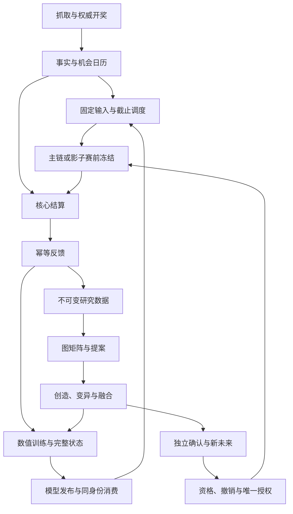

# 运行、研发和资格之间的实现边界

## 1. 业务链与研究链共用事实，不共用一个阻塞大事务

这张图说明数据关系，不表示所有步骤在同一线程或事务中运行。B02提供有界writer服务，B04把核心冻结/结算与延后证据拆开，B08消费有独立事务边界。失败记录和初始化首错spool不能依赖自己正在修复的被堵路径。

业务展示读取已提交快照。首次用户启用或系统要求的显式重新启用可以启动合法服务；此后正常打开页面不充当持续业务所必需的补初始化、重设分析截止或学习触发器。恢复由服务owner根据真实业务停滞证据发起，并以恢复后的业务提交验收；心跳、重启次数、广播次数不计恢复效果。

## 2. 每种“产出”必须对应原件

| 所称能力 | 最小可核原件 | 必须拒绝的伪产出 |
|---|---|---|
| 创建策略 | 合法AST/参数、身份、父代、输入pin、可执行输出、出生事务 | 名称或记录数增加 |
| 训练 | 数值输入、梯度/优化器、状态前后hash、cursor、提交收据 | RUNNING、回合编号、未提交内存变化 |
| 发布 | checkpoint可恢复、manifest及当前consumer的同hash绑定 | publication行存在但无人使用 |
| 反馈学习 | 原预测/结果键、唯一反馈消费、下一轮状态/研究输入 | 每次都消费同一已结算行 |
| 图表/矩阵 | 原始输入与role、实际数值、support、生成窗口、消费者/只读用途 | 全零占位、缺源回填空数组、重画旧图 |
| 变异 | 明确算子与节点变化、行为差、可执行子代及拒绝/接受原因 | 改ID、随机文字说明 |
| 融合 | 两个合法父代、同目标A/B/A+B对照、新子代状态与新资格身份 | 复制父证书、只画相关性热力图 |
| 进化改善 | 独立配对效果、成本、确认/未来状态 | 完成一代就算胜率提高 |
| 实时出号 | 截止前不可变冻结、明确角色与唯一入口、后续权威结算 | 事后补算、影子数当REAL数 |

## 3. 全链集成场景

B12复验至少覆盖以下一条完整轨迹，并保留每段原件键：

`原始响应 → 权威开奖入库 → 目标机会 → PIT输入 → 赛前冻结 → 核心结算 → 反馈消费 → 真实训练/发布 → 研究输入固定 → 图矩阵产物 → 提案 → 子代或具体非出生动作 → 新确认/未来身份 → 合法资格或明确不足 → 唯一主链授权 → 报告与界面同源显示`。

工程fixture可验证“合法资格会进入唯一主链”的接线，但只能在隔离库中产生模拟资格。真实环境没有合格资产时，全链末端应证明合法NO_BET及研究持续；不能为填满轨迹伪造自然证书。

故障轨迹应覆盖：写锁阻塞、结构未就绪、来源缺失、输入变更、过期fence、deadline已过、部分位置训练、checkpoint缺字节、提案提交前后崩溃、断网和时钟跳变、预算耗尽、报告导出与实时竞争。相应批次已有局部场景，不要求为每次低风险文案修改重复整套压力测试；最终集成只为验证共享链条未被后批破坏。

## 4. 验收矩阵的使用

`ACCEPTANCE_MATRIX.json` 为每条验收给出唯一ID、层级、场景、期望、原件和拟实现的测试入口。新增入口均明确为 `TEST_CONTRACT_REQUIRES_IMPLEMENTATION`，不能据命令字符串存在判定执行过。

默认Android测试必须调用真实生产owner和Android SQLite；纯数学部分允许复用同一生产类在JVM运行，再由Android用例验证持久化与消费。禁止另外写一套测试专用算法并以其结果证明生产链。B01构建桥及B12封包工具使用真实Git/APK/日志fixture的Python测试。DEVICE由真机采样，NATURAL由事前固定的真实未来评价。

每个工程用例至少有一个正例和对应关键拒例，精确测量字段来自真实产物。工单内已有多个独立场景时可共用一次隔离启动以控制时间，不能用一个总PASS替代逐断言。验收记录对不适用用例写明确理由，并由工单修订重新封印；不得静默删用例绕过覆盖检查。
