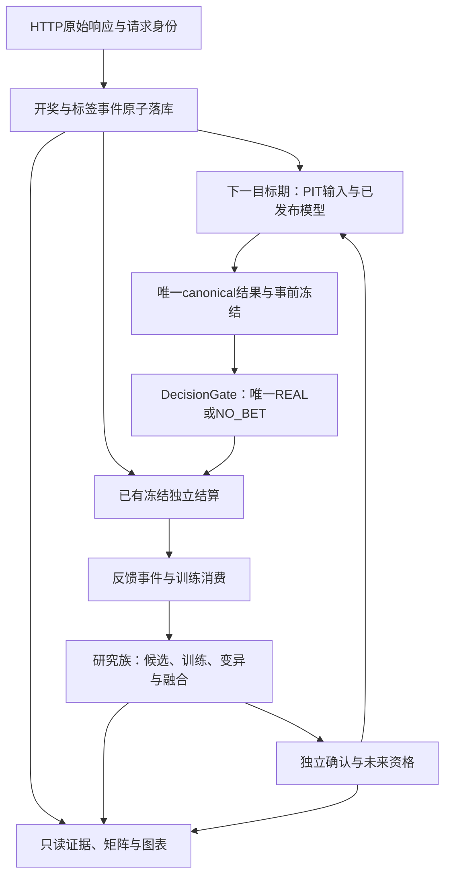

# 唯一运行链、事务与恢复合同

## 1. 主链拓扑

抓取/结算不等待一次完整深度训练、图表刷新或报告导出。研究族可以多种实现，但输入事件、角色隔离、产物身份、资格接口和真实Gate必须统一。不能把各版本引擎都设置为真实下注入口。

## 2. 原owner与写入责任

|责任|095现有owner|R34合同|
|---|---|---|
|HTTP来源|ApiClient、FetchLedgerR925|精确原body/requestId，receipt缺失与冲突分开|
|唯一数据库writer|DatabaseCoordinator|保留现有WriteClass九类；恢复控制只获最小必要权限|
|迁移与研究启动|SchemaDomainCoordinatorR926、RuntimeCoordinatorR26|版本安装、保护表审计、会话注册拆开|
|分析任务/租约|AnalysisRequestStoreR36、AnalysisSingleFlightR36、AutoFetchService|durable任务、唯一owner/fence、deadline|
|canonical准备/落库|PreparedCanonicalStoreR335、PreparedCanonicalCodecR335、CanonicalObservationWriterR36|相同输入相同结果身份，重试不改目标|
|冻结/结算|V51RuntimeOrchestrator、OosAfterDrawWriterR36、SettlementEngine、SettlementTaskStoreR36|固定截止、同freeze原件、最早待办公平处理|
|标签/反馈|RuntimeSchemaR26.feedbackWithinTransaction、EssentialSettlementFeedbackR923|draw label不依赖BET/证书；模型消费幂等|
|研究调度|RuntimeCoordinatorR26、RuntimeR27、ResearchPoolR27、ResearchDirectorR952|各族预算/产物/水位单列，统一消费合同|
|真实出手|UnifiedResearchChoiceR932、CertifiedPredictionR974、DecisionGateEngine|所有族经typed身份核对后汇聚同Gate|

## 3. 每期状态与幂等键

- drawKey=(gameCode,issue)，同键同payload是重复，同键异payload是冲突。
- opportunityKey=(gameCode,targetIssue,enabledEpoch)，记录事前已确定的deadline和是否应服务。
- freezeKey包含target/lane/policyHash/实验身份；freezeId全局唯一。只存在合法赛前冻结才产生该策略自然预测样本。
- REAL唯一约束为(gameCode,targetIssue)，position是已冻结载荷；不能把position纳入唯一键而允许同一期多位置各一单。
- settlementKey=freezeId+drawHash；既有BET使用原合同结算，策略切换不能改旧投注。
- trainConsumeKey=modelIdentity+labelEventId+trainingRole；cursor、参数checkpoint与commitReceipt在同事务生效。
- birthKey=旧父身份+新数值ABI+不可变数据集+配方版本；相同出生重试只一子代。新的训练权重产生新checkpoint/stateHash；预登记ONLINE协议不因此清空观察账本。改变阈值规则/机制/ABI须新protocolHash；静态冻结实例不能原位换权重，详见LEARNING_AND_QUALITY。

每个阶段分别记录input watermark、completed watermark、lastCommittedAt、oldestPending、lastReason、owner/fence、尝试次数与有效产出次数。只更新heartbeat或attempt不等于进展。

终态：PREDICTED、SKIPPED_INPUT、SKIPPED_RESOURCE、MISSED_DEADLINE、SERVICE_UNAVAILABLE、CONFLICT_QUARANTINED。SKIP/MISSED不得计为已出号；没有冻结的开奖仍写NO_PREDRAW终态保留漏期证据。

## 4. 事务顺序与重试

读阶段准备可取消的不可变输入→writer准入→核输入版本与owner→短事务写最少业务事实及outbox/receipt→提交→独立readback→推进任务游标/发布状态。

提交状态分NOT_STARTED/ROLLED_BACK/COMMITTED/UNKNOWN。UNKNOWN必须先查同key的持久receipt，不能直接重做参数更新。异常带category、phase、domain、owner、deadline、cause；已识别资源等待不耗业务失败预算，未知DEPENDENCY仍保留失败分类。fatal内存/VM错误不能被宽泛catch吞掉。

事务内禁止网络、全模型训练、报告压缩、大对象hash、全表循环和无界存储遍历。SQLite WAL改善读写并发但仍是单writer，不能靠开更多写线程解决锁争用；BUSY_SNAPSHOT需结束旧读事务并重新取得合法快照。[SQLite隔离文档](https://www.sqlite.org/isolation.html)。

迁移采用逐单元journal。原SchemaDomainCoordinator的CLEANUP不是永远跳过验证的许可证：新版本/定义改变需重验；旧定义一致的已验证单元不重复全表扫描。session登记每次运行、schema安装只随版本。参考实现和Android owner接线属于不同验收项。

## 5. PIT、预测时限与时间

1. 输入dataThroughOrdinal < targetOrdinal；未来结果未进入特征、归一化器、挑选、checkpoint或候选评分。
2. 模型发布时间与输入水位必须在本期冻结前可见。耗时训练只供之后版本。
3. 冻结以真正耐久提交时点判断，不能用计算开始/队列入站时间代替。durableFreeze ≤ fixedDeadline，且早于目标结果firstAvailable。
4. 标签时间≥max(sourceResultAt,firstAvailable)。开奖延迟不能推迟事前冻结截止。
5. 同boot用elapsed测时，wall对照源发布时间；跨boot/NTP异常不能填负延迟或通过相减伪造合规。
6. 历史补抓可以修真实开奖和REPLAY材料，不能补造过去的FUTURE冻结或独立自然N。

## 6. 性能目标与运行环境

保留用户目标：1秒抓取节拍、开奖后1秒内落库/最小结算、下一期正式决策在5秒预算内且不晚于赛前截止、后台研究继续、热历史≤5000。实施记录所有事前启用机会的逐项原始时间；事后网络/进程/超时故障不从分母删除。scheduled/started/completed/timeout/unmeasured、成功完成样本分位数与withinSlo/scheduled并列，不以统计分位数遮掉漏期，也不把1秒轮询配置当1秒到账证明。

将sourcePublished→receive、receive→durableDraw、durableDraw→settled、previousDraw→nextFreeze分别报告。未知源发布时间标NOT_MEASURABLE；网关/供应商故障与内部超时分别记录，但总体用户体验仍计实际失败。频繁重启不代替恢复。

用户设备为vivo V2353A Android14。前台服务需要正确类型/权限，后台启动受系统限制；WorkManager周期任务最小15分钟，只适合延后恢复，不能担当1秒主循环。[Android FGS](https://developer.android.com/develop/background-work/services/fgs/changes) · [PeriodicWorkRequest](https://developer.android.com/reference/androidx/work/PeriodicWorkRequest)。对更高target/API按相应FGS时限另验，不把Android15规则硬套现场Android14。用户强停、系统冻结或网络完全中断时无法补造真实赛前观察；恢复后补开奖和研究材料，并保留这段缺口。

## 7. 不清零、不补假数据的恢复

原件缺失：保留旧身份和WAIT_SOURCE/不可恢复原因；新身份冷启独立训练。热库5000期限制不等于整个应用5000期大小，WAL/模型/原件/报告各自记账。GC只有在原件保全和引用闭包已证实时执行；未知子集绝不是可删除。

所有图表和报告是只读投影。不存在的样本显示缺输入/阻断原因；不把null补成0曲线，不用“生产者类存在”替代运行receipt。
