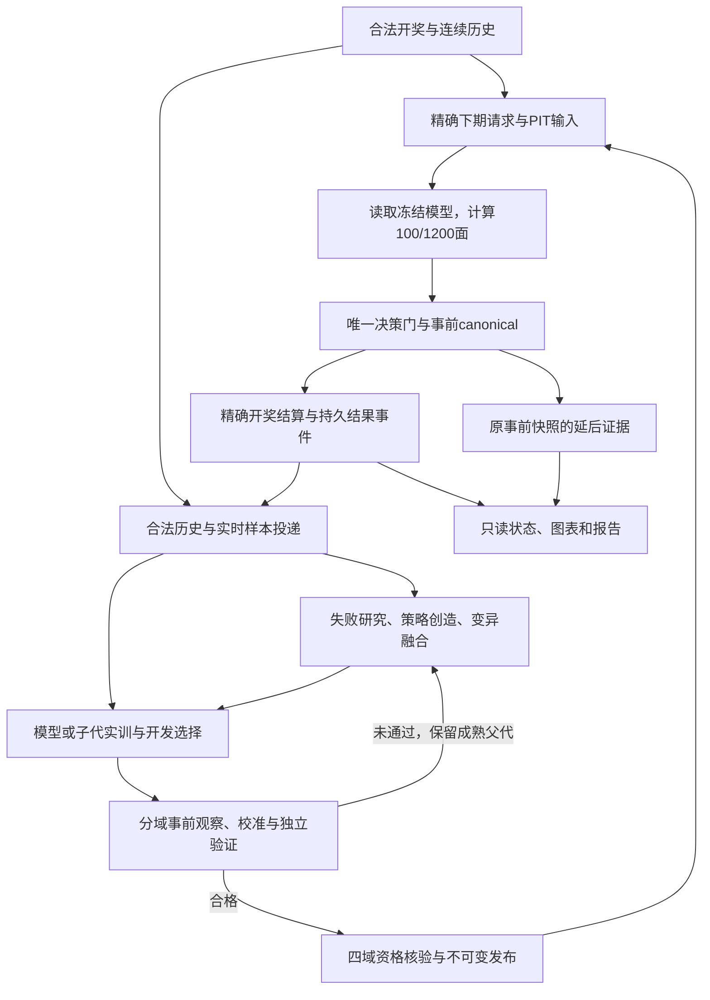

# STARCORE R34.2 完整汇总施工方案

**文档修订1｜2026-11-25｜绑定577311152应用底座｜本次交付为审计与施工方案。**

## 结论与适用范围

本轮把已取得的方案、报告和152源码范围内的问题归并为 **57项独立问题、证据缺口及升级前置，按12批施工顺序逐项编号**。同一原因在不同报告中的重复投影合并，PASS、OBSERVED、未检查和缺原件不冒充新的已证实故障。每项都含原报告定位、源码定位、确定机制、待证部分、处理步骤、文件方法、成熟功能保留和验收。

本报告能确定的核心现象是：研究owner在checkpoint保留阶段停住；writer故障积压触发多条研究写入退避；现代家族被全目录就绪条件不必要地串行阻塞；现代训练在输入/协议/任务登记前断链；事前预测覆盖不足，后续在线学习、独立未来评价、进化融合和主链资格消费没有形成当前版本的完整闭环。

不能把它简化为“所有功能没写”或“全都没有训练”。旧R952有25次实际数值更新和不同模型payload；AtomNet有2150样本、790stage、19发布；长期能力有1041发布和717冠军概率。这些成熟产物必须保留，但它们不能分别冒充当前持续训练、19次优化器更新、1043代更强策略或正式独立未来资格。

**本轮没有修改应用源码、构建新APK、连接真机或运行自然未来验证。** 方案自检通过只表示本文件与覆盖/身份/依赖合同经过核对；任何软件修复完成、长期后台稳定、高胜率及代代提高都必须由后续真实原件证明。

## 固定身份与证据边界

|对象|本轮核对结果|
|---|---|
|应用基线|`R34.1-B12-2026-11-25-577311152`，源码[`eb8f82a8bda8db22f1f122095217132f07053bcb`](https://github.com/gtt46461-star/starcore-public-build/tree/eb8f82a8bda8db22f1f122095217132f07053bcb)|
|Git tree|`eb3eec742a195c77b50b9a4ae051165bba9ba420`|
|当前安装包名|`com.starcore.research.r13`；保持签名和数据路径兼容|
|计划发布基线|主分支`2b0177b77fa5f6079da27c915201b95b8bdcef20`；仅更新方案与当前入口|
|旧方案|R34.1第6版仍以122底座`5562f9b19aa09f9f7d9e69ca085db56c537967fc`为源；原要求不删除|
|检测包|DIAGNOSTIC；57成员，56载荷字节/hash逐一核验，manifest与外索引一致|
|缺少的复现原件|原始SQLite、实际安装APK、模型/训练原字节；不能宣称已经独立回放数值|
|时间范围|13:46运行与快照、13:58诊断进程cohort、14:10磁盘巡查各自保留，不混成一时点|

完整身份见[EVIDENCE_SCOPE.md](EVIDENCE_SCOPE.md)与[evidence/BASELINE_IDENTITY.json](evidence/BASELINE_IDENTITY.json)。

## 全量覆盖与状态解释

|来源|数量|本轮处理|
|---|---:|---|
|报告检查|96|按health归一为4 PASS、4 FAIL、7 WARN、21 NOT_PROVEN、44 OBSERVED、16 NOT_APPLICABLE；原domain_outcome细分状态另存，逐条对应处理/补证/保留/不适用|
|质量和工程指标|44|35 INSUFFICIENT、5 RECORDED_UNVALIDATED，其余4各有明确缺口；没有借“有数值”签质量通过|
|升级方向|165|82能力、20矩阵、18研究方向、29旧图表、16逻辑表，逐项保留owner、nextAction和验证入口|
|报告数据库对象|800表|完整计数保留；存在表、0行、无表与缺原件分别判断|
|旧R34.1方案|62工单/152验收/295文件卡|全部承接；295文件卡归一为294个不同路径；按卡统计127相同、122已改、46新建，逐文件避免旧后态覆盖|
|报告历史需求账|1832条/299卡|原字节完整保留；1770需求未检查、62已改待验、0已验，299卡296未检查、3已改待验、0已验|

1832条历史账的“未检查”不是“1770个功能确定没有实现”。本方案不替这些历史状态签过，只新增精确路径关联与受影响条款回归责任。详见[覆盖目录](coverage/README.md)、[旧方案传承](inheritance/R341_WORK_ORDER_STATUS.md)、[历史需求完整附录](inheritance/REPORT_LEDGER_INHERITANCE.md)。

## 唯一主链怎样运行

现有服务入口是AutoFetchService；业务协调由BusinessReconcilerR36负责；AnalysisSingleFlightR36保证每目标唯一推理owner，V51RuntimeOrchestrator负责实际推理/提交。唯一主链指唯一事实源、唯一决定/结算所有者与确定的事件关系；网络、推理和研究有各自预算，避免一个长任务堵住全软件。

合法历史输入可在启动时直接创建研究/训练任务，不等待第一笔新REAL或结算；新子代先实训与开发选择，再按所属资格域分别登记冻结观察、校准FIT/EMBARGO/VALIDATION、独立未来或确认角色。各域顺序和门槛不同，不能用历史TUNE代替要求的事前校准观察，也不能在最终验证之后再拟合回写。失败结果进入下一轮研究，成熟父代保留。

实际开奖回调中，保留现有“先持久请求下一期，再交接上一期结算”的时效设计，下一期不能等待全部旧结算、训练、图表或报告。结算仍必须由精确目标的既有冻结记录和精确开奖产生；缺事前记录的旧期只记缺失终态，不能补预测。

实时主链读取已经发布的模型快照。研究在锁外计算、有界短事务提交，通过原outbox/消费者恢复，不建立第二个抢写同表的后台owner。模型更新只能影响后续期；本期捕获的模型、数据、水位、概率和选择器身份不可变。四种资格域分别按现有完整合同验证，统一在现有决策/插入门核验，不能用一个120/250样本门槛取代全部合同。详见[MAINLINE](specs/MAINLINE.md)及[CERTIFICATE_DOMAINS](specs/CERTIFICATE_DOMAINS.md)。

## 成熟功能保留红线

保留合法抓取、传输治理、跨日目标解析、历史冲突校验和已有最小连续suffix通道；保留唯一分析owner、事前冻结、提交回读、不可变原件、SHADOW/REAL分账、精确结算和幂等补偿；保留旧候选、旧模型、数值训练、AtomNet与长期摘要的可恢复读取能力。

保留单写协调、受限故障排空、资源保护、局部隔离和确定故障断路器；修复的是它们的分类、恢复、预算及真实生产衔接。保留图表、报告、轻量诊断和历史原件，同时使它们展示真实状态。禁止以清空表、删除旧功能、改绿色状态、全局PROVEN翻真、跳过资格、扩大热历史或新增竞争循环代替修复。

主链继续**单位置固定K3，每期最多一个REAL**；完整计算面为10位置×10号码及10×C(10,3)=1200动作。没有K4、动态K、多个REAL位置、追单或频率补债。频率30%目标、15%最低目标只能在真实合格与用户开关允许下争取，不能强制不合格下注。完整保留合同见[PRESERVATION](specs/PRESERVATION.md)。

## 十二批施工顺序

B02的故障原件最小保全/有界归档必须独立完成，不能等B10全局存储治理才排空。B03先恢复任务owner与登记能力，不靠后续训练模拟“已启动”；B06先分族就绪和合法输入；B08先正式冻结/配对，再验证变异融合；B11图表消费前批原件，不反向阻塞算法生产。同一文件按批次累积修改，后批before必须是前批实际提交。

|批次|要完成的闭环|问题数|
|---|---|---:|
|[B01](batches/B01.md)|152底座重绑、版本桥与成熟功能保全|2|
|[B02](batches/B02.md)|故障原件排空与数据库写入背压恢复|4|
|[B03](batches/B03.md)|研究启动、分能力schema与公平续跑|5|
|[B04](batches/B04.md)|历史最小前缀、赛前冻结、结算与完整证据|3|
|[B05](batches/B05.md)|秒级调度、后台连续与卡顿定位|5|
|[B06](batches/B06.md)|分族就绪、历史快速训练与可恢复模型|4|
|[B07](batches/B07.md)|持续多机制创造、原子与新思路族|7|
|[B08](batches/B08.md)|在线训练、反馈研究、矩阵与进化融合|12|
|[B09](batches/B09.md)|独立未来评价、校准、证书与主链应用|2|
|[B10](batches/B10.md)|5000期之外的总存储预算与原件恢复|4|
|[B11](batches/B11.md)|研究图表、诊断报告与修复生效账|7|
|[B12](batches/B12.md)|集成回归、APK交付与真机自然证据|2|

## 57项逐项索引

以下编号按施工依赖排序，详细原因、证据、文件、方法、保留及验收在每项链接中；[ISSUES.md](ISSUES.md)也提供全部连续正文。

1. **[R342-001：当前唯一方案仍以122为底座，必须对152已完成改动作无损重绑](issues/R342-001.md)**（B01）
2. **[R342-002：新R34.2版本身份必须扩展构建链，不能直接改版本名](issues/R342-002.md)**（B01）
3. **[R342-003：启动错误分类与故障原件不足，可能把依赖或资源等待错误归为 BUG](issues/R342-003.md)**（B02）
4. **[R342-004：writer 故障证据积压触发研究写入背压，同时挡住普通历史回补与前瞻冻结前置动作](issues/R342-004.md)**（B02）
5. **[R342-005：故障排空报告读取的是诊断进程静态队列，无法说明主运行进程已解除背压](issues/R342-005.md)**（B02）
6. **[R342-006：故障冷原件已索引但只有部分做了hash和receipt核验](issues/R342-006.md)**（B02）
7. **[R342-007：研究 owner 在 checkpoint 保存阶段失败，并达到同因三次 BUG 停启条件](issues/R342-007.md)**（B03）
8. **[R342-008：服务心跳存在但研究健康长期陈旧，尝试时间不能替代实际进度](issues/R342-008.md)**（B03）
9. **[R342-009：三项关键研究来源表在诊断快照缺失，部分“全局schema READY”不代表能力就绪](issues/R342-009.md)**（B03）
10. **[R342-010：8409 条研究任务大多只是维护，缺少真实训练和研究动作任务的可交付进度](issues/R342-010.md)**（B03）
11. **[R342-011：研究公平服务和数值能力必须按当前版本真实提交衡量，旧会话与空推进不能验收](issues/R342-011.md)**（B03）
12. **[R342-012：历史引导出现等待，多期在历史已绑定后仍未形成 canonical，逐期断点待闭合](issues/R342-012.md)**（B04）
13. **[R342-013：近 30 期前瞻覆盖只有 1 期；“已有义务结算零滞后”掩盖未建义务](issues/R342-013.md)**（B04）
14. **[R342-014：延后证据积压 1632，当前号码/全动作曲面未落齐](issues/R342-014.md)**（B04）
15. **[R342-015：一秒采集目标漏时隙 444，当前调度稳定性未达证明](issues/R342-015.md)**（B05）
16. **[R342-016：分析 PASS 只有 1 个有效计时样本，不能证明实时出号整体不卡](issues/R342-016.md)**（B05）
17. **[R342-017：界面存在可测掉帧，但目前缺少定位每次卡顿的完整因果链](issues/R342-017.md)**（B05）
18. **[R342-018：后台权限当前可用，24h/72h持续运行与设备恢复尚未验证](issues/R342-018.md)**（B05）
19. **[R342-019：崩溃/长卡记录跨版本且滚动窗口不完备，不能直接算本版本故障或零故障](issues/R342-019.md)**（B05）
20. **[R342-020：全部 15 个现代策略家族被全量 4200 分子目录完成条件串联阻塞](issues/R342-020.md)**（B06）
21. **[R342-021：历史库有缺口，现代快训、回放和多周期研究的有效连续输入必须逐家族判断](issues/R342-021.md)**（B06）
22. **[R342-022：历史快速训练在输入登记、协议和任务注册之前就中断，尚未到可归因的数值训练阶段](issues/R342-022.md)**（B06）
23. **[R342-023：回放数据集没有给研究子任务持续提供可用输入，进化被依赖链挡住](issues/R342-023.md)**（B06）
24. **[R342-024：50 个旧候选与 12 个专家实验被 ABI 保全后，没有完成独立新身份的冷启再训练](issues/R342-024.md)**（B07）
25. **[R342-025：固定 40 个基础变体没有闭合为持续发现新结构的方法与算法生产](issues/R342-025.md)**（B07）
26. **[R342-026：第6版要求的新思路族“生成规则归纳→发布→异段迁移→恢复消费”未找到完整实现](issues/R342-026.md)**（B07）
27. **[R342-027：现代训练链当前只保留一个旧 RECENCY_BLEND 候选，不能代表多机制策略已经运行](issues/R342-027.md)**（B07）
28. **[R342-028：25350个原子规格没有转化为已准入、已绑定的训练特征和边际贡献证据](issues/R342-028.md)**（B07）
29. **[R342-029：分子仍处扫描阶段，合法双组件与分子协同研究没有可消费原件](issues/R342-029.md)**（B07）
30. **[R342-030：81/82静态可调用中唯一缺件是F23教师未绑定，需局部修复而非重写全部家族](issues/R342-030.md)**（B07）
31. **[R342-031：AtomNet 已有物化和发布，但本次不能证明梯度更新→完整模型→预测消费闭环](issues/R342-031.md)**（B08）
32. **[R342-032：已工作的在线数值训练没有追到最新数据，25次历史成功不能替代当前持续运行](issues/R342-032.md)**（B08）
33. **[R342-033：训练流25次结算与正式独立未来资格是两套证据，正式冻结观察仍空](issues/R342-033.md)**（B08）
34. **[R342-034：父子同期配对、固定窗口和独立确认没有运行，尚不能证明任何一代提升](issues/R342-034.md)**（B08）
35. **[R342-035：20个注册矩阵没有保留的类型化生产/消费，不能用另一路25个R952快照抵充](issues/R342-035.md)**（B08）
36. **[R342-036：17个矩阵输入在投影前过期，输入保留期与真实消费服务没有协调](issues/R342-036.md)**（B08）
37. **[R342-037：长期摘要持续更新但没有进入新策略出生与冻结输入，1043不是进化代数](issues/R342-037.md)**（B08）
38. **[R342-038：538条研究测量中517条是输入失效事件，不能当538次完成研究，需查明版本反复失效](issues/R342-038.md)**（B08）
39. **[R342-039：失败诊断没有生成可验证的假设→行动→子代→结果回流，已安装不是已执行](issues/R342-039.md)**（B08）
40. **[R342-040：已有出生和50次演化尝试没有完成真正代际记录与可复验的改善归因](issues/R342-040.md)**（B08）
41. **[R342-041：互补融合缺同目标双父件与共同失败/增益验证，不能只平均概率称融合进化](issues/R342-041.md)**（B08）
42. **[R342-042：多周期探针与绑定研究没有持续观测，只有4条未运行记录和大量未记账机会](issues/R342-042.md)**（B08）
43. **[R342-043：候选概率校准及冻结漂移策略缺件，概率值尚不具备已验证的质量含义](issues/R342-043.md)**（B09）
44. **[R342-044：研究到证书、选择器、唯一主链冻结与结算的最后一段没有完成](issues/R342-044.md)**（B09）
45. **[R342-045：总体占用约10.97GB，5000期开奖保留上限没有控制派生/报告/备份体积](issues/R342-045.md)**（B10）
46. **[R342-046：checkpoint引用闭包不完整：556缺原件、18未字节验证、574子集合未知](issues/R342-046.md)**（B10）
47. **[R342-047：冷归档完成不等于物理空间已回收，当前没有可验证的GC释放闭环](issues/R342-047.md)**（B10）
48. **[R342-048：数据库对象体积只截到前1024个名称，当前无法准确定位全部大表/索引](issues/R342-048.md)**（B10）
49. **[R342-049：修复生效账仅覆盖2项工单且只保存首次事件，无法62项持续回查](issues/R342-049.md)**（B11）
50. **[R342-050：18个研究方向没有本次源码的可用产物与精确消费回执，读图不能替代算法闭环](issues/R342-050.md)**（B11）
51. **[R342-051：生命周期报告的晋级权重说明与实际证书协议不一致](issues/R342-051.md)**（B11）
52. **[R342-052：K3九层失败诊断仍依赖静态PROVEN和文本关键词，不能准确归因当前运行模型](issues/R342-052.md)**（B11）
53. **[R342-053：96项检查完成与语义封包成功不等于96项能力通过](issues/R342-053.md)**（B11）
54. **[R342-054：44项工程/质量指标没有已验证通过项，静态handler声明不能算运行效果](issues/R342-054.md)**（B11）
55. **[R342-055：多时点和多进程观测并存，需要范围对齐才能判断矛盾或改善](issues/R342-055.md)**（B11）
56. **[R342-056：工程闭环和自然质量尚未验收，不能把升级目标写成高胜率或代代必强承诺](issues/R342-056.md)**（B12）
57. **[R342-057：本包为DIAGNOSTIC，没有数据库/APK/模型训练原字节，外部复现能力受限](issues/R342-057.md)**（B12）

## 何谓真正完工

每个问题需要六层证据分别签收：方案合同、源代码接入、工程实际执行、安装身份与兼容、目标设备长期运行、独立未来自然质量。某层未取得原件就保持未验证，不用其它层代签。

每批在真实前批提交上完成方法/迁移/任务注册/恢复路径与相关测试，产生当前批APK和身份原件；B12只做全链集成及外部验收汇总。合格的交接必须列source commit、plan hash、APK hash、签名、安装版本、数据库身份、场景/输入hash、真实runner结果、原件收据和未完项。

性能按同一request trace分段：接收合法开奖、历史就绪、排队/推理、决策持久回读、UI应用、结算、学习提交。目标抓取1s一次、合法开奖接收到核心处理/结算1s、分析持久化5s，并必须在赛前deadline前冻结；时延、覆盖、失败和缺测分别统计。当前一个计时样本PASS不满足总体性能证明，生命周期P95也不能与当前单样本相减当提升量。

后台24h/72h需真实设备覆盖息屏、锁屏、网络切换、电量状态、更新与重启。Android系统限制按设备API和target分别处理；WorkManager的周期任务不能充当秒级循环。存储治理分开DB/WAL/报告快照/备份/CAS，先验证引用与恢复再清理；归档不等于物理回收。

自然质量使用冻结前注册的同目标对照与完整机会分母。当前594/1858命中约31.97%，示例95% Wilson下界约29.89%，本身不能证明优于30%均匀基线；历史筛选、相关样本、多重试验和缺预测期还需按原合同处理。不能承诺随机数据必然可预测或每代必强；系统应持续提出、训练、验证，并让有证据的好子代替换，失败子代留痕而成熟父代继续服务。

详细阈值与分层状态见[ACCEPTANCE_AND_STATUS](specs/ACCEPTANCE_AND_STATUS.md)；新增57正反场景合同见[ACCEPTANCE_MATRIX](ACCEPTANCE_MATRIX.md)，原152条见[继承用例](inheritance/R341_ACCEPTANCE_CROSSWALK_152.json)。

## 执行入口与变更控制

后续执行只按[CODEX_EXECUTE.md](CODEX_EXECUTE.md)和本目录封印推进。方案入口更新不合并旧主分支应用代码，也不把报告版本号当新的构建完成。152源码为实施基线；新版本号由构建工具从已安装、manifest和发布索引的最高值生成，不在方案写死下一号。

新增规则使用拟建的TypedGenerationRuleR342类型，经原创建/发布/消费链，不另建学习系统。新增表和列在各自批次由原migration owner幂等引入，保留旧只读兼容。未经数值验证的代码、测试未运行、设备未连接或自然期不足都原样列出。

风险回退优先切回已验证旧模型/规则指针或停用新分支。不得删除canonical、结算、模型和故障原件，不把已迁移库降级给不兼容APK。严格检查内容、依赖、源码路径和全量覆盖的实际结果保存在[SELF_CHECK](SELF_CHECK.md)；全部文件hash在[MANIFEST_SHA256.json](MANIFEST_SHA256.json)。
