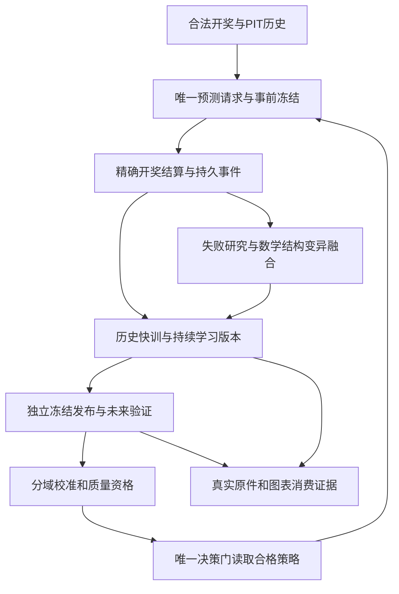

# STARCORE 173现场返修施工总方案 · R34.3-173

## 结论与本次交付的边界

用户指出的闭环未完成有事实依据。当前安装173已经增加很多实现，但报告显示研究启动失败、现代训练错误终结、现代AST3持续学习未接线、冻结/校准/独立未来/合格消费为零，以及图表事实读取和报告元数据输出缺陷。不能把新增文件、任务计数、96个检测执行完成或静态Owner检查当作软件全部施工完成。

本方案以 **577311173 / `4d1de9d83692635b5c5ce39144fece1c8a31c8ac`** 为唯一应用审计底座。已对原报告67个载荷核对字节和SHA256；逐项整理44个主问题、50条审计发现、96个检测、44个指标、165个对象、47图与16表、801张数据库表，以及旧57问题、62工单、152验收、295文件卡和当前1832需求/299卡。重复发现有别名，观察不足保留边界，不以数量冒充逐功能运行验证。

交付包括实际补丁、每一步完整before/after文件、前后SHA、精确应用器、源路径和方法锚点、原始检测ZIP、分批验收合同、数学实现映射和施工提示词。**本次是报告/源码审计及可审查的修复代码准备，不是已把修复装入手机。** Android完整构建、用户数据迁移、真机24/72小时和独立未来质量均不能由此签PASS。源报告没有SQLite数据库、安装APK或全部模型原字节，故不能声称复现了所有现场原因；这些条目明确给出缺少的证据与下一步取证，不编造根因。

## 1. 身份、版本和不可破坏合同

|对象|固定身份/处理|
|---|---|
|已安装版本|R34.2-B12-2026-11-26-577311173|
|源码提交|4d1de9d83692635b5c5ce39144fece1c8a31c8ac|
|安装APK SHA256|9304472262455c12b4600708fb23480d698acf9f3ba710ddee86cda214ae8750|
|原始上传ZIP SHA256|3fb241b3181dccd4d149cf91471d86532919f77d943847ff8ce348cce5ec4d86|
|报告快照SHA256|4b545bd14b45af1240786a921131e0315dbf2df17e31a4e262ba8d91b6620b0e|
|计划名称|R34.3-173；只表示本轮返修计划，不自动改变APK版本系列|
|后续APK系列|继续使用已实现的R34.2-B01…B12，versionCode必须大于已安装/已发布/本地manifest三者最高值|
|计划维护与应用分支|main维护方案；应用从173或已包含173的合法后代隔离施工，禁止把main旧应用树当173|

保留单位置固定K3、100号码面、1200完整动作空间、最多一次REAL、唯一分析/决策/结算Owner、PIT事前冻结、SHADOW与REAL分账、5000热历史限制、原件/父代/证据保护、原签名包名与四类证书合同。禁止删库、清空失败、改PASS常量、放宽证书、以开奖后数据补造预测、重复开奖二次更新、拿旧APK改名交付。

原R33/R34/R341/R342封印和绑定全部保持原字节。新增`release/field173_plan_binding.json`将本轮发布后的计划commit与manifest SHA绑定到源码，并经现有APK嵌入身份和发布验收链传递。完整代码位于B01/B12补丁，不让施工方自创版本分派。 修订2增加semantic_support：原候选补丁新增12个生产Java文件未登记到原R967闭集，会在B02构建前确定失败。现在提供完整精确重绑定工具，保留1589原角色、显式审核31个既有变更和12新增叶子；每批先当批源码，再四文件版本，再两份当前identity，再提交构建。只更新当前R967/R82身份，旧封印/SU1/R81及统计资格不移植。此项是候选方案自检修正，不冒称173手机现场故障。

## 2. 直接解释用户观察的关键事实

|用户观察|本次报告/源码能确定的事实|应如何解决|
|---|---|---|
|没有持续创造有数学结构的策略|现代已注册5、另提议2，并非全部0；四个TRAIN被writer依赖异常错误隔离，剩余RULE只到部分特征；维护任务13799不等于数值训练；现有17变异操作和TypedGenerationRule存在但未形成现场闭环|先修启动和错误终结，再恢复独立家族快训、接入持续学习版本与独立冻结；按数学结构、参数变化、模型更新分别记账，执行现有规则归纳/跨父代迁移并保留证据|
|没有快速历史训练筛选和持续实时反馈|5000热行有11缺口，CP12实际已选择2066连续后缀；43次更新来自legacy；AST3未接持续在线owner；正式未来和校准为0|保留已正确的连续后缀选择；按族真实历史需求开工；新增固定cutoff、原始PIT输入、CP9数值训练、断点恢复和结算事件驱动的rolling owner，不把训练流当未来资格|
|永远只有8个有数据|能证实16逻辑表恰有8非空；未取得47个UI屏幕，不能猜是哪8张图；18研究图有元数据白名单漏表、共享768KiB预算饿死、R06与3张正式只读图漏计、出生消费漏计|按47图+16表逐对象查询、生产、消费、ABI、渲染复核；补白名单和预算分配，按原件join计算当前帧；有真实0或依赖未就绪时显示原因，不造数据|
|合格策略没有真实进入主链|四类证书适配和唯一决策门已存在，但现代冻结、校准、独立Future、合格证书和自然主链贡献均为0|先取得合格证据再自动发布，由原唯一主链下一期读取；不增加第二个REAL写入者、不为达出手率强行跳过资格|

额外发现一处确定诊断错误：`coveredSettled`把OOS标签记录hash与整笔结算汇总hash做相等比较，两个域本来不同，导致已覆盖结算计数显示0。修复通过精确OOS标签回执和COMPLETED任务分别验证；**这不会消除真实8/30覆盖、22期缺预测的问题。**

## 3. 必须按依赖接通的唯一链路

当前`BusinessReconcilerR36`先请求下一期，再交接上一期结算。保留此顺序；不能让历史回补、训练或全量报告阻塞下一期事前提交。

“一个闭环”不等于“一个大事务”。计算、网络、训练、原件校验均在writer外分片执行；数据库只提交有界结果、lease/fence、outbox和游标。重新投递相同事件不能重复更新；提交结果未知先回读身份，不能以未知错误终结候选。

### 3.1 恢复研究启动和训练任务

根因可精确对上代码：`DatabaseCoordinator`创建合法`r31q_ddl_cache_flush(x INTEGER)`，`StartupCheckpointIdentityR31`只放行三张`r335_extension_*` TEMP表。WAL连接池中读/写连接TEMP目录不必相同；prepare可能通过而commit检查失败。补丁引入四个精确受控TEMP合同和main限定查询，仍拒绝未知表/字段影射；不能放行所有TEMP。

启动三次同类BUG后，新增有界冷却恢复探测，保留原失败原件与熔断证据，不用忙循环刷成功。资源预算拒绝改回已注册类别RESOURCE_QUEUE；原写入背压仍有效。

四个既有FAILED_TERMINAL任务不可改回PENDING。补丁逐个核原任务、候选、协议、原始输入、typed异常和未完成数值训练事实，创建单次恢复回执及继任TRAIN，唯一键/CAS原子提交。原错误任务、失败原因和已经产生的特征原件全部保留；非白名单失败不自动复活。

### 3.2 历史快训与持续学习

快速训练的前提是可证明的输入，不是把5000行当5000连续期。按每族minimumHistory和实际连续后缀、事前可用时间、模型/特征ABI选输入。五个learned族使用已逐条验证的局部分子种子，不必等所有4200条物化；全目录原始SHA和单条哈希/位置合同仍需满足。

B06新增独立rolling版本/头/事件/特征/发布offer，不修改候选结构唯一键和原protocol一候选一记录的合同。结算只投递持久事件，既有研究owner按固定输入水位训练。每个版本绑定candidate、predecessor、AST、protocol、input、code和cutoff，以及原始特征/标签、正常化器、模型状态和lease/fence；重复开奖、崩溃和补投递不得重复提交进度。未提交切片可以重新计算，不能把重算当两次学习。bound/teacher/long特征缺原件必须局部等待。

模型继续学习时，旧已冻结版本保持不变并继续未来评价。独立冻结publisher校验模型、输入页、CP9检查点和完成回执后发布，适配`ResearchEvaluationRunR967`/`FrozenCandidateAdapterR958`，不能因原RUN训练头变化把旧冻结窗作废。研究耗时不得卡住下一期推理；实时读取已发布快照。

### 3.3 数学创造、变异、融合和规则归纳

数学实现在`specs/MATHEMATICAL_MECHANISMS.md/.json`逐个给出24个F族和15个modern族的实际公式、输入、状态、更新、评估与主链消费者、源码SHA。必须保留以下真实区别：modern7族是固定图规则，不存在可学习模型权重；5个learned族映射4个kernel，LINEAR/HYBRID共享线性kernel；BANDIT/EXPERT/ENSEMBLE共享Hedge实现。家族标签数不等于独立数学机制数。

原40变体、17变异操作和typed grammar是真实已有实现。恢复后应让“失败证据→可执行结构提议→compile→Director提交子代及TRAIN→训练完成→冻结→父子同目标验证→结果反馈→规则归纳与迁移”实际执行。禁止增加一堆命名方法、随机参数、维护任务或计数来充当创造。

B07补丁新增创建分类回执：保留完整AST/父代/算子/证据hash，并计算保守的typed拓扑和原子family形状摘要；纯参数或来源变化、结构变化、交叉、融合分别记录。形状hash不是新ABI，也不自动授予“新机制”或“质量通过”。新机制仍需可执行公式差异、去重/退化检查、消融和独立验证；参数变化不冒充数学创新。原`KnowledgeLedger`在同一真实子代TRAIN提交事务记录回执，NO_OP不计真实创造。

每代不保证提高、不能保证永远产生新机制。软件必须持续尝试、解释NO_OP/局部等待、留存失败并能根据反馈重新提议；“高胜率、高稳定、高品质”只能由事先锁定合同、独立样本和真实消费证明，不能由代码常量承诺。

### 3.4 图表应从真实事实驱动

每个图表用以下诊断顺序：源表是否存在→当前source/role/ABI数据数→过滤后数据数→有限有效点数→缓存/帧原件身份→生产Owner是否跑过→消费回执→renderer截图。源码已有查询但源表0，需要恢复上游；SQL有行而series空，查适配；series非空而UI空，才能定位布局/坐标/生命周期。

现有报告证实的展示代码缺陷已有精确替换：补r33研究输入/消费表元数据白名单；为关键图表证据分配可控内联预算；18研究图按实际提交帧计数，正式只读图不伪装优化器消费；BORN与非BORN消费分别验证，历史hash不能把当前0翻成YES；缺表UNKNOWN、存在且计数0、截断PARTIAL、不适用N/A和历史AS_OF分开。主writer TTL无法取得可信冻结单调时钟时继续UNKNOWN，允许查看已校验历史payload但不冒充当前健康。

## 4. 分批施工与每批退出条件

完整入口为[BATCH_INDEX.md](BATCH_INDEX.md)。每批先运行封印/前态校验，再按`PATCHSET.json`顺序应用完整after，不允许让施工方凭文字自行选择同名旧文件。没有代码变更的已实现能力，严格按对应源方法和原验收合同取证。

每批交付：实际源码commit与diff、计划hash、所有执行命令和原始日志、正反及保留场景、迁移/恢复身份、实际APK及签名、实际覆盖安装证据；设备和未来不足分别保留状态，不能写“已全部完成”。下一批不得绕过前批的工程阻断；不依赖已完成自然未来窗口的工程工作可以继续，运行资格不得提前授予。

## 5. 验收必须分四层

|层级|能证明什么|本次实际状态|
|---|---|---|
|方案与补丁完整性|报告hash、源锚点、before/after、补丁可应用、覆盖关系、文档一致性|见SELF_CHECK实际记录|
|主机工程验证|纯Java策略、精确SQL正反例、预算/分类合同、语法与脚本校验|只按实际执行记录签具体用例；不是Android通过|
|Android与真机工程|完整编译、迁移、绑定、进程/重启/结算恢复、47图渲染、覆盖安装和24/72小时|NOT_RUN；后续施工必须执行|
|自然策略效果与主链|独立Future、校准、配对比较、质量证书、当期事前消费和真实结算|NOT_PROVEN；不得挪用历史训练/合成样本|

96项health分类为43 OBSERVED、21 NOT_PROVEN、16 NOT_APPLICABLE、8 WARN、4 PASS、4 FAIL；44指标0 PASS。下一份报告必须保留原检测和每个不足原因，不删条目求全绿。报告账本1832需求1770未检查、62已修改待验证，299卡296未检查、3已修改待验证、0已验证完成；这既不能证明全没实现，也不能核销全部要求。

## 6. 尚需原件才能定因的项目如何闭合

故障排空卡点、约39秒未分配时延、真机后台重启、图表实际屏幕、检查点缺失/未知、长期自然质量等，不能凭本诊断ZIP给出不存在的确定根因。方案已给出具体生产阶段观测和收集合同：记录run/source/APK/database/boot/PID/role、请求入队/锁等待/compute/prepare/save/commit/readback/延后证据分段、排空线程进入与每个原件阶段、精确错误typed category/phase/outcome，并保存日志、输入和原始二进制引用。

每个未决项必须通过正例/故障复现/反例/恢复回读获得结果后关闭。不能把这些字段补成常量0；若底层原件确实丢失，记录不可恢复的明确终态、影响范围、隔离旧资格和新独立验证计划，不能生成假的旧字节或补历史预测。原件验证与引用闭包完成以前不释放活引用、父代和检查点；`VACUUM`不能作为修复逻辑的替代。

## 7. 开工指令与交付阅读顺序

先读README、ISSUES、PATCHSET、批次合同和CODEX_EXECUTE，再读具体after文件及数学/主链合同。先运行`tools/verify_plan.py`，应用器默认只检查；明确`--apply`才修改指定施工工作树。若before不匹配，停止该文件并检查合法后代差异，不使用`--force`、`--reject`或旧整文件覆盖。

计划已准备不意味着最终应用毫无问题。施工方必须对本批新增代码完成真实Android编译、必要回归与运行验证，发现反例立即回到对应卡修复并留下证据；软件“完成”状态只在相应层真实满足退出条件后成立。

## 本次续接复核的范围修订

本轮文档修订2将每个指标和检测项对应到实际负责生产的批次、源码与验收场景；B11只是汇总验收归口。predraw早于开奖覆盖与M05要求的至少5秒裕量分别测量。冻结快照没有独立单调时钟原件时保持UNKNOWN并保留历史原件，不把纯helper能力写成生产证明。详细续审记录见`CONTINUATION_REVIEW.md`。
