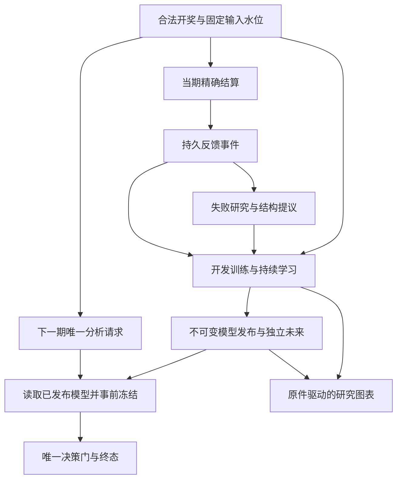

# 唯一运行链路、保全与增量施工合同

## 1. 本轮底座与施工边界

本轮只以报告对应的 **577311211 / 5c7f1b36eaee6036df280e85835bb0fb4ce0b40d** 为应用底座。仓库 main 的应用目录不是该安装版本；main 用来保存审计和方案。施工方从该提交或逐文件核验过的后代建立工作树。不得把 main 的旧 app 目录、173 的整文件后态、旧版本压缩包覆盖到 211。

本计划提供问题处置、代码锚点、若干精确候选补丁及验收合同；各补丁的实际验证范围写在 validation 中。静态可应用、主机等价验证、Android 构建、用户数据库迁移、真机运行和自然未来质量是不同结论。没有执行的层级保持 NOT_RUN / NOT_PROVEN。

## 2. 必须保留的合同

|合同|施工要求|回归证据|
|---|---|---|
|唯一主链|沿用 AutoFetchService、BusinessReconcilerR36、AnalysisSingleFlightR36、DecisionGateEngine、SettlementTaskStoreR36 等既有所有者；不增第二套出号或真实结算写入者|同一 target 在重试、进程重启、并发回调下仅有一个权威决策及一次业务结算|
|玩法|保留单位置固定 K=3；概率面与研究动作不扩大真实投注范围；原 10 个位置×每位置 C(10,3) 的 1200 个研究动作不等于 1200 笔真实出手|固定输入前后对比；拒绝 K4、重复号码、无效位置、重复 REAL|
|PIT|特征、标准化器、父模型、模型版本和决策必须在本期合法截止前确定；迟到原件只能用于之后的研发|边界前后、晚标签、错误 cutoff、错误冻结 hash 的反例|
|SHADOW / REAL 分账|影子覆盖、研究训练、历史回放、自然未来与 REAL 各用自己的分母|报表不能通过混合这些样本抬高胜率或覆盖率|
|幂等与提交身份|保持 inputSnapshot、commitKey、payloadHash、ownerEpoch、fence 和 chunkSeq 绑定；已知回滚可重试；UNKNOWN 先查权威回执|同批重投、提交后进程死亡、租约过期、错 payload 不能重复推进游标|
|数值与语义 ABI|旧 AST、父模型、冻结窗口、资格与检查点保持不可变；旧模型不兼容时保留原件，新建独立子代|不能把旧权重改标签后当新内核；错 ABI 不得推理、续训或晋升|
|原有有效图表|保留旧有能用的统计、矩阵快照和所有读取校验；新研究图按真实源生产并接线|旧数据可见，当前/历史/无数据/读取失败明确区分；不造点、不清空失败|
|检测报告|保留 96 检查、44 指标、现有附件/索引、单 ZIP/分卷、取消、重试、SAF 分享及语义验收|连续导出、取消后重试、低空间和读取超时的原生输出与 SHA 验证|
|源与签名身份|包名、签名连续性、既有 R33/R34/R341/R342 封印保留；本次新增计划绑定不改写历史封印|原封印哈希不变；新 APK/source/计划/版本/当前语义清单一致|
|用户数据|不删库、不重置安装数据、不把研究失败任务原记录改为成功、不靠清空故障队列解除背压；报告作业沿原状态机可在新attempt真实重试成功，但必须保留旧失败回执|迁移前后原件引用、待结算、原任务与恢复继任任务可以追溯|

## 3. 主链的实际次序

`BusinessReconcilerR36.reconcile` 已经先持久化并提交下一期分析请求，再交接当前开奖的精确结算。保留这个次序：上一期缺预测或结算阻塞不能吃掉下一期的合法赛前窗口。

这条链路有两个相互衔接的时序。实时路径只使用准备好的推理输入与已发布模型；训练、全量检查点校验、图表研究由各自既有 owner 在有界切片中推进。报告继续使用独立 diagnostics 进程与 ReportExportServiceCP4，不移入研究调度器或借用实时 writer。一次研究提交的原件、游标与回执保持一个小事务，不把全链放入一个事务。

## 4. 三条研究路径各自修复，不相互冒充

|路径|本次现场事实|修复顺序|
|---|---|---|
|R26 旧家族与检查点|有 50 个 candidate/evolution、训练步骤和反馈；冻结/资格未形成，旧数值 ABI 与原件问题仍存在|有原state者按原ColdRebirth合同建冷子代；无原件者隔离旧父代，完全独立基础新实验另走既有工厂，不继承旧资格|
|R27 固定回放与进化|有 3 条 replay_dataset 记录，但 policy/replay_score/generation/live_shadow/certificate 均为 0|公平准入与错误分类→同一数据集 pin 的物化/恢复→合法历史评价→结构提议→冻结与未来|
|AST3 / R952 现代策略|已有创建/原子/特征和旧在线产物；5 条原 TRAIN 失败，已有 1 条恢复继任任务；rolling owner 已存在，开发训练回执未形成使版本发布为 0|恢复符合原件条件的 TRAIN→CP9 数值完成与开发回执→既有 RollingLearner→独立 FrozenPublisher→未来与证书|

不能用旧 R26 的训练条数证明 AST3 训练已完成；不能用维护任务数、输入失效次数或 family 标签数证明新策略已创造；不能为了让 R27 出数而偷换数据集 pin，也不能再增加一套现代 rolling owner。

## 5. 调度修复的精确边界

先修 `ResearchWriteQueueR27.writerBusy` 的分类错配：同一个 `R31_WRITER_HOLD_FAULT_BACKLOG_PENDING_DURABLE_DRAIN`，当前协调器返回 RESOURCE_QUEUE，而消费者只认 DEPENDENCY。仅允许 **精确原因 + ADMISSION + ROLLED_BACK** 的旧/新类别进入等待；其他 RESOURCE_QUEUE、未知提交结果和完整性错误不扩大重试。等待保留 immutable batch 与提交身份。

然后消除双层调度的饥饿可能：`submitAttemptR31` 的宽泛实时压力不能永久遮住 `DatabaseCoordinator` 已有的公平服务槽。实际正在结算的临界事务和截止前保护窗口仍优先；达到有界等待条件的已准备研究小批次只可交给同一协调器准入。协调器继续检查容量、fence、负载、取消、存储和真实赛前边界。不得设置全局忽略实时压力、无限重试或绕过故障原件背压。

故障排空单独保证前进：持久 outbox→精确 fault receipt→读回成功→释放队列项与容量。用同一故障原件的幂等键防重复，不在故障记录写入失败时同步递归再记录同类写者故障。物理磁盘耗尽时不存在代码保证的硬实时；应保存最低限度恢复状态、明确暂停原因，并在满足原件保护合同后释放可回收空间。

## 6. 历史、恢复与连续运行

热开奖窗口不超过 5000 期，但不能把 5000 行视为 5000 连续期。继续使用 `TargetIssueResolver` 检查真实相邻期、合法开奖、首次可见时刻及固定 cutoff。不同家族按实际所需历史长度开工。补历史是输入恢复，不给旧期补造赛前预测。

固定回放数据集必须记录源 pin、输入分片和游标。重启从最后已提交分片继续，不能重新捕获一个变化的 live 数据集并冒用旧 dataset hash。原始数据确已丢失时保留旧失败与缺口，新建具有独立身份的研究输入，不凭空重造旧记录。

后台的业务触发来自既有 Service/持久事件，Activity 只订阅读模型。当前 APK `targetSdk=28`，不能把目标 SDK 34 的规则硬套为本次故障原因。继续用实际启动 journal、前台通知、业务提交与息屏样本验证；将权限“已授予”与 24/72 小时业务连续性分别列示。WorkManager 周期任务只承担恢复/巡检，不能承担 1 秒实时循环。

## 7. 构建、回退与批次衔接

各批只动问题卡列出的 211 文件和方法；确认 source SHA 后再做增量修改。发现更晚合法后代时先三方对比，保留已修复代码，重写该文件的小补丁；禁止强制套用旧整文件。

每批顺序为：读取前批交付身份→应用本批代码→运行本批负例和保留场景→更新既有版本事务与当前 R967/R82 语义身份→提交干净源码→沿既有构建签名链产出 APK→保存结果。versionCode 高于实际已发布和安装最高值，不预先占用固定数字。不得等到最后一批才发现新增类未进入当前语义角色清单。

数据库迁移只能由已登记 owner 执行，使用增量 schema 版本和可恢复 journal；读取者不偷偷 CREATE TABLE。原表/原件不做不可逆覆盖。回退优先停止新增研究能力、保留已提交数据并回到上一份兼容 APK；若 schema 已前迁且旧 APK 不兼容，则采用前向修复，不指示用户卸载清空数据。

## 8. 必须明确的完工条件

每个问题分别签收：代码实现、主机验证、Android/迁移、现场运行、自然质量。报告仍有读取失败时不能宣布 96 项业务健康；当前没有合格策略时应继续真实训练与影子，而非改门槛制造 REAL。达到原资格合同的策略，应由现有唯一主链在下一合法决策边界自动消费，并以决策引用和真实结算证明；不能停留在排行榜或证书文件里。
