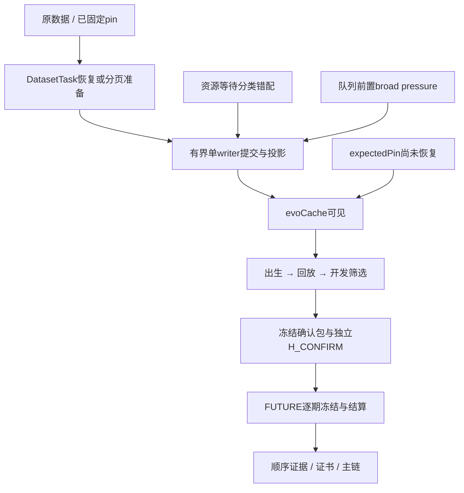

# 策略生成、训练、反馈、进化与主链晋升专项审计

## 一、结论和审计边界

**当前问题是多条实际执行链没有完成闭环，不能概括为“没有算法”，更不能通过删除门禁、重置计数、覆盖旧模型解决。** 安装版211已有真正可执行的数学图、6种数值内核、结构变异/交叉/融合、分片训练、冻结、结算、反馈和证书路径。报告同时证明：R27新主链策略/回放得分/世代/冻结/证书全部为0；现代AST3开发训练也没有一条完成receipt。已有旧流的部分真实计算必须保留，不能为了好看的“新方案”删掉。

本审计只读检查报告和**精确安装源码** `5c7f1b36eaee6036df280e85835bb0fb4ce0b40d`，安装版 `577311211`。源码目录为 `211安装源码工作树`。仓库main的旧应用树不是施工底座；本轮未修改该安装工作树、未构建APK、未连接设备、未写远端。

报告锚点：`evidence/report/DIAGNOSTIC_SCOPE.json`、`R26_REPORT.json`、`R30_REPORT.json`、`runtime-observation.json`。报告绑定sourceCommit同上，snapshotSha256=`64bf0b335c6204de44da467026ce6d75b5218fbbb86bf8b5ff7cc340cce8b0a3`，latestIssue=`202611270881`。以下 `DIAGNOSTIC_SCOPE.recentEvidence[table=…]` 均指带columns/rows/complete的表级证据，不把缺省字段解释为0。报告没有原SQLite、APK、训练CAS/模型二进制，因此不能在本环境确认每一个缺原件原因或完成设备端复演。

证据置信度分为：**A：报告原始行与源码合同共同确认；B：源码可证的风险，现场缺少同次owner/fence回执；C：报告确认结果/依赖，但近因仍需补证。** A不意味着完成设备修复验收。

## 二、先把“算过什么”与“当前形成什么”分开

| 证据层 | 本次实际值 | 准确解释 |
|---|---:|---|
| 旧R26候选/进化 | 50候选、50尝试、10结构候选；行为新颖0、研究接纳0、晋升/改进断言0 | 旧探索记录存在，不等于当前R27完成一代 |
| 旧R26训练 | 50条 `BLOCKED_WARM_NUMERICAL_ABI_PRESERVED` | 旧数值ABI保护；不能强行续训旧权重 |
| R27策略主链 | policy/replay_score/generation/lineage/live_shadow/live_frozen/opportunity/certificate/eprocess均0 | 新主链尚未产出可追溯候选到证书链 |
| R27输入/素材 | replay_dataset3、evolution_cursor1、molecule64、expert_proposal24、atom_contribution64 | 输入记录和素材存在；不证明消费者实际运行 |
| AST3候选 | 5个现代固定图；旧AST1另1个 | 5个AST3均有规范图和开发训练协议，未完成开发训练 |
| AST3特征分片 | 1100行=128+24+64+884 | 真实特征准备已执行，随后误终止；不是“从未跑过任何数据” |
| AST3训练恢复 | 5条原FAILED_TERMINAL；1条恢复receipt、1条PENDING successor尝试0；现有4候选QUARANTINED | 211已恢复FREQUENCY入口，尚未真正续跑训练；旧方案“四例全未恢复”不准确 |
| 开发数值产物 | `research_development_receipt_v2=0`，`r967_frozen_evaluation_v2=0` | 没有完整开发验证产物，也没有现代冻结模型 |
| 旧在线反馈 | r952_artifact44，全属同一旧AST1、`LEGACY_ONLINE`，numeric_updates1..44 | 旧单一候选的在线更新真实存在；development/validation样本均0，不能充当AST3训练完成 |
| R952真实冻结/结算 | candidate_predraw50，48已结算；outbox48中44COMPLETED、4DEPENDENCY_RETIRED | 既有闭环片段应保留，不能把全部功能宣布失效 |
| 现代滚动学习 | settled event24；version/head/offer/frozen publication均0 | 已接收结算来源，未形成可训练/发布的滚动版本 |
| 研究消费 | R01–R18当前源码produced/consumed都为0；research source consumption0 | 算法绑定/菜单可调用不等于产生、消耗研究证据 |
| 原子与分子登记 | atoms25350（25220 DISCOVERED、130 REQUIRES_BINDING）；molecules1303 VALIDATED | 最新值为1303，不再是旧方案1203；登记≠学习有效性 |

来源：`R26_REPORT.strategyAssessment`，`sections[EVOLUTION/TRAINING/BACKGROUND]`；`DIAGNOSTIC_SCOPE.tables`及上述同名recentEvidence；`R30_REPORT.lifecycleEvidenceR31`、`objectIndex.researchCharts.objects`。

## 三、主调用链与真正的阻断位置

### 3.1 R27链

`RuntimeR27.DatasetTask.step`先尝试从`r27_evolution_cursor`恢复原dataset；`ResearchInputPinR30R1.loadCurrent`验证原样本及源有效性；恢复metadata写入成功并再次校验后才发布`evoCache`。`EvolutionTask.step`发现cache空直接返回`DEPENDENCY(r27-replay-dataset)|expectedPin=…`。这说明**新增变异算子并不能修通当前主链**。必须先让原pin/准备事务走通，再验证九步进化实际产生artifact。

现场dataset任务RUNNING、cursor3597847、steps3；evolution BLOCKED、cursor13、steps4，expectedPin=`78827dff1fb517bfc64095e4fd0dd2b99dcc29fa943a03ebfe2ef8ece541d587`。atoms/calibration/study依赖evolution，matrices/observatory依赖IMMUTABLE_REPLAY_DATASET。报告可证依赖链，尚不能单凭expectedPin判为原件丢失或某个故障唯一所致。

### 3.2 现代AST3链

`ResearchDirectorR952.pulse`在既有六槽TRAIN/POST/MATRIX/RESEARCH/EVOLVE/IMPORT运行。IMPORT的`ModernFamilyFactoryCP12`构建/编译规范AST3；Director在同一事务注册candidate、protocol、input和TRAIN任务；`ResearchTrainingHookRegistryR952`完成特征页、数值checkpoint、开发验证、artifact；FREEZE子槽形成独立冻结模型；严格结算进入反馈与`RollingLearnerR343`；研究行动经`EvolutionControllerR952`和`MutationGraphCP12`创建新孩子再进入相同TRAIN路径。

当前5个基础AST3在`CP12_TRAIN_FEATURE_PAGE`的资源等待被旧版本误判为终止；211修正基础设施分类并恢复其中1个入口，但新任务attempt=0。`research_development_receipt_v2=0`使`RollingLearnerR343.planOne`的INNER JOIN无候选；没有现代冻结模型又使teacher、BANDIT/EXPERT/ENSEMBLE、bound parent等等待。这是**有前置层级的停滞**，不能通过放开教师绑定或用未训练权重冒充冻结专家处理。

## 四、逐项问题、原因、施工与验收

### ST01｜R27固定输入未进入进化cache，导致多消费者级联等待

**A（依赖关系）/C（固定pin具体未恢复原因）。** 证据为上述BACKGROUND任务，以及R30 replayKnowledge=`UNAVAILABLE_REPLAY_KNOWLEDGE`、datasetHash=null。`r30r1_analysis_run`有3条INPUT_DATASET_PINNED、1条INVALID_INPUT_CURSOR_PRESERVED；不能将这1条泛化为expectedPin必坏。

源码锚点：`strategyv2/RuntimeR27.java:236–340,344–369,418–455`；`ResearchInputPinR30R1.java:34–47,93–101`。现有3个输入和旧evolution cursor必须保留。恢复请求应输出requested hash、命中run、源修订、原件验证结果、是否等metadata提交，复用原owner。在修复后的冷启动中，应先证明原pin被恢复、`evoCache`与cursor dataset一致，然后证明`r27_policy/replay_score/generation`由真实事务新增。不得清cursor、改expectedPin或重置曝光账本让门禁消失。

### ST02｜writer backlog的生产/消费分类不一致，准备好的批次被当失败丢弃

**B：确定代码缺陷。** `DatabaseCoordinator.runWrite:1023–1026`发出`RESOURCE_QUEUE / ADMISSION / ROLLED_BACK`及精确backlog cause；`ResearchWriteQueueR27.writerBusy:241–253`只接受旧`DEPENDENCY`，所以当前wrapper走抛出分支。失败prepared可被清理、下一轮重复解压/计算；“资源暂不可用”不应成为模型质量失败。

施工：已给窄候选`strategy_candidates/ST02_queue_category.patch`及正负JUnit，保持同batch/commitIdentity/cursor。只接纳上述精确原因的两种历史/当前category。UNKNOWN/COMMITTED不重试，所有hash/源/fence保护保留。验收需先运行所附准入测试，再用native SQLite检查同receipt恰好一次、进程死亡和未知提交恢复；设备测资源压力下prepared是否保留。

### ST03｜队列前置压力门可能使已有公平服务槽无法被调用

**B：源码可证风险；现场关联不能升级为唯一归因。** `ResearchWriteQueueR27.submitAttemptR31:185–203`的broad critical门，除历史导入外在writer外先挡住所有研究。只有进入runnable，最终REPLAY_DATASET才`prepareReplayDatasetR341`。而`DatabaseCoordinator:1016–1019`已经提供有年龄的dataset/研究公平槽。门外一直等待会令内层公平槽永远看不到准备就绪的真实事务。

现场`runtime-observation`同时realtimePressure=true、settlementExecutionActive=true；dataset/live为COOPERATIVE_PREPARED_STEP。此瞬间真实settlement优先是正确的；不能以“公平”为名让研究抢正在执行的结算。

施工合同在`strategy_code_contracts.md:C2`：用绑定prepared身份的服务票据让既有单writer完成有界裁决，分清正在执行的settlement/freeze和仅broad backlog；不增加第二写者，不把研究改成CONTROL，不放开未知op。验收用持久pressure+间歇关键事务测试真实有界前进和freeze抢占，记录owner/fence/payload及准入原因。数据解压、全模型训练不进入writer事务。

### ST04｜旧pin恢复诊断过粗，已存在派生投影也重复要求写入

**B（代码）/C（现场pin细因）。** `loadCurrent`多个不相同原因都返回null；`publishRecoveredReplayKnowledgeR31:356–363`即使`isPublishedR31`已完全一致仍submit。后者给已验证恢复多添一次写者依赖，但报告当前投影不可用，所以只做此优化并不能完全修复现场。

施工：新增兼容的typed load outcome；匹配精确payload、mode、源码身份和原recordedAt且再次验证fence/pin/投影时，才可跳过纯重复metadata写。旧sourceCommit或不同mode不得命中。缺投影沿既有小事务补建，原pin不改。热尾删除与原数据纠正区别处理。验收逐个覆盖原件损坏、schema pending、源变更、metadata过期、换owner、提交后死亡，恢复后原RNG/ledger/cursor逐字段一致。

### ST05｜50个旧数值ABI候选停训；冷重生入口存在但未产生孩子

**A（现场）/C（各原件可恢复性）。** TRAINING50条全为`BLOCKED_WARM_NUMERICAL_ABI_PRESERVED`；`cold-rebirth-r34`READY/steps0，等待`R33_WAIT_WRITER_HOLD_FAULT_BACKLOG`，`r34_cold_rebirth=0`。代码`ColdRebirthR34.prepare/step`核原身份与state proof，剥离warm数值参数，从新数据冷启动，保留数学成员，初始开发/未来计数为0。

保留ABI门禁；不得把旧optimizer/normalizer/权重按新ABI解释。先恢复资源服务，再逐个核对原state/数学规范，使用现有唯一old→child记录建新孩子。F23 exact teacher不在时继续等原教师；缺旧state的个体应有可追溯hold，其余个体继续有界轮转。如确需独立新实验，必须用独立身份和新的数据/协议，不能假冒旧孩子继承旧样本成绩。验收旧对象/hash不变，新子代n=0，新checkpoint可恢复，真实训练后计数才增。

### ST06｜现代训练的第5条误终止记录不在现有恢复白名单

**A。** 全量任务5条FAILED_TERMINAL，都是同一旧CP12_TRAIN_FEATURE_PAGE/DEPENDENCY/ADMISSION/ROLLED_BACK/backlog原因。211白名单只有4条，当前只有FREQUENCY已恢复。漏掉RULE task=`678d059b7207c6f2ec712c0cdd906dbc201357a61632236b8019af0c67ce740f`，cursor `FEATURES|884|16c69ec…`。

报告同时给出RULE AST、协议、input registry：FIXED_GRAPH、64节点、requiredHistory50、无teacher/binding/long-summary、boundFiles空，原输入105547 bytes、1671 rows、训练1200、验证120，中间embargo1。代码`TrainingRecoveryR343.KNOWN/known/read/verifyAndResume/commit`足以按原合同进行**有条件恢复资格**。

施工候选`ST06_fifth_training_recovery.patch`只增精确五元组。原.scdev文件未随报告提供，所以不宣称该例现场可立即恢复；原件/协议/AST/分割全验后由现有owner建立successor，旧失败task和cursor不变。拒绝“把所有QUARANTINED UPDATE成NURSERY”。验收包括新白名单、改任意身份负例、原件失踪/篡改拒绝、恢复重入不重复、无Future/real授权、旧记录永久保留。

### ST07｜现代训练新入口已有，但未获真实运行；不能再用旧错误替代当前原因

**A（新任务尝试0）/C（具体未claim原因）。** FREQUENCY successor=`247e79ceb34ef207b068d57e81d875a0275adcf688ae6299bc8919c038b18e08`，PENDING、generation0、attempt0。Director last slot=POST，priority=MATRIX，training_subslot=2；现代continuity近期因R932_COHORT_REVIEW/RESOURCE_QUEUE/ADMISSION/ROLLED_BACK失败。没有证据证明此新任务再次进入feature preparation。

211现有`TrainingInfrastructurePolicyR343`已支持RESOURCE_QUEUE及UNKNOWN/COMMITTED区分；`ResearchTrainingHookRegistryR952:137–211`有五子槽；Director:576–612有六槽和ready训练预留，不能拿173源码再覆盖。施工是给每层记录“未进入/预算不足/无ready任务/claim拒绝/实际片段产物”的结构化区别，恢复资源后逐段观察现有轮转；只有证实某最小slice仍不可用才调整有界预算，不能默认大幅扩线程。

验收以FEATURES cursor单调、有真实feature row/hash、normalizer/train/validate checkpoint、dev receipt和artifact闭合为准。对FIXED_GRAPH，数值优化steps可以合法为0：必须验证其真实PIT前向计算和验证tape，而不是伪造权重更新。learned模型才要求对应梯度/树/专家权重状态变化证据。

### ST08｜已有真实多机制实现，生成结果必须按类型计数

**A（源码）/C（当前产物有效性）。** 数学族与内核见下一节。`MutationGraphCP12`存在最多32次确定性图搜索，规范编译、类型/单位/节点上限、语义去重；`CreationChangeKindR343.receipt`明确区分参数/来源迭代、结构改变、融合、交叉，状态都是UNVALIDATED而非新机制已证实。R27 `FormulaIdentityR341`也比较结构、node edits、same-input undo-edit ablation及行为签名。

施工应先使现有结构图得到实际调用和验证；每个孩子保留parent hashes、operator/seed、完整AST、结构shape、训练数据、行为签名、消融和结果来源。只换窗口/lag/阈值/权重/教师版本不得算新机制。新的基础原语若确有必要，单独实现可审查的typed primitive及正确性/边界测试；不要运行模型随意生成的Java或把文本“公式描述”计为可执行程序。

验收分开 `proposalAttempt/compiledDistinct/parameterVariant/structuralChanged/behaviorChanged/devAccepted/futureQualified`；选择集高分不是有效新机制证书。当前`research_action_proposal_cp12=0`、现代结构行动产物未闭合，不能以已注册15family显示“已完成动态算法进化”。

### ST09｜有类型规则归纳/迁移代码，尚无真实供体和子代验证闭环

**A（零产物）/C（供体机会未知）。** `TypedGenerationRuleR342.induct`要求两个不同、实际执行且有proof的开发程序，兼容类型、不同结构、2–4个typed slots；`instantiate`要求新的dataset且时间范围晚于供体，通过有限组合产2个不同结构子代。`AtomPublicationStoreR31.prepareRuleR342/publishRuleR342/readRulesR342`和`ResearchContextR30R1`已有调用接线。

报告typedGeneration childrenWithRetainedDevScores=0、distinctTransferDatasets=0；eligibleDonorPairs=null，明确`DONOR_PAIR_ATTEMPT_NOT_PERSISTED`。null不能写为“没有供体”。

施工：先恢复开发回放产出供体proof，再在现有owner附加有界pair尝试回执，记录不合格原因（同结构、无proof、ABI不兼容、slot不足等）、规则hash、目标dataset和子代scores。不为凑2个供体重复同参数图，不把H_CONFIRM/FUTURE成绩回灌规则归纳。验收至少真实两供体→typed rule→严格更晚不同dataset→真实子代dev scores→未来独立验证；若找不到合法供体，报告真实不足，不强放行。

### ST10｜旧在线反馈确实存在，现代滚动学习仍停在训练前置层

**A。** legacy44个artifact全部来自`R952-C-c41f6a28c10408b48b88`（AST1 RECENCY_BLEND，lookback120）。唯一learning_cursor训练至`202611260101`。现代rolling event24但version/head/offer/publication均0。

211的`RollingLearnerR343.settled:63–74`只接入经认证完成的结算；`planOne:120–140`必须JOIN开发receipt；`trainSlice`在TRAIN owner中运行；失败只隔离该learner version，保留原冻结/认证版本。这已修复旧173“AST3无在线owner”的代码缺口，当前0主要受没有dev receipt这一可证前置限制，仍可能有服务问题。

施工：保留旧在线产物及outbox，先完成AST3首个开发模型和冻结，再让现有rolling版本消费新的settled事件。旧冻结版本必须固定用于评价，学习版本产生新版本；同一个评价标签不可反向改写其冻结预测。验收新旧modelHash不同且能复算、cutoff与source epoch真实、去重重送不重复更新、Future/evaluation行不作当前模型训练、真实发布receipt与清理许可闭合。

### ST11｜18研究能力没有当前生产/消费证据；原子出版也未等于模型出版

**A。** researchCharts18全为currentSourceProducedFrames0、actualSourceConsumptionReceipts0；capabilities82中81可调用（F23等待原teacher），但实现/绑定不是生产/消费。AtomNet publication19/PUBLISHED19，却publishedModelRows0；当前capacity显示在active reservation范围内，不能无证据认定模型档案容量已满。

研究成本应按实际帧/input/proposal/child/hash连接，不让健康轮询、目录登记、同名函数存在充当成果。恢复输入与训练之后，按依赖从可独立计算的短窗统计/误差/校准诊断推进，再到需要冻结模型的比较/融合/归纳。保留source reference、consumer receipt、same-input反事实；无产物时明确是哪一前置未满足。验收每个研究族至少出现可复演source→consumption→changed child或明确NO_OP/拒绝，不以“18/18 callable”验收研究有效。

### ST12｜长期摘要源已因真实期号缺口失效，不能直接接给长窗模型

**A（状态和缺口）/C（缺口成因）。** `research_long_head_r80`为INVALID_SOURCE，through_issue=`202611260400`，last_error=`SOURCE_GAP:202611260431:202611260460:EXPECTED=202611260432`；有4个epoch、1764 snapshot/publication，long_creation0。近期r80 probe/bound source为NOT_RUN_OWNER_NOT_REACHED。

`LongScaleSummaryR80`具有严格连续来源协议、source token、epoch、available_at和64行有界页；原数据纠正会触发失效。施工先查canonical/history补录可否用原来源修复；补录晚到数据必须保留真实可知时间。旧epoch原件保留，按现有新epoch规则重建，长窗不足则记录不足；不得用跳跃样本伪造连续10080/43200窗、填零或回写旧available_at。验收gap定点定位、hash重放、晚到数据无未来泄漏、长窗达到要求才可作为feature，而非靠降低requiredHistory。

### ST13｜任务回执很多，实际artifact工作量仍为0；诊断需要分母

**A（字段）/C（因果）。** R30 runtime tasks显示evolution历史attempt36519、committed task receipts31424、observed work units0；live attempt37399/receipts29297/work0；cold358/358/work0。部分last_artifact_hash=null、NOT_ARTIFACT_BOUND，RUNNING可能只是COOPERATIVE_PREPARED_STEP。

这不是证明“伪造回执”，而是计数单位不同：claim/heartbeat/等待/事务回执不等于模型或数据artifact。施工将时段、源码、owner、fence、input和产物绑定，输出attempt→claim→prepared→admission→artifact commit→消费的漏斗；同时保留旧计数语义。不能回填历史artifact hash冒充原生产证据。当前atomnet unsliced故障样本currentOwnerAndFenceMatch=false，不应当作本次唯一未运行原因。

### ST14｜主链晋升和证书为0是上游证据未产生的结果，不是门槛过高的证据

**A。** R27 live shadow/frozen/opportunity/eprocess/certificate均0；R30质量多项INSUFFICIENT，realPermission=false，naturalQuality=NOT_PROVEN。`LiveTask`真实顺序为certify/freeze/observe freeze/settle/qualify/gap repair；没有候选或冻结时，certificate0正常。

保留`SplitR27`的train/select/confirm/open隔离（BLOCK=720，dataset少于2160无sealed holdout能力），`EvolutionLoopR27.step`对开发可读范围的限制、独立冻结确认、同期开盲负控、`QualificationInboxR29`连续消费、`SequentialQualificationR27`永久alpha index、`CertificateGateR27`原版本阈值和`MainlineAdapterR31`精确证明。

施工顺序必须先真实dev artifact，再独立confirm与FUTURE冻结、真实结算，最后满足所有证据才由原证书/主链owner晋升；不能将训练历史、补录历史、开发早停120验证或synthetic/host测试当FUTURE。验收故意高回测分但无Future的候选仍不可晋升；错model hash、晚冻结、缺期、过期校准、重复标签、无证书一律不授权。修通执行链不能保证高胜率。

### ST15｜滚动5000行live cache可能每期全量重建，需要性能证据后局部修

**B。** `RuntimeR27.liveCacheWithPlaceholder:681–720`载入最新5000行并用旧序列为新序列前缀决定能否append；达到热尾上限后，每来一期最老行被淘汰，前缀条件自然不成立，因而走rebuild。报告cp12_draw_tail_eviction显示countBefore5000。

这可证明重复计算风险，不能直接归因为某次1秒延迟。施工先量化load/decode/feature rebuild耗时、内存和每期次数；必要时实现以issue+rowhash+source revision识别的滑窗重叠复用，保持窗口状态、上下文缺失及source correction重建语义。验收旧新实现对同一真实固定输入逐概率/特征一致，source改动必invalidate，峰值内存有界；不为省计算把过期特征混进新数据。

## 五、现有数学机制应该怎样保留并真正使用

| 机制 | 已实现数学/执行对象 | 正确的验证与分类 |
|---|---|---|
| FREQUENCY | PIT频率向量→正归一化 | 换50/120/300/500窗口是参数变体；按独立数据评价 |
| OMISSION | 遗漏长度、截断/变换与向量归一化 | 遗漏不自带“应当补出”的概率保证；原样跑基线对照 |
| MARKOV | 已登记条件转移原语、平滑后的分数/概率 | 窗口换值是参数；条件阶数/机制改变另记结构 |
| TRANSITION | 跨位置延迟或条件转移组合 | 保留source<target的PIT约束与缺历史mask |
| STATISTICAL | 频率与熵调节的遗漏项加权 | 必须消融熵/遗漏项，不能凭换权重宣称新机制 |
| RULE | 频率阈值→条件选择→PACK10→归一化 | AST图是真实程序；固定图无需假造梯度更新 |
| REGIME | 五个不同分量经REGIME_SCORE调节后混合 | 同一数据上检查门控作用与全HOLD/常数退化 |
| LINEAR/HYBRID | softmax线性分类；HYBRID加交互feature | 两个family标签主要共用数值内核，需显示特征差异 |
| LOGISTIC | OVR_LOGISTIC | 真实loss gradient、标准化、mask与校准测试 |
| TREE | 训练分位切点、Gini增益、深度≤4/节点≤31 | 保留bounded tree scan和checkpoint，验证分支使用 |
| NEURAL | MLP_D32_16_10，Adam | 固定seed/optimizer状态、梯度裁剪、数值有限性 |
| BANDIT/EXPERT/ENSEMBLE | 2或3个真实冻结专家，EXPERT_HEDGE | 共同核心不能冒称3种全新学习算法；父模型hash与时点完整 |
| 结构变异/交叉/融合 | typed subtree、operator、feature、同类型交叉、固定双专家混合 | 规范AST不同≠机制新颖≠效果改善，逐级证明 |
| 类型规则迁移 | 两个执行供体、2–4 typed slots、后续dataset有限组合 | 供体proof、迁移时间边界、子代开发与未来证据分别保留 |

源码：`r952/ModernFamilyFactoryCP12:33–59,73–102,136–166`；`CandidateCompilerR952.ModelKind:74`；`DevelopmentTrainerCP9:106–201`；`MutationGraphCP12:21–54`；`CreationChangeKindR343:14–50`；`strategyv2/TypedGenerationRuleR342:22–105`。

训练评分要与执行问题分开。10分类交叉熵为 `-log(p_actual)`；代码Brier为10类平方误差平均；固定选择3个号码的均匀基准命中率为0.30。开发validation120用于选epoch/早停，反复访问它会引入选择，**不能再称完全未接触最终测试**。大量尝试即使纯随机也可能出现很高的开发分，因此保留试验总数、固定确认曝光、永久alpha预算和FUTURE核验，防止“挑到最高分”被误报为改进。

## 六、可落地的恢复次序和阶段产物

1. **保护既有原件与导出。** 固定211底座和升级前备份/manifest；候选、checkpoint、pin、旧失败、report exporter不删除。先修writer故障原件归档/资源服务（由runtime专项给出），应用ST02窄分类补丁后验证prepared不再被暂态等待清掉。报告导出是独立验收，算法返修不得顺带重写导出器。
2. **恢复固定输入。** 逐个核expectedPin与3个原pin，完成真实metadata发布及evoCache恢复；C2公平服务要先通过受控压力试验。产物：pin load outcome、输入hash、原split、真实提交receipt。
3. **跑通首个R27世代。** 保留已有九步链与原曝光账本；产物：规范策略、lineage、开发replay scores、不可变generation snapshot、确认包。拒绝/NO_OP也要有真实理由；不要求一定产生高分赢家。
4. **恢复现代TRAIN。** 先运行已存在PENDING successor；验证其原input和每页进度；补第5条资格并恢复其它可证原件。产物：完整开发receipt/validation tape/模型hash，再形成冻结评价版本。FIXED_GRAPH和learned kernel分别按真实计算类型验收。
5. **接通研究和动态更新。** 由已有POST/RESEARCH/EVOLVE/IMPORT及rolling子槽消费真实产物；教师/绑定/长窗按先决条件推进。产物：研究source consumption、结构分类、父子图、消融、真实滚动版本和冻结发布。不能另造第二套计数体系掩盖旧队列。
6. **真实未来闭环。** 预截止冻结、真实标签结算、连续顺序证据、独立冻结校准、达到门槛再证书/主链。产物：可追溯的逐期预测与结算证明，而非仅UI绿色或报告“callable”。

阶段验收应该回答“哪一个真实输入，在哪个owner/fence，执行了哪一段计算，提交了什么hash，哪个消费者使用了它”。一次host测试只能证明其实际覆盖的合同；不能替代手机性能、冷启动恢复、报告全量导出和连续运行。当前不存在合理依据承诺返修后高命中率或立即可晋升。

## 七、自检与待施工状态

已复核最新5失败/1恢复、1303分子、现代rolling owner已存在、Split BLOCK720/最少2160、15family与6内核的区别，纠正沿用旧173方案会产生的错误。针对确定缺口提供2份窄候选diff，另有公平准入与pin恢复2份方法合同，详见`strategy_code_contracts.md`。

已执行：两候选对精确211的`git apply --check`；未修改安装工作树tracked文件。另通过Java源码启动方式运行从真实文件逐字抽取的before/after `writerBusy`方法，30例中原版仅`RESOURCE_QUEUE/ADMISSION/ROLLED_BACK`发生预期反例1个，候选0失败；证据在`strategy_candidates/writer_busy_source_run.txt`和`writer_busy_extraction.json`。测试使用typed-category适配器，只证明抽取的窄分类分支，不覆盖生产fallback分类器、prepared batch事务、Android或设备。

未执行：完整应用Java编译/JUnit/native SQLite/Android/设备测试；环境没有javac命令、Android SDK或生产编译产物。原SQLite与.scdev/CAS不在报告内，所以原件存在性和设备同次调用因果仍保留为待验。以上限制必须在总方案施工/发布状态中保留，不能把“方案自检通过”写成“手机已经返修成功”。
