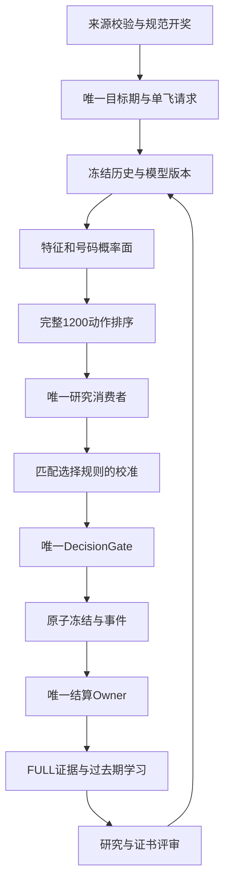

# 唯一主链与模块接口设计

## 不变身份

Binance1-PK10、一分钟游戏、单位置固定K3、每期最多一个REAL。包名、DB名和user_version=36延续。DecisionGateEngine决定最终BET，SettlementEngine负责结算，TargetIssueResolver负责期号，AnalysisSingleFlightR36负责预测单飞。OosAfterDrawWriterR36与DeferredEvidenceWriterR36继续分担结果证据写入；禁止新模块另起一个出手或结算Owner。

## 数据与调用顺序

L→C只允许对下一期生效；该图不表示允许当前期结果回灌。正式动作宇宙一直为1200，研究代理缩减不能删除正式动作。无合格研究消费者时使用原基础排序。

## 计划新增接口（均为待实现，不冒充现有类）

|模块|接口与输入|输出/副作用|调用者与失败行为|
|---|---|---|---|
|RuntimeEventRepositoryR926|appendWithinTransaction(db,event)|追加事件+outbox；event_id幂等|各现有Owner；提交失败业务事务一起回滚|
|IssueProjectionRepositoryR926|read(game,from,limit,watermark)|不可变DTO，分页|UI/报告；查询失败显示错误与旧数据时间|
|ResearchSchemaCoordinatorR926|ensureSlice(deadline,token)|READY/PROGRESS/BLOCKED/FAILED|服务空闲片；不抢critical写锁|
|FeatureManifestR926|validate(snapshot,contract)|类型化错误集合|训练导出/loader；失败隔离不用生产|
|ModelBundleStoreR926|stage(file); verify(id); activateNextIssue(id)|完整bundle原子指针|导入界面+现有orchestrator；无半激活|
|CertificateServiceR926|authorize(candidate,target,selectionHash,domain)|Permit(level,maxWeight,reason,evidenceHash)|三个消费者共用；缺证0权重|
|CandidateScheduleR926|plan(target,cohort,budget)|冻结A/B/C清单与公平序号|ResearchPredrawCapture；只跑清单|
|FailureReplayR926|replay(snapshot,moduleMask)|独立诊断结果，不写BET/canonical|开奖后worker；预算超限留游标|
|AtomValueR926|value,present,reason,maxSource,cost|原子产出结构|原子生产处；禁止隐式缺失转0|
|CapabilityPresenterR926|capture(snapshot)|权限与业务两个状态|MainActivity；不做DB写入和模型训练|

## 线程、锁和事务

UI线程只绑定DTO、绘图、导航。网络线程不持DB锁发HTTP。预测单飞线程拿本期ImmutableBundle和不可变历史；写入统一coordinator。研究worker一次只申请小写片，出现critical立即让步。不能在同一SQLite事务里执行长网络、训练、全文件hash或UI回调。

业务事件和业务数据同事务；只有外部请求开始/响应这类无法与服务端一起事务化的事件使用独立id+outbox对账。任何“runWrite返回false”都不得标操作成功。超时的旧attempt无法覆盖新attempt或已提交canonical。保留旧接口薄委托是迁移步骤，全部调用切换和回归后删除重复主体。

## 研究融合合同

一期候选在赛前按已冻结的证书优先级与tie-break选出一个。先保留baseline rank；计算candidate rank；用预注册rank百分位融合保持量纲一致；使用同一selection_policy_hash对应的校准与policy。记录before/after ordinal、consumer、weight、rank delta、chosenChanged、cert hash与失败原因。即使没改变rank1，也要如实记录“参与但未改变选中”。

5/12/20/30%是协议上限，现有创生8%等更小安全上限不会仅因新证书自动被移除。解除旧低上限必须作为选择策略变更，新校准+新独立窗口；否则effectiveWeight=min(协议上限,原消费者上限,域上限,资源上限)。
