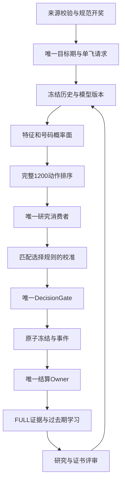

# STARCORE R925 → R926 全缺口闭环施工方案

编制日期：2026-09-07。基线：已交付 V57.21.1-R5.4.1-925。拟定下一版：V57.21.2-R5.4.2-926，未施工、未发行。

本包交付的是继续实施所需的详细工程设计、问题台账、数据/数据库合同、测试矩阵、源码定位和原方案追踪。方案正文、42张任务卡与验收门共同构成施工范围；不把方案文件存在当成功能已完成。

## 先回答还没完成什么

1. 首次数据库迁移仍夹带研究大schema；大文件分层与关键吞错审计未完整做完，手机冷启动/5秒出号没有实测。
2. 后台恢复、逐阶段持久化事件、每期结算和学习幂等、FULL旧积压实际清空还缺完整实现或运行验证。
3. NumberQ/Gate/Ranker/校准/Predictability/Policy没有当前游戏真实生产证明，模型包导入、跨阶段依赖及手机parity尚未闭环。
4. 证书底层仍是三套兼容结构，配对baseline需固定；raw score参与概率误差、融合后选择规则改变等语义必须修正。
5. 分域路由、不确定性、结构/行为/残差去重、顺序多重比较、8/24/64调度、Elite Repair和修复成功率仍未全实现。
6. 原子真实缺失/耗时/PIT/独立消融、自动隔离与最低构件定向创造尚未完整接入。
7. 四个独立能力页、趋势、为什么中/不中多状态框、风险/稳定性空白回归和大报告真机分享仍有工作。
8. 同签名覆盖后实际启动、息屏120期、划掉30期、24小时及真实未来晋级窗口均未在本次环境执行。

## 阅读顺序

先看 `完整施工方案.html`（手机浏览器可离线打开，可搜索），再看 `01_详细施工/01_现状与新增问题.md` 和 `02_施工台账/42项逐项施工任务.md`。开工时使用 `02_施工台账/tasks.json` 和 `03_合同与迁移设计`；验收按 `04_验收与执行`。原有两份施工方案完整保留在 `06_原方案`，所有原问题与原测试都有映射。

## 一次性交付的定义

这次以一个冻结基线、一个发行分支、同一套合同和一轮总发布完成全部计划范围。内部允许修复与回归，不能承诺“一次编写绝无缺陷”。工程实现、手机可用性、真实训练和未来效果都过各自门后，才允许称为全部目标验收。没有真实数据、手机和未来样本时，工程可以继续完成，设备与效果门仍必须保持未通过。

任何方案都不能保证随机或近随机序列存在稳定高胜率信号，也不能承诺两次未中后第三次必中。这里给的是找出有效策略、拒绝无效策略、保留证据、逐期验证与受控接入的完整施工路径。

---

# 现状、剩余工程与本轮新增发现

## 已经有证据的 R925 产物

已交付APK SHA256：`957f3e3dbe78bfa93788fbf2f7873ed3de03244a2cd08b89a230a67b4a8bffcf`，3,642,545字节。签名证书SHA256：`ae7e1b4a5a71f1f299d4a0b2472c6a36513873514e78190d42d6cfba3340116f`。包名 `com.ethk3.novaonepro`，versionCode `577250925`。559个Java文件、71个资源文件，13个纯主机harness执行；APK检查的65/65是指定运行类集合，不是DEX总类数。

R925增加了schema指纹、首淘汰原因、机会分账、独立窗口、抓取/影子/时延报表、原子质量观察、真实冻结训练导出和研究模型训练/推理。最后已修正一期多个研究消费者连续改写及权重记录问题，这些不应再被写成“完全没做”。

主机数值核对是14,400动作分数，最大绝对差1.735e-18；四类深度网络400个输出，最大差2.221e-16；Gate9号码面100项最大差3.042e-14。全部Android parity标NOT_RUN。100期模拟训练只验证合同和代码执行，不代表当前游戏收益。详细基线日志见05目录。

## 此次直接从代码定位的新增问题或风险

|编号|证据|判断|施工项|
|---|---|---|---|
|N01|release_identity.properties schemaRevision=4；SchemaRevisionR925.REVISION=R925_SCHEMA_6|可能分别代表旧/新修订，但报告未区分作用域；须统一命名并生成|B01|
|N02|DatabaseCoordinator.ensureCriticalSchemaOrThrow仍有R820_RESEARCH_SCHEMA；matches对全sqlite_master做hash|首次迁移与研究DDL还耦合，stamp不是全量lazy|B03/B04|
|N03|PromotionWindowR925.evaluate/evaluateGenesis选择p.score；fromCursor用(score-hit)^2|分数未绑定校准合同，误差门的概率语义不充分|C03/D06|
|N04|PromotionWindowR925窗口JOIN运行oos标签，未包含固定champion_hash与window_end|缺冻结比较对象和终点；持续重复查看需要额外统计治理|C02/C06|
|N05|窗口查询从anchor至今全部拉入ArrayList|长周期增长、查询/内存预算未封顶|C02/B05|
|N06|DeepCandidateRuntimeR925声明FEATURE_CONTRACT；R811 codec仅type/trainedUntil/fields|同维度不代表同语义，loader必须校验外部manifest；不认定目前会自动激活|D02/D10|
|N07|deep_candidates.surfaces从META派生输入；主链META在NumberQ后构造|新网络是派生研究合同，不能直接作为原NumberQ上游替换，需消除循环依赖设计|D02|
|N08|训练封存registry位置为source.resolve().parent|限制了同父目录，但搬源到其他父目录仍可另建registry，非全局试验账本|D03|
|N09|Ranker一个线性模型族；Hard pair取32个高分正负动作|不等于完整R0–R5比较，也未严格实现“只差一个号码”近邻策略|D05|
|N10|capture record执行两条语句，冻结在其他方法事务；调用方未统一处理写失败|需要统一事务及幂等状态机，当前主机测试不能覆盖所有崩溃切点|C04|
|N11|Backlog用MAX(completed target)描述latest FULL|最新已完成不等于连续完整水位，中间洞需要另报|B10|
|N12|AtomQuality在旧冻结表GROUP BY找最近120期，只有循环内deadline|入游标之前SQL可能已扫描大量历史；增量索引和可中断查询须实测|C10|
|N13|MainActivity末部动态面板与共享详情Activity|四独立页和设备视觉门仍未完成；布局ID一致只证明绑定的一部分|U01/U02|
|N14|AppConfig存在多代SHADOW/MODEL/REAL开关|实际生效必须按调用链与DecisionGate快照解释，不能读单一常量下结论|B11|

这些发现中，N01是身份语义歧义，N06/N07是未来接入风险，N10是崩溃一致性待实现/验证；均不能仅凭静态发现宣称已在用户手机复现故障。

## 不能恢复与不能替代的证据

升级前丢失的first_prune、请求事件与赛前输入不能事后伪造。缺失旧记录应永久标UNKNOWN/UNAVAILABLE，并让新版记录完整。无赛前快照的历史开奖可以研究历史特征，但不能作为当时真实Future-OOS冻结预测。手机启动与后台必须有设备证据；模型成功必须有真实封存与未来窗口。

---

# 唯一主链与模块接口设计

## 不变身份

Binance1-PK10、一分钟游戏、单位置固定K3、每期最多一个REAL。包名、DB名和user_version=36延续。DecisionGateEngine决定最终BET，SettlementEngine负责结算，TargetIssueResolver负责期号，AnalysisSingleFlightR36负责预测单飞。OosAfterDrawWriterR36与DeferredEvidenceWriterR36继续分担结果证据写入；禁止新模块另起一个出手或结算Owner。

## 数据与调用顺序

L→C只允许对下一期生效；该图不表示允许当前期结果回灌。正式动作宇宙一直为1200，研究代理缩减不能删除正式动作。无合格研究消费者时使用原基础排序。

## 计划新增接口（均为待实现，不冒充现有类）

|模块|接口与输入|输出/副作用|调用者与失败行为|
|---|---|---|---|
|RuntimeEventRepositoryR926|appendWithinTransaction(db,event)|追加事件+outbox；event_id幂等|各现有Owner；提交失败业务事务一起回滚|
|IssueProjectionRepositoryR926|read(game,from,limit,watermark)|不可变DTO，分页|UI/报告；查询失败显示错误与旧数据时间|
|ResearchSchemaCoordinatorR926|ensureSlice(deadline,token)|READY/PROGRESS/BLOCKED/FAILED|服务空闲片；不抢critical写锁|
|FeatureManifestR926|validate(snapshot,contract)|类型化错误集合|训练导出/loader；失败隔离不用生产|
|ModelBundleStoreR926|stage(file); verify(id); activateNextIssue(id)|完整bundle原子指针|导入界面+现有orchestrator；无半激活|
|CertificateServiceR926|authorize(candidate,target,selectionHash,domain)|Permit(level,maxWeight,reason,evidenceHash)|三个消费者共用；缺证0权重|
|CandidateScheduleR926|plan(target,cohort,budget)|冻结A/B/C清单与公平序号|ResearchPredrawCapture；只跑清单|
|FailureReplayR926|replay(snapshot,moduleMask)|独立诊断结果，不写BET/canonical|开奖后worker；预算超限留游标|
|AtomValueR926|value,present,reason,maxSource,cost|原子产出结构|原子生产处；禁止隐式缺失转0|
|CapabilityPresenterR926|capture(snapshot)|权限与业务两个状态|MainActivity；不做DB写入和模型训练|

## 线程、锁和事务

UI线程只绑定DTO、绘图、导航。网络线程不持DB锁发HTTP。预测单飞线程拿本期ImmutableBundle和不可变历史；写入统一coordinator。研究worker一次只申请小写片，出现critical立即让步。不能在同一SQLite事务里执行长网络、训练、全文件hash或UI回调。

业务事件和业务数据同事务；只有外部请求开始/响应这类无法与服务端一起事务化的事件使用独立id+outbox对账。任何“runWrite返回false”都不得标操作成功。超时的旧attempt无法覆盖新attempt或已提交canonical。保留旧接口薄委托是迁移步骤，全部调用切换和回归后删除重复主体。

## 研究融合合同

一期候选在赛前按已冻结的证书优先级与tie-break选出一个。先保留baseline rank；计算candidate rank；用预注册rank百分位融合保持量纲一致；使用同一selection_policy_hash对应的校准与policy。记录before/after ordinal、consumer、weight、rank delta、chosenChanged、cert hash与失败原因。即使没改变rank1，也要如实记录“参与但未改变选中”。

5/12/20/30%是协议上限，现有创生8%等更小安全上限不会仅因新证书自动被移除。解除旧低上限必须作为选择策略变更，新校准+新独立窗口；否则effectiveWeight=min(协议上限,原消费者上限,域上限,资源上限)。

---

# 数据库、首次启动和积压施工细则

B03/B04/B05/B10共同实施，不能单独加一张stamp表便标完成。

## Critical表依赖的取得方式

从StarcoreApplication→服务初始化→DbStore→runR36→canonical commit→CORE settlement逐调用追踪SQL，形成table/column/index/trigger四列白名单。包含所有首次读取的配置与状态表；由实际fixture在空库运行捕获缺表错误并补全。只有这份闭包可以阻塞首个实时周期。R35/R36/V51/B03中属于研究的表应拆出，不能仅按旧方法名整体划分。

生成critical、research、legacy三个独立修订：每域对象DDL规范化hash、校验代码hash、最后成功步骤、迁移开始/完成时间。ready只能由对象逐项校验写入，不能因另一个域成功而设true。

## 首迁移流程

1. 取得唯一迁移lease，先读取轻量DB身份，显示明确“升级中”。
2. 对现有库进行一致性备份并验证；备份耗时单列，不伪装计算耗时。
3. small critical变更在短事务完成；主链所需索引必须存在。
4. critical通过后开放主链，研究/旧UI读取各自就绪状态。
5. research迁移以步骤游标推进，大量回填每批建议200行、写片目标≤100ms，超限缩小；每片后让出critical。
6. 最大等待目标5分钟内得到研究READY或明确错误。繁忙导致无法达成必须显式CAPACITY_BLOCKED，不能永远“稍后”。
7. 最终核对各域stamp和全部旧记录基线hash。

批大小与时间是实施初值，要用真实大库测并记录。SQLite建索引本身可能是长操作；若建在大旧表上，需预迁移窗口或新辅助表增量维护，不能假装在SQL外检查deadline便能中断。

## 设计DDL范围

`03_合同与迁移设计/schema_r926_design.sql`给出新增核心表、主键、索引、检查约束与不可变触发器，能在host SQLite重复执行。它是初始设计DDL；手机接入仍要实现coordinator、事务、迁移游标和兼容测试，不允许直接在用户库手工运行。针对最低API21的SQLite，不使用UPSERT新语法、窗口函数、JSON1、STRICT、RETURNING等高版本依赖。

## 大库性能试验

数据库夹具分别包含1千、10万、100万冻结/事件行及2216个积压任务；记录EXPLAIN QUERY PLAN、P50/P95、读写竞争和GC。百万行是容量试验设计，不是当前用户真实数据规模。最近20/500与单候选窗口必须命中复合索引并有limit/window_end。原子窗口用独立issue_context单行表与时间索引，不扫描每个资产的重复blob。

CORE/FULL分开：CORE预测/结算承担及时性；FULL仍必须完成全1200，不能删任务达成性能。连续FULL水位要按实际draw序列而非数字期号相减；跳过日期/游戏边界需TargetIssueResolver。旧pending若缺snapshot，隔离并保留数量，关闭工单前必须恢复证据或明确无法重建，不能用“队列已空”隐藏丢失。

## 备份与回退

SQLite WAL数据库存在未归并日志时，仅复制主.db可能不完整。备份设计必须保持同一一致快照；应用无法调用native backup时，受控停止写入、checkpoint成功、关闭连接、复制验证后再恢复工作。不能用长时全局锁覆盖正常一分钟链路。[SQLite WAL官方说明](https://www.sqlite.org/wal.html)

库结构回退采用保留新增表、旧查询兼容；模型指针回退不改历史。普通Android安装通常会拒绝更低versionCode，故旧APK是历史资产，真正代码回退需同签名更高versionCode的恢复构建，且先验证新增schema兼容。不要用卸载丢数据作为默认恢复步骤。

---

# 后台、抓取、结算与设备测试设计

## 当前平台事实

源码与构建清单为compileSdk36/minSdk21/targetSdk28，AutoFetchService声明dataSync和stopWithTask=false。Android版本条件必须同时注明OS与target：针对target35及以上的dataSync每24小时6小时总额度和BOOT_COMPLETED限制，不能直接套在当前target28上解释其现有问题；未来升target时必须重新评审。[Android FGS超时](https://developer.android.com/develop/background-work/services/fgs/timeout)、[FGS类型](https://developer.android.com/develop/background-work/services/fgs/service-types)

周期WorkManager最短15分钟且执行时机受约束，不能作为一分钟准确出号机制。此次保留原服务与唯一恢复入口，不为凑常驻另加一条定时出手链。[官方周期工作说明](https://developer.android.com/develop/background-work/background-tasks/persistent/getting-started/define-work)

Doze会限制后台网络、唤醒锁和普通闹钟，因此需要按实际豁免状态和机型验证；一个绿灯或一个活着的进程不足以证明业务持续。[Doze官方说明](https://developer.android.com/training/monitoring-device-state/doze-standby)

## 五种退出要分开

|操作|预期|验收依据|
|---|---|---|
|返回桌面|用户仍启用服务，持续一期业务|事件与最新期心跳|
|划掉最近任务|在允许设备状态下恢复/持续服务，未授权不能假装成功|onTaskRemoved及后续真实流水|
|系统回收进程|可用系统触发到来后原入口幂等恢复|新process epoch+recovery_event|
|应用内停止|停止业务，不被watchdog强行拉回|user_enabled=false，随后无新预测|
|系统设置强制停止|尊重停止状态，用户重新启动后恢复|强停期间显示无法执行；重开后补历史而非补旧BET|

Android15强化stopped状态并取消PendingIntent；移出该状态需要用户相关动作。强停不是可以承诺“永远自动复活”的正常后台场景。[Android15所有应用行为变化](https://developer.android.com/about/versions/15/behavior-changes-all)

## 完整逐期状态机

每个已规范化的实际开奖触发：目标解析→请求接受/拒绝→排队→计算→赛前冻结→等待开奖→CORE结算→影子标签→FULL→研究结算/学习→下一期。每个阶段记录开始、结束、错误、attempt、owner、版本及event_id。未开奖不要求结算；没有赛前冻结不可制造历史预测；开奖后不可补BET。

应用恢复不以“heartbeat健康”直接跳过检查，而应校验抓取循环、目标解析、singleflight租约、结算游标与outbox；每项重整只能走已有owner。网络中断期间允许真实错误事件，恢复后补合法历史标签，错过预测记MISS_SYSTEM，不能回填为100%实时覆盖。

## 设备与资源测试

主目标用户Android14手机（具体机型以设备读取为准）；辅助API21兼容环境及API35/36设备/模拟器做系统分支。实体设备是息屏/厂商调度的最终证据，模拟器不能替代厂商后台验收。

冷启动10次与稳定期分开。亮屏120期、息屏120期、划掉30期为最低连续场景；24h需真实运行24h，不用压缩时间回放替代。网络故障矩阵另计，不能把正常运行目标套到物理无网期间，也不能删这些故障的总统计。记录电量/温度/CPU/堆/GC、ANR/崩溃、request-to-durable与draw-to-settle。长耗时失败也显示。

24h验收既包含实时0重复、规定正常网络区间0掉期，也包括学习游标/FULL连续水位与新样本增长。只出现通知、只抓到最新开奖、只更新一个timer均不算业务验收成功。

---

# M1–M5：从原始赛前输入到最终选择概率

## 不能跳过的上游重建

R925冻结META96允许精确回放当时的1200动作排序，但META96来自已有NumberQ和专家。若用它训练一个网络，再把该网络当同一轮NumberQ上游，会形成语义循环。R926生产路线固定为：原始过去窗口/状态特征→冻结基础专家logits→NumberQ/Gate→完整1200 META→Ranker→最终研究选择→SelectedHitP→Policy。R925派生网络可保留作独立二阶段研究，不直接替换原R811输入96。

## 字段合同

原始训练snapshot至少包含：game、target、base、created/frozen/received/draw时点、schema和feature hash、max_source_issue、data source hash、模型版本、10×10专家面、原始特征及mask、D2过去慢状态、1200动作及ordinal、原子语义清单和消费者、最终选择策略hash、原选动作。label独立按target join，只在结果数据层出现。所有数值定义单位和缺失原因，禁止用未来信息补缺。

旧快照没有这些上游字段时分为LEGACY_META_REPLAY，仍可做固定旧ranker研究；不能把缺字段填0升为新生产合同。每个导出分片固定水位，落盘后hash再打包。手机当前库未提供，首先要用新版导出按钮收集。

## 数据数量与日历预算

建议首轮规划10,000个完整真实issue作为训练工程预算，50%TRAIN/15%TUNE/13%CAL/10%POLICY/12%SEALED，即5000/1500/1300/1000/1200期。它不是达到胜率的保证，也不是统计充分性的通用定理。有效域CAL不足120、特征稀疏或指标区间过宽时继续采集，不人为合并到达标。

一分钟且每期有效时10,000期理论下限约6.94天；现有合格旧快照可减少等待。缺失、停机和状态不齐会延长。当前100期模拟数据仅工程合同测试，不达本轮生产计划。后续证书Future必须在模型冻结后新增，不能拿TRAIN或SEALED重新算Future。

## 阶段产物与依赖

|阶段|输入|产物|失败处理|
|---|---|---|---|
|DATA|真实冻结分片+schema|dataset manifest、坏行隔离、缺口表、分段hash|禁止进入训练|
|NUMBER|更早raw+专家+label|D0/D1/D2/D3候选、选择日志、OOF Q|保留旧baseline|
|GATE|更早冻结expert OOF|Gate9、权重/专家健康合同|退回已验证静态融合|
|RANK|严格OOF Q生成的1200 META|R0–R5比较、选定artifact、OOF selected|未胜baseline不晋级|
|CAL|更后固定最终selection输出|C0/C1/C2/C3比较、校准支持、reliability bins|SelectedHitP=N/A|
|POLICY|更后校准输出与label|冻结阈值、coverage-risk frontier、predictability|不强行出手|
|SEALED|最后未读取目标窗口|独立完整流水与单次评价证书|失败保留，不反复调参|
|FUTURE|冻结bundle之后新增期|同版本未来证书与逐期贡献|独立窗口不通过则撤回|

每阶段manifest包含源码commit、输入hash、超参/seed、有效期数、训练截止、依赖artifact、schema、选择规则与输出hash。并行执行多个独立试验可以在同一阶段内部进行，但全部候选都登记；不能只留下最好的那一个。

## 模型实现具体规则

NumberQ：保留9专家与原矩阵；D0小MLP、D1残差、D2快慢、D3蒸馏在同折比较。D2慢状态只在上一期后更新，复位/重启语义训练与手机一致。Gate输入只含过去状态和专家健康，9权重softmax；专家缺失按冻结mask规则处理。Sinkhorn使用相同迭代上限/温度/误差与稳定运算。

Ranker：所有1200动作不删除；标签每issue360正例。hard negatives取同位置K3仅换一个号码的负例、rawP高但miss负例，采样seed冻结。R0 raw基线，R1 pairwise线性，R2 listwise线性，R3顶部加权，R4树可研究比较且需可部署证明，R5小MLP。R4若不可部署，出具资源/兼容拒绝结果，不把“未做”伪装已实现。性能预算不允许1200×1200全矩阵爆炸。

Calibration：C0 logistic/beta、C1 isotonic、C2域条件、C3向全局收缩。同一selection_policy_hash才能消费其校准。融合消费者或weight改变导致动作分布变化时，需匹配其独立校准；未匹配保持0新贡献或无证明，不能盲用旧校准。分箱边界在CAL冻结后，未来报告不按标签重新分箱挑结果。

Uncertainty：报告分箱支持、历史Wilson、域支持、专家分歧、扰动稳定性和nonconformity；明确每项解释与采样单位。分箱频率区间不是单期命中概率的保证。无支持显示N/A和证据缺口。

Regime：市场序列状态与设备运行状态完全分开，后者只影响可运行性，不能当号码优势。生产域证书与schema/边界/有效期绑定。离开域立即0贡献，低样本域不永久prune。领域选择也属于试验，需要纳入多重比较。

## 训练执行命令合同

本包 `03_合同与迁移设计/command_contract.json`列出待实现的R926 CLI参数/产物，不声称脚本已经存在。已有R925命令只用作基线验证。必须先完成新训练接口与tests，再运行真实数据；禁止把旧命令成功当整个新体系已完成。

---

# M6–M10：证书、家族、修复、原子与创造

## 证书梯子和有效权重

|阶段|证据|允许作用|
|---|---|---|
|L0 IDEA|设计、中文名、结构hash|不可运行生产|
|L1 NURSERY|类型/PIT/VM成本/确定性测试|TierC代理研究|
|L2 OBSERVING|真实赛前完整冻结与精确结算|积累独立Future|
|L3 EVIDENCE_READY|Future≥120、合同有效|有资格比较，不代表高胜率|
|L4 CHALLENGER|Future≥240、HR≥.36、Wilson≥.30、Brier≤.24、ECE≤.12、paired≥120、Δ≥.02等原政策门|注册固定champion的新窗口|
|L5 SHADOW_CERTIFIED|注册后新120有效配对期，校准/域/资源无退化，配对下界≥0|独立影子模拟重排，实际主排序仍0|
|L6 INFLUENCE_5|L5后再新240，预注册superiority或非劣+风险改善|最多5%主排序影响，仍经唯一Gate|
|INFLUENCE_12|再新240，总新窗口≥600|最多12%，受旧低上限约束|
|INFLUENCE_20|再新240，总新窗口≥840|最多20%，受旧低上限约束|
|INFLUENCE_30|再新360，总新窗口≥1200|最多30%，受旧低上限约束|
|L7 CHAMPION|完整bundle替换另过激活与整体Future门|下一期生效，不直接授权REAL|

240/120/240不是三次读取同一批数据。每一段有固定start/end与input/candidate/champion/calibration/selection hash。表中样本数是最低设计门，合格有效样本不足必须等待。初始L4证据不计入后续1200。按一分钟且每期入样，新360至少6小时，后续1200至少20小时；候选没被每期选择会更久。

## 基线与选择偏差

候选对固定champion做同时期影子比较；生产总主链可以随部署变化，但不能把混合多版本标签称同一基线。候选在未来窗口开始前冻结，期间代码、权重、原子、域、校准有变化就终止该窗口，新结构重新注册。共同有效配对期一一对应；漏样本原因也报告，防选择性只保留有利期。

L4保留原门的block/regime/maxMiss与覆盖审核，统一名称和作用域，不为凑一个挑战者简单放宽。L6默认使用“配对HR下界≥0、Brier不劣且至少一种预注册风险指标改善”；若用允许小幅HR非劣容差，应作为新协议在看数据前固定，不能现场改变。本包初版容差设0。

## 概率真值

raw score仅排序，概率证书需要candidate_calibration_hash和对应selection。缺校准可以继续研究命中标签与排名，但Brier/ECE状态必须UNCALIBRATED，不可用clamp01替代。历史score可离线重新校准做分析，不能伪造它在当时赛前已存在。

## 家族与检验协议

统计family在注册时冻结；调度cluster可以基于已结过去残差调整，但不影响历史hypothesis分母。完全重复保留alias与证据，停止计算不删除登记。族内一位champion、至多3个challenger；互补领域保留。

默认协议为有明确名称的保守FWER控制：总alpha=.05，批次r的alpha=.05/[r(r+1)]，批次预注册F个family与各m_f个候选，单候选预算alpha_r/(F*m_f)。各检验只在固定窗口终点一次；统计输入p的有效性依赖独立性/相关结构等假设，分块bootstrap近似需如实声明，不能仅凭预算式宣称任意依赖下有效。R925正态近似fdrQ不直接冒充精确p。若最终选择层级FDR算法，另写版本与模拟验证报告；在其完成前保持保守命名和门。

固定窗口中途只能按预注册安全规则撤权，不能不断检测“刚好赢了”晋级。所有模型超参、领域划分、精英修复子代都登记。未结算的候选不算失败，归档不能减少历史试验数。

## 精英修复

父代N≥120且预定义高潜条件满足至少两项时入池；HR、Wilson、校准、配对、域支持都同时显示。挑一个明确失败机制：边界号码错误→hard-negative repair；校准假高→calibration repair；域失效→router repair；重复/冲突原子→substitution；记忆窗口失配→memory repair。child结构hash和N重新起步；父证据只能用作设计先验。

修复链：FailureCase→冻结聚类版本→RepairIntent→最小结构变更→类型/PIT/VM资源检查→新注册→未来paired→matured/passed/revoked。成功率=成熟且通过的新修复/全部成熟修复，并同时列pending、运行拒绝、质量失败，不把未完成从attempted总数中隐藏。

## 模块消融和原子质量

对固定快照真正重执行：baseline、去FTRL、去TinyDeep、去Teacher、去Trend、去Shape、去Relation、去Invented，输出选择变化/Hit/Brier和时延。label仅在诊断末尾比较，快照不变。软件开关干预能证明“该模块改变了计算结果”，不自动证明市场因果。

原子产出时记录mask、来源最大期、独立耗时与确定性hash，不能用值==0推missing，也不能把一组耗时平均给每项。每期一个原子上下文供多资产复用；240项原语义层登记保留。质量图分相关、共选、冲突、互补、消融五类边；不同证据不可混称因果。

自动隔离不删除固定旧矩阵：新研究消费者按ACTIVE/WATCH/SHADOW_ONLY/QUARANTINED路由。变更原子集合意味着新schema和新证书，不能保持旧证书继续生产。没有充分支持时观察，不靠相关低或一次miss判原子无价值。

## 真正的底层创造

允许原子组合构建表达式、状态更新程序、方法图和算法Genome。类型系统规定数值/类别/布尔/窗口/状态输入以及合法算子；有界VM限制循环、内存、指令数和输出finite。创新分三类：参数变体、结构变更、新操作拓扑家族。中文名和结构解释与执行文本一起生成。优先解决具体失败、寻找残差互补，最后才考虑增加复杂度。

缺少有效信息时正确结果可以是“新候选未通过”。不能写“至少生成一个高胜率算法”作为无需数据即可保证的工程通过条件。

---

# UI、原功能保留与检测报告

## 首页布局合同

顶端固定横向版本摘要（可横向滚动但不多行占屏）；第二行权限灯与业务灯独立；当前期号码/模式/风险/稳定性保持主位；Shadow独立摘要；最近20期流水紧凑可展开；四大能力各一张短卡与“详情”。不能把几十行后台文字放顶端挤没出号。

每个值都有明确空态：等待第一期、等待开奖、样本不足、查询失败、旧数据、合同不兼容、未授权、模型未证明。无值不能补0或“良好”。数据过期显示上次成功时间。异步加载必须绑定screen generation，界面退出后不再写View。

## 四独立页的最小完整内容

|页面|首屏问题|证据与交互|
|---|---|---|
|深度学习|当前用了哪个模型？更新有效吗？|训练窗口/截止、模型图、专家权重、OOS/未来ΔHR/Brier/ECE、设备耗时、证明状态；按模型/期号筛选|
|动态进化|刚改了什么？是否修好了？|父子谱系、修复目标/差异、N=0重启、成熟成功率、暂停/淘汰首次原因和后续转移|
|创造能力|到底创造出什么可执行策略？|中文名、原子依赖、genome/公式源码、创新等级、完整1200运行与机会覆盖、证书漏斗和实际权重|
|原子因子|哪些构件有用、缺失、重复或有害？|240项语义层、mask/PIT/时延/支持/漂移/消融、消费者、质量图、隔离原因和恢复门|

趋势数据只画已有独立样本。连续时间没样本要断线，不用插值伪造业务连续性；历史按版本着色或分段。表格可查看明细，图只辅助。

## 为什么中/不中

预判部分：号码面、第三/第四边界、动作稳定、号码风险、趋势形态、位置/号码关联、teacher支持/分歧、校准与不确定性、研究消费者。结果部分：实际号码、命中位置、最近获胜动作、真实重执行消融、何处高估、归因支持。展示紧凑多状态框；教师详细文本继续保留在展开区。原始概率和校准概率分名，缺证明不能暗示校准成功。

原有矩阵与形态功能做“入口→数据→渲染→明细→回到主页”逐条用例，每条保留截图和原资产hash。不能为简化四卡删除原有内容。变更 UI 文件时同时检查phone和sw600dp，并对新增4 Activity进行Manifest、DEX、按钮导航和生命周期测试。

## 一键完整报告结构

0 总判定分工程/主机/APK/设备/数据/未来；1身份与不可变红线；2运行/权限/恢复；3逐期事件及缺口；4时延/内存；5规范来源和抓取；6canonical/影子/REAL独立账；7CORE/FULL/连续水位与隔离欠账；8全部生产artifact与依赖hash；9深度学习；10进化/修复；11创造/家族/多重比较；12原子/因果与语义；13证书梯子/域/权重/贡献；14 UI按钮/布局；15Manifest/资源；16逐文件源码/资产；17错误/异常与自检；18升级/回退；19完整明细索引与hash。

各章独立状态，不是全部凑成一个超大String。报告元数据含snapshot_id、as_of、水位、release/process/cadence epoch、source_commit、APK hash、schema hash。每个数字注明分母和时间窗。旧数据明确旧版本；抓取业务错误保留原error_code，不将HTTP200标作成功。

分享TXT主报告、JSON可机读报告和分片CSV/JSONL，全部同一manifest。CSV正确转义换行/逗号/引号，避免手写拼接；下载后自动解析重读核对。文件Provider只允许受控报告目录规范路径，MIME和grant权限实际用另一应用打开验证。

---

# 一次总施工的顺序、依赖与封板规则

## 阶段与退出门

|阶段|工单范围|退出条件|失败返回|
|---|---|---|---|
|S0 基线和合同|B01/B02，定义B06/C01/D01接口|源hash/Owner/任务覆盖无空项|补齐职责与合同|
|S1 可恢复基础设施|B03/B04/B06/B07/B08/B09/B10/B11/B05|schema/事件/结算/抓取/队列故障回归通过|对应Owner修复|
|S2 数据与模型离线|D01–D08、D10设计和C01/C03/C06接口|数据PIT、全1200、阶段依赖、校准和封存测试通过|污染数据隔离，新试验登记|
|S3 研究闭环|C01–C12、D09/D10集成|三类消费者、精英、原子、领域与权重统一|不改变原已冻结主链|
|S4 界面和报告|U01–U04|所有原入口与四新页、报告明细一致|修复DTO/绑定/查询|
|S5 全主机与APK|D11主机部分/Q01|所有必需负例、SQL、资源与真实DEX通过|只重跑受影响依赖闭包|
|S6 设备与真实训练|D11设备/Q02/Q03|覆盖/性能/24h、真实sealed、未来证书证据|修复后需要新的相关窗口|
|S7 总发行|Q04|所有目标门通过、可重建总包完整|发行阻断，不伪装完成|

阶段内以tasks.json精确依赖为准。D06与C01需先冻结联合选择/证书合同再各自编码，不让两组旧接口继续分叉。S2可先用合成数据实现训练与负例，但生产训练要等实际数据；Q01的主机gate完成后才开始全设备验收。一次总交付不等于跳过中间自检。

## 每个文件的施工记录

必须记录path、关联任务、原问题、处置（保留/抽取/重写/新增/删除重复主体）、方法锚点、before/after SHA256、行数、字符数、增删行/字符、影响调用者、DB合同、线程/Owner、验证命令与输出。不能事先编造修改行数；本计划只记录当前基线并留待真实施工填写。短文件不自动等于空壳，接口/常量/受控delegate可以短，必须以可执行职责判断。

## 完成门

工程完成：42项中所有可实现代码和合同已实现，全部要求的静态/host/APK门PASS，无ENGINEERING类NOT_STARTED/PARTIAL/FAIL。设备项不因host通过而PASS。模型证明：真实dataset+训练各阶段+sealed+三端parity+未来窗口及资源证据齐全；PROVEN由验证器产出，不是开发者手改布尔值。目标效果：冻结策略满足预先规定HR/覆盖/校准/风险目标，否则保持FAIL_EFFECT。

三层的PASS必须各自出具，不允许把“工程已完成，效果未证明”写成“所有问题彻底解决”。若数据无优势，完整系统应明确拒绝晋级；这是正确行为，但用户期待的高胜率目标仍未达成。

## 依赖与耗时不能隐瞒

环境已经有Java17/D8、SDK36和原签名材料，能继续源码与host构建。当前缺真实应用DB及新版冻结输入、可连接Android设备、未来时间窗。执行者应首先完成不依赖外部条件的代码、测试和导出入口；尽早安排数据与设备，避免全部写完才发现没数据。120/240窗口按有效样本计，不把1200动作当1200期，不模拟生成未来开奖证明。

## 失败归属与回归范围

安装不启动→版本/Manifest/资源/应用初始化；只通知不业务→服务阶段/恢复租约；结算少→来源→冻结→CORE→标签链；有证据无贡献→证书/域/校准/权重/消费者；数字空白→产出/存储/DTO/绑定；积压涨→吞吐和游标；训练好上线差→输入合同/三端parity/选择校准/漂移。每个失败映射到一个主Owner，可有多个依赖任务，但不得随意改无关模型阈值。

---

# 平台依据与技术取舍

检索核对日期：2026-09-07；仅使用Android与SQLite官方资料。下列规则用于约束后台/迁移方案，不能据此推断用户手机某次故障的具体原因。

- target Android12+的后台启动FGS存在条件限制，当前项目target28应按真实OS/target分别判断。[Android后台启动限制](https://developer.android.com/develop/background-work/services/fgs/restrictions-bg-start)
- target35+ dataSync累计时限、超时回调及开机广播启动限制，需要未来升target专项改造，不能用改服务类型冒充无限常驻。[FGS超时](https://developer.android.com/develop/background-work/services/fgs/timeout)、[FGS类型](https://developer.android.com/develop/background-work/services/fgs/service-types)
- Doze限制网络与任务机会，特权/豁免与厂商行为应以设备测试为准。[Doze/App Standby](https://developer.android.com/training/monitoring-device-state/doze-standby)
- 周期WorkManager至少15分钟，不能承诺一分钟精准调度。[Work requests](https://developer.android.com/develop/background-work/background-tasks/persistent/getting-started/define-work)
- Android15的停止状态清理PendingIntent，系统强停需要用户相关动作恢复。[所有应用行为变化](https://developer.android.com/about/versions/15/behavior-changes-all)
- WAL与checkpoint决定备份一致性；不能把运行中复制主.db当完整数据库备份。[SQLite WAL](https://www.sqlite.org/wal.html)、[Checkpoint API语义](https://sqlite.org/c3ref/wal_checkpoint_v2.html)

代码/模型方案是基于当前源码的工程设计。总体阈值是原方案目标与本方案明确预注册初值，尚未用真实数据证明一定可达。分块统计的依赖假设必须纳入统计协议，不引用公式名称伪装无条件保证。

---

# 42项逐项施工任务

以下均是R925之后的剩余工作，status=NOT_STARTED指本计划施工状态，不否认R925已有基础实现。新增类在架构章明确标待实现。

## B01 冻结基线、统一版本与 schema 身份

优先级：P0；类别：ENGINEERING；原要求：P1-12 / P2-02；前置：无。

### 当前缺口

release_identity 的 schemaRevision=4 与 R925_SCHEMA_6 同时出现，读者无法知道其作用域；现有静态通过不能代表运行通过。

### 具体文件与入口

REVISION；APP_IDENTITY_AND_BUILD；版本生成入口

- `release/release_identity.properties`：EXISTING，当前10行，SHA256 `c66decd88b70880d70d21fad11fd756ffd00ae95f4de0480c1552dc765a32e2e`。

- `scripts/r925_source_audit.py`：EXISTING，当前52行，SHA256 `dc78d953c38658bbfe6b11203be82ab649e7dadc593388a37ad0d84c853b086a`。

- `app/src/main/java/com/ethk3/novaonepro/SchemaRevisionR925.java`：EXISTING，当前46行，SHA256 `20a0c9c23827118f7776798c5366e052239d959ab1382053e2215f33d57f78e8`。

- `app/src/main/java/com/ethk3/novaonepro/AppConfig.java`：EXISTING，当前6216行，SHA256 `0eb6be3cca74192260d00df5ad2f538820c73207bf5d01423b115aaaf1f2a10d`。

- `app/src/main/java/com/ethk3/novaonepro/V51BuildManifest.java`：EXISTING，当前359行，SHA256 `47c4aef812005666ddb298bfd0d71a723f2a6792aca4e00a80f4af384d4c26d5`。

### 实施步骤

1. 生成唯一 release_manifest.json，分别声明 user_version=36、legacyR906Revision=4、r925Revision=R925_SCHEMA_6 和拟新增分域修订号

2. 从清单生成 Java/报告/构建版本，禁止手工多处改号

3. 固定 R925 APK/源码/Git hash、559 Java、71资源基线

4. 拟用 V57.21.2-R5.4.2-926 与 577250926，构建时再验证大于实际安装版，未经发行不写已发布

5. BuildIdentity逐字段列期望值/实际值/来源/硬软错误码，不能只显示BUILD_IDENTITY_HARD_BLOCK总状态

### 验收条件

- 同一构建所有身份一致，故意改任意一处必失败

- 原基线字节不变，新版本号不与已有发行冲突

### 失败处理与证据

关闭本项新入口并回到已冻结的 R925 对应实现，保留新增证据表，禁止重写历史预测和结算。

实施后写入 evidence/B01/result.json、输入哈希、输出哈希、命令、退出码、期号范围、设备与版本；当前仅为施工设计。

## B02 全文件职责审计与大文件拆分

优先级：P1；类别：ENGINEERING；原要求：P2-02 / P1-12；前置：B01。

### 当前缺口

原巨型文件与历史多代入口仍在；559 文件索引只是静态清单，并非逐条执行证明。

### 具体文件与入口

初始化、查询、回调、所有 catch、公共 API

- `app/src/main/java/com/ethk3/novaonepro/MainActivity.java`：EXISTING，当前9440行，SHA256 `ce51799bd437d0e687a844672be80e44ba02bb23fb9b72297013f46b1d946741`。

- `app/src/main/java/com/ethk3/novaonepro/AutoFetchService.java`：EXISTING，当前17481行，SHA256 `0ac3cf4d83bc28342a4fee5f12e97d76777e152f733df706aa9619671126a444`。

- `app/src/main/java/com/ethk3/novaonepro/DbStore.java`：EXISTING，当前23272行，SHA256 `6b476d069e95b6b532724f8a8aa4e409394534adf0527362e59d02e0e2cf0acf`。

- `app/src/main/java/com/ethk3/novaonepro/DbHelper.java`：EXISTING，当前8573行，SHA256 `53c4f42f153e7ba42effdac914c9c2c4f73604c8630cda48051b8404c1e403e8`。

- `app/src/main/java/com/ethk3/novaonepro/DatabaseCoordinator.java`：EXISTING，当前3313行，SHA256 `bdde174e72379084a74066b320d281cadd67bd2f675d9b03d02e4b22c9fe0ba0`。

- `scripts/r925_source_audit.py`：EXISTING，当前52行，SHA256 `dc78d953c38658bbfe6b11203be82ab649e7dadc593388a37ad0d84c853b086a`。

- `app/src/main/java/com/ethk3/novaonepro/CodeOwnershipCompletenessAuditEngine.java`：EXISTING，当前429行，SHA256 `71a1bb282c31c8a798bf2ce02920c10931c3f018da0860a54cdef97aa719e08e`。

### 实施步骤

1. 逐文件建立 callers/callees、DB读写、线程、Owner、异常码、是否可达和处置

2. 先抽取 UI Presenter、抓取/恢复阶段、只读查询 Repository、Schema 分域

3. 保留原入口薄委托后删除重复主体，避免新旧两套逻辑运行

4. 关键 catch 分类为可忽略/重试/降级/终止并写错误码，标明依据，禁止机械删短文件

5. 旧矩阵和形态资产保留哈希与访问路径，默认不改计算意义

### 验收条件

- 559个原Java和全部新增文件都有有依据的处置

- 关键链没有无诊断吞错，抽取前后固定输入输出一致

- 复杂度/调用图改善可量化，不以删代码行数当完成

### 失败处理与证据

关闭本项新入口并回到已冻结的 R925 对应实现，保留新增证据表，禁止重写历史预测和结算。

实施后写入 evidence/B02/result.json、输入哈希、输出哈希、命令、退出码、期号范围、设备与版本；当前仅为施工设计。

## B03 Critical / Research / Legacy schema 真正分域

优先级：P0；类别：ENGINEERING；原要求：P0-01 / P2-02；前置：B01、B02。

### 当前缺口

首次不命中 stamp 仍执行研究大迁移，且全库 fingerprint 会因研究 DDL 改变。

### 具体文件与入口

ensureCriticalSchemaOrThrow / ensureRuntimeSchemaOnce / ensureR811ResearchSchemaOnce / ensureSchema

- `app/src/main/java/com/ethk3/novaonepro/DatabaseCoordinator.java`：EXISTING，当前3313行，SHA256 `bdde174e72379084a74066b320d281cadd67bd2f675d9b03d02e4b22c9fe0ba0`。

- `app/src/main/java/com/ethk3/novaonepro/DbHelper.java`：EXISTING，当前8573行，SHA256 `53c4f42f153e7ba42effdac914c9c2c4f73604c8630cda48051b8404c1e403e8`。

- `app/src/main/java/com/ethk3/novaonepro/DbStore.java`：EXISTING，当前23272行，SHA256 `6b476d069e95b6b532724f8a8aa4e409394534adf0527362e59d02e0e2cf0acf`。

- `app/src/main/java/com/ethk3/novaonepro/SchemaRevisionR925.java`：EXISTING，当前46行，SHA256 `20a0c9c23827118f7776798c5366e052239d959ab1382053e2215f33d57f78e8`。

- `app/src/main/java/com/ethk3/novaonepro/R811SchemaIntegrityVerifier.java`：EXISTING，当前180行，SHA256 `5038ebd6cf428ff926967baa1c3e7b59af95e6d4a02beb58b5d2f3d7533d67f3`。

- `app/src/main/java/com/ethk3/novaonepro/V51Repository.java`：EXISTING，当前4875行，SHA256 `5d2249eebed01654c50cd8dc30cecd542b2fd546bfa91f34009fc87569413f22`。

### 实施步骤

1. 枚举首次 canonical/settlement 所需表列索引触发器闭包，生成 critical_contract

2. 拆出 ResearchSchemaCoordinator 与 LegacySchemaCoordinator，独立 stamp 和依赖

3. critical就绪即允许唯一主链工作，研究显示初始化而非静默消失

4. 研究按小事务、有游标与强制最大等待策略调度，不能再次被持续 quiet-window 条件饿死

5. fingerprint 仅覆盖该域白名单，不因另一域变化反复全迁移

6. 缺研究表返回可观测未就绪，禁止 catch 后冒充成功

### 验收条件

- 新装/旧库/缺表/旧stamp/中断迁移五类可恢复

- critical开库不调用research全量ensure

- 研究最终进入READY或明确失败，不无限等待

- 真机冷启动目标<8秒单独验收

### 失败处理与证据

关闭本项新入口并回到已冻结的 R925 对应实现，保留新增证据表，禁止重写历史预测和结算。

实施后写入 evidence/B03/result.json、输入哈希、输出哈希、命令、退出码、期号范围、设备与版本；当前仅为施工设计。

## B04 升级数据一致性与可恢复备份

优先级：P0；类别：ENGINEERING；原要求：P0-01 / P2-02；前置：B03。

### 当前缺口

DB_VERSION仍36，增加schema不能只靠onUpgrade；真实大库和WAL中断恢复尚无验证。

### 具体文件与入口

prepareAndVerify / onCreate / onUpgrade / onDowngrade

- `app/src/main/java/com/ethk3/novaonepro/SchemaUpgradeCoordinatorR815.java`：EXISTING，当前222行，SHA256 `7a97d366e275afb5355a9f08bf9efeb3ef2199daaf52a2d18e6ed113d920586a`。

- `app/src/main/java/com/ethk3/novaonepro/DatabaseCoordinator.java`：EXISTING，当前3313行，SHA256 `bdde174e72379084a74066b320d281cadd67bd2f675d9b03d02e4b22c9fe0ba0`。

- `app/src/main/java/com/ethk3/novaonepro/DbHelper.java`：EXISTING，当前8573行，SHA256 `53c4f42f153e7ba42effdac914c9c2c4f73604c8630cda48051b8404c1e403e8`。

- `app/src/main/java/com/ethk3/novaonepro/DiagnosticTextExportR923.java`：EXISTING，当前147行，SHA256 `ad3ef3cfa57ce05567e20b51543daa769d73672dfc356e11f2fe59a8ceab9a7d`。

### 实施步骤

1. 同版本迁移使用分域修订表与逐步 journal，每步幂等

2. 备份走应用受控静默写入窗口、完成checkpoint并关闭连接后复制，或验证可用的SQLite一致快照接口，禁止运行中只拷.db

3. 备份记录所有关键表计数、hash与user_version

4. 每DDL/回填小事务提交后更新游标，崩溃仅重放该步

5. 新增表优先，不删除/重写旧canonical/trade/label

6. 恢复先验证备份再替换，禁止清空用户库救启动

### 验收条件

- 对有未checkpoint数据的库备份恢复后记录不丢

- 在每步注入进程中止均可重入

- upgrade后历史行及关键hash100%相同

- 同版本重复执行不重复数据

### 失败处理与证据

关闭本项新入口并回到已冻结的 R925 对应实现，保留新增证据表，禁止重写历史预测和结算。

实施后写入 evidence/B04/result.json、输入哈希、输出哈希、命令、退出码、期号范围、设备与版本；当前仅为施工设计。

## B05 全路径时延与一分钟实时预算

优先级：P0；类别：ENGINEERING；原要求：P0-01 / P0-02；前置：B03、B06。

### 当前缺口

主机编译不能证明手机5秒；时延需分冷启动、排队、计算、提交和故障超时。

### 具体文件与入口

runR36 / request→durable / performance

- `app/src/main/java/com/ethk3/novaonepro/V51RuntimeOrchestrator.java`：EXISTING，当前773行，SHA256 `f2dfb85f2b1ce22d70822f71af8647bf3a4ecbd5a0b32ab6e316d0b8bccf0ad8`。

- `app/src/main/java/com/ethk3/novaonepro/AnalysisSingleFlightR36.java`：EXISTING，当前355行，SHA256 `627ccf5b9e4966dbf6f90e07e1e26c43b604337441b9f0490a022d8428f6ae2d`。

- `app/src/main/java/com/ethk3/novaonepro/RealtimePressureGateR811.java`：EXISTING，当前88行，SHA256 `5d16a76ecb0ddb5c39e298030f3e752e4fc5db92d4da58e046a84b7f54407a5e`。

- `app/src/main/java/com/ethk3/novaonepro/RuntimeObservabilityR925.java`：EXISTING，当前93行，SHA256 `9f4b8e3ac2781a8f62c7357d570cf0a5a628d125416876a7d91eff09cf157e19`。

- `app/src/main/java/com/ethk3/novaonepro/AutoFetchService.java`：EXISTING，当前17481行，SHA256 `0ac3cf4d83bc28342a4fee5f12e97d76777e152f733df706aa9619671126a444`。

- `app/src/main/java/com/ethk3/novaonepro/K3FailureDiagnosisEngine.java`：EXISTING，当前284行，SHA256 `5f5b850aadd25b2ff961d5a14b33a6eb169233537950445b1c23987d64c3a101`。

- `app/src/main/java/com/ethk3/novaonepro/V57FailureDiagnosisEngine.java`：EXISTING，当前542行，SHA256 `aefd1c74cf4042aec6f5c94594ee7a128df9e4b1c15e97f143c497903ec3fe55`。

### 实施步骤

1. 耗时用elapsedRealtime或nanoTime，审计时间用wall clock，禁止跨进程比较单调钟

2. 记录每次attempt并单列成功率，失败/取消不从延迟报告隐去

3. 给历史读取、共享特征、号码面、1200排序、gate、提交分预算与取消点

4. 缓存只按baseIssue/schema/artifact/stateHash完整键复用

5. 生产前研究让步，长SQL不能靠循环内deadline视为已限制

6. 记录P50/P95/P99/max、GC/堆峰值、锁等待及原始样本

### 验收条件

- 同机120期稳态request→durable P95≤5000ms、compute P95≤3000ms

- 冷启动独立10次目标<8000ms

- 超时/失败全计数，不能用成功子集掩盖掉期

### 失败处理与证据

关闭本项新入口并回到已冻结的 R925 对应实现，保留新增证据表，禁止重写历史预测和结算。

实施后写入 evidence/B05/result.json、输入哈希、输出哈希、命令、退出码、期号范围、设备与版本；当前仅为施工设计。

## B06 逐期事件账本与唯一幂等投影

优先级：P0；类别：ENGINEERING；原要求：P0-05 / P0-02 / P1-10；前置：B01、B03。

### 当前缺口

R925流水主要JOIN终态，不能完整区分未调度、被拒、抓取失败、排队卡住、提交失败。

### 具体文件与入口

pipeline / runPredictionTransaction / runSettlementTransaction

- `app/src/main/java/com/ethk3/novaonepro/RuntimeObservabilityR925.java`：EXISTING，当前93行，SHA256 `9f4b8e3ac2781a8f62c7357d570cf0a5a628d125416876a7d91eff09cf157e19`。

- `app/src/main/java/com/ethk3/novaonepro/RuntimeHealthLedgerR36.java`：EXISTING，当前316行，SHA256 `5e5b130ff6b0020bcb62fead9371b30c583a681d5fb6fe4687b2a7c147fa5a8a`。

- `app/src/main/java/com/ethk3/novaonepro/V51RuntimeOrchestrator.java`：EXISTING，当前773行，SHA256 `f2dfb85f2b1ce22d70822f71af8647bf3a4ecbd5a0b32ab6e316d0b8bccf0ad8`。

- `app/src/main/java/com/ethk3/novaonepro/DatabaseCoordinator.java`：EXISTING，当前3313行，SHA256 `bdde174e72379084a74066b320d281cadd67bd2f675d9b03d02e4b22c9fe0ba0`。

- `app/src/main/java/com/ethk3/novaonepro/AutoFetchService.java`：EXISTING，当前17481行，SHA256 `0ac3cf4d83bc28342a4fee5f12e97d76777e152f733df706aa9619671126a444`。

- `app/src/main/java/com/ethk3/novaonepro/SettlementEngine.java`：EXISTING，当前3045行，SHA256 `0dde0c59781661a17285ea78d08bfd6993d832ab3c1ca39126b8fdd6f41645a9`。

- `app/src/main/java/com/ethk3/novaonepro/RuntimeTruthSnapshotR906.java`：EXISTING，当前857行，SHA256 `615e02108c03f32fd1b00a9d4794d6c2a19a4af516124680ab438bfc48cc28de`。

- `app/src/main/java/com/ethk3/novaonepro/CanonicalObservationWriterR36.java`：EXISTING，当前487行，SHA256 `866c03b6f1be07608567ec1cf4061f150b3f04282cbbee60a728222d171ed9d5`。

- `app/src/main/java/com/ethk3/novaonepro/K3FunnelOrchestrator.java`：EXISTING，当前383行，SHA256 `1e15ed3afa38727b8277e4caa4da6f18e21e0e82e48c8a56965067490a1ca83a`。

- `app/src/main/java/com/ethk3/novaonepro/TargetIssueResolver.java`：EXISTING，当前176行，SHA256 `aa5ca72a05dc6a54f32482b474008d0334bddcea13fde601de2d8b22e623adac`。

### 实施步骤

1. 新增append-only runtime_event及只读issue_projection，统一game/issue/epoch/attempt/event_id

2. 事件覆盖request/accepted/rejected/queued/started/frozen/settled/FULL/learned/recovery

3. 业务提交事件与业务行在同一事务，非事务外部事件使用outbox与去重键

4. 明确事件重复、乱序、旧进程回调处理，不允许晚到事件回退终态

5. 首页/报告/CSV从同一投影取值并带as_of/event_watermark

6. 启动做账本对账，无法还原的升级前事件标LEGACY_UNKNOWN

7. K3漏斗七阶段trace绑定同一target与1200动作hash，保留完整动作宇宙，不让UI推测阶段是否运行

### 验收条件

- 任意阶段杀进程后事件可重放且终态不回退

- 重复回调10次只一个canonical与一次结算

- 最近20/500/导出逐期一致且错误归因唯一

### 失败处理与证据

关闭本项新入口并回到已冻结的 R925 对应实现，保留新增证据表，禁止重写历史预测和结算。

实施后写入 evidence/B06/result.json、输入哈希、输出哈希、命令、退出码、期号范围、设备与版本；当前仅为施工设计。

## B07 后台恢复、锁屏、重启与用户停止语义

优先级：P0；类别：ENGINEERING；原要求：P0-03 / P0-04；前置：B06、B04。

### 当前缺口

有恢复入口但缺物理连续性证据；授权绿灯并不等于每分钟业务健康。

### 具体文件与入口

onCreate / onStartCommand / onTaskRemoved / reconcileAutoFetchService

- `app/src/main/java/com/ethk3/novaonepro/AutoFetchService.java`：EXISTING，当前17481行，SHA256 `0ac3cf4d83bc28342a4fee5f12e97d76777e152f733df706aa9619671126a444`。

- `app/src/main/java/com/ethk3/novaonepro/BootReceiver.java`：EXISTING，当前405行，SHA256 `de6bfe40db72e9de42ecea84ce9f2aea86e99a0b9c6e37c834af641eea3f40c6`。

- `app/src/main/java/com/ethk3/novaonepro/ServiceWatchdogJobService.java`：EXISTING，当前134行，SHA256 `b36db6254f60b05aba502a92d12a3c8c7fa1444118579fd43182b168d4ed049a`。

- `app/src/main/java/com/ethk3/novaonepro/InternalWatchdogReceiverR815.java`：EXISTING，当前56行，SHA256 `c13353eafcfe4b402b12ef11fb7d9a4fc473b8f4847e356cc4fcece0cf04ecc9`。

- `app/src/main/java/com/ethk3/novaonepro/ServiceHeartbeatStore.java`：EXISTING，当前1515行，SHA256 `b9849b2f432a8edbcd2b0d3fdfc28c4619798b27813c57c4524c3eb22f257b82`。

- `app/src/main/java/com/ethk3/novaonepro/BackgroundRuntimeCapabilityR811.java`：EXISTING，当前87行，SHA256 `2759d9d68105f4ea625c6ce7f7eea9fb48d5d7efe833b30b87307dd5a4b96f76`。

### 实施步骤

1. 先及时显示前台服务通知再异步初始化

2. 恢复统一走原BootReceiver/lease入口重整业务定时器，心跳与业务健康分别判断

3. 锁定未解锁时只读device-protected最小启停标志，解锁后开凭据库

4. 区分返回桌面/划掉/系统回收/应用内停止/系统强停，手动停止不得复活

5. Job和闹钟仅恢复提示与校验，不能当作每分钟准确计时来源

6. 按真实OS和targetSdk分支处理启动受限/授权撤回/网络切换/退避，日志注明无法恢复原因

### 验收条件

- 亮屏120期、息屏120期、划掉30期连续业务验收

- 用户停止和系统强停不绕过，用户重开后幂等恢复

- 每次恢复都能看到请求/接受/真正业务恢复三时点

### 失败处理与证据

关闭本项新入口并回到已冻结的 R925 对应实现，保留新增证据表，禁止重写历史预测和结算。

实施后写入 evidence/B07/result.json、输入哈希、输出哈希、命令、退出码、期号范围、设备与版本；当前仅为施工设计。

## B08 抓取账本、来源治理与网络失败恢复

优先级：P0；类别：ENGINEERING；原要求：P1-10 / P0-05；前置：B06。

### 当前缺口

HTTP成功不等于有效开奖；记录机会有但离线、脏数据、进程中断需要完整状态归因。

### 具体文件与入口

GET/POST / response / payload acceptance

- `app/src/main/java/com/ethk3/novaonepro/ApiClient.java`：EXISTING，当前1323行，SHA256 `e015468e4bd44d916456d9fe3f77d66d9bd2e9d9dfbd3af5579d510333e8aaff`。

- `app/src/main/java/com/ethk3/novaonepro/FetchLedgerR925.java`：EXISTING，当前36行，SHA256 `a812817f479f21518ecb1a58a0603dba348a8c8da0e0fe6817608692038c5636`。

- `app/src/main/java/com/ethk3/novaonepro/ApiTransportGovernanceEngine.java`：EXISTING，当前842行，SHA256 `d656bf68bd165d1de6b1ad04189a189018eea1194182c4a3e31814ae8f067948`。

- `app/src/main/java/com/ethk3/novaonepro/AutoFetchService.java`：EXISTING，当前17481行，SHA256 `0ac3cf4d83bc28342a4fee5f12e97d76777e152f733df706aa9619671126a444`。

- `app/src/main/java/com/ethk3/novaonepro/DbStore.java`：EXISTING，当前23272行，SHA256 `6b476d069e95b6b532724f8a8aa4e409394534adf0527362e59d02e0e2cf0acf`。

### 实施步骤

1. 将REQUESTED/HTTP_RECEIVED/PARSE_REJECTED/PROVENANCE_REJECTED/CANONICAL_ACCEPTED/INTERRUPTED分开

2. 请求id串起payload哈希、候选开奖、规范化结果，canonical接受与事件同事务

3. 校验期号/10号码排列/游戏/开奖时点/重复冲突

4. 旧响应不得覆盖新期，来源冲突进入隔离

5. 请求开始后进程死亡保留未知结果并下次对账，禁止推造超时返回码

6. 重试指数退避+抖动+限额，保留现有provider额度配置，不做未知外部调用

### 验收条件

- 503/超时/200脏JSON/合法重复/冲突/乱序/飞行模式均有结果码

- 重复不会双预测

- HTTP200但业务拒绝在UI与报告可区分

### 失败处理与证据

关闭本项新入口并回到已冻结的 R925 对应实现，保留新增证据表，禁止重写历史预测和结算。

实施后写入 evidence/B08/result.json、输入哈希、输出哈希、命令、退出码、期号范围、设备与版本；当前仅为施工设计。

## B09 每期结算、影子、学习恰好一次

优先级：P0；类别：ENGINEERING；原要求：P0-04 / P1-09；前置：B06、B08。

### 当前缺口

需要验证全期结算、学习去重、崩溃重放；只看累计数不能证明一分一期闭环。

### 具体文件与入口

exact settlement / labels / online update

- `app/src/main/java/com/ethk3/novaonepro/SettlementEngine.java`：EXISTING，当前3045行，SHA256 `0dde0c59781661a17285ea78d08bfd6993d832ab3c1ca39126b8fdd6f41645a9`。

- `app/src/main/java/com/ethk3/novaonepro/OosAfterDrawWriterR36.java`：EXISTING，当前419行，SHA256 `21913b1977d345c7ca1cb9b0917e39bd42caac8a29d2ff461eb48693243867c6`。

- `app/src/main/java/com/ethk3/novaonepro/DeferredEvidenceWriterR36.java`：EXISTING，当前1069行，SHA256 `d302924e373b64033fb0dd1d7975e3a9e034311d20f9944c26d8c71ccc69644a`。

- `app/src/main/java/com/ethk3/novaonepro/ResearchAdaptiveLearnerStoreR811.java`：EXISTING，当前312行，SHA256 `5194b12069a011bc9f6dcf8150a31765bc1de4cf4cf3b811ed1f767f094daf2d`。

- `app/src/main/java/com/ethk3/novaonepro/ResearchTinyDeepLearnerR909.java`：EXISTING，当前311行，SHA256 `ffc729f771473ae8bc024645cd9fb858c4d13a6411baf78cb2496a243086e11c`。

- `app/src/main/java/com/ethk3/novaonepro/DbStore.java`：EXISTING，当前23272行，SHA256 `6b476d069e95b6b532724f8a8aa4e409394534adf0527362e59d02e0e2cf0acf`。

- `app/src/main/java/com/ethk3/novaonepro/CanonicalObservationWriterR36.java`：EXISTING，当前487行，SHA256 `866c03b6f1be07608567ec1cf4061f150b3f04282cbbee60a728222d171ed9d5`。

### 实施步骤

1. 以game/issue/model_snapshot定义结算和学习幂等键

2. CORE结算先持久化，FULL和研究通过outbox异步展开

3. 未开奖PENDING、无赛前冻结NO_PREDRAW、已开奖缺结算ERROR独立展示

4. FTRL/TinyDeep更新以已结算过去期游标和输入hash一次提交

5. 当前期模型读取冻结版本，训练更新不能倒写该期

6. 旧缺失来源不伪造PIT，只保留历史统计单列

### 验收条件

- 连续完整样本每期CORE结算一条、重放不重复

- 同一标签不能更新模型两次

- 崩溃在学习前后均确定恢复

- 120期测试要求全部应结已结

### 失败处理与证据

关闭本项新入口并回到已冻结的 R925 对应实现，保留新增证据表，禁止重写历史预测和结算。

实施后写入 evidence/B09/result.json、输入哈希、输出哈希、命令、退出码、期号范围、设备与版本；当前仅为施工设计。

## B10 FULL积压实质收敛与可观测调度

优先级：P0；类别：ENGINEERING；原要求：P2-01；前置：B05、B09。

### 当前缺口

当前最新FULL期差只是MAX完成值，可能掩盖中间洞；旧积压并未实测清空。

### 具体文件与入口

drainAvailable / drainSettledCatchup / claim / next_action_ordinal

- `app/src/main/java/com/ethk3/novaonepro/DeferredEvidenceWriterR36.java`：EXISTING，当前1069行，SHA256 `d302924e373b64033fb0dd1d7975e3a9e034311d20f9944c26d8c71ccc69644a`。

- `app/src/main/java/com/ethk3/novaonepro/BacklogConvergenceR925.java`：EXISTING，当前19行，SHA256 `9951cdb122c0e54e1fb7e565e224d7d5857d5fac8e725513cc51ee3fb59c3d5d`。

- `app/src/main/java/com/ethk3/novaonepro/V51Repository.java`：EXISTING，当前4875行，SHA256 `5d2249eebed01654c50cd8dc30cecd542b2fd546bfa91f34009fc87569413f22`。

- `app/src/main/java/com/ethk3/novaonepro/RealtimePressureGateR811.java`：EXISTING，当前88行，SHA256 `5d16a76ecb0ddb5c39e298030f3e752e4fc5db92d4da58e046a84b7f54407a5e`。

### 实施步骤

1. 实时canonical和CORE优先，再最新已结FULL，最后按最老欠账公平补齐

2. 将每1200动作分块游标与lease原子提交，分片幂等

3. 指标增加最老未完成issue、连续FULL水位、洞数量、终止失败队列

4. 按服务率减新增率报告净吞吐，不能要求有新任务时逐条pending严格单调

5. 过期无快照转缺证隔离并计未完成，不删除当作清零

6. 用真实备份库回放2216量级任务，限制DB写片长

### 验收条件

- 全量有可恢复证据的待办最终归零

- 不可恢复数明确非零即全闭环不通过

- 最新FULL≤2实际开奖滞后且连续水位无隐洞

- 模型与UI不因补账卡顿

### 失败处理与证据

关闭本项新入口并回到已冻结的 R925 对应实现，保留新增证据表，禁止重写历史预测和结算。

实施后写入 evidence/B10/result.json、输入哈希、输出哈希、命令、退出码、期号范围、设备与版本；当前仅为施工设计。

## B11 真实出手来源与最终唯一决策审计

优先级：P0；类别：ENGINEERING；原要求：P0-06 / P1-02；前置：B06、B09。

### 当前缺口

旧101条来源无效不能被新版改成有效；现有多个策略标志需解析实际门，而非仅读一个SHADOW常量。

### 具体文件与入口

final gate / immutable decision / provenance

- `app/src/main/java/com/ethk3/novaonepro/DecisionGateEngine.java`：EXISTING，当前11349行，SHA256 `428455f117549f91cf4d70f0531bd3962b088398b93fb2fa6ef5a6e89d608144`。

- `app/src/main/java/com/ethk3/novaonepro/RealBetDiagnosisEngine.java`：EXISTING，当前5711行，SHA256 `459dab7540c8cc5b23e43428c9b61387f09f3b536c0eeaa0992179ba45619602`。

- `app/src/main/java/com/ethk3/novaonepro/V51RuntimeOrchestrator.java`：EXISTING，当前773行，SHA256 `f2dfb85f2b1ce22d70822f71af8647bf3a4ecbd5a0b32ab6e316d0b8bccf0ad8`。

- `app/src/main/java/com/ethk3/novaonepro/ControlledCandidateOpportunityAuditR922.java`：EXISTING，当前365行，SHA256 `429e07f99bdc353c2d1f9d18eceadec90cadcd3c908b439566c2c9e50f764188`。

- `app/src/main/java/com/ethk3/novaonepro/CodeOwnershipCompletenessAuditEngine.java`：EXISTING，当前429行，SHA256 `71a1bb282c31c8a798bf2ce02920c10931c3f018da0860a54cdef97aa719e08e`。

- `app/src/main/java/com/ethk3/novaonepro/TargetIssueResolver.java`：EXISTING，当前176行，SHA256 `aa5ca72a05dc6a54f32482b474008d0334bddcea13fde601de2d8b22e623adac`。

### 实施步骤

1. 生成有效门配置快照，记录所有参与策略开关及实际DecisionGate分支

2. REAL行必须携带request/frozen/durable时点、draw来源、action/model/bundle/cert哈希

3. Research没有创建BET的接口能力

4. 旧无效REAL独立报表，严禁纳入新严格胜率

5. 无证据策略与频率提案由原唯一Gate裁定，不新增后台BET作者

### 验收条件

- 新受控测试REAL invalid=0 duplicate=0，每期最多一条且固定K3单位置

- 来源缺一拒绝

- 旧101条状态不被篡改

- 所有Owner扫描和行为测试通过

### 失败处理与证据

关闭本项新入口并回到已冻结的 R925 对应实现，保留新增证据表，禁止重写历史预测和结算。

实施后写入 evidence/B11/result.json、输入哈希、输出哈希、命令、退出码、期号范围、设备与版本；当前仅为施工设计。

## D01 PIT训练快照、字段语义与数据可用性

优先级：P0；类别：ENGINEERING；原要求：P1-01 / M1；前置：B04、B06。

### 当前缺口

目前导出META96与标签，但缺完整上游原始输入合同、域签名、缺失掩码、依赖版本和证书绑定。

### 具体文件与入口

write / validate / positionActions / snapshot hash

- `app/src/main/java/com/ethk3/novaonepro/TrainingSnapshotExportR925.java`：EXISTING，当前55行，SHA256 `7eb25309c5ee8e75e048ea7692bacd8e6140ba7d7078d618e2f579bc53082671`。

- `app/src/main/java/com/ethk3/novaonepro/DeferredEvidenceSnapshotR36.java`：EXISTING，当前1037行，SHA256 `3cb068dbd86c256d903bf0f33639d9b1013d9d24fa93c8e70d08610fd9d45f50`。

- `app/src/main/java/com/ethk3/novaonepro/GenesisAssetVmR915.java`：EXISTING，当前424行，SHA256 `6045a3436344eba31b64c0a6f9fa1e3145a9cb3d96b46b5544cb5a5c5662e475`。

- `app/src/main/java/com/ethk3/novaonepro/V51Models.java`：EXISTING，当前1804行，SHA256 `fd86dd41bf85094c5fa0f6d0889c0cc1744751a82188cfee9146e5451f994ba3`。

- `training/r925/pipeline.py`：EXISTING，当前201行，SHA256 `cf36699bf67858cf1bc647b308c17b4b26667504fbc83c51b011d4decc0d730f`。

- `app/src/main/java/com/ethk3/novaonepro/V51PermutationFeatureEngine.java`：EXISTING，当前1460行，SHA256 `99c3c310016368a1375335dd8d247bfdccebf8cc3e56c509200675dc3c22d182`。

- `app/src/main/java/com/ethk3/novaonepro/V51RelationGraphVerifier.java`：EXISTING，当前45行，SHA256 `3e058679421cc8bfb392db8d879bdf3eb5bfa1ea8bb48cc745d1a0e4b733fc13`。

### 实施步骤

1. 新建不可变FeatureManifest，每维明确名称/单位/范围/lag/window/source/missing/cost/版本

2. 导出raw上游state/expert/atommask与full1200，所有max_source_issue严格早于target

3. 保存snapshot内target与SQL join target一致、创建/冻结/接收/开奖时点一致断言

4. 导出稳定快照或高水位分片，不长期占读事务阻塞WAL

5. 每分片hash、范围、总manifest和隔离坏行清单

6. 缺数据先部署采集，只允许新赛前冻结积累Future证据

### 验收条件

- 错误游戏/重复期/未知schema/时间穿越/坏hash/非完整1200拒绝

- 100期逐字段PIT检查

- 同输入导出内容hash相同

- 缺标签只作待结，不偷偷补特征

### 失败处理与证据

关闭本项新入口并回到已冻结的 R925 对应实现，保留新增证据表，禁止重写历史预测和结算。

实施后写入 evidence/D01/result.json、输入哈希、输出哈希、命令、退出码、期号范围、设备与版本；当前仅为施工设计。

## D02 消除NumberQ与META96的循环输入歧义

优先级：P0；类别：ENGINEERING；原要求：P1-01 / P1-07 / M1 / M2 / M3；前置：D01。

### 当前缺口

R925深度候选用动作META96的均值派生输入，与原R811原始96维不是同合同；动作META又含号码面，不能反向作为同一号码面的上游。

### 具体文件与入口

FEATURE_CONTRACT / surfaces / predict

- `app/src/main/java/com/ethk3/novaonepro/DeepCandidateRuntimeR925.java`：EXISTING，当前52行，SHA256 `437029bea9b9311f26cc9d8b2b218317a1bcd051b604387343427a8ea1cb504f`。

- `app/src/main/java/com/ethk3/novaonepro/V51PermutationNumberModelEngine.java`：EXISTING，当前257行，SHA256 `d1d3302565c881c3d23ee0c8866faa9c7d03032b80125227aa2d66c5c9a040fb`。

- `app/src/main/java/com/ethk3/novaonepro/V51ActionMetaFeatureEngine.java`：EXISTING，当前87行，SHA256 `54c7d4797198e2c748de384831cafcd356c17b3f52306bcda8799ffd5da1883c`。

- `training/r925/deep_candidates.py`：EXISTING，当前130行，SHA256 `60cd6a0957da610ec051ad4a90abb899c31bc9497ce05c15fb82ee5dca48ce4e`。

- `app/src/main/java/com/ethk3/novaonepro/V51PermutationFeatureEngine.java`：EXISTING，当前1460行，SHA256 `99c3c310016368a1375335dd8d247bfdccebf8cc3e56c509200675dc3c22d182`。

### 实施步骤

1. 画出raw history→base experts→NumberQ→META96→ranker的无环依赖

2. 保留R925派生网络为明确二阶段residual专家，或以原始上游96重新训练NumberQ，默认选择后者用于主号码面

3. 禁止将R925权重改个类型名直接装入R811

4. artifact manifest绑定input_stage/schema_hash/parent_artifact_hash，Java loader必须实际检查

5. D2慢状态只取t-1及以前并持久化游标，首次无历史按训练约定冷启动

6. 9专家直接导出原始冻结logits，旧META反演仅兼容审计

### 验收条件

- 同维数不同语义artifact拒绝

- 依赖图无环

- 同一issue offline/Java/Android输入逐字段相等

- 重启慢状态不读当前标签

### 失败处理与证据

关闭本项新入口并回到已冻结的 R925 对应实现，保留新增证据表，禁止重写历史预测和结算。

实施后写入 evidence/D02/result.json、输入哈希、输出哈希、命令、退出码、期号范围、设备与版本；当前仅为施工设计。

## D03 独立训练阶段、时间切分与全局封存

优先级：P1；类别：ENGINEERING；原要求：P1-01 / M1 / M2 / M3 / M4；前置：D01、D02。

### 当前缺口

R925源文件父目录封存登记能拦同目录重跑，却不是跨源副本、跨项目实验的统一试验账本；模块输出还非独立生产合同。

### 具体文件与入口

run / splits / r925_sealed_registry / stage_entry

- `training/r925/pipeline.py`：EXISTING，当前201行，SHA256 `cf36699bf67858cf1bc647b308c17b4b26667504fbc83c51b011d4decc0d730f`。

- `training/r925/deep_candidates.py`：EXISTING，当前130行，SHA256 `60cd6a0957da610ec051ad4a90abb899c31bc9497ce05c15fb82ee5dca48ce4e`。

- `training/v51_training_core.py`：EXISTING，当前877行，SHA256 `23567fb59055c6cd3b7db86ec5432f39090fb361197982f5303470164082522d`。

- `training/v50_train_pipeline.py`：EXISTING，当前1022行，SHA256 `8b862ba6ced4e45ec8da2cc4e8bda4f4c38b4159b0661a4e345a6839ed1ffeab`。

### 实施步骤

1. 拆dataset/number/gate/ranker/calibration/policy/evaluate命令与独立manifest

2. 统一experiment registry以game+schema+源内容hash+sealed issue集合标识，不能靠复制目录重置

3. freeze选择前不读sealed标签，记录试验数与超参候选，故障恢复同trial幂等

4. 至少5个expanding folds，内层调参、外层比较、CAL只选中样本、POLICY更后、SEALED最后

5. 折边界历史特征可引用过去，学习参数和慢状态不可引用未来

6. 各阶段失败不能给其他阶段写PROVEN

7. 所有旧V49/V50/V51/R811训练入口明确LEGACY_REPLAY或委托新CLI；旧10动作pipeline不能出R926生产证明

### 验收条件

- 复制源文件到其他目录仍拒绝同sealed窗口新选择

- 篡改上游hash下游失效

- 五阶段样本区间严格有序

- 同trial崩溃恢复不重复消费sealed

### 失败处理与证据

关闭本项新入口并回到已冻结的 R925 对应实现，保留新增证据表，禁止重写历史预测和结算。

实施后写入 evidence/D03/result.json、输入哈希、输出哈希、命令、退出码、期号范围、设备与版本；当前仅为施工设计。

## D04 NumberQ、Gate9、深度和在线侧路完整比较

优先级：P1；类别：ENGINEERING；原要求：P1-01 / P1-07 / M2；前置：D02、D03。

### 当前缺口

R925研究推理通过host parity，但无生产数据训练、设备资源证据和生产artifact装载链。

### 具体文件与入口

predict / logits / gate / prepare

- `app/src/main/java/com/ethk3/novaonepro/V51PermutationNumberModelEngine.java`：EXISTING，当前257行，SHA256 `d1d3302565c881c3d23ee0c8866faa9c7d03032b80125227aa2d66c5c9a040fb`。

- `app/src/main/java/com/ethk3/novaonepro/V51ExpertGateEngine.java`：EXISTING，当前213行，SHA256 `1b4b4cf3fe899e10c98359b42ebbffc7d8bc78740411bc0a8a15f11a232d6e62`。

- `app/src/main/java/com/ethk3/novaonepro/V51SinkhornEngine.java`：EXISTING，当前207行，SHA256 `58c3810a7a1365a0e8054ed85bbf3ff529ecdb18f8d11169724c924427f604d2`。

- `app/src/main/java/com/ethk3/novaonepro/DeepCandidateRuntimeR925.java`：EXISTING，当前52行，SHA256 `437029bea9b9311f26cc9d8b2b218317a1bcd051b604387343427a8ea1cb504f`。

- `app/src/main/java/com/ethk3/novaonepro/ResearchTinyDeepLearnerR909.java`：EXISTING，当前311行，SHA256 `ffc729f771473ae8bc024645cd9fb858c4d13a6411baf78cb2496a243086e11c`。

- `training/r925/deep_candidates.py`：EXISTING，当前130行，SHA256 `60cd6a0957da610ec051ad4a90abb899c31bc9497ce05c15fb82ee5dca48ce4e`。

- `app/src/main/java/com/ethk3/novaonepro/DeepLearningBridgeEngine.java`：EXISTING，当前3209行，SHA256 `397aba6ceaef6e33b665364b5b35677eef21302528498f9759844b462243d81c`。

### 实施步骤

1. 保留9专家及已有矩阵，冻结各expert版本与可用性

2. 比较原NumberQ、D0、D1残差、D2快慢、D3蒸馏，Gate9独立OOS训练

3. 号码面finite、行列和≤1e-6、非负与专家退化fallback合同

4. 训练teacher只用更早冻结模型，蒸馏不能见目标窗口标签

5. 在线FTRL/TinyDeep仅过去label更新，升级为champion必须走相同证书

6. 报告per-position CE/Top1/Top3/Brier、专家权重/失效、资源与增量

### 验收条件

- 每候选同fold完整结果，包括失败试验

- 没有更优候选时保留baseline且报告未达到效果门

- host/设备推理一致且满足主链预算

### 失败处理与证据

关闭本项新入口并回到已冻结的 R925 对应实现，保留新增证据表，禁止重写历史预测和结算。

实施后写入 evidence/D04/result.json、输入哈希、输出哈希、命令、退出码、期号范围、设备与版本；当前仅为施工设计。

## D05 完整1200动作Ranker模型族与生产一致性

优先级：P1；类别：ENGINEERING；原要求：P1-01 / M3；前置：D03、D04。

### 当前缺口

R925实现一个线性listwise+pairwise，不等于原计划多个ranker候选与独立阶段全部完成。

### 具体文件与入口

rankDetailed / artifactScore / fit / scores

- `app/src/main/java/com/ethk3/novaonepro/K3ActionSpaceEngine.java`：EXISTING，当前531行，SHA256 `25925852af63bed57b010e30051fbacee9d150c98c6b11de2ea7fb2e5295ec85`。

- `app/src/main/java/com/ethk3/novaonepro/V51ActionRankerEngine.java`：EXISTING，当前161行，SHA256 `ca552537cea28f0821c6932d63f7b923ec0d17650da3df96d96ddd38a07bf420`。

- `app/src/main/java/com/ethk3/novaonepro/RankerMathR925.java`：EXISTING，当前16行，SHA256 `294a7777185737aaad9bb8b1c1672445fc77e41979ac80a8fdb3ee2457114923`。

- `app/src/main/java/com/ethk3/novaonepro/V51ActionRankerArtifact.java`：EXISTING，当前23行，SHA256 `19d3c8083db6bd0518a6e6a08f2f2865e7016ff2a1ded8a86edf67dc685b986c`。

- `training/r925/pipeline.py`：EXISTING，当前201行，SHA256 `cf36699bf67858cf1bc647b308c17b4b26667504fbc83c51b011d4decc0d730f`。

- `app/src/main/java/com/ethk3/novaonepro/K3FunnelOrchestrator.java`：EXISTING，当前383行，SHA256 `1e15ed3afa38727b8277e4caa4da6f18e21e0e82e48c8a56965067490a1ca83a`。

- `app/src/main/java/com/ethk3/novaonepro/V51PositionActionBuilder.java`：EXISTING，当前90行，SHA256 `5a8528e9c5492230cb2b057da904d83ef1d151df55a21b0fa5f6b360312096a5`。

### 实施步骤

1. 固定position1..10、每位120组、ordinal0..1199和并列tie-break

2. 比较RawActionP、pairwise线性、listwise线性、top-weighted pairwise、小MLP，树模型仅在资源与导出可行时研究比较

3. hard-negative以同组差一号码为主，统计样本单位始终issue

4. 训练Ranker的META来自更早冻结Number/Gate OOF输出，不能用未来已训练号码面

5. 记录Rank1/Top3/MRR/NDCG/paired/regime/block、全1200hash

6. 并列/近并列和非有限值给确定性处理

### 验收条件

- 每期1200唯一动作、360正标签、全1200评分

- 100期×1200 Java/Android rank1完全一致

- 仅1200行视作1期样本

- 最终封存比较无退化

### 失败处理与证据

关闭本项新入口并回到已冻结的 R925 对应实现，保留新增证据表，禁止重写历史预测和结算。

实施后写入 evidence/D05/result.json、输入哈希、输出哈希、命令、退出码、期号范围、设备与版本；当前仅为施工设计。

## D06 最终被选动作的校准与融合后失配修复

优先级：P0；类别：ENGINEERING；原要求：P1-01 / M4 / M6；前置：D03、D05、C01。

### 当前缺口

单独校准基础rank1不足以证明研究融合后新选动作概率；原始score不能直接充当命中概率。

### 具体文件与入口

selected / calibration_fit / buildRankedActionStage

- `app/src/main/java/com/ethk3/novaonepro/V51SelectedActionCalibrationEngine.java`：EXISTING，当前93行，SHA256 `488da5257f76020a1c5db3063965afcb43a8b255e9c67f95e723587ee59caf00`。

- `app/src/main/java/com/ethk3/novaonepro/V51SelectedCalibrationArtifact.java`：EXISTING，当前22行，SHA256 `4f9324c3d135dd1b03df831c049515169a483118ec6c3bfa0d04b9935e38ef39`。

- `app/src/main/java/com/ethk3/novaonepro/V51RuntimeOrchestrator.java`：EXISTING，当前773行，SHA256 `f2dfb85f2b1ce22d70822f71af8647bf3a4ecbd5a0b32ab6e316d0b8bccf0ad8`。

- `training/r925/pipeline.py`：EXISTING，当前201行，SHA256 `cf36699bf67858cf1bc647b308c17b4b26667504fbc83c51b011d4decc0d730f`。

### 实施步骤

1. 定义selection_policy_hash包含ranker+consumer+weight+regime+tie-break

2. 校准数据必须由相同冻结选择规则生成，融合改变选择后重新进入校准合同

3. 比较logistic/beta/isotonic/域收缩，选择仅用更早数据

4. 保存原rawScore、RawActionP、SelectedHitP及各来源，未知显示N/A

5. 概率[Brier/ECE]只接受已校准并有支持的字段

6. 把概率与分数分离为类型，禁止clamp01(score)当作校准

### 验收条件

- 变更consumer/权重/排序会使不兼容calibration拒绝

- 错误概率类型被测试发现

- sealed Brier/ECE/NLL及分箱附样本数，达到合同门才宣告证明

### 失败处理与证据

关闭本项新入口并回到已冻结的 R925 对应实现，保留新增证据表，禁止重写历史预测和结算。

实施后写入 evidence/D06/result.json、输入哈希、输出哈希、命令、退出码、期号范围、设备与版本；当前仅为施工设计。

## D07 不确定性、稳定性和选择性拒绝

优先级：P1；类别：ENGINEERING；原要求：M4 / P1-01；前置：D06。

### 当前缺口

完整不确定性分解尚缺，单期风险、稳定性存在空白反馈，不能用固定值填充。

### 具体文件与入口

SelectedHitP / risk / stability

- `app/src/main/java/com/ethk3/novaonepro/V51SelectedActionCalibrationEngine.java`：EXISTING，当前93行，SHA256 `488da5257f76020a1c5db3063965afcb43a8b255e9c67f95e723587ee59caf00`。

- `app/src/main/java/com/ethk3/novaonepro/DecisionGateEngine.java`：EXISTING，当前11349行，SHA256 `428455f117549f91cf4d70f0531bd3962b088398b93fb2fa6ef5a6e89d608144`。

- `app/src/main/java/com/ethk3/novaonepro/FeatureAblationAttributionEngine.java`：EXISTING，当前57行，SHA256 `6efea69dead58faf69d2128f58e0d9a4f07cddc601a4e1a1131c6e41f1796cf5`。

- `app/src/main/java/com/ethk3/novaonepro/MainActivity.java`：EXISTING，当前9440行，SHA256 `ce51799bd437d0e687a844672be80e44ba02bb23fb9b72297013f46b1d946741`。

### 实施步骤

1. 输出reliability_bin_n/分箱历史Wilson区间/calibration support/regime support/模型分歧/漂移

2. Wilson明确为群体频率区间，不是这一次必中的个体区间

3. nonconformity是拒绝特征，不冒充概率或无条件conformal保证

4. stability按冻结输入扰动/专家删除的K3一致度定义并版本化

5. 来源不足显示缺失原因、最近成功期与下一步，不显示0误导

6. 把不确定性门写入同一policy artifact而非UI自判

### 验收条件

- 常数/小样本/新域/专家全失效时状态可解释

- 每个指标追到输入hash和窗口

- 拒绝不产生补频率BET

### 失败处理与证据

关闭本项新入口并回到已冻结的 R925 对应实现，保留新增证据表，禁止重写历史预测和结算。

实施后写入 evidence/D07/result.json、输入哈希、输出哈希、命令、退出码、期号范围、设备与版本；当前仅为施工设计。

## D08 领域证书与赛前状态路由

优先级：P1；类别：ENGINEERING；原要求：P1-05 / M5；前置：D06、C01、C06。

### 当前缺口

R925只有离线域校准，未完成手机DOMAIN证书及路由；现有≥12组支持不等于生产校准支持。

### 具体文件与入口

regime assignment / production influence

- `app/src/main/java/com/ethk3/novaonepro/AlgorithmRegimeEvidenceR923.java`：EXISTING，当前143行，SHA256 `d80d6155efce2d03a542d559be2b427048f57cc412b0ce8b0bfb44898be72805`。

- `app/src/main/java/com/ethk3/novaonepro/V51StateTrajectoryEngine.java`：EXISTING，当前3665行，SHA256 `8e5eba367acfbd083d595c1cb1207289a1f165583d79127c75af3a4c925374d8`。

- `app/src/main/java/com/ethk3/novaonepro/AlgorithmProductionGovernorR915.java`：EXISTING，当前442行，SHA256 `3978563f45357eff48f0a29b3cdeb0f7faf960f2cdb4f6726b53193a27a1bf0f`。

- `app/src/main/java/com/ethk3/novaonepro/CertifiedResearchMixerR915.java`：EXISTING，当前243行，SHA256 `0ce66437efac93159fc926a3d2794965af7c7e519b524f9d37b977f2dbc827a4`。

- `training/r925/pipeline.py`：EXISTING，当前201行，SHA256 `cf36699bf67858cf1bc647b308c17b4b26667504fbc83c51b011d4decc0d730f`。

### 实施步骤

1. 训练段冻结状态边界，market regime与runtime health两个命名空间

2. 领域artifact绑定regime schema、feature hash、选择规则与证书

3. 足够CAL有效样本默认每域≥120，否则收缩到已证明全局或拒绝领域激活

4. 路由只用赛前state，退出域立即weight0

5. 域优势判断同时报告overall与每域paired置信/覆盖/风险，纳入多重比较

6. 未知域/切换抖动用冻结滞回规则与显式fallback

### 验收条件

- 同一target与hash路由可复现

- 未支持域只能PAUSE/fallback

- 域外0贡献

- 更改边界必须重新起窗，不继承证据

### 失败处理与证据

关闭本项新入口并回到已冻结的 R925 对应实现，保留新增证据表，禁止重写历史预测和结算。

实施后写入 evidence/D08/result.json、输入哈希、输出哈希、命令、退出码、期号范围、设备与版本；当前仅为施工设计。

## D09 Predictability与出手频率的真实目标闭环

优先级：P1；类别：DATA_DEPENDENT；原要求：P1-01 / P0-06 / M4；前置：D06、D07、D08、B11。

### 当前缺口

至少15%是效果目标，R925没有经证明达标的当前游戏策略；不能以强制放行代替训练。

### 具体文件与入口

policy selection / predictability / final REAL decision

- `app/src/main/java/com/ethk3/novaonepro/V51PredictabilityArtifact.java`：EXISTING，当前14行，SHA256 `60a21473ce2f41fd1e5c28bb3bfcd5a319e402f5d5e9f5747c1963c9caf1c084`。

- `app/src/main/java/com/ethk3/novaonepro/V51PolicySurfaceArtifact.java`：EXISTING，当前13行，SHA256 `466a571fd0fc8ecc89989cf421aa8be118ae9eadf7cc2e2b2d8649e116631c9c`。

- `app/src/main/java/com/ethk3/novaonepro/DecisionGateEngine.java`：EXISTING，当前11349行，SHA256 `428455f117549f91cf4d70f0531bd3962b088398b93fb2fa6ef5a6e89d608144`。

- `app/src/main/java/com/ethk3/novaonepro/ControlledCandidateOpportunityAuditR922.java`：EXISTING，当前365行，SHA256 `429e07f99bdc353c2d1f9d18eceadec90cadcd3c908b439566c2c9e50f764188`。

- `training/r925/pipeline.py`：EXISTING，当前201行，SHA256 `cf36699bf67858cf1bc647b308c17b4b26667504fbc83c51b011d4decc0d730f`。

### 实施步骤

1. 独立训练predictability/selector并绑定更早OOF校准

2. 只在POLICY集冻结阈值，输出覆盖—HR—Brier—风险Pareto表

3. sealed与Future分开报告eligible/selected/REAL三个分母

4. 工程目标40%与频率15%都必须由同一冻结策略独立验证，未达标记录FAIL_EFFECT

5. 禁止频率债务、追期、两挂后硬出手

6. DecisionGate保持唯一，证书与频率目标不能直接授权BET

### 验收条件

- 冻结策略真实数据独立评估完整

- 覆盖不足明确多少，不改分母达标

- 即使找不到可行策略训练流程仍可验收工程，但效果目标不能关闭

### 失败处理与证据

关闭本项新入口并回到已冻结的 R925 对应实现，保留新增证据表，禁止重写历史预测和结算。

实施后写入 evidence/D09/result.json、输入哈希、输出哈希、命令、退出码、期号范围、设备与版本；当前仅为施工设计。

## D10 模型包验证、导入、原子激活和撤回

优先级：P0；类别：ENGINEERING；原要求：P1-01 / P1-07 / M1 / M2 / M3 / M4 / M5 / M6；前置：D03、D04、D05、D06、D08、C01。

### 当前缺口

新二进制仅type/trainedUntil/fields，尚不能单凭其字节证明input合同、来源、阶段证书；生产多artifact一致装载未闭环。

### 具体文件与入口

decode / type / manifest / model snapshot

- `app/src/main/java/com/ethk3/novaonepro/ResearchArtifactCodecR811.java`：EXISTING，当前159行，SHA256 `05d8f015f9f91c51a115960bd8c3bd0cb73d5bc4215000e9db2d7657a31b0c43`。

- `app/src/main/java/com/ethk3/novaonepro/V51ActionRankerArtifact.java`：EXISTING，当前23行，SHA256 `19d3c8083db6bd0518a6e6a08f2f2865e7016ff2a1ded8a86edf67dc685b986c`。

- `app/src/main/java/com/ethk3/novaonepro/V51NumberModelArtifact.java`：EXISTING，当前26行，SHA256 `8eb169a38e0972b2d3c475b32be8c444c8e3c448b7695c85911f5c0dd8c7c29d`。

- `app/src/main/java/com/ethk3/novaonepro/V51ExpertGateArtifact.java`：EXISTING，当前29行，SHA256 `ea300bb12306bc1f24e3f90e8000cb7f13b6844a309f8a5d674be2a1df4d5676`。

- `app/src/main/java/com/ethk3/novaonepro/V51RuntimeOrchestrator.java`：EXISTING，当前773行，SHA256 `f2dfb85f2b1ce22d70822f71af8647bf3a4ecbd5a0b32ab6e316d0b8bccf0ad8`。

- `app/src/main/java/com/ethk3/novaonepro/MainActivity.java`：EXISTING，当前9440行，SHA256 `ce51799bd437d0e687a844672be80e44ba02bb23fb9b72297013f46b1d946741`。

- `app/src/main/java/com/ethk3/novaonepro/DeepLearningBridgeEngine.java`：EXISTING，当前3209行，SHA256 `397aba6ceaef6e33b665364b5b35677eef21302528498f9759844b462243d81c`。

- `app/src/main/java/com/ethk3/novaonepro/ModelEffectivenessAnalyzerR35.java`：EXISTING，当前947行，SHA256 `09b9b7d4f3b154656f6989eae833d8e08b1d8d3586ed281fe62db691cd24c7a2`。

- `app/src/main/java/com/ethk3/novaonepro/ImprovementChallengerPlanEngine.java`：EXISTING，当前360行，SHA256 `1fc9b2284a9b38da7457a297abb2bf5f46fe5a4b7902aabdafdfbb4d1bbdfd8a`。

- `app/src/main/java/com/ethk3/novaonepro/ResearchCertificationEngineR811.java`：EXISTING，当前281行，SHA256 `1e88f119b5a72cfd4f21d959766e5b08f869177bc7441709e0d99758887e496c`。

### 实施步骤

1. 建立bundle manifest列Number/Gate/Ranker/Calibration/Predictability/Policy、schema/training/parity/certificate hash

2. 导入先解包限额/路径/内容hash/类型/签名验证，完整成功才落STAGED

3. APK原签名不等于模型包签名，模型签名独立owner可信key且私钥不放运行APK

4. stage/verify/activate在一期边界原子换bundle指针，每期固定一套依赖

5. 证书过期、非有限、hash不符、资源异常立即下一决策禁用并回已有可用bundle

6. 旧静态常量通过adapter读取，禁止半套新旧模型混用

### 验收条件

- 任意丢一artifact/错维度同形状错schema/非法路径/错签名/中途中止全部拒绝

- 请求进行中换指针不改变该期

- 回滚无重复canonical/REAL

### 失败处理与证据

关闭本项新入口并回到已冻结的 R925 对应实现，保留新增证据表，禁止重写历史预测和结算。

实施后写入 evidence/D10/result.json、输入哈希、输出哈希、命令、退出码、期号范围、设备与版本；当前仅为施工设计。

## D11 主机与Android三端数值和状态一致性

优先级：P0；类别：ENGINEERING；原要求：P1-01 / P1-07 / M2 / M3；前置：D10、Q01。

### 当前缺口

现有host成绩规模为14400动作分数和400网络输出，Android为NOT_RUN；不能当100期×1200手机通过。

### 具体文件与入口

float output / artifact decode / target PIT

- `verification/r925/verify_parity.py`：EXISTING，当前39行，SHA256 `8510d9af6b77c4f122d5f6fe221dc5bca06da461fa9d639b4190c83f119648c7`。

- `verification/r925/DeepParityHarness.java`：EXISTING，当前20行，SHA256 `c0c1dcb05fd72d16b74071ad91606f83a583da5edd07e5b3a29de9bd900eaad4`。

- `verification/r925/GateParityHarness.java`：EXISTING，当前15行，SHA256 `9cb79bf1eb4d0eda92c390f3452d0311f5bb52530fc097e71a187605f1355d91`。

- `verification/r925/RankerParityHarness.java`：EXISTING，当前11行，SHA256 `5ad89f9efe3d878e664db704c593241cabe4be81e4656174df88059750812ded`。

- `app/src/main/java/com/ethk3/novaonepro/DeepCandidateRuntimeR925.java`：EXISTING，当前52行，SHA256 `437029bea9b9311f26cc9d8b2b218317a1bcd051b604387343427a8ea1cb504f`。

### 实施步骤

1. 建立100个完整真实或明确标记合同fixture，覆盖边界/tie/缺失/慢状态/重启/坏artifact

2. 从同一签名APK内实际推理导出分数，禁止使用另一份Java简化函数

3. 比较完整1200、Q行列和、最终选中、概率、域/权重、bundle hash

4. 默认absolute1e-8+relative1e-6，rank1/tie-break100%一致，差异先定位不放宽门掩盖

5. 报告每模型minSdk21设备或模拟器与目标手机API

### 验收条件

- Python/host/Android逐元素结果全可复现

- 维度、语义、PIT、非有限和坏hash负例全部拒绝

- 设备结果不以host替代

### 失败处理与证据

关闭本项新入口并回到已冻结的 R925 对应实现，保留新增证据表，禁止重写历史预测和结算。

实施后写入 evidence/D11/result.json、输入哈希、输出哈希、命令、退出码、期号范围、设备与版本；当前仅为施工设计。

## C01 统一证书V2、状态梯子与三个消费者

优先级：P0；类别：ENGINEERING；原要求：P1-02 / P1-05 / M6；前置：B06、D01。

### 当前缺口

R925共用窗口计算但底层三套证书仍分离，晋级门、原因和消费授权没有一个版本化合同。

### 具体文件与入口

register / evaluate / evaluateAsset / evaluateGenesis / govern / mix

- `app/src/main/java/com/ethk3/novaonepro/PromotionWindowR925.java`：EXISTING，当前60行，SHA256 `ad0aaab62168f63e92ebd009e0b67ad5e66c66aa0e6e310384d089258408d36a`。

- `app/src/main/java/com/ethk3/novaonepro/ResearchCertificateR906.java`：EXISTING，当前111行，SHA256 `d03d585dd09ef1aa6d227e169f378518716bf85fa87708ddd75bc884a8243f2c`。

- `app/src/main/java/com/ethk3/novaonepro/ResearchGenomeContractR915.java`：EXISTING，当前290行，SHA256 `a088c3dd1bfe1c1ceed89c23991a5ac2c462e4c78918297104ac8921a564d9dd`。

- `app/src/main/java/com/ethk3/novaonepro/AlgorithmProductionGovernorR915.java`：EXISTING，当前442行，SHA256 `3978563f45357eff48f0a29b3cdeb0f7faf960f2cdb4f6726b53193a27a1bf0f`。

- `app/src/main/java/com/ethk3/novaonepro/CertifiedResearchMixerR915.java`：EXISTING，当前243行，SHA256 `0ce66437efac93159fc926a3d2794965af7c7e519b524f9d37b977f2dbc827a4`。

- `app/src/main/java/com/ethk3/novaonepro/ResearchMainlineGovernorR903.java`：EXISTING，当前82行，SHA256 `ac4e832795d2dca31e1c3a5b1f7fcdf9c0b4cd81281fd24af44aaa767623aed6`。

- `app/src/main/java/com/ethk3/novaonepro/ResearchCertificationEngineR811.java`：EXISTING，当前281行，SHA256 `1e88f119b5a72cfd4f21d959766e5b08f869177bc7441709e0d99758887e496c`。

### 实施步骤

1. 新证书结构统一candidate namespace/family/model/bundle/schema/选择策略/域/统计协议/anchor

2. L0到L7与暂停/撤销分开建模，所有消费者只调用CertificateService

3. 旧证书映射LEGACY_REVIEW，不能自动带权，保留全部旧证据

4. 明确L5仅影子模拟重排，L6才受控主排序5%，更高权重按新增独立证据

5. 同一期只一个实际研究消费者，候选选择使用更早冻结证书排序并列规则

6. UI展示每一门observed/required/pass/source，0证书给具体原因

### 验收条件

- 算法/图资产/创生三者用同一合同测试向量得到一致授权

- 无证书0权重

- 证书只授予排序影响不创建REAL

- 旧新状态全部可解释

### 失败处理与证据

关闭本项新入口并回到已冻结的 R925 对应实现，保留新增证据表，禁止重写历史预测和结算。

实施后写入 evidence/C01/result.json、输入哈希、输出哈希、命令、退出码、期号范围、设备与版本；当前仅为施工设计。

## C02 配对基线冻结、固定窗口与晋级防反复试探

优先级：P0；类别：ENGINEERING；原要求：P1-02 / P1-05 / M6；前置：C01、C06。

### 当前缺口

当前窗口扫描自anchor后的全部记录，以当时运行主链标签作baseline；候选不足以证明比较对象固定，反复查看的统计错误率未单独治理。

### 具体文件与入口

fromCursor / stats / ORDER BY p.target_issue

- `app/src/main/java/com/ethk3/novaonepro/PromotionWindowR925.java`：EXISTING，当前60行，SHA256 `ad0aaab62168f63e92ebd009e0b67ad5e66c66aa0e6e310384d089258408d36a`。

- `app/src/main/java/com/ethk3/novaonepro/AlgorithmEvolutionLifecycleR912.java`：EXISTING，当前527行，SHA256 `027a5975c707443ea0499fe4d0377ba4c2c199dc28f21a976d233e57c3a77604`。

- `app/src/main/java/com/ethk3/novaonepro/ResearchCertificateR906.java`：EXISTING，当前111行，SHA256 `d03d585dd09ef1aa6d227e169f378518716bf85fa87708ddd75bc884a8243f2c`。

- `app/src/main/java/com/ethk3/novaonepro/AssetGenesisEngineR915.java`：EXISTING，当前887行，SHA256 `6a49d8bd4197696f40405d950359445fb9815934f4ff2e16241423acc7445072`。

### 实施步骤

1. 创建window_id并绑定candidate hash、固定champion bundle及其独立影子预测，不能用随时间变更的production混合结果代替

2. 预注册新窗口边界和配对缺失规则，统一每issue仅一条pair

3. L5新120期、L6再新240期

4. 后续权重升级各新增240/240/360期，目标累计600/840/1200

5. 每个窗口只在预定终点做一次晋级判断，期间仅做资源/PIT硬撤销或预注册安全监测

6. 置信区间按issue分块与依赖假设报告，20期块和t近似不得称无条件显著性保证

7. 累计历史改为每window增量聚合和有限分页，禁止每轮无限扫全部历史

### 验收条件

- 重复label/跨game/基线变更/错窗口/回看调门负例全部拒绝

- fail窗口不可原样反复试到PASS

- 固定champion逐期预测hash可重算

- 长历史查询预算可控

### 失败处理与证据

关闭本项新入口并回到已冻结的 R925 对应实现，保留新增证据表，禁止重写历史预测和结算。

实施后写入 evidence/C02/result.json、输入哈希、输出哈希、命令、退出码、期号范围、设备与版本；当前仅为施工设计。

## C03 候选概率合同与Brier/ECE真值

优先级：P0；类别：ENGINEERING；原要求：P1-05 / M4 / M6；前置：C01、D06。

### 当前缺口

当前algorithm/genesis窗口直接读取score计算误差平方；clamp01(score)也不是概率校准，存在证据语义风险。

### 具体文件与入口

freezeOne score/probability / stats / evaluate

- `app/src/main/java/com/ethk3/novaonepro/AlgorithmInventionLabR908.java`：EXISTING，当前734行，SHA256 `ed7018326c9d8e7ee1eccd6475cc2ef184eff92cb1ae580ad2d1dcf117a147e9`。

- `app/src/main/java/com/ethk3/novaonepro/GenesisAssetVmR915.java`：EXISTING，当前424行，SHA256 `6045a3436344eba31b64c0a6f9fa1e3145a9cb3d96b46b5544cb5a5c5662e475`。

- `app/src/main/java/com/ethk3/novaonepro/PromotionWindowR925.java`：EXISTING，当前60行，SHA256 `ad0aaab62168f63e92ebd009e0b67ad5e66c66aa0e6e310384d089258408d36a`。

- `app/src/main/java/com/ethk3/novaonepro/AlgorithmEvidencePolicyR912.java`：EXISTING，当前282行，SHA256 `8b2f62ad95da8b5e432dccb9361de93060c85dd8e5610935ce11c715f296a308`。

### 实施步骤

1. 冻结raw_score与selected_hit_p两个独立列及calibration_hash

2. 只有独立CAL校准的对应动作才参与Brier/ECE门

3. 原score证据保留标RAW_SCORE_NOT_CALIBRATED，不据此宣称概率证明

4. 每个候选难以单独CAL时使用事先冻结的族级收缩校准且注明支持，否则停观察

5. 非有限、超范围、缺失校准和不同选择策略一律不给概率证书

6. 迁移不能用新校准倒算历史并冒充旧赛前概率，只能离线诊断

### 验收条件

- 构造相同ranking不同score尺度，概率证书不被尺度伪造

- raw score=.9不自动等于90%命中概率

- 所有Brier行可追calibration/selection hash

### 失败处理与证据

关闭本项新入口并回到已冻结的 R925 对应实现，保留新增证据表，禁止重写历史预测和结算。

实施后写入 evidence/C03/result.json、输入哈希、输出哈希、命令、退出码、期号范围、设备与版本；当前仅为施工设计。

## C04 四层捕获覆盖与冻结事务一致性

优先级：P0；类别：ENGINEERING；原要求：P1-04 / M10；前置：B06、C01。

### 当前缺口

R925拆了eligible与执行，但机会登记与冻结未在同一统一状态机里，runWrite失败和中断仍可能造成状态歧义。

### 具体文件与入口

eligible / record / freezeOne

- `app/src/main/java/com/ethk3/novaonepro/CaptureOpportunityR925.java`：EXISTING，当前30行，SHA256 `7de3719b9a95dfc5c1dd222984d3fd29dea3dfd7ac97b54f5240697b5d5be25c`。

- `app/src/main/java/com/ethk3/novaonepro/ResearchPredrawCaptureR923.java`：EXISTING，当前191行，SHA256 `6fe435e9938e7c39cf7e68b20d83871c2d920bc121d5c452ae038545e1e7cefb`。

- `app/src/main/java/com/ethk3/novaonepro/AlgorithmInventionLabR908.java`：EXISTING，当前734行，SHA256 `ed7018326c9d8e7ee1eccd6475cc2ef184eff92cb1ae580ad2d1dcf117a147e9`。

- `app/src/main/java/com/ethk3/novaonepro/DatabaseCoordinator.java`：EXISTING，当前3313行，SHA256 `bdde174e72379084a74066b320d281cadd67bd2f675d9b03d02e4b22c9fe0ba0`。

- `app/src/main/java/com/ethk3/novaonepro/ResearchFailureAttributionR815.java`：EXISTING，当前87行，SHA256 `af7bdc2ac0b27bc23cf443dbff72d07c32eb7d770ccccefc6528fad629fc01fd`。

### 实施步骤

1. 记录system_available/eligible/selected/execution_started/frozen各阶段与原因，不混系统压力和算法主动失败

2. 冻结果、opportunity终态、事件在同一DB事务，状态转移用CAS

3. 失败写入不能返回成功，runWrite布尔/异常必须上抛可观测码

4. TierC代理证据独立于full1200不得计晋级样本

5. 系统拒绝进入可恢复pause，不从总系统coverage分母删除

6. 旧缺口保留unknown

7. ResearchFailureAttributionR815中的旧coverage归因同步改为系统/调度/执行原因，不能仅改生命周期而让归因页继续误判

### 验收条件

- 在冻结前/后/事务中断分别注入故障，终态与预测行一致

- 同一期冻结不可被后续失败覆盖

- 分母公式可从明细逐行复算

### 失败处理与证据

关闭本项新入口并回到已冻结的 R925 对应实现，保留新增证据表，禁止重写历史预测和结算。

实施后写入 evidence/C04/result.json、输入哈希、输出哈希、命令、退出码、期号范围、设备与版本；当前仅为施工设计。

## C05 结构、行为、残差去重与家族冠军

优先级：P1；类别：ENGINEERING；原要求：P1-06 / M7；前置：C04、C06。

### 当前缺口

R925用操作码拓扑登记和保守旧族，尚无全候选行为/残差聚类及每族冠军调度。

### 具体文件与入口

register / reconcile / structuralHash / behavior probe

- `app/src/main/java/com/ethk3/novaonepro/ResearchFamilyRegistryR925.java`：EXISTING，当前38行，SHA256 `4fd3f43d8ce2f6ba38e4bf670c6a82c3e5ebae88c5d6c8804c2fe0b02f2c82a2`。

- `app/src/main/java/com/ethk3/novaonepro/AlgorithmInventionLabR908.java`：EXISTING，当前734行，SHA256 `ed7018326c9d8e7ee1eccd6475cc2ef184eff92cb1ae580ad2d1dcf117a147e9`。

- `app/src/main/java/com/ethk3/novaonepro/FormulaAlgorithmAuditEngine.java`：EXISTING，当前336行，SHA256 `0560e76e0ed1ab66883ea90981f2138892362381226ede588122461e5dc6af26`。

- `app/src/main/java/com/ethk3/novaonepro/AlgorithmGenomeR908.java`：EXISTING，当前777行，SHA256 `e37b894ad8118cf233a9896412846f0b594623720adb22827f33f072e77409d1`。

- `app/src/main/java/com/ethk3/novaonepro/StrategyConflictAblationEngine.java`：EXISTING，当前389行，SHA256 `32df9cd99493816b8cd8b94e55ad9283a77f6df4621443494b1a89187bc6da8a`。

### 实施步骤

1. 结构canonical化参数顺序与无效操作，完全相同保留alias不重复计算

2. 固定PIT probe输入及schema，记录全1200rank/选中hash

3. 残差相关仅在共同Future期且支持足够时评估，按既定阈值>0.95标同质，域互补则保留

4. 统计family注册不可事后改族缩小检验分母，调度cluster与统计family两个字段

5. 每族1champion和至多3challenger，其余暂停保留证据

6. 冠军替换需要新独立配对窗口，不用训练分数挑赢者

### 验收条件

- 重复结构/行为候选不占双份active预算

- 高相关但不同有效域不误并

- 归档和合并不减少已注册假设总数

- 每族冠军可追晋级依据

### 失败处理与证据

关闭本项新入口并回到已冻结的 R925 对应实现，保留新增证据表，禁止重写历史预测和结算。

实施后写入 evidence/C05/result.json、输入哈希、输出哈希、命令、退出码、期号范围、设备与版本；当前仅为施工设计。

## C06 多重比较、试验注册与顺序检验协议

优先级：P0；类别：ENGINEERING；原要求：P1-06 / M7；前置：D03、C01。

### 当前缺口

R925是保守FWER上界，不是实现了BH/FDR算法；重复试验、模型搜索和动态增加家族需统一统计合同。

### 具体文件与入口

adjustedQ / fdrQ / hierarchical_adjustment

- `app/src/main/java/com/ethk3/novaonepro/ResearchFamilyRegistryR925.java`：EXISTING，当前38行，SHA256 `4fd3f43d8ce2f6ba38e4bf670c6a82c3e5ebae88c5d6c8804c2fe0b02f2c82a2`。

- `app/src/main/java/com/ethk3/novaonepro/AlgorithmEvidencePolicyR912.java`：EXISTING，当前282行，SHA256 `8b2f62ad95da8b5e432dccb9361de93060c85dd8e5610935ce11c715f296a308`。

- `training/r925/research_governance.py`：EXISTING，当前38行，SHA256 `c51d75f5a9b34b2e33f5ac04b5141cf7127998c7355d981ded71cab638ffeee0`。

- `training/r925/pipeline.py`：EXISTING，当前201行，SHA256 `cf36699bf67858cf1bc647b308c17b4b26667504fbc83c51b011d4decc0d730f`。

### 实施步骤

1. 报告命名区分raw_p/FWER_adjusted_p与FDR_q，禁止把所有值都叫q

2. 默认保守分层Bonferroni+固定批次：批次alpha按预注册序列分配，族/候选预算冻结

3. 候选/超参/域路由/修复子代均注册，归档不能删预算

4. 局部与全局窗口检查登记look_id，不因看见好结果提前发证

5. bootstrap/分块统计明确依赖假设和近似性质，历史正态近似小N不当精确p

6. 若采用其他层级FDR，必须单独实现验证依赖假设与仿真错误率后切换协议，禁止直接调低48下限

### 验收条件

- 在纯噪声、相关候选、连续追加、重复look下统计测试报告可复现

- 分配alpha总额≤预注册总额

- 旧假设无法通过改名/归档/拆族逃避分母

### 失败处理与证据

关闭本项新入口并回到已冻结的 R925 对应实现，保留新增证据表，禁止重写历史预测和结算。

实施后写入 evidence/C06/result.json、输入哈希、输出哈希、命令、退出码、期号范围、设备与版本；当前仅为施工设计。

## C07 8/24/64分层调度、共享计算与公平采样

优先级：P1；类别：ENGINEERING；原要求：P1-04 / P1-06 / M10；前置：B05、C04、C05。

### 当前缺口

R925为32观察/8批量，不是8+24+64完整三层；简单扩容会占满一分钟。

### 具体文件与入口

MAX_RUNNABLE / MAX_OBSERVATION_COHORT_R925 / select cohort

- `app/src/main/java/com/ethk3/novaonepro/AlgorithmEvolutionLifecycleR912.java`：EXISTING，当前527行，SHA256 `027a5975c707443ea0499fe4d0377ba4c2c199dc28f21a976d233e57c3a77604`。

- `app/src/main/java/com/ethk3/novaonepro/AlgorithmInventionLabR908.java`：EXISTING，当前734行，SHA256 `ed7018326c9d8e7ee1eccd6475cc2ef184eff92cb1ae580ad2d1dcf117a147e9`。

- `app/src/main/java/com/ethk3/novaonepro/ResearchPredrawCaptureR923.java`：EXISTING，当前191行，SHA256 `6fe435e9938e7c39cf7e68b20d83871c2d920bc121d5c452ae038545e1e7cefb`。

- `app/src/main/java/com/ethk3/novaonepro/RealtimePressureGateR811.java`：EXISTING，当前88行，SHA256 `5d16a76ecb0ddb5c39e298030f3e752e4fc5db92d4da58e046a84b7f54407a5e`。

- `app/src/main/java/com/ethk3/novaonepro/ResearchEvaluationSchedulerR906.java`：EXISTING，当前60行，SHA256 `68df884cc7262b22c8f2d8994df00f6ef7f55335443501e696b0b5356ff856e4`。

### 实施步骤

1. A最多8个全1200、B最多24个共享特征批量完整评分、C最多64个代理苗圃，容量上限非每期必执行数

2. 每期先冻结调度清单与budget，按缺样本年龄/晋级级别/家族配额确定，规则不看当期标签

3. 缓存按issue/schema/model/atom状态键共享且只读

4. 计算片≤250ms、总研究预算初值700ms并由实测自适应，临近下一期让步

5. 执行失败/系统让步/未选中完整计账，不能淘汰没得到资源的候选

6. 轮转最大等待与连续Future采样效率报告

### 验收条件

- 64苗圃压力下主链仍满足5秒门

- 无候选无限饿死且无重复active

- C层证据不能伪装full1200晋级

- 资源撤回不会误prune

### 失败处理与证据

关闭本项新入口并回到已冻结的 R925 对应实现，保留新增证据表，禁止重写历史预测和结算。

实施后写入 evidence/C07/result.json、输入哈希、输出哈希、命令、退出码、期号范围、设备与版本；当前仅为施工设计。

## C08 生命周期V3与精英修复效果账本

优先级：P1；类别：ENGINEERING；原要求：P1-03 / P1-04 / M10；前置：C01、C04、C07、C09。

### 当前缺口

首次原因已有保护，但完整Elite pool、修复操作选择、父子成败追踪仍缺。

### 具体文件与入口

maintain / freshChild / first_prune_reason

- `app/src/main/java/com/ethk3/novaonepro/AlgorithmEvolutionLifecycleR912.java`：EXISTING，当前527行，SHA256 `027a5975c707443ea0499fe4d0377ba4c2c199dc28f21a976d233e57c3a77604`。

- `app/src/main/java/com/ethk3/novaonepro/LifecycleAuditR925.java`：EXISTING，当前27行，SHA256 `8c5f061694793cac2e641cb91214e6aa823da8b4627dd318acbbbfe587d27904`。

- `app/src/main/java/com/ethk3/novaonepro/ResearchGenomeContractR915.java`：EXISTING，当前290行，SHA256 `a088c3dd1bfe1c1ceed89c23991a5ac2c462e4c78918297104ac8921a564d9dd`。

- `app/src/main/java/com/ethk3/novaonepro/AlgorithmEvidencePolicyR912.java`：EXISTING，当前282行，SHA256 `8b2f62ad95da8b5e432dccb9361de93060c85dd8e5610935ce11c715f296a308`。

- `app/src/main/java/com/ethk3/novaonepro/AssetGenesisEngineR915.java`：EXISTING，当前887行，SHA256 `6a49d8bd4197696f40405d950359445fb9815934f4ff2e16241423acc7445072`。

- `app/src/main/java/com/ethk3/novaonepro/ImprovementChallengerPlanEngine.java`：EXISTING，当前360行，SHA256 `1fc9b2284a9b38da7457a297abb2bf5f46fe5a4b7902aabdafdfbb4d1bbdfd8a`。

- `app/src/main/java/com/ethk3/novaonepro/ResearchFailureHypothesisEngineR811.java`：EXISTING，当前296行，SHA256 `f3d57d5b0f1b891aba4c23b15b775e662bc09c8d2d6ca4b12ef3e56c1b4b8553`。

- `app/src/main/java/com/ethk3/novaonepro/ResearchFailureAttributionR815.java`：EXISTING，当前87行，SHA256 `af7bdc2ac0b27bc23cf443dbff72d07c32eb7d770ccccefc6528fad629fc01fd`。

### 实施步骤

1. 统一状态机IDEA/NURSERY/OBSERVING/EVIDENCE_READY/CHALLENGER/SHADOW/INFLUENCE/CHAMPION及暂停/隔离/质量淘汰

2. 高潜父代按冻结多指标规则入elite，列具体未过门

3. 每child必须repair_target/parent/changed_modules/atoms/expected_effect/falsification，结构新ID、新N=0

4. 保留首次淘汰与所有转移事件，旧不可恢复原因为UNAVAILABLE

5. 系统误杀经证据复核回观察，不直接恢复生产

6. 修复成功率分attempted/matured/passed/pending，未到样本不算失败或成功

### 验收条件

- 父代200样本child仍0

- 两次同结果不重复转移

- 系统缺失只pause

- 修复后必须独立paired改善才success，不以created数量完成

### 失败处理与证据

关闭本项新入口并回到已冻结的 R925 对应实现，保留新增证据表，禁止重写历史预测和结算。

实施后写入 evidence/C08/result.json、输入哈希、输出哈希、命令、退出码、期号范围、设备与版本；当前仅为施工设计。

## C09 逐期失败分析、真正模块消融与定向反事实

优先级：P1；类别：ENGINEERING；原要求：M8 / P1-07；前置：D01、C01。

### 当前缺口

R925十类失败标志与离线留一特征族不是完整模块重执行，不足以称因果证明或手机修复闭环。

### 具体文件与入口

evaluate / snapshot / synthesize / failure diagnostics

- `app/src/main/java/com/ethk3/novaonepro/ResearchAblationR815.java`：EXISTING，当前81行，SHA256 `759250e2abc20ac7c2d913e626c7f7918596ba058362d91c2f13727fe3d8eee6`。

- `app/src/main/java/com/ethk3/novaonepro/FeatureAblationAttributionEngine.java`：EXISTING，当前57行，SHA256 `6efea69dead58faf69d2128f58e0d9a4f07cddc601a4e1a1131c6e41f1796cf5`。

- `app/src/main/java/com/ethk3/novaonepro/ResearchNovelFormulaSynthesizerR903.java`：EXISTING，当前108行，SHA256 `6358f89d9a46b7b65254205d78ca05e41aedf918ec1f9c650342a2a935a8c990`。

- `app/src/main/java/com/ethk3/novaonepro/ResearchMethodGraphSynthesizerR903.java`：EXISTING，当前145行，SHA256 `b1a738569034ade2c91e92f5117cd99bee77e7eee2a1cd9cb03eea77cbae3587`。

- `training/r925/pipeline.py`：EXISTING，当前201行，SHA256 `cf36699bf67858cf1bc647b308c17b4b26667504fbc83c51b011d4decc0d730f`。

- `app/src/main/java/com/ethk3/novaonepro/StrategyConflictAblationEngine.java`：EXISTING，当前389行，SHA256 `32df9cd99493816b8cd8b94e55ad9283a77f6df4621443494b1a89187bc6da8a`。

- `app/src/main/java/com/ethk3/novaonepro/V51RelationGraphVerifier.java`：EXISTING，当前45行，SHA256 `3e058679421cc8bfb392db8d879bdf3eb5bfa1ea8bb48cc745d1a0e4b733fc13`。

- `app/src/main/java/com/ethk3/novaonepro/ResearchFailureHypothesisEngineR811.java`：EXISTING，当前296行，SHA256 `f3d57d5b0f1b891aba4c23b15b775e662bc09c8d2d6ca4b12ef3e56c1b4b8553`。

### 实施步骤

1. 存FailureCase与冻结输入、选中动作、第三第四边界、原概率/校准、teacher/shape/relation、consumer和statehash

2. 按已定义赛前特征分组，开奖只用于标注失败，聚类参数只能用于之后

3. 在完全同一输入上关闭FTRL/TinyDeep/Teacher/Trend/Shape/Relation/Invented逐一重跑完整选择链

4. 记录changed selection、Δscore/Hit/Brier与运行成本，保证counterfactual_run不写canonical

5. 区分软件干预贡献与真实世界因果，最近获胜K3只作诊断不倒改预测

6. 少于预定失败支持不盲造，输出WAIT_FOR_FAILURE_EVIDENCE

### 验收条件

- 每一模块消融有真实执行输出，不是重命名指标

- 所有当期历史hash不变

- repair只影响下一候选和未来期

- 负对照模块应零影响

### 失败处理与证据

关闭本项新入口并回到已冻结的 R925 对应实现，保留新增证据表，禁止重写历史预测和结算。

实施后写入 evidence/C09/result.json、输入哈希、输出哈希、命令、退出码、期号范围、设备与版本；当前仅为施工设计。

## C10 逐原子缺失、时延、PIT与质量图

优先级：P1；类别：ENGINEERING；原要求：M9 / P1-07；前置：D01、C09。

### 当前缺口

当前120期均值方差漂移和128相关边不包含真实missingness、逐原子耗时与独立消融；deadline也不能中断已开始的大SQL。

### 具体文件与入口

AtomSpec / PredrawContext / maintain

- `app/src/main/java/com/ethk3/novaonepro/GenesisSchemaRegistryR915.java`：EXISTING，当前292行，SHA256 `1aacddab094e95c456713c5c010bd5766b459a4ab6650a0db01161a938f0e604`。

- `app/src/main/java/com/ethk3/novaonepro/GenesisAssetVmR915.java`：EXISTING，当前424行，SHA256 `6045a3436344eba31b64c0a6f9fa1e3145a9cb3d96b46b5544cb5a5c5662e475`。

- `app/src/main/java/com/ethk3/novaonepro/AtomQualityLedgerR925.java`：EXISTING，当前54行，SHA256 `8c26c5fef8f28dbecee857049eac7bdeca817b5d30d3ca879699a8362e993755`。

- `app/src/main/java/com/ethk3/novaonepro/GenesisSchemaRegistryR915.java`：EXISTING，当前292行，SHA256 `1aacddab094e95c456713c5c010bd5766b459a4ab6650a0db01161a938f0e604`。

### 实施步骤

1. 原子产出ValueResult包含value/present/missing_reason/max_source_issue/cost_ns/hash，零值与缺失严格分开

2. 在原子计算处计时而非把整组耗时平均到每个原子

3. 240项语义分层逐项保留，165赛前/40代理/20开奖后/15审计来源列表核对

4. 质量采用增量有游标窗口，最近期查询用专门冻结上下文索引而非每轮全表GROUP BY

5. 相关/共选/冲突/残差互补边各自命名，不把相关当因果

6. 同一期多个资产复用同一atom上下文只算一次支持

### 验收条件

- 每个原子有来源/掩码/耗时/消费者清单

- 本期postdraw20项生产调用0

- 百万冻结记录查询EXPLAIN索引与性能满足预算

- 旧fixture缺mask明确unknown

### 失败处理与证据

关闭本项新入口并回到已冻结的 R925 对应实现，保留新增证据表，禁止重写历史预测和结算。

实施后写入 evidence/C10/result.json、输入哈希、输出哈希、命令、退出码、期号范围、设备与版本；当前仅为施工设计。

## C11 原子准入、隔离和保留既有矩阵

优先级：P1；类别：ENGINEERING；原要求：M9；前置：C10、C01。

### 当前缺口

R925只观察不自动降噪；新增隔离必须避免删掉用户要求保留的原有矩阵与素材。

### 具体文件与入口

productionScoreEligible / semanticTier / atom consumers

- `app/src/main/java/com/ethk3/novaonepro/GenesisSchemaRegistryR915.java`：EXISTING，当前292行，SHA256 `1aacddab094e95c456713c5c010bd5766b459a4ab6650a0db01161a938f0e604`。

- `app/src/main/java/com/ethk3/novaonepro/GenesisAssetVmR915.java`：EXISTING，当前424行，SHA256 `6045a3436344eba31b64c0a6f9fa1e3145a9cb3d96b46b5544cb5a5c5662e475`。

- `app/src/main/java/com/ethk3/novaonepro/AtomQualityLedgerR925.java`：EXISTING，当前54行，SHA256 `8c26c5fef8f28dbecee857049eac7bdeca817b5d30d3ca879699a8362e993755`。

- `app/src/main/java/com/ethk3/novaonepro/ResearchNovelFormulaSynthesizerR903.java`：EXISTING，当前108行，SHA256 `6358f89d9a46b7b65254205d78ca05e41aedf918ec1f9c650342a2a935a8c990`。

### 实施步骤

1. 状态ACTIVE/WATCH/SHADOW_ONLY/QUARANTINED带规则版本和证据

2. PIT/非确定性硬失败立即隔离新研究消费，缺失/有害消融须足够支持

3. 既有固定矩阵注册为legacy_fixed，不物理删除/改其公式，新增候选通过受控adapter引用

4. 原子替换改变schema/asset hash，相关证书失效重新观察

5. 新原子准入要求签名schema、有限范围、PIT、确定性、成本、支持定义和parity

6. 恢复只能通过新的审计证据，禁止下次轮询自动解禁

### 验收条件

- 原有趋势/形态/关系/教师/反推/因果/反哺资产hash保留

- 隔离后新候选不会再调用该原子

- 缺失与低相关不能触发无证据删除

- 恢复过程可审计

### 失败处理与证据

关闭本项新入口并回到已冻结的 R925 对应实现，保留新增证据表，禁止重写历史预测和结算。

实施后写入 evidence/C11/result.json、输入哈希、输出哈希、命令、退出码、期号范围、设备与版本；当前仅为施工设计。

## C12 创造搜索的结构新颖度与质量目标

优先级：P1；类别：ENGINEERING；原要求：M8 / M9 / M10 / P1-02；前置：C05、C08、C11。

### 当前缺口

用户要求创造具体算法机制，不只是改参数、增加候选数；现有搜索还需把失败与互补证据接成目标。

### 具体文件与入口

synthesize / instruction set / genome / VM

- `app/src/main/java/com/ethk3/novaonepro/ResearchNovelFormulaSynthesizerR903.java`：EXISTING，当前108行，SHA256 `6358f89d9a46b7b65254205d78ca05e41aedf918ec1f9c650342a2a935a8c990`。

- `app/src/main/java/com/ethk3/novaonepro/ResearchMethodGraphSynthesizerR903.java`：EXISTING，当前145行，SHA256 `b1a738569034ade2c91e92f5117cd99bee77e7eee2a1cd9cb03eea77cbae3587`。

- `app/src/main/java/com/ethk3/novaonepro/AlgorithmGenomeR908.java`：EXISTING，当前777行，SHA256 `e37b894ad8118cf233a9896412846f0b594623720adb22827f33f072e77409d1`。

- `app/src/main/java/com/ethk3/novaonepro/AlgorithmGenomeVmR908.java`：EXISTING，当前236行，SHA256 `4e1b0319002bef9365127ff37a4083e493d498269bc504b94736f830ac9ea1d6`。

- `app/src/main/java/com/ethk3/novaonepro/AssetGenesisEngineR915.java`：EXISTING，当前887行，SHA256 `6a49d8bd4197696f40405d950359445fb9815934f4ff2e16241423acc7445072`。

- `app/src/main/java/com/ethk3/novaonepro/ResearchFailureHypothesisEngineR811.java`：EXISTING，当前296行，SHA256 `f3d57d5b0f1b891aba4c23b15b775e662bc09c8d2d6ca4b12ef3e56c1b4b8553`。

### 实施步骤

1. 建立允许的原子→表达式→方法图→状态更新程序搜索语法，保留解释与中文名

2. 生成先做类型/范围/PIT/成本/资源上界检查，再结构/行为去重

3. 标明PARAMETER_VARIANT/STRUCTURAL_CHANGE/NEW_FAMILY，不把调参称新算法家族

4. 有失败证据优先最小修复，无证据按预注册少量探索配额生成

5. 目标先硬约束再配对增益/校准/域稳定/资源Pareto比较，复杂度和新颖度最后

6. 产物包含可执行genome文本、依赖原子、输入输出例、失效条件、所属家族和未来证书链

### 验收条件

- 从最底层原子到可执行候选有完整源码文本

- 至少用合同fixture验证新结构能运行并被正确拒绝/晋级，真实高品质只能由Future证据认定

- 每个创造事件都有目的与预算

### 失败处理与证据

关闭本项新入口并回到已冻结的 R925 对应实现，保留新增证据表，禁止重写历史预测和结算。

实施后写入 evidence/C12/result.json、输入哈希、输出哈希、命令、退出码、期号范围、设备与版本；当前仅为施工设计。

## U01 首页固定信息、流水和独立影子卡

优先级：P1；类别：ENGINEERING；原要求：P0-03 / P0-05 / P1-09 / P1-10；前置：B06、B07、B09。

### 当前缺口

R925动态加卡尚无设备视觉验收；长流水可能挤压主信息，授权和实际运行状态容易混读。

### 具体文件与入口

install R925 panels / capture / pipeline / shadow

- `app/src/main/java/com/ethk3/novaonepro/MainActivity.java`：EXISTING，当前9440行，SHA256 `ce51799bd437d0e687a844672be80e44ba02bb23fb9b72297013f46b1d946741`。

- `app/src/main/java/com/ethk3/novaonepro/OperationalDashboardR925.java`：EXISTING，当前23行，SHA256 `02830c819dcb2021581d7db98cd98888b1bf40027b4bd36fd7b48c0f2256f72d`。

- `app/src/main/java/com/ethk3/novaonepro/RuntimeObservabilityR925.java`：EXISTING，当前93行，SHA256 `9f4b8e3ac2781a8f62c7357d570cf0a5a628d125416876a7d91eff09cf157e19`。

- `app/src/main/res/layout/activity_main.xml`：EXISTING，当前679行，SHA256 `66c5f236d2ca3234323a3f574714d54c88a99c86a13dd3514057f5a2de1c3af0`。

- `app/src/main/res/layout-sw600dp/activity_main.xml`：EXISTING，当前679行，SHA256 `66c5f236d2ca3234323a3f574714d54c88a99c86a13dd3514057f5a2de1c3af0`。

- `app/src/main/java/com/ethk3/novaonepro/RuntimeTruthSnapshotR906.java`：EXISTING，当前857行，SHA256 `615e02108c03f32fd1b00a9d4794d6c2a19a4af516124680ab438bfc48cc28de`。

### 实施步骤

1. 顶部横向版本条及后台能力条固定，权限与业务健康两个灯

2. 首页只显示最近20期紧凑行，可展开500，抓取最近100独立筛选

3. Shadow卡显示总/已结/待结/中/未中/HR/Wilson/30/60/120且按需展开

4. 显示as_of时间/旧数据/查询失败，刷新失败不能留下无标识旧值

5. 全部DB读取后台、有生命周期取消和请求版本号防旧回调覆盖新页面

6. 保留原号码面/风险/形态入口

### 验收条件

- phone与sw600dp全部ID/handler一致

- 最大字体和窄屏不遮按钮

- 停止刷新/旋转重建无泄漏

- UI计数与同一event watermark导出一致

### 失败处理与证据

关闭本项新入口并回到已冻结的 R925 对应实现，保留新增证据表，禁止重写历史预测和结算。

实施后写入 evidence/U01/result.json、输入哈希、输出哈希、命令、退出码、期号范围、设备与版本；当前仅为施工设计。

## U02 四个独立能力页面及趋势证据

优先级：P1；类别：ENGINEERING；原要求：P1-08 / M2 / M7 / M8 / M9 / M10；前置：U01、C08、C10、D10。

### 当前缺口

目前四卡仍共用现有详情Activity长文，缺四个职责清晰的独立趋势页面。

### 具体文件与入口

captureSection / detail routes / Activity registration

- `app/src/main/java/com/ethk3/novaonepro/MainActivity.java`：EXISTING，当前9440行，SHA256 `ce51799bd437d0e687a844672be80e44ba02bb23fb9b72297013f46b1d946741`。

- `app/src/main/java/com/ethk3/novaonepro/ResearchDashboardR924.java`：EXISTING，当前143行，SHA256 `1c0ee626459554ceb1cac7e80c5440ac412997fbc4e99e324fc4122907935eb0`。

- `app/src/main/java/com/ethk3/novaonepro/ModelLearningActivity.java`：EXISTING，当前200行，SHA256 `ca383f468f6ae25ecf006e53387890217cc02a42a7f6eea95b315db8366fa657`。

- `app/src/main/AndroidManifest.xml`：EXISTING，当前89行，SHA256 `bae4edec4437a9037ceed7b87b1ed41e0eabebaba0e892f90b114b5f5fb9fae2`。

### 实施步骤

1. 新增DeepLearningActivity/ EvolutionActivity/CreationActivity/AtomQualityActivity及独立只读Presenter，全部Manifest明确注册

2. 每页固定职责/最近动作/输入/产物/样本/独立提升/卡门/主链贡献8项

3. 趋势按期绘制样本、pairedΔ、校准、状态转移与实权重，N不足画空态不画假曲线

4. 深度页分离模型版本与更新次数，进化页父子图和修复率，创造页中文公式/代码/证书漏斗，原子页质量/消费者/语义隔离

5. 图表本地Canvas只读，数据分页且无额外网络依赖

6. 从四页回到同一issue证据和完整报告

### 验收条件

- 用户5秒能找到正在做什么/有没有改善/是否接主链/为什么未接

- 四页各自点击、返回、空态、错误、长名单和大屏测试通过

- 原有功能页全部可达

### 失败处理与证据

关闭本项新入口并回到已冻结的 R925 对应实现，保留新增证据表，禁止重写历史预测和结算。

实施后写入 evidence/U02/result.json、输入哈希、输出哈希、命令、退出码、期号范围、设备与版本；当前仅为施工设计。

## U03 为什么中/不中、风险稳定性与旧矩阵回归

优先级：P1；类别：ENGINEERING；原要求：M8 / P1-08；前置：D07、C09、U01。

### 当前缺口

历史用户反馈空值与长教师段落；R925缺设备证明，不能假设代码存在即修好。

### 具体文件与入口

reason states / original p / stability / matrices

- `app/src/main/java/com/ethk3/novaonepro/MainActivity.java`：EXISTING，当前9440行，SHA256 `ce51799bd437d0e687a844672be80e44ba02bb23fb9b72297013f46b1d946741`。

- `app/src/main/java/com/ethk3/novaonepro/FeatureAblationAttributionEngine.java`：EXISTING，当前57行，SHA256 `6efea69dead58faf69d2128f58e0d9a4f07cddc601a4e1a1131c6e41f1796cf5`。

- `app/src/main/java/com/ethk3/novaonepro/V57CompleteDiagnosticReportEngine.java`：EXISTING，当前643行，SHA256 `44bef170584845aa20a5da82d1e373e5f1087fde62aaec88d8271e711bcef4ed`。

- `app/src/main/java/com/ethk3/novaonepro/Models.java`：EXISTING，当前21363行，SHA256 `16a9fbe9f63c6bb8342595bd0face89814b065ca893aa9fdf33e31c52d542ca7`。

- `app/src/main/java/com/ethk3/novaonepro/K3FailureDiagnosisEngine.java`：EXISTING，当前284行，SHA256 `5f5b850aadd25b2ff961d5a14b33a6eb169233537950445b1c23987d64c3a101`。

- `app/src/main/java/com/ethk3/novaonepro/V57FailureDiagnosisEngine.java`：EXISTING，当前542行，SHA256 `aefd1c74cf4042aec6f5c94594ee7a128df9e4b1c15e97f143c497903ec3fe55`。

- `app/src/main/java/com/ethk3/novaonepro/V51RelationGraphVerifier.java`：EXISTING，当前45行，SHA256 `3e058679421cc8bfb392db8d879bdf3eb5bfa1ea8bb48cc745d1a0e4b733fc13`。

### 实施步骤

1. 追踪号码风险/动作稳定性/原始概率/校准概率的计算→持久化→DTO→绑定每一段

2. 恢复紧凑多状态框，包含来源强度/分歧/边界/形态/关系/teacher/漂移/样本/研究贡献等实际可得状态

3. 开奖前分析与开奖后解释分区，教师长文放展开详情

4. 没有数据给缺失原因和期号，不用固定填充值

5. 保留趋势形态、号码属性、位置关联、教师、反推、因果、反哺原资产并逐入口回归

6. “两挂”触发诊断事件可以做，但不能保证第三次命中

### 验收条件

- 对旧反馈每个字段提供有值/缺失/失败fixture及设备截图

- 原矩阵入口和数值来源无消失

- 开奖后解释不修改赛前决策

### 失败处理与证据

关闭本项新入口并回到已冻结的 R925 对应实现，保留新增证据表，禁止重写历史预测和结算。

实施后写入 evidence/U03/result.json、输入哈希、输出哈希、命令、退出码、期号范围、设备与版本；当前仅为施工设计。

## U04 完整检测报告、导出与可追溯证据

优先级：P0；类别：ENGINEERING；原要求：P1-12 / P0-05 / M1 / M2 / M3 / M4 / M5 / M6 / M7 / M8 / M9 / M10；前置：B06、U02、U03、C02、D10。

### 当前缺口

静态审计已嵌入，但动态分项失败、证书七件套、全模块进度与一键大数据导出仍需统一并验证。

### 具体文件与入口

report / static asset / sharePrepared / MIME

- `app/src/main/java/com/ethk3/novaonepro/V57CompleteDiagnosticReportEngine.java`：EXISTING，当前643行，SHA256 `44bef170584845aa20a5da82d1e373e5f1087fde62aaec88d8271e711bcef4ed`。

- `app/src/main/java/com/ethk3/novaonepro/SoftwareAuditR925.java`：EXISTING，当前35行，SHA256 `db051920120947ad2c721e90730699f7449866b2f3a2b80bfbaa692a7a4c707c`。

- `app/src/main/java/com/ethk3/novaonepro/DiagnosticTextExportR923.java`：EXISTING，当前147行，SHA256 `ad3ef3cfa57ce05567e20b51543daa769d73672dfc356e11f2fe59a8ceab9a7d`。

- `app/src/main/java/com/ethk3/novaonepro/DiagnosticReportProviderR923.java`：EXISTING，当前63行，SHA256 `1e1e53dd5a181c8bf353c89e88bb8632b17e86e3c1a184bf2f30654e7900abb5`。

- `app/src/main/java/com/ethk3/novaonepro/TrainingSnapshotExportR925.java`：EXISTING，当前55行，SHA256 `7eb25309c5ee8e75e048ea7692bacd8e6140ba7d7078d618e2f579bc53082671`。

### 实施步骤

1. 一个诊断快照ID汇总身份/权限/业务事件/时延/结算/影子/REAL/积压/模型/证书/家族/修复/原子/UI/全部源文件资产

2. 每节有status/as_of/source/hash/window，错误独立列不吞

3. 一键导出主报告txt与JSON、明细CSV/JSONL及manifest，使用流式写文件避免超大String和binder

4. 分享只授权本次URI且Provider验证规范路径与文件范围

5. 复制完整报告与导出共用同一快照，超过系统剪贴能力明确改用文件

6. 结果摘要分别CODE/HOST/APK/DEVICE/DATA/FUTURE，不用一个PASS覆盖所有层

### 验收条件

- 任何章节故障仍导出错误码及其他章节

- 所有M1-M10状态非缺省

- 同一snapshot UI与报告计数一致

- 导出文件实际可分享打开、hash可复算

### 失败处理与证据

关闭本项新入口并回到已冻结的 R925 对应实现，保留新增证据表，禁止重写历史预测和结算。

实施后写入 evidence/U04/result.json、输入哈希、输出哈希、命令、退出码、期号范围、设备与版本；当前仅为施工设计。

## Q01 主机、SQL、故障注入与统计回归

优先级：P0；类别：ENGINEERING；原要求：P1-12 / P2-02 / M1 / M2 / M3 / M4 / M5 / M6 / M7 / M8 / M9 / M10；前置：B10、B11、C12、U04、D10。

### 当前缺口

既有host通过是基线；新方案需故障语义和负例，不能全靠regex扫描通过。

### 具体文件与入口

现有host harness扩展 / real SQLite bridge

- `scripts/r925_compile_host.sh`：EXISTING，当前42行，SHA256 `778cc725ce0fdf962cedaf6a0d029c11427e136aa16207925245b70a440a516d`。

- `scripts/r925_verify_sql_and_training.sh`：EXISTING，当前17行，SHA256 `36d623360837abc02a6b19db4044c7f12edac402c1d89df18761d9649b2cea0e`。

- `verification/r925/R925PolicyHarness.java`：EXISTING，当前21行，SHA256 `aebb878cd16dc176bd21edb802554b453d34a657e0d3c88719206854c795cb24`。

- `verification/r925/R925SqlHarness.java`：EXISTING，当前63行，SHA256 `caaf06f058ef293eb5050c6d079e94f0345a7dd7286146860502bc203bbc41af`。

- `verification/r925/verify_training.py`：EXISTING，当前39行，SHA256 `080c578c82a0845db11e8c06dbf8fded50f7fc12209d35b77739a9d7e5686d77`。

### 实施步骤

1. 保留原13纯主机harness结果并核对真实接口，新增每任务负例

2. 真实SQLite测试所有DDL幂等/唯一键/回放/回滚/并发锁

3. 完整流水在每个持久化边界注入中止，核对收敛与Owner

4. 训练污染、复制sealed、错校准选择hash、改域、基线变更、假family与重复look一律拒绝

5. 原子语义和旧矩阵fixture保留

6. 证据中明确mock、synthetic、host、instrumented四种来源

7. 本项仅主机/SQL/构建合同门，不依赖Android实测完成；D11先做host子检查，设备部分在Q01产出测试APK后完成，避免启动依赖环

### 验收条件

- 所有必需负例可触发预期拒绝

- 零测试不得显示PASS

- 失败列表、命令/版本/hash完整，改动相关回归全部通过

### 失败处理与证据

关闭本项新入口并回到已冻结的 R925 对应实现，保留新增证据表，禁止重写历史预测和结算。

实施后写入 evidence/Q01/result.json、输入哈希、输出哈希、命令、退出码、期号范围、设备与版本；当前仅为施工设计。

## Q02 手机覆盖安装与完整后台设备矩阵

优先级：P0；类别：DEVICE_DEPENDENT；原要求：P0-01 / P0-02 / P0-03 / P0-04 / P1-09 / P1-11 / P2-01；前置：Q01。

### 当前缺口

没有可访问手机或模拟器，当前所有物理启动/息屏/划掉/24h未执行。

### 具体文件与入口

实体Android14目标手机优先 / 辅助API21与35/36

- `app/src/main/AndroidManifest.xml`：EXISTING，当前89行，SHA256 `bae4edec4437a9037ceed7b87b1ed41e0eabebaba0e892f90b114b5f5fb9fae2`。

- `scripts/r925_apk_acceptance.sh`：EXISTING，当前185行，SHA256 `f08e34edd4a245ed2d52cd62f5c961cee39301d6fc4dfead7138d1a5f0bb7463`。

- `app/src/main/java/com/ethk3/novaonepro/MainActivity.java`：EXISTING，当前9440行，SHA256 `ce51799bd437d0e687a844672be80e44ba02bb23fb9b72297013f46b1d946741`。

- `app/src/main/java/com/ethk3/novaonepro/AutoFetchService.java`：EXISTING，当前17481行，SHA256 `0ac3cf4d83bc28342a4fee5f12e97d76777e152f733df706aa9619671126a444`。

### 实施步骤

1. 先备份应用内可恢复数据并核对当前安装包身份，使用原签名覆盖安装不卸载

2. 按设备表执行冷启动、120亮屏、120息屏、划掉30、网络/锁屏/重启/授权撤回/用户停止

3. 系统强停单独记录系统行为，恢复从用户启动开始验收

4. 24h连续运行保存逐期事件、logcat/ANR/崩溃、耗时与电量温度

5. 全部页面大字体/暗色/窄屏/平板点击截图，导出回传

6. 任一失败归Owner修复后仅重跑相关项与必要端到端门

### 验收条件

- 安装后可启动且历史保留

- 规定可运行场景掉期0/重复0，连续120覆盖目标≥99%但若要求无掉期则按120/120判

- 稳态5秒和FULL/结算门全达标

- 未执行维持NOT_RUN

### 失败处理与证据

关闭本项新入口并回到已冻结的 R925 对应实现，保留新增证据表，禁止重写历史预测和结算。

实施后写入 evidence/Q02/result.json、输入哈希、输出哈希、命令、退出码、期号范围、设备与版本；当前仅为施工设计。

## Q03 真实训练、封存与未来证书效果验收

优先级：P0；类别：DATA_AND_FUTURE_DEPENDENT；原要求：P1-01 / P1-02 / P1-07 / M1 / M2 / M3 / M4 / M5 / M6 / M7 / M8 / M9 / M10；前置：Q02、D09、C02、D10、D11。

### 当前缺口

附件提供报告和项目，不包含足以完成该合同的当前游戏生产训练快照；120+240新期本来需要经过真实时间。

### 具体文件与入口

真实当前游戏训练快照 / sealed / Future live

- `training/r925/pipeline.py`：EXISTING，当前201行，SHA256 `cf36699bf67858cf1bc647b308c17b4b26667504fbc83c51b011d4decc0d730f`。

- `training/r925/deep_candidates.py`：EXISTING，当前130行，SHA256 `60cd6a0957da610ec051ad4a90abb899c31bc9497ce05c15fb82ee5dca48ce4e`。

- `app/src/main/java/com/ethk3/novaonepro/PromotionWindowR925.java`：EXISTING，当前60行，SHA256 `ad0aaab62168f63e92ebd009e0b67ad5e66c66aa0e6e310384d089258408d36a`。

- `app/src/main/java/com/ethk3/novaonepro/V57CompleteDiagnosticReportEngine.java`：EXISTING，当前643行，SHA256 `44bef170584845aa20a5da82d1e373e5f1087fde62aaec88d8271e711bcef4ed`。

- `app/src/main/java/com/ethk3/novaonepro/ModelEffectivenessAnalyzerR35.java`：EXISTING，当前947行，SHA256 `09b9b7d4f3b154656f6989eae833d8e08b1d8d3586ed281fe62db691cd24c7a2`。

### 实施步骤

1. 在工程设备门通过后启动新快照采集与已结数据导出，可用旧严格快照按合同审计后补充训练

2. 由训练命令生成全部artifact，独立sealed一次性验收并永久登记

3. 失败则保持研究、不伪造PROVEN，下一轮需要新的预注册设计与未消费数据

4. 只有经批准的冻结bundle进入影子Future

5. 证书阶梯按实际有效配对期等待，漏样本会延长，不能模拟补满

6. 目标40%/15%及稳定性独立报表，任何未达标效果项保持失败

### 验收条件

- 真实dataset/所有阶段/host+Androidparity/hash/封存/资源/新Future齐全才模型证明

- 至少1个真实合格候选若未出现就不能声称创造效果完成

- 不保证数据必有可持续优势

### 失败处理与证据

关闭本项新入口并回到已冻结的 R925 对应实现，保留新增证据表，禁止重写历史预测和结算。

实施后写入 evidence/Q03/result.json、输入哈希、输出哈希、命令、退出码、期号范围、设备与版本；当前仅为施工设计。

## Q04 一次总交付、可重建包与实际回退

优先级：P0；类别：ENGINEERING；原要求：P1-12 / P2-02；前置：Q01、Q02、Q03。

### 当前缺口

下一次必须严格区别工程包与通过全部验收的正式封板包；同签名旧APK未必允许versionCode降级覆盖。

### 具体文件与入口

源码→资源→DEX→签名→总包 / release gate

- `scripts/r925_build_release.sh`：EXISTING，当前256行，SHA256 `7b4154f5ac8391490a437ca9ba9f94fb08d5a67b17b7117aed205a0422c3e4ce`。

- `scripts/r925_build_total.sh`：EXISTING，当前10行，SHA256 `3e537b744498c1198dd3fe92aa4de9c29420169712055989ed13d8d4654992ad`。

- `scripts/r925_apk_acceptance.sh`：EXISTING，当前185行，SHA256 `f08e34edd4a245ed2d52cd62f5c961cee39301d6fc4dfead7138d1a5f0bb7463`。

- `release/release_identity.properties`：EXISTING，当前10行，SHA256 `c66decd88b70880d70d21fad11fd756ffd00ae95f4de0480c1552dc765a32e2e`。

### 实施步骤

1. 所有任务施工与验证完成后统一冻结发行commit，不逐小补丁交付

2. 包含完整源码资产、所有模型证据/原方案/DDL/构建工具/原签名材料/历史包/最终APK/修改统计/未关闭项

3. 构建后从实际APK提取DEX/资源/身份/模型hash与源码生成清单核对

4. 回退首选同版本内停用新模型/研究开关，代码回退构建更高versionCode恢复包，原旧APK仅作存档，不能承诺普通手机直接降级覆盖

5. 检查总包所有字节和重建命令

6. 发布门由机器读取任务结果，不允许NOT_RUN/BLOCKED/FAIL被整体PASS盖掉

### 验收条件

- 全部工程门PASS方可工程完成

- 设备/数据/Future效果门也全PASS才允许标全部目标验收

- 单一总包文件可校验、可按文档重建，实际恢复包数据兼容已测

### 失败处理与证据

关闭本项新入口并回到已冻结的 R925 对应实现，保留新增证据表，禁止重写历史预测和结算。

实施后写入 evidence/Q04/result.json、输入哈希、输出哈希、命令、退出码、期号范围、设备与版本；当前仅为施工设计。

---

# 原要求覆盖

|原要求|内容|施工任务|
|---|---|---|
|P0-01|冷启动/延迟口径|B03、B04、B05、Q02|
|P0-02|覆盖口径混淆|B05、B06、Q02|
|P0-03|后台系统授权未完成|B07、U01、Q02|
|P0-04|后台真机闭环未证明|B07、B09、Q02|
|P0-05|实时观察不可见|B06、B08、U01、U04|
|P0-06|REAL旧账本来源无效|B11、D09|
|P1-01|生产模型未训练|D01、D02、D03、D04、D05、D06、D07、D09、D10、D11、Q03|
|P1-02|创造主链贡献0|B11、C01、C02、C12、Q03|
|P1-03|淘汰原因丢失|C08|
|P1-04|coverage淘汰混入基础设施因素|C04、C07、C08|
|P1-05|证书门与算法门两套阈值不统一|D08、C01、C02、C03|
|P1-06|FDR/候选爆炸|C05、C06、C07|
|P1-07|深度学习只研究不生产|D02、D04、D10、D11、C09、C10、Q03|
|P1-08|四大能力概念混杂|U02、U03|
|P1-09|影子统计不独立|B09、U01、Q02|
|P1-10|抓取记录不可见|B06、B08、U01|
|P1-11|大屏布局缺后台授权按钮|Q02|
|P1-12|报告缺UI/资源/Manifest/逐文件章节|B01、B02、U04、Q01、Q04|
|P2-01|Deferred backlog|B10、Q02|
|P2-02|MainActivity/AutoFetchService/DbStore超大|B01、B02、B03、B04、Q01、Q04|
|M1|模块1全部子项见原方案与详细章节|D01、D02、D03、D10、U04、Q01、Q03|
|M2|模块2全部子项见原方案与详细章节|D02、D03、D04、D10、D11、U02、U04、Q01、Q03|
|M3|模块3全部子项见原方案与详细章节|D02、D03、D05、D10、D11、U04、Q01、Q03|
|M4|模块4全部子项见原方案与详细章节|D03、D06、D07、D09、D10、C03、U04、Q01、Q03|
|M5|模块5全部子项见原方案与详细章节|D08、D10、U04、Q01、Q03|
|M6|模块6全部子项见原方案与详细章节|D06、D10、C01、C02、C03、U04、Q01、Q03|
|M7|模块7全部子项见原方案与详细章节|C05、C06、U02、U04、Q01、Q03|
|M8|模块8全部子项见原方案与详细章节|C09、C12、U02、U03、U04、Q01、Q03|
|M9|模块9全部子项见原方案与详细章节|C10、C11、C12、U02、U04、Q01、Q03|
|M10|模块10全部子项见原方案与详细章节|C04、C07、C08、C12、U02、U04、Q01、Q03|
|USER-01|保留原矩阵形态与底层构件资产|B02、C11、U03、Q04|
|USER-02|为什么中不中多状态框、风险稳定性与原始概率|D07、U03|
|USER-03|最少15%真实频率与高胜率目标|D09、Q03|
|USER-04|一键完整报告、所有资产单链接|U04、Q04|
|USER-05|具体算法源码与中文名、不是调参冒充新家族|C12、U02|
|USER-06|逐文件行数/字符和阶段严格自检|B01、B02、Q01、Q04|

---

# DDL的边界与事务接线

设计SQL提供26张新增表和不可变证据触发器，不修改原表及user_version。手机层要通过原DatabaseCoordinator执行迁移，分域stamp与旧表适配须实现后才能发布。schema本身不能证明代码正确。

关键写事务：canonical/贡献/event/outbox一组；CORE settlement/label/event/outbox一组；候选freeze/schedule终态/event一组；学习参数/学习游标/outbox完成一组；bundle激活指针CAS与激活事件一组。网络响应和用户操作先记录request id，再由这些事务完成投影。

SQLite CHECK无法覆盖完整Java/Python合同：有限数、真实日期期号、snapshot与join issue一致、证书签名、窗口game/candidate/hash匹配、统计协议和PIT必须由应用验证并做负例。外键需每连接开启并检验foreign_key_check；声明外键不代表已启用。

r926_window的start/end、候选/基线/schema/calibration/selection/domain/protocol在REGISTERED之后不可改变：设计SQL已含字段级不可变触发器，手机迁移必须安装并实际测试，状态与result_hash只允许预定义转移。r926_certificate的签发合同不可改，撤销仅补revoked_at/reason。r926_bundle manifest不可改，status变化需事件。下文自检只验证当前设计表/约束，并未替代这些手机服务方法。

时间窗不足不扩大end并继续直到赢：该窗口以不足样本结束为INCOMPLETE记录（应用可映射ABORTED+原因），下一窗口重新预注册；旧不足样本不装作新证据。生产建议按实际issue序列预先确定end，不能用字符串加240处理跨日。game/issue为业务键，hash是身份与证据键，两者不可混用。

迁移回填只将旧证据映射为LEGACY并保留旧hash；旧未知概率/缺mask/缺原原因不能自动补真。r926_atom_measure对research/settlement语义允许事后来源，只有生产消费者校验max_source<target。先保留全部旧240项，再对165生产可用项施加赛前门。

---

# 原方案验收口径冲突的明确处理

1. 覆盖≥99%与“120期无掉期”：正常场景取更严格120/120；覆盖百分比仍另报。断网测试单列故障时段，不从全期流水消失。
2. 结算≥99.9%与120期样本：120期任何一条未结即不能PASS，采用全部应结样本完成且duplicate0；24h再报告比例。
3. backlog单调下降：有新增任务时瞬时pending可以上升。改为净吞吐为正、旧队列龄下降、可恢复欠账最终0；全部缺证隔离也必须列出，不能装作清零。
4. 100%归档有原始原因：对新版所有转移要求完整；旧已丢失原因只能UNAVAILABLE。旧未知不能改为通过，明确历史证据不可恢复。
5. 每级新Future窗口：此处明确为120/240/240/240/360不重叠；初始L4旧样本不计入。已有R925历史只作兼容诊断，不直接购买新窗口授权。
6. SHADOW5–12%与生产阶梯：L5只在独立影子副本重排；L6才实际5%。旧更低消费者cap继续取min，扩大cap要新的选择/校准合同和新窗口。
7. 至少1个真实合格候选：保留为效果目标；如果真实数据找不到，则FAIL_EFFECT，不能降低阈值或用模拟构造候选报完成。
8. FDR字段：原R925实际FWER上界必须改名明确；新方案默认固定批次保守多重比较协议，不把它冒充BH。
9. 所有手机都永远后台：不可执行的绝对承诺。验收指定设备和授权/网络场景；尊重用户强停。当前target28，target35特有限制不可误判为当前事实。
10. R811/R925都96维：维数相同不是合同相同。生产上游重新训练；派生META网络单列研究；绝不改名激活。
11. 生产真值：AppConfig多代标志有不同作用域，按实际Gate调用与本期配置hash判断，不能用旧常量文字推测实际REAL权限。
12. “不删除原资产”和自动降噪：保留原代码/素材与历史，隔离新的研究消费者；如果确需改变固定旧资产，另形成明确diff和证明，不能暗中删改。

---

# 设备验收操作表

当前全部NOT_RUN。设备准备记录OS/API、厂商、电池优化、通知、精确闹钟、网络、应用身份、数据hash与起止时间；不能用终端host结果填写设备PASS。

|ID|场景|操作|预期|
|---|---|---|---|
|DEV01|覆盖安装并冷启动|同包名证书versionCode检查→应用内备份→覆盖安装→首次启动|数据不丢，界面和服务可用，冷启动10次分项时延|
|DEV02|亮屏120期|合法网络/用户启用→120实际draw|120/120预测，全部应结已结，0重复|
|DEV03|息屏120期|记录权限状态→真实锁屏两小时以上|逐期业务完整，系统限制错误不能隐藏|
|DEV04|划掉30期|启用服务→划掉任务→观察30期|仍运行/允许恢复，0重复，记录onTaskRemoved|
|DEV05|系统回收|测试设备诱发进程回收，禁止等同强停|lease恢复、无并发Owner，恢复时间与缺口明确|
|DEV06|应用内停止|用户点停止→等10期→手动重启|停止不复活，恢复不补旧BET|
|DEV07|系统强停|系统设置强停→等10期→用户重开|尊重强停，重开明确epoch和漏期，正确补历史|
|DEV08|断网与切网|飞行模式3分钟→恢复/WiFi移动切换|错误和恢复可见，补标签不补假赛前预测|
|DEV09|通知电池闹钟权限撤回|分别撤回再恢复|能力灯与真实业务状态独立、跳转和返回重读|
|DEV10|重启未解锁与解锁|重启保持锁定→稍后解锁|锁定期不访问凭据DB，解锁后幂等恢复|
|DEV11|24小时soak|正常网络完整24h记录环境与版本|0crash/ANR/OOM/重复，正常段0掉期，性能/积压/学习达门|
|DEV12|页面与旧资产|窄屏/大字体/平板→全部原入口和四新页|无空白误标、遮挡、卡死；资产不丢，截图齐全|
|DEV13|导出与分享|导出txt/json/csv/jsonl→其他应用打开|文件完整可读，hash正确，不只复制截断|
|DEV14|三端parity|签名APK执行100期×1200完整fixture|完整输出hash、rank1一致、概率误差门|
|DEV15|回退构建|同签名更高VC恢复包测试|数据保留，新增schema兼容，恢复原模型和主链|

开发人员可在已授权测试设备使用 `adb install -r <signed.apk>`；操作前确认设备序列号和包签名。释放版allowBackup=false时，不承诺adb backup可读取数据库，数据导出/恢复必须走应用实现的受控接口。不要通过卸载换取启动通过。真实强停/断网的时段不可用假回放抹平。

每场景产物：device_manifest.json、原始logcat、app_events.jsonl、metrics.json、screenshots/、exports/、assertions.json。记录设备是否实际连接，环境不足时保持BLOCKED_ENVIRONMENT。

---

# 本包脚本的实际作用

`python3 04_验收与执行/validate_plan.py`：检查42工单、依赖无环、路径/基线、原要求/验收映射、合同和SQL设计语法/唯一/不可变约束。通过只能称方案结构自检通过。

`python3 04_验收与执行/release_gate.py 04_验收与执行/结果记录模板.json`：应退出1并输出FAIL，因为当前未施工和未实测。该拒绝是正确行为。施工完成后用真实结果文件与可读取hash证据运行。此脚本只是结果目录的防漏报门，不代替实际设备/统计判读，也不能防止有人伪造所有原始证据。

`schema_r926_design.sql`是在隔离内存SQLite验证的设计DDL，不应由用户直接导入手机库。真实迁移由B03/B04接入原应用coordinator后生成，须执行断电/旧库兼容门。

保留现有R925构建命令用于基线回归；R926 CLI与新增Java类尚待实现，具体接口见command_contract和任务卡。完成结果应记录源码commit、构建APKhash、实际运行设备/数据/窗口，而不是拿本计划自检日志当运行证明。

---

# 原逐文件施工要求逐条映射

|原表|文件|原要求|新任务|
|---|---|---|---|
|07_关键文件逐文件施工清单.csv|AutoFetchService.java|真机后台尚未证明；启动/恢复/抓取/分析/结算均集中在超大Service，需拆分稳态与冷启动遥测并做T29-T34真机闭环|B02、B05、B06、B07、B08、Q02|
|07_关键文件逐文件施工清单.csv|BackgroundRuntimeCapabilityR811.java|报告显示电池无限制=NO，物理后台不可能宣称完成；UI必须长期显示未授权红灯直到补齐|B07|
|07_关键文件逐文件施工清单.csv|BootReceiver.java|Boot/Replace/Unlock有恢复入口，但taskRemoved/kill/24h真机证据仍缺|B07|
|07_关键文件逐文件施工清单.csv|DatabaseCoordinator.java|critical schema冷启动约34.8s，是39.6s壁钟P95的重要来源；需版本化一次迁移、预校验和启动轻量化|B02、B03、B04、B06、C04|
|07_关键文件逐文件施工清单.csv|DbHelper.java|8572+行且大量DDL；critical路径仍含R906/R811 research schema，启动成本过高；需把非主链研究DDL移出P0启动|B02、B03、B04|
|07_关键文件逐文件施工清单.csv|DecisionGateEngine.java|当前机会频率0，受MODEL_NOT_PROVEN/BuildIdentity及稳定性熵等门阻断；不能靠放宽门硬凑15%|B11、D07、D09|
|07_关键文件逐文件施工清单.csv|InternalWatchdogReceiverR815.java|内部watchdog存在但不能绕过OEM/force-stop；需在UI展示真实限制和最近恢复记录|B07|
|07_关键文件逐文件施工清单.csv|RuntimeHealthLedgerR36.java|运行真值存在，但当前报告仍会把启动前缺口混入当前覆盖；需增加release/process epoch范围|B06|
|07_关键文件逐文件施工清单.csv|ServiceWatchdogJobService.java|JobScheduler存在但尚未完成真机矩阵证明|B07|
|07_关键文件逐文件施工清单.csv|V51BuildManifest.java|受控候选出现BUILD_IDENTITY_HARD_BLOCK；需逐字段定位而不是只显示总状态|B01|
|07_关键文件逐文件施工清单.csv|V51RuntimeOrchestrator.java|请求到提交P95被冷启动/排队混合；需分解queue/db-start/compute/commit并确保每期请求|B05、B06、B11、D06、D10|
|07_关键文件逐文件施工清单.csv|AlgorithmEvidencePolicyR912.java|coverage<0.60且N>=120可不可逆淘汰；coverage可能混入系统未捕获/暂停造成的基础设施缺口，需拆算法可用性覆盖与系统捕获覆盖|C03、C06、C08|
|07_关键文件逐文件施工清单.csv|AlgorithmEvolutionLifecycleR912.java|已淘汰后lifecycle_reason被重写为IRREVERSIBLE_EVIDENCE_PRUNE，原始淘汰原因丢失；必须保留first_prune_reason/metric snapshot并支持纠错复核|C02、C07、C08|
|07_关键文件逐文件施工清单.csv|AlgorithmProductionGovernorR915.java|只读取CHALLENGER_FUTURE_OOS；当前0挑战者所以NO_CERTIFIED_ALGORITHM、权重0|D08、C01|
|07_关键文件逐文件施工清单.csv|CertifiedResearchMixerR915.java|无证书则NO_CERTIFIED_NEW_ASSET，主链贡献0；不能把38/50%小样本直接接入|D08、C01|
|07_关键文件逐文件施工清单.csv|DeepLearningBridgeEngine.java|大量研究/兼容逻辑，需明确哪些信号真实进入当前NumberQ/Ranker，哪些仅诊断|D04、D10|
|07_关键文件逐文件施工清单.csv|DiagnosticTextExportR923.java|导出能力存在；报告需新增UI/资源/Manifest/逐文件审计章节|B04、U04|
|07_关键文件逐文件施工清单.csv|K3FailureDiagnosisEngine.java|同上；根因优先级正确但口径还不够细|B05、U03|
|07_关键文件逐文件施工清单.csv|MainActivity.java|影子统计、抓取、研究等塞进综合长文本且固定行数/省略；用户无法一眼确认每期抓取→分析→出号→结算|B02、D07、D10、U01、U02、U03、Q02|
|07_关键文件逐文件施工清单.csv|ModelEffectivenessAnalyzerR35.java|当前MODEL_PROVEN=false；需要冻结数据集/Artifact/严格时间OOS证书|D10、Q03|
|07_关键文件逐文件施工清单.csv|ModelLearningActivity.java|复用Diagnosis大文本页，四大能力没有结构化表格/趋势/候选晋级进度，难以理解|U02|
|07_关键文件逐文件施工清单.csv|OosAfterDrawWriterR36.java|严格赛前冻结后结算逻辑存在，但有效校准样本=0，需补合法SelectedHitP|B09|
|07_关键文件逐文件施工清单.csv|ResearchCertificateR906.java|资产证书门极严：N240、coverage95%、Brier≤.21、ECE≤.06、block≥.70等；当前0证书需要先保证连续捕获和可执行Parity，再谈证书|C01、C02|
|07_关键文件逐文件施工清单.csv|ResearchDashboardR924.java|已有四框数据源，但需要拆清深度学习/动态迭代/创造/原子因子的职责与KPI，避免混杂|U02|
|07_关键文件逐文件施工清单.csv|ResearchEvaluationSchedulerR906.java|活跃评估受MAX_RUNNABLE/队列限制；需防止高证据候选被容量暂停长期饿死|C07|
|07_关键文件逐文件施工清单.csv|ResearchMainlineGovernorR903.java|只有证书化可执行资产才能重排SHADOW；当前长期fallback|C01|
|07_关键文件逐文件施工清单.csv|ResearchPredrawCaptureR923.java|四lane轮转且总预算6200ms；依赖durable snapshot，任何上游延迟/pressure都会减少Future-OOS样本|C04、C07|
|07_关键文件逐文件施工清单.csv|ResearchTinyDeepLearnerR909.java|正在SHADOW更新但不等于生产证明；需明确独立OOS贡献和消融|B09、D04|
|07_关键文件逐文件施工清单.csv|RuntimeTruthSnapshotR906.java|统一真值是优点；下一版要增加逐期pipeline ledger、shadow window stats、certificate funnel|B06、U01|
|07_关键文件逐文件施工清单.csv|ServiceHeartbeatStore.java|已有heartbeat数据，但缺独立可视化流水表|B07|
|07_关键文件逐文件施工清单.csv|V51ActionRankerArtifact.java|PROVEN=false、RANK_ORDER_PASSED=false、STABLE_FOLDS=0；生产排序退化为手工researchScore|D05、D10|
|07_关键文件逐文件施工清单.csv|V51ActionRankerEngine.java|未证明时使用researchScore=1.8*rawP+0.28*stability-0.14*entropy+thirdMargin+微弱meta系数|D05|
|07_关键文件逐文件施工清单.csv|V51ExpertGateArtifact.java|PROVEN=false；运行时走中性/证据质量研究路由|D10|
|07_关键文件逐文件施工清单.csv|V51NumberModelArtifact.java|DATA_SHA256/参数均UNTRAINED，PROVEN=false；当前号码面是研究型专家融合，不是冻结训练模型|D10|
|07_关键文件逐文件施工清单.csv|V51PermutationNumberModelEngine.java|9专家→证据质量路由→Sinkhorn；Artifact未证明时仍可出SHADOW预测，但不是已证明高胜率生产模型|D02、D04|
|07_关键文件逐文件施工清单.csv|V51PolicySurfaceArtifact.java|CELLS为空、MODEL_GATE_PASSED=false；选择性策略未训练|D09|
|07_关键文件逐文件施工清单.csv|V51PredictabilityArtifact.java|PROVEN=false、权重全零；未形成已证明的可预测性模型|D09|
|07_关键文件逐文件施工清单.csv|V51SelectedActionCalibrationEngine.java|Artifact未证明则返回NaN；这是MODEL_NOT_PROVEN长期存在的核心之一|D06、D07|
|07_关键文件逐文件施工清单.csv|V51SelectedCalibrationArtifact.java|PROVEN=false；SelectedHitP直接N/A，无法用校准概率做可靠门策略|D06|
|07_关键文件逐文件施工清单.csv|V57CompleteDiagnosticReportEngine.java|运行/研究很全，但没有完整AndroidManifest、按钮接线、layout变体、资源孤儿/缺失、545文件静态健康章节|U03、U04、Q03|
|07_关键文件逐文件施工清单.csv|V57FailureDiagnosisEngine.java|需要把冷启动/稳态、版本前/版本后覆盖分开，避免错修模型|B05、U03|
|07_关键文件逐文件施工清单.csv|CanonicalObservationWriterR36.java|first-write-wins要继续保持并增加逐期UI可见性|B06、B09|
|07_关键文件逐文件施工清单.csv|FormulaAlgorithmAuditEngine.java|1852公式数量很大，需做去重/族级FDR/有效性贡献，而不是继续堆数量|C05|
|07_关键文件逐文件施工清单.csv|ImprovementChallengerPlanEngine.java|当前只生成计划，productionMutation=0；要把训练、冻结、证书流水真正跑通|D10、C08|
|07_关键文件逐文件施工清单.csv|K3ActionSpaceEngine.java|1200公式存在；延后动作行未全收敛时FULL仍pending|D05|
|07_关键文件逐文件施工清单.csv|K3FunnelOrchestrator.java|静态合同存在；需真机逐期持久化7阶段trace|B06、D05|
|07_关键文件逐文件施工清单.csv|StrategyConflictAblationEngine.java|已有但要进入候选淘汰/晋级解释，避免重复策略堆叠|C05、C09|
|07_关键文件逐文件施工清单.csv|V51PermutationFeatureEngine.java|需加入逐特征PIT/leakage和训练/服务parity报告|D01、D02|
|07_关键文件逐文件施工清单.csv|V51PositionActionBuilder.java|必须继续全量，不可为提速删动作|D05|
|07_关键文件逐文件施工清单.csv|V51RelationGraphVerifier.java|工程存在但物理运行/PIT证据仍需复测|D01、C09、U03|
|07_关键文件逐文件施工清单.csv|V51Repository.java|canonical/动作持久化是真值基础，延后FULL仍pending需收敛|B03、B10|
|07_关键文件逐文件施工清单.csv|CodeOwnershipCompletenessAuditEngine.java|唯一Owner静态审计PASS，继续保持|B02、B11|
|07_关键文件逐文件施工清单.csv|TargetIssueResolver.java|当前唯一Owner正确，继续保持|B06、B11|
|19_逐文件施工矩阵.csv|training/v51_training_core.py|拆成1200 groupwise dataset/ranker；parity由证书输入|D03|
|19_逐文件施工矩阵.csv|training/v50_train_pipeline.py|禁止作为R925生产证明；只保留legacy replay|D03|
|19_逐文件施工矩阵.csv|K3ActionSpaceEngine.java|输出训练/生产共享ordinal fixture|D05|
|19_逐文件施工矩阵.csv|V51ActionRankerEngine.java|加载R925 1200 groupwise artifact；fallback显式|D05|
|19_逐文件施工矩阵.csv|AlgorithmEvidencePolicyR912.java|拆system/candidate/selection coverage；质量与证据pause分离|C03、C06、C08|
|19_逐文件施工矩阵.csv|AlgorithmEvolutionLifecycleR912.java|分Tier调度；生命周期V3；first prune保留|C02、C07、C08|
|19_逐文件施工矩阵.csv|ResearchCertificationEngineR811.java|增加L3-L7证书梯子/独立表|D10、C01|
|19_逐文件施工矩阵.csv|AlgorithmProductionGovernorR915.java|增加0/5/12/20/30阶梯证书|D08、C01|
|19_逐文件施工矩阵.csv|ResearchTinyDeepLearnerR909.java|增加OOS/paired/calibration/drift dashboard|B09、D04|
|19_逐文件施工矩阵.csv|ResearchAdaptiveLearnerStoreR811.java|FTRL作为独立challenger并做paired证书|B09|
|19_逐文件施工矩阵.csv|AlgorithmRegimeEvidenceR923.java|加Wilson/Brier/ECE/paired per regime|D08|
|19_逐文件施工矩阵.csv|ResearchFailureHypothesisEngineR811.java|输出FailureCluster id与具体repair target|C08、C09、C12|
|19_逐文件施工矩阵.csv|ResearchFailureAttributionR815.java|接入system capture truth|C04、C08|
|19_逐文件施工矩阵.csv|ResearchAblationR815.java|模块/原子/家族逐期paired ablation|C09|
|19_逐文件施工矩阵.csv|FeatureAblationAttributionEngine.java|沉淀长期责任分布/不确定性|D07、C09、U03|
|19_逐文件施工矩阵.csv|ResearchNovelFormulaSynthesizerR903.java|失败驱动+原子质量+互补搜索|C09、C11、C12|
|19_逐文件施工矩阵.csv|ResearchMethodGraphSynthesizerR903.java|统一M1-M10证书合同|C09、C12|
|19_逐文件施工矩阵.csv|ResearchGenomeContractR915.java|支持生命周期V3+阶段证书|C01、C08|
|19_逐文件施工矩阵.csv|DbHelper.java|DB_VERSION保留36时用addColumn幂等迁移或明确升37|B02、B03、B04|
|19_逐文件施工矩阵.csv|ResearchDashboardR924.java|增加十模块状态与证书漏斗|U02|

---

# 工程实现和外部证据的准备顺序

任务卡里的implementation、host、device、data、future应作为独立子状态记录。D01–D10、C01–C12可以先用显式合同fixture完成代码和负例；这种fixture不能获得生产授权。Q01仅要求主机/SQL/APK合同，不等待D11的Android结果，先产出可测试APK；D11设备数值核对和Q02全设备矩阵在该APK上执行。Q03在这些门之后做真实训练、封存与Future。这样不会出现“必须先有设备PASS才能造测试APK”的循环。

临时采集/验收APK只用于取得证据，保留明确测试身份与状态；用户要求的一次正式总交付仍在Q04。工程师必须尽早组织数据/手机，不能以依赖为由停止其余可实施项目。

若现有严格快照够训练，可提前做离线真实数据验证；正式Future计数仍需冻结bundle之后。本计划不预填任何生产分数或预期获胜候选。

---

# 186条验收用例明细

所有以下用例均为NOT_RUN。前置、证据路径与状态见JSON/CSV。

|ID|任务|操作/输入|预期|
|---|---|---|---|
|AT-B01-01|B01|按任务卡方法入口执行该条件的正常与破坏输入；记录逐步输出与错误码|同一构建所有身份一致，故意改任意一处必失败|
|AT-B01-02|B01|按任务卡方法入口执行该条件的正常与破坏输入；记录逐步输出与错误码|原基线字节不变，新版本号不与已有发行冲突|
|AT-B02-01|B02|按任务卡方法入口执行该条件的正常与破坏输入；记录逐步输出与错误码|559个原Java和全部新增文件都有有依据的处置|
|AT-B02-02|B02|按任务卡方法入口执行该条件的正常与破坏输入；记录逐步输出与错误码|关键链没有无诊断吞错，抽取前后固定输入输出一致|
|AT-B02-03|B02|按任务卡方法入口执行该条件的正常与破坏输入；记录逐步输出与错误码|复杂度/调用图改善可量化，不以删代码行数当完成|
|AT-B03-01|B03|按任务卡方法入口执行该条件的正常与破坏输入；记录逐步输出与错误码|新装/旧库/缺表/旧stamp/中断迁移五类可恢复|
|AT-B03-02|B03|按任务卡方法入口执行该条件的正常与破坏输入；记录逐步输出与错误码|critical开库不调用research全量ensure|
|AT-B03-03|B03|按任务卡方法入口执行该条件的正常与破坏输入；记录逐步输出与错误码|研究最终进入READY或明确失败，不无限等待|
|AT-B03-04|B03|按任务卡方法入口执行该条件的正常与破坏输入；记录逐步输出与错误码|真机冷启动目标<8秒单独验收|
|AT-B04-01|B04|按任务卡方法入口执行该条件的正常与破坏输入；记录逐步输出与错误码|对有未checkpoint数据的库备份恢复后记录不丢|
|AT-B04-02|B04|按任务卡方法入口执行该条件的正常与破坏输入；记录逐步输出与错误码|在每步注入进程中止均可重入|
|AT-B04-03|B04|按任务卡方法入口执行该条件的正常与破坏输入；记录逐步输出与错误码|upgrade后历史行及关键hash100%相同|
|AT-B04-04|B04|按任务卡方法入口执行该条件的正常与破坏输入；记录逐步输出与错误码|同版本重复执行不重复数据|
|AT-B05-01|B05|按任务卡方法入口执行该条件的正常与破坏输入；记录逐步输出与错误码|同机120期稳态request→durable P95≤5000ms、compute P95≤3000ms|
|AT-B05-02|B05|按任务卡方法入口执行该条件的正常与破坏输入；记录逐步输出与错误码|冷启动独立10次目标<8000ms|
|AT-B05-03|B05|按任务卡方法入口执行该条件的正常与破坏输入；记录逐步输出与错误码|超时/失败全计数，不能用成功子集掩盖掉期|
|AT-B06-01|B06|按任务卡方法入口执行该条件的正常与破坏输入；记录逐步输出与错误码|任意阶段杀进程后事件可重放且终态不回退|
|AT-B06-02|B06|按任务卡方法入口执行该条件的正常与破坏输入；记录逐步输出与错误码|重复回调10次只一个canonical与一次结算|
|AT-B06-03|B06|按任务卡方法入口执行该条件的正常与破坏输入；记录逐步输出与错误码|最近20/500/导出逐期一致且错误归因唯一|
|AT-B07-01|B07|按任务卡方法入口执行该条件的正常与破坏输入；记录逐步输出与错误码|亮屏120期、息屏120期、划掉30期连续业务验收|
|AT-B07-02|B07|按任务卡方法入口执行该条件的正常与破坏输入；记录逐步输出与错误码|用户停止和系统强停不绕过，用户重开后幂等恢复|
|AT-B07-03|B07|按任务卡方法入口执行该条件的正常与破坏输入；记录逐步输出与错误码|每次恢复都能看到请求/接受/真正业务恢复三时点|
|AT-B08-01|B08|按任务卡方法入口执行该条件的正常与破坏输入；记录逐步输出与错误码|503/超时/200脏JSON/合法重复/冲突/乱序/飞行模式均有结果码|
|AT-B08-02|B08|按任务卡方法入口执行该条件的正常与破坏输入；记录逐步输出与错误码|重复不会双预测|
|AT-B08-03|B08|按任务卡方法入口执行该条件的正常与破坏输入；记录逐步输出与错误码|HTTP200但业务拒绝在UI与报告可区分|
|AT-B09-01|B09|按任务卡方法入口执行该条件的正常与破坏输入；记录逐步输出与错误码|连续完整样本每期CORE结算一条、重放不重复|
|AT-B09-02|B09|按任务卡方法入口执行该条件的正常与破坏输入；记录逐步输出与错误码|同一标签不能更新模型两次|
|AT-B09-03|B09|按任务卡方法入口执行该条件的正常与破坏输入；记录逐步输出与错误码|崩溃在学习前后均确定恢复|
|AT-B09-04|B09|按任务卡方法入口执行该条件的正常与破坏输入；记录逐步输出与错误码|120期测试要求全部应结已结|
|AT-B10-01|B10|按任务卡方法入口执行该条件的正常与破坏输入；记录逐步输出与错误码|全量有可恢复证据的待办最终归零|
|AT-B10-02|B10|按任务卡方法入口执行该条件的正常与破坏输入；记录逐步输出与错误码|不可恢复数明确非零即全闭环不通过|
|AT-B10-03|B10|按任务卡方法入口执行该条件的正常与破坏输入；记录逐步输出与错误码|最新FULL≤2实际开奖滞后且连续水位无隐洞|
|AT-B10-04|B10|按任务卡方法入口执行该条件的正常与破坏输入；记录逐步输出与错误码|模型与UI不因补账卡顿|
|AT-B11-01|B11|按任务卡方法入口执行该条件的正常与破坏输入；记录逐步输出与错误码|新受控测试REAL invalid=0 duplicate=0，每期最多一条且固定K3单位置|
|AT-B11-02|B11|按任务卡方法入口执行该条件的正常与破坏输入；记录逐步输出与错误码|来源缺一拒绝|
|AT-B11-03|B11|按任务卡方法入口执行该条件的正常与破坏输入；记录逐步输出与错误码|旧101条状态不被篡改|
|AT-B11-04|B11|按任务卡方法入口执行该条件的正常与破坏输入；记录逐步输出与错误码|所有Owner扫描和行为测试通过|
|AT-D01-01|D01|按任务卡方法入口执行该条件的正常与破坏输入；记录逐步输出与错误码|错误游戏/重复期/未知schema/时间穿越/坏hash/非完整1200拒绝|
|AT-D01-02|D01|按任务卡方法入口执行该条件的正常与破坏输入；记录逐步输出与错误码|100期逐字段PIT检查|
|AT-D01-03|D01|按任务卡方法入口执行该条件的正常与破坏输入；记录逐步输出与错误码|同输入导出内容hash相同|
|AT-D01-04|D01|按任务卡方法入口执行该条件的正常与破坏输入；记录逐步输出与错误码|缺标签只作待结，不偷偷补特征|
|AT-D02-01|D02|按任务卡方法入口执行该条件的正常与破坏输入；记录逐步输出与错误码|同维数不同语义artifact拒绝|
|AT-D02-02|D02|按任务卡方法入口执行该条件的正常与破坏输入；记录逐步输出与错误码|依赖图无环|
|AT-D02-03|D02|按任务卡方法入口执行该条件的正常与破坏输入；记录逐步输出与错误码|同一issue offline/Java/Android输入逐字段相等|
|AT-D02-04|D02|按任务卡方法入口执行该条件的正常与破坏输入；记录逐步输出与错误码|重启慢状态不读当前标签|
|AT-D03-01|D03|按任务卡方法入口执行该条件的正常与破坏输入；记录逐步输出与错误码|复制源文件到其他目录仍拒绝同sealed窗口新选择|
|AT-D03-02|D03|按任务卡方法入口执行该条件的正常与破坏输入；记录逐步输出与错误码|篡改上游hash下游失效|
|AT-D03-03|D03|按任务卡方法入口执行该条件的正常与破坏输入；记录逐步输出与错误码|五阶段样本区间严格有序|
|AT-D03-04|D03|按任务卡方法入口执行该条件的正常与破坏输入；记录逐步输出与错误码|同trial崩溃恢复不重复消费sealed|
|AT-D04-01|D04|按任务卡方法入口执行该条件的正常与破坏输入；记录逐步输出与错误码|每候选同fold完整结果，包括失败试验|
|AT-D04-02|D04|按任务卡方法入口执行该条件的正常与破坏输入；记录逐步输出与错误码|没有更优候选时保留baseline且报告未达到效果门|
|AT-D04-03|D04|按任务卡方法入口执行该条件的正常与破坏输入；记录逐步输出与错误码|host/设备推理一致且满足主链预算|
|AT-D05-01|D05|按任务卡方法入口执行该条件的正常与破坏输入；记录逐步输出与错误码|每期1200唯一动作、360正标签、全1200评分|
|AT-D05-02|D05|按任务卡方法入口执行该条件的正常与破坏输入；记录逐步输出与错误码|100期×1200 Java/Android rank1完全一致|
|AT-D05-03|D05|按任务卡方法入口执行该条件的正常与破坏输入；记录逐步输出与错误码|仅1200行视作1期样本|
|AT-D05-04|D05|按任务卡方法入口执行该条件的正常与破坏输入；记录逐步输出与错误码|最终封存比较无退化|
|AT-D06-01|D06|按任务卡方法入口执行该条件的正常与破坏输入；记录逐步输出与错误码|变更consumer/权重/排序会使不兼容calibration拒绝|
|AT-D06-02|D06|按任务卡方法入口执行该条件的正常与破坏输入；记录逐步输出与错误码|错误概率类型被测试发现|
|AT-D06-03|D06|按任务卡方法入口执行该条件的正常与破坏输入；记录逐步输出与错误码|sealed Brier/ECE/NLL及分箱附样本数，达到合同门才宣告证明|
|AT-D07-01|D07|按任务卡方法入口执行该条件的正常与破坏输入；记录逐步输出与错误码|常数/小样本/新域/专家全失效时状态可解释|
|AT-D07-02|D07|按任务卡方法入口执行该条件的正常与破坏输入；记录逐步输出与错误码|每个指标追到输入hash和窗口|
|AT-D07-03|D07|按任务卡方法入口执行该条件的正常与破坏输入；记录逐步输出与错误码|拒绝不产生补频率BET|
|AT-D08-01|D08|按任务卡方法入口执行该条件的正常与破坏输入；记录逐步输出与错误码|同一target与hash路由可复现|
|AT-D08-02|D08|按任务卡方法入口执行该条件的正常与破坏输入；记录逐步输出与错误码|未支持域只能PAUSE/fallback|
|AT-D08-03|D08|按任务卡方法入口执行该条件的正常与破坏输入；记录逐步输出与错误码|域外0贡献|
|AT-D08-04|D08|按任务卡方法入口执行该条件的正常与破坏输入；记录逐步输出与错误码|更改边界必须重新起窗，不继承证据|
|AT-D09-01|D09|按任务卡方法入口执行该条件的正常与破坏输入；记录逐步输出与错误码|冻结策略真实数据独立评估完整|
|AT-D09-02|D09|按任务卡方法入口执行该条件的正常与破坏输入；记录逐步输出与错误码|覆盖不足明确多少，不改分母达标|
|AT-D09-03|D09|按任务卡方法入口执行该条件的正常与破坏输入；记录逐步输出与错误码|即使找不到可行策略训练流程仍可验收工程，但效果目标不能关闭|
|AT-D10-01|D10|按任务卡方法入口执行该条件的正常与破坏输入；记录逐步输出与错误码|任意丢一artifact/错维度同形状错schema/非法路径/错签名/中途中止全部拒绝|
|AT-D10-02|D10|按任务卡方法入口执行该条件的正常与破坏输入；记录逐步输出与错误码|请求进行中换指针不改变该期|
|AT-D10-03|D10|按任务卡方法入口执行该条件的正常与破坏输入；记录逐步输出与错误码|回滚无重复canonical/REAL|
|AT-D11-01|D11|按任务卡方法入口执行该条件的正常与破坏输入；记录逐步输出与错误码|Python/host/Android逐元素结果全可复现|
|AT-D11-02|D11|按任务卡方法入口执行该条件的正常与破坏输入；记录逐步输出与错误码|维度、语义、PIT、非有限和坏hash负例全部拒绝|
|AT-D11-03|D11|按任务卡方法入口执行该条件的正常与破坏输入；记录逐步输出与错误码|设备结果不以host替代|
|AT-C01-01|C01|按任务卡方法入口执行该条件的正常与破坏输入；记录逐步输出与错误码|算法/图资产/创生三者用同一合同测试向量得到一致授权|
|AT-C01-02|C01|按任务卡方法入口执行该条件的正常与破坏输入；记录逐步输出与错误码|无证书0权重|
|AT-C01-03|C01|按任务卡方法入口执行该条件的正常与破坏输入；记录逐步输出与错误码|证书只授予排序影响不创建REAL|
|AT-C01-04|C01|按任务卡方法入口执行该条件的正常与破坏输入；记录逐步输出与错误码|旧新状态全部可解释|
|AT-C02-01|C02|按任务卡方法入口执行该条件的正常与破坏输入；记录逐步输出与错误码|重复label/跨game/基线变更/错窗口/回看调门负例全部拒绝|
|AT-C02-02|C02|按任务卡方法入口执行该条件的正常与破坏输入；记录逐步输出与错误码|fail窗口不可原样反复试到PASS|
|AT-C02-03|C02|按任务卡方法入口执行该条件的正常与破坏输入；记录逐步输出与错误码|固定champion逐期预测hash可重算|
|AT-C02-04|C02|按任务卡方法入口执行该条件的正常与破坏输入；记录逐步输出与错误码|长历史查询预算可控|
|AT-C03-01|C03|按任务卡方法入口执行该条件的正常与破坏输入；记录逐步输出与错误码|构造相同ranking不同score尺度，概率证书不被尺度伪造|
|AT-C03-02|C03|按任务卡方法入口执行该条件的正常与破坏输入；记录逐步输出与错误码|raw score=.9不自动等于90%命中概率|
|AT-C03-03|C03|按任务卡方法入口执行该条件的正常与破坏输入；记录逐步输出与错误码|所有Brier行可追calibration/selection hash|
|AT-C04-01|C04|按任务卡方法入口执行该条件的正常与破坏输入；记录逐步输出与错误码|在冻结前/后/事务中断分别注入故障，终态与预测行一致|
|AT-C04-02|C04|按任务卡方法入口执行该条件的正常与破坏输入；记录逐步输出与错误码|同一期冻结不可被后续失败覆盖|
|AT-C04-03|C04|按任务卡方法入口执行该条件的正常与破坏输入；记录逐步输出与错误码|分母公式可从明细逐行复算|
|AT-C05-01|C05|按任务卡方法入口执行该条件的正常与破坏输入；记录逐步输出与错误码|重复结构/行为候选不占双份active预算|
|AT-C05-02|C05|按任务卡方法入口执行该条件的正常与破坏输入；记录逐步输出与错误码|高相关但不同有效域不误并|
|AT-C05-03|C05|按任务卡方法入口执行该条件的正常与破坏输入；记录逐步输出与错误码|归档和合并不减少已注册假设总数|
|AT-C05-04|C05|按任务卡方法入口执行该条件的正常与破坏输入；记录逐步输出与错误码|每族冠军可追晋级依据|
|AT-C06-01|C06|按任务卡方法入口执行该条件的正常与破坏输入；记录逐步输出与错误码|在纯噪声、相关候选、连续追加、重复look下统计测试报告可复现|
|AT-C06-02|C06|按任务卡方法入口执行该条件的正常与破坏输入；记录逐步输出与错误码|分配alpha总额≤预注册总额|
|AT-C06-03|C06|按任务卡方法入口执行该条件的正常与破坏输入；记录逐步输出与错误码|旧假设无法通过改名/归档/拆族逃避分母|
|AT-C07-01|C07|按任务卡方法入口执行该条件的正常与破坏输入；记录逐步输出与错误码|64苗圃压力下主链仍满足5秒门|
|AT-C07-02|C07|按任务卡方法入口执行该条件的正常与破坏输入；记录逐步输出与错误码|无候选无限饿死且无重复active|
|AT-C07-03|C07|按任务卡方法入口执行该条件的正常与破坏输入；记录逐步输出与错误码|C层证据不能伪装full1200晋级|
|AT-C07-04|C07|按任务卡方法入口执行该条件的正常与破坏输入；记录逐步输出与错误码|资源撤回不会误prune|
|AT-C08-01|C08|按任务卡方法入口执行该条件的正常与破坏输入；记录逐步输出与错误码|父代200样本child仍0|
|AT-C08-02|C08|按任务卡方法入口执行该条件的正常与破坏输入；记录逐步输出与错误码|两次同结果不重复转移|
|AT-C08-03|C08|按任务卡方法入口执行该条件的正常与破坏输入；记录逐步输出与错误码|系统缺失只pause|
|AT-C08-04|C08|按任务卡方法入口执行该条件的正常与破坏输入；记录逐步输出与错误码|修复后必须独立paired改善才success，不以created数量完成|
|AT-C09-01|C09|按任务卡方法入口执行该条件的正常与破坏输入；记录逐步输出与错误码|每一模块消融有真实执行输出，不是重命名指标|
|AT-C09-02|C09|按任务卡方法入口执行该条件的正常与破坏输入；记录逐步输出与错误码|所有当期历史hash不变|
|AT-C09-03|C09|按任务卡方法入口执行该条件的正常与破坏输入；记录逐步输出与错误码|repair只影响下一候选和未来期|
|AT-C09-04|C09|按任务卡方法入口执行该条件的正常与破坏输入；记录逐步输出与错误码|负对照模块应零影响|
|AT-C10-01|C10|按任务卡方法入口执行该条件的正常与破坏输入；记录逐步输出与错误码|每个原子有来源/掩码/耗时/消费者清单|
|AT-C10-02|C10|按任务卡方法入口执行该条件的正常与破坏输入；记录逐步输出与错误码|本期postdraw20项生产调用0|
|AT-C10-03|C10|按任务卡方法入口执行该条件的正常与破坏输入；记录逐步输出与错误码|百万冻结记录查询EXPLAIN索引与性能满足预算|
|AT-C10-04|C10|按任务卡方法入口执行该条件的正常与破坏输入；记录逐步输出与错误码|旧fixture缺mask明确unknown|
|AT-C11-01|C11|按任务卡方法入口执行该条件的正常与破坏输入；记录逐步输出与错误码|原有趋势/形态/关系/教师/反推/因果/反哺资产hash保留|
|AT-C11-02|C11|按任务卡方法入口执行该条件的正常与破坏输入；记录逐步输出与错误码|隔离后新候选不会再调用该原子|
|AT-C11-03|C11|按任务卡方法入口执行该条件的正常与破坏输入；记录逐步输出与错误码|缺失与低相关不能触发无证据删除|
|AT-C11-04|C11|按任务卡方法入口执行该条件的正常与破坏输入；记录逐步输出与错误码|恢复过程可审计|
|AT-C12-01|C12|按任务卡方法入口执行该条件的正常与破坏输入；记录逐步输出与错误码|从最底层原子到可执行候选有完整源码文本|
|AT-C12-02|C12|按任务卡方法入口执行该条件的正常与破坏输入；记录逐步输出与错误码|至少用合同fixture验证新结构能运行并被正确拒绝/晋级，真实高品质只能由Future证据认定|
|AT-C12-03|C12|按任务卡方法入口执行该条件的正常与破坏输入；记录逐步输出与错误码|每个创造事件都有目的与预算|
|AT-U01-01|U01|按任务卡方法入口执行该条件的正常与破坏输入；记录逐步输出与错误码|phone与sw600dp全部ID/handler一致|
|AT-U01-02|U01|按任务卡方法入口执行该条件的正常与破坏输入；记录逐步输出与错误码|最大字体和窄屏不遮按钮|
|AT-U01-03|U01|按任务卡方法入口执行该条件的正常与破坏输入；记录逐步输出与错误码|停止刷新/旋转重建无泄漏|
|AT-U01-04|U01|按任务卡方法入口执行该条件的正常与破坏输入；记录逐步输出与错误码|UI计数与同一event watermark导出一致|
|AT-U02-01|U02|按任务卡方法入口执行该条件的正常与破坏输入；记录逐步输出与错误码|用户5秒能找到正在做什么/有没有改善/是否接主链/为什么未接|
|AT-U02-02|U02|按任务卡方法入口执行该条件的正常与破坏输入；记录逐步输出与错误码|四页各自点击、返回、空态、错误、长名单和大屏测试通过|
|AT-U02-03|U02|按任务卡方法入口执行该条件的正常与破坏输入；记录逐步输出与错误码|原有功能页全部可达|
|AT-U03-01|U03|按任务卡方法入口执行该条件的正常与破坏输入；记录逐步输出与错误码|对旧反馈每个字段提供有值/缺失/失败fixture及设备截图|
|AT-U03-02|U03|按任务卡方法入口执行该条件的正常与破坏输入；记录逐步输出与错误码|原矩阵入口和数值来源无消失|
|AT-U03-03|U03|按任务卡方法入口执行该条件的正常与破坏输入；记录逐步输出与错误码|开奖后解释不修改赛前决策|
|AT-U04-01|U04|按任务卡方法入口执行该条件的正常与破坏输入；记录逐步输出与错误码|任何章节故障仍导出错误码及其他章节|
|AT-U04-02|U04|按任务卡方法入口执行该条件的正常与破坏输入；记录逐步输出与错误码|所有M1-M10状态非缺省|
|AT-U04-03|U04|按任务卡方法入口执行该条件的正常与破坏输入；记录逐步输出与错误码|同一snapshot UI与报告计数一致|
|AT-U04-04|U04|按任务卡方法入口执行该条件的正常与破坏输入；记录逐步输出与错误码|导出文件实际可分享打开、hash可复算|
|AT-Q01-01|Q01|按任务卡方法入口执行该条件的正常与破坏输入；记录逐步输出与错误码|所有必需负例可触发预期拒绝|
|AT-Q01-02|Q01|按任务卡方法入口执行该条件的正常与破坏输入；记录逐步输出与错误码|零测试不得显示PASS|
|AT-Q01-03|Q01|按任务卡方法入口执行该条件的正常与破坏输入；记录逐步输出与错误码|失败列表、命令/版本/hash完整，改动相关回归全部通过|
|AT-Q02-01|Q02|按任务卡方法入口执行该条件的正常与破坏输入；记录逐步输出与错误码|安装后可启动且历史保留|
|AT-Q02-02|Q02|按任务卡方法入口执行该条件的正常与破坏输入；记录逐步输出与错误码|规定可运行场景掉期0/重复0，连续120覆盖目标≥99%但若要求无掉期则按120/120判|
|AT-Q02-03|Q02|按任务卡方法入口执行该条件的正常与破坏输入；记录逐步输出与错误码|稳态5秒和FULL/结算门全达标|
|AT-Q02-04|Q02|按任务卡方法入口执行该条件的正常与破坏输入；记录逐步输出与错误码|未执行维持NOT_RUN|
|AT-Q03-01|Q03|按任务卡方法入口执行该条件的正常与破坏输入；记录逐步输出与错误码|真实dataset/所有阶段/host+Androidparity/hash/封存/资源/新Future齐全才模型证明|
|AT-Q03-02|Q03|按任务卡方法入口执行该条件的正常与破坏输入；记录逐步输出与错误码|至少1个真实合格候选若未出现就不能声称创造效果完成|
|AT-Q03-03|Q03|按任务卡方法入口执行该条件的正常与破坏输入；记录逐步输出与错误码|不保证数据必有可持续优势|
|AT-Q04-01|Q04|按任务卡方法入口执行该条件的正常与破坏输入；记录逐步输出与错误码|全部工程门PASS方可工程完成|
|AT-Q04-02|Q04|按任务卡方法入口执行该条件的正常与破坏输入；记录逐步输出与错误码|设备/数据/Future效果门也全PASS才允许标全部目标验收|
|AT-Q04-03|Q04|按任务卡方法入口执行该条件的正常与破坏输入；记录逐步输出与错误码|单一总包文件可校验、可按文档重建，实际恢复包数据兼容已测|
|F01|B04|迁移完成DDL但未更新step_cursor时中止|重启仅幂等重复本步，历史行hash相同|
|F02|B04|WAL含未checkpoint交易时做一致备份|恢复保留所有已提交交易，不能丢WAL记录|
|F03|B03|Research新表缺失、critical表完整|主链可运行，研究INIT/FAILED可见|
|F04|B03|研究DDL变化但critical对象未变|不重复critical全库迁移|
|F05|B06|canonical事务提交前中止|无半条canonical/贡献/event|
|F06|B06|事务提交后outbox消费前中止|重启只消费一次，canonical不重建|
|F07|B06|旧attempt响应晚于新attempt durable|旧回调不覆盖终态，不制造第二REAL|
|F08|B08|HTTP200但JSON错游戏/错号码排列|HTTP已收，业务拒绝，有独立码|
|F09|B08|两个来源同一期不同排列|隔离冲突，不静默覆盖|
|F10|B07|通知可见但抓取timer不再触发|业务灯变坏，恢复原定时器而不是只续心跳|
|F11|B09|标签重复10次/学习回调重复10次|仅一次结算与一次参数更新|
|F12|B10|最新FULL成功而中间10期未完成|连续水位和洞数量显示缺口|
|F13|B10|欠账snapshot损坏/丢失|隔离并计未闭环，不删作清零|
|F14|D01|snapshot内target与SQL join target不同|导出拒绝，不生成伪标签|
|F15|D01|frozen_at>=draw_at、base>=target|PIT拒绝|
|F16|D02|相同96维但不同feature_contract|loader拒绝|
|F17|D02|D2输入包含当期更新后的慢状态|PIT/状态hash拒绝|
|F18|D03|把已消费sealed源复制到另一目录|全局registry仍拒绝新选择|
|F19|D05|只提供10动作而非1200|合同拒绝|
|F20|D05|所有分数相等/差1e-12的并列动作|三端同一ordinal tie-break|
|F21|D06|研究权重变化但使用旧selection校准hash|校准不兼容，禁止新证明/贡献|
|F22|C03|raw score从0..1缩放到0..100|不能影响概率质量证书，raw不算Brier|
|F23|D08|未知域/域CAL支持119|PAUSE/fallback，不品质prune|
|F24|D10|丢Policy artifact或签名/hash错误|整包不激活|
|F25|D10|预测中更换bundle、进程中止|当期固定原bundle；下一期或重启一致选择|
|F26|C02|同一target两条pair或换champion_hash|唯一/窗口合同拒绝|
|F27|C02|first120失败后延长直到变好|原窗口仍失败，新窗口必须预注册|
|F28|C04|冻结写成功但机会写失败|同事务回滚或完整成功，不能半成功|
|F29|C05|相同结构改中文名重新注册|别名关联，active不双计、统计历史保留|
|F30|C06|归档90%失败候选后重算显著性|历史假设预算不下降|
|F31|C07|连续压力导致某候选未分配运行|PAUSED_CAPACITY，不QUALITY_PRUNE|
|F32|C08|父代N200拷贝给child|子代birth N必须0，约束拒绝非0|
|F33|C09|消融重执行试图写当期canonical|只读/权限边界拒绝，历史hash不变|
|F34|C10|一个原子合法值0、另一个缺失|mask与missing_reason明确区分|
|F35|C11|开奖后原子流入赛前评分|PIT硬拒绝并隔离新研究消费|
|F36|U01|页面退出后旧查询完成|不写已销毁View，新屏不被旧数据覆盖|
|F37|U02|四页面无样本/一万个候选/最大字号|空态真实、分页流畅、按钮不遮挡|
|F38|U04|其中一章SQL异常、报告超过内存预算|流式导出其余与错误码，无OOM/截断冒充完整|
|F39|Q04|APK资源/模型/版本与manifest一项不一致|发行gate拒绝|
|F40|Q04|仅host日志且设备/Future为NOT_RUN|release gate拒绝全部完成声明|