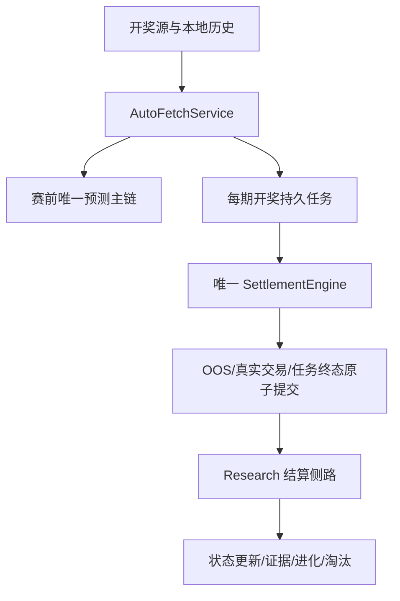
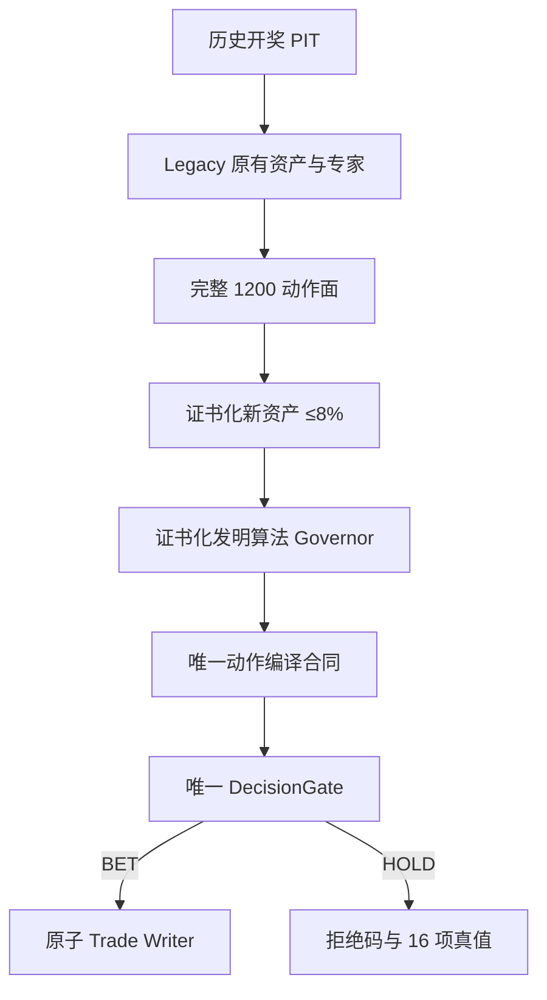
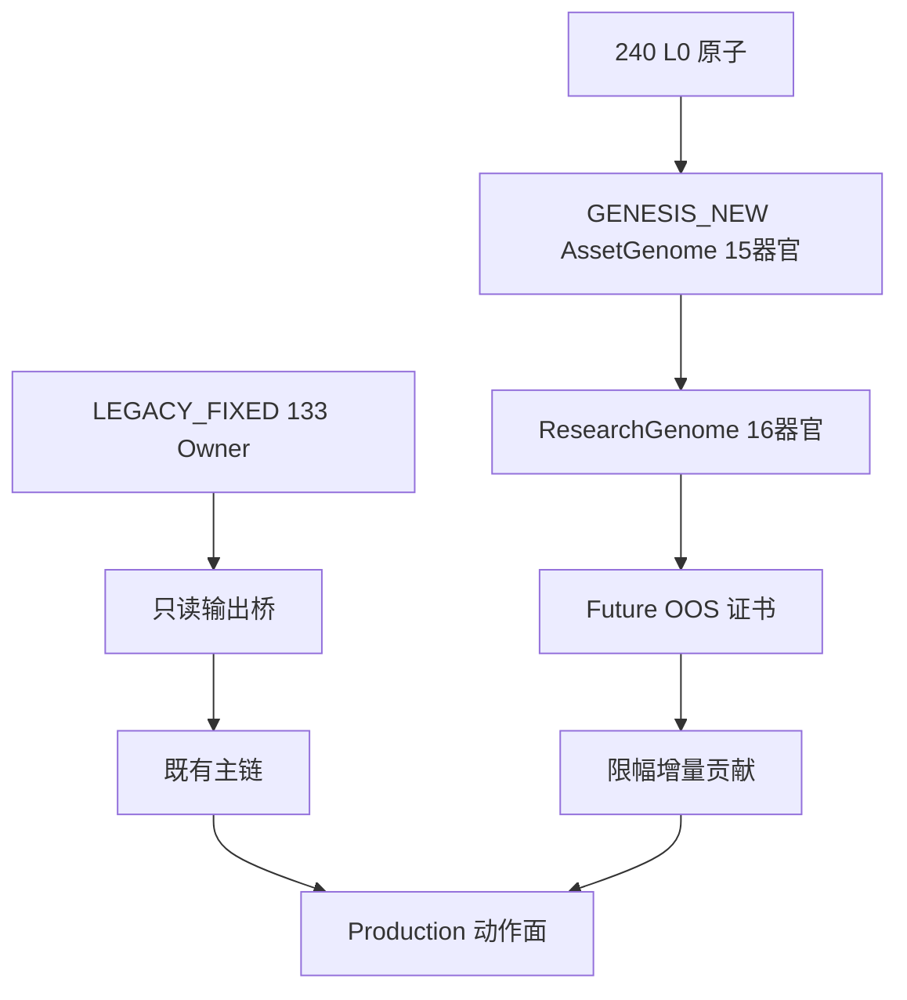
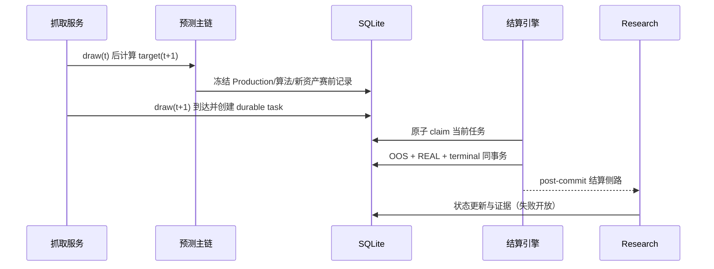
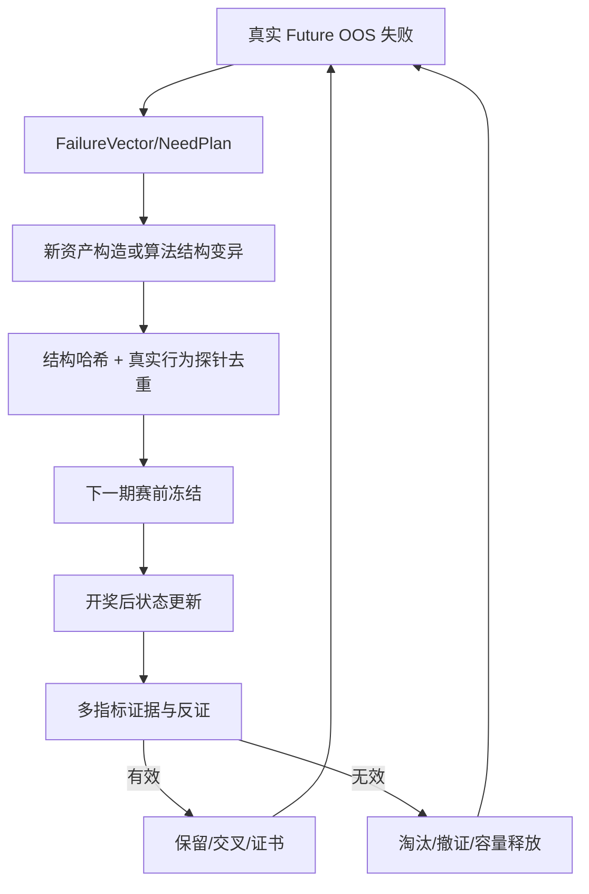

# R915 项目架构与唯一主链图纸

## 软件运行职责

实时出号和结算是 P0；Research 遇到实时压力必须 yield。研究侧路失败不能回滚已完成的生产结算。

## 唯一预测与出手主链

- Legacy 路径先完整计算，新层无证书或异常时贡献严格为 0。
- 新资产 Mixer 和算法 Governor 只调整评分，不拥有 REAL 权限。
- 只有 `DecisionGateEngine` 能产生授权决定，只有现有原子交易写入链能落 REAL。

## Legacy 与 Genesis 永久隔离

Genesis 禁止对 Legacy 做 REWRITE、MUTATE、CROSSOVER、PRUNE、REPLACE、RENAME、SCHEMA_CHANGE 或固定权重覆盖。133 个锁定 Owner 中 131 个与基线逐字节相同；仅唯一控制 Owner `DecisionGateEngine` 与 `SettlementEngine` 因本次 P0 修复明示修改并以新交付哈希重锁。它们不是被 Genesis 进化的分析资产。

## 每期开奖的赛前与结算时序

任何 target 的开奖结果都不能写回它自己的赛前输入。没有冻结记录时只能明确排除，不能开奖后重算出一条“预测”。

## 算法与资产创造闭环

这不是改几个参数：候选拥有自己的观察、表示、持久状态、推断、1200 动作评分、选择/HOLD、不确定度、校准、结算更新、失败模型、反证、资源、证据、血统、解释和证书。

