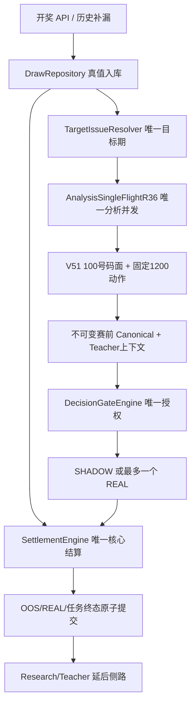
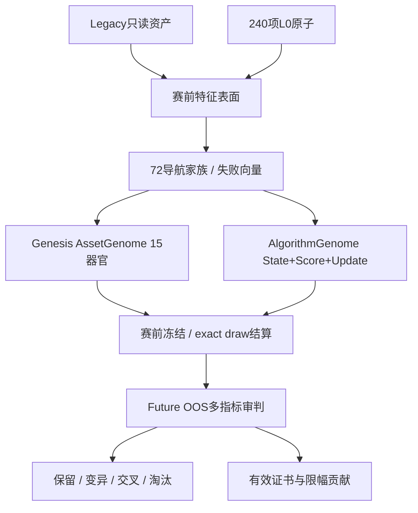

# R919 项目架构与唯一主链图纸

## 唯一生产主链

`K` 无权回滚 `J`，无权直接创建 REAL。研究结果只有在证书完整时，才能以限幅分数进入 `E`，随后仍须
经过 `G`。原来的趋势、形态、状态、走势、号码属性、位置关联、Teacher 和矩阵全部属于
`LEGACY_FIXED_ASSETS`，保持只读，不被 Genesis 删除、改名、变异或替换。

## 双分母结算

| 分母 | 统计对象 | 合法终态 | 禁止行为 |
|---|---|---|---|
| 开奖任务 | 每个已获取合法开奖期 | COMPLETED / NO_PREDRAW / FAILED / INVALID | 静默丢期 |
| 预测结算 | 有同一期赛前冻结记录的期 | exact draw HIT/MISS | 用开奖后补造预测 |
| Research 冻结 | 每个算法/资产在目标开奖前的行 | hit=-1 → 0/1 | 同期重复更新状态 |
| Teacher 归因 | 同一期赛前 Teacher 上下文 | ATTRIBUTED_EXACT_DRAW | 开奖信息倒灌赛前理由 |

## 因子/原子创造架构

### 12 个原子组

| 组 | 名称 | 时间边界 |
|---|---|---|
| A0 | 时点与数据真值 | 赛前快照 |
| A1 | 排列、位置、号码身份 | 当前动作坐标 |
| A2 | 时间与生命周期 | 历史多尺度 |
| A3 | 关系图与迁移 | 历史图窗口 |
| A4 | 数值变换与交互 | 只由冻结输入派生 |
| A5 | 统计与信息 | 历史统计窗口 |
| A6 | 可学习状态与反馈 | `t-1` 已结算状态，赛前只读 |
| A7 | 不确定性、风险、反证 | 赛前风险窗口 |
| A8 | 固定 1200 动作几何 | 当前目标期 |
| A9 | Future-OOS、血统、证书 | 仅开奖后，最早 `t+1` 使用 |
| A10 | 资源与后台健康 | 当前运行切片 |
| A11 | 进化互补与信用分配 | 训练截止期小于目标期 |

### AssetGenome 的 15 个器官

身份命名空间、原子来源、时间边界、持久状态、观察程序、推断程序、结算更新、输出语义、质量合同、
失败合同、证伪合同、资源预算、血统、证据生命周期、晋级与解释。少任一器官即不允许注册为创生资产。

### AlgorithmGenome 的算法级门

算法不是一条表达式。必须至少读取两个不同历史输入，赛前评分必须读取持久记忆，开奖后更新必须读取
命中/实际号码/概率残差并写回本地或全局记忆；Score Program 禁止写状态。结构哈希判断程序拓扑，行为哈希
在固定探针序列上同时执行推断和学习，合并“写法不同、行为相同”的假创新。

## 动态迭代和生产贡献

1. 每 24 个新的、不同目标期的算法 Future-OOS 才允许产生下一代；
2. 父代失败向量决定结构修复意图，不靠统一阈值加减；
3. 子代所有证据清零，从下一个合法目标期开始冻结；
4. Wilson、FDR、Brier、ECE、覆盖、分块、Regime、最大连挂、配对主链和资源成本共同判定；
5. 退化或失效自动 `PRUNED/REVOKED`，保留墓碑和原因，不物理删除审计证据；
6. 未制证贡献为 0；创生资产有证书时最多 8%，算法家族最多 30%；
7. 限幅贡献只能改动作评分，不能绕开唯一 DecisionGate。

## 后台运行架构

前台服务 `START_STICKY` 是第一层；任务移除立即重臂、WakeLock 和业务循环是第二层；AlarmManager、
JobScheduler、Boot/Package-Replaced Receiver 是第三层。R919 每 30 秒把真实系统能力写入数据库：电池优化
是否忽略、精确闹钟是否获准、运行/目标 SDK、权限摘要、证书 hash 和观察时刻。界面只展示实际授权，
不把 Manifest 声明冒充系统已授权。
