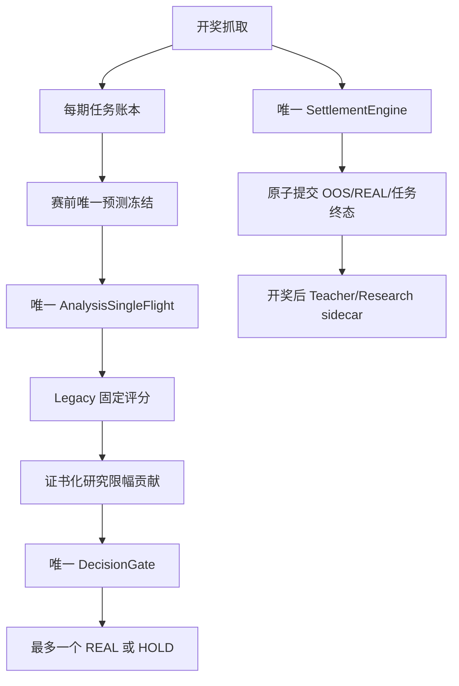

# R920 / R5.3.6 大版本施工方案与实际落码

## 施工硬规则

1. 先证明唯一主链、真值、冻结和结算，再谈研究胜率。
2. Legacy 固定资产不进入 Genesis 变异、交叉、淘汰或替换。
3. 新资产、新算法使用独立表、ID、状态、Future OOS 和证书；无证书贡献为零。
4. 无独立 Observation/State/Score/SettlementUpdate/Failure/Falsification 的对象不能叫算法家族。
5. 开奖后数据不能进入赛前原子；每个状态更新必须 exactly-once，最早下一期可使用。
6. 研究线程让位于抓取、分析和结算，但必须获得有上限的公平时间片和断点恢复。
7. 发布 APK 必须从最终资源真值生成 R.java，并在签名成品中再验一次。
8. 行数不是完成度；空文件、注释壳、无类型、TODO/FIXME、无法解释的短具体 Owner 直接失败，
   窄接口/不可变合同/枚举/适配器则按单一职责审计，不用无效代码灌到几千行。

## 唯一业务主链

研究 sidecar 失败不回滚核心结算；Research 没有 REAL 写权限；fixed-K3、单位置、每期最多一个
REAL 的红线不变。

## 《算法创造方案 V4.1》逐阶段实现

| 阶段 | 真实 Owner 与行为 | R920 验收 |
| --- | --- | --- |
| Legacy Freeze | `LegacyFixedAssetRegistryR915`、`LegacySourceLockManifestR915`、`LegacyIntegrityGuardR915`、`LegacyPredrawContextBridgeR915` | 133 Owner 锁；全版本审计 131 原样、2 个唯一控制 Owner 明示重锁；违规 0 |
| Truth/Capture/Settlement | `AutoFetchService`、`SettlementTaskStoreR36`、`SettlementCoordinatorR815`、`SettlementEngine`、`SettlementPostCommitSidecarR909` | 277/277 任务终态；200/200 预测结算；重复 0；sidecar 故障不破坏核心提交 |
| Atomic World | `GenesisSchemaRegistryR915`、`GenesisAtomicWorldR920` | A0–A11 共 240 原子、12 组、72 导航家族；205 个赛前可算；每个具名原子按时间/拓扑/统计/风险/动作语义物化；A9 的 20 个开奖后证据禁止赛前选择 |
| New Asset Genesis | `GenesisAssetGenomeR915`、`GenesisAssetVmR915`、`AssetGenesisEngineR915` | 15 器官、typed program、状态、冻结、结算、证据、血统、证书、撤证与淘汰均为可执行代码和持久层 |
| Mechanism Discovery | `FailureVector`/`NeedPlan`、结构哈希、40 步行为探针 | 从真实失败选结构；结构不同但行为等价的候选合并；中文名来自机制而非随机包装 |
| Algorithm Lifeform | `AlgorithmGenomeR908`、`AlgorithmGenomeVmR908`、`ResearchGenomeContractR915` | 必须读状态、评分、读开奖反馈并写状态；16 器官合同与 hash；赛前 score 不改状态 |
| Deep Learning | `ResearchTinyDeepLearnerR909` | 7→16→8→1 的真实前向、在线结算标签更新、checkpoint/trainedUntil；严格按期，最早 t+1 使用；无 REAL 权限 |
| Dynamic Evolution | `AlgorithmInventionLabR908`、`AlgorithmEvolutionLifecycleR912` | 七类失败向量驱动结构变异；交叉/新种子/行为 niche；子代 Future N=0；垃圾 PRUNED，退化可回滚 |
| Certificate/Mixer | `AlgorithmEvidencePolicyR912`、`AlgorithmProductionGovernorR915`、`CertifiedResearchMixerR915` | Future OOS N、Wilson、FDR、ECE、Brier、覆盖、块、Regime、最大连挂、paired 指标共同制证；研究贡献上限 8% |
| Truth UI | `RuntimeTruthSnapshotR906`、`MainActivity`、`ModelLearningActivity` | 同一 DB 快照；16 状态框；完整 240 原子、中文名、创造原因、证据、淘汰、证书、贡献；无样本/读错不伪装为 0/PASS |
| Release Closure | R920 资源先行构建与 APK 反编译合同 | R919 11 项漂移被拒；R920 275/275、启动绑定 45/45、行绑定 6/6 |

## “原子—分子—新资产—算法”的实际关系

240 原子是带 `datatype/range/window/lag/support/trainedUntil/leakageClass/updateTiming/cost/version`
的底层注册项，不是 UI 名词。`GenesisAtomicWorldR920` 从冻结 PIT 历史一次构建多窗频率、事件间隔、
转移/跨位矩阵、图路径、熵/信息、风险和动作几何，再为 1200 动作物化具名 240 维向量；
旧的通用轮换生成方法已从生产路径删除。Asset VM 用 typed composition 将赛前可用原子组合成标量、向量、矩阵、
图、序列、状态机、残差场、证据面或风险面；Genome 保存来源、结构、状态、失败条件和证据。
“分子”在代码中对应经过类型检查的组合子图/中间表示，不另建一批只有名字的空壳类。

240 不是上限。新原子提案必须证明现有原子无法低成本表达、通过 PIT/泄漏和资源审查，并进入下一
签名 schema 版本后才能执行；运行中不能热改旧原子语义，否则历史 Future OOS 不再可比。

## 算法创造不是调参数

`AlgorithmGenomeR908` 的可进化对象是程序结构：特征/状态读取、寄存器连线、算术与非线性、条件
分流、记忆地址、score program、settlement update program 和输出。七类 FailureVector 会定向
改变记忆、分流、风险、校准、跨位交互、恢复或资源结构；不是只做 `weight += 0.01`。

每个候选持久化：中文机制名、机制说明、structural hash、behavior hash、generation、parents、
mutation intent、creation reason、state blob、trainedUntil、适用/失效条件和 Future OOS 证据。
例如名称“玄策·迁移记忆分流非线性算法·第09代”由真正的跨位、状态、分流和非线性指令统计生成；
改名字或微调权重不会绕过行为去重。

## 动态迭代的正确“越来越好”

R920 的单调约束作用于“保留/上线规则”，不是伪造未来命中率：

- 新代不继承父代 Future OOS 样本，必须从 N=0 接受新的自然未来期；
- 只有多指标不退化且提供独立增量的候选可保留/制证；
- 失败候选定向变异或淘汰，证书漂移则撤证，贡献立即归零；
- Legacy 基线始终存在，研究层异常、无证书或超预算时自动回退；
- 不允许把开发回放、一次结算、小样本高命中或后验选优宣传成 70%–80%。

因此软件能越来越会排除伪规律、避免重复失败并寻找更稳定的机制，但真实胜率是否提高、提高多少，
只能由部署后的独立 Future OOS 数据证明。

## 本次 R920 相对 R919 的实际修改

- 版本身份从 R919/R5.3.5 升到 R920/R5.3.6，覆盖安装 versionCode 递增。
- 删除发布构建对手工 R 常量的依赖，新增资源先行两阶段发布构建。
- 新增最终 APK 的全资源、源码引用、首页控件类型、动态行和 launcher 合同。
- 新增被拒 R919 的 11 项失败证明，作为永不回归哨兵。
- `MainActivity` 增加启动期整体绑定保护与可复制安全页。
- UI 可见产品名和所有运行真值标识统一为 R920；不再混用旧 R900/R919 标题。
- 逐文件审计支持版本化前缀；R920 patch 审计 523/523、空壳 0、失败 0。

## 证明边界

主机和 APK 成品能证明：代码行为合同、数据库模拟闭环、完整编译、最终资源一致、Dex 接线、签名和
覆盖安装身份。它不能证明某台手机的 OEM 杀后台行为，也不能替代连续自然未来期的胜率证据。
所以实体冷启动、后台连续 200 期与真实证书表现仍保留 `RETEST_REQUIRED/NOT_PROVEN`，这是防止
再次“编译成功就宣称完美”的交付约束。
