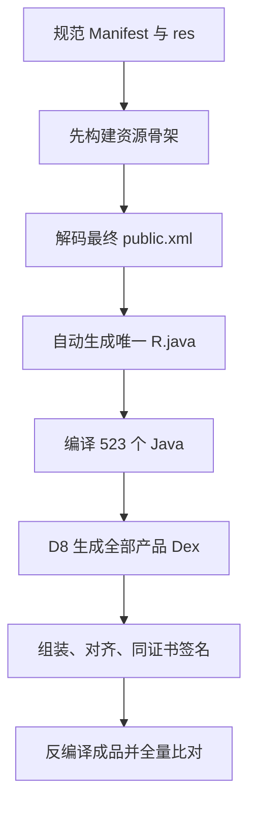

# R920 覆盖安装后打不开：根因、修复与反回归证据

## 确定根因

R919 发布流程先用 `verification/r36-stubs/.../R.java` 中的手工 ID 编译 Java/Dex，之后 apktool 又
根据新增资源重新分配 `resources.arsc`。两份 ID 真值发生漂移。R919 成品反编译得到 11 项偏差，
其中致命冲突是：

| 资源 | R919 Dex 常量 | R919 最终 ARSC | 运行后果 |
| --- | ---: | ---: | --- |
| `btn_background_reliability` | `0x7f050040` | `0x7f050048` | Dex 查到错误控件 |
| `diagnostic_state_host` | `0x7f05f002` | `0x7f050040` | `0x7f050040` 实际是 `LinearLayout` |

因此 `MainActivity.bindViews()` 对 `findViewById(0x7f050040)` 做 `Button` 转型时会抛出
`ClassCastException`。这解释了“APK 能覆盖安装，但点击后直接打不开”；它不是签名、数据库或
用户操作问题。

完整 11 项偏差保存在：
`R920_REJECTED_R919_RESOURCE_FAILURE_PROOF.txt`。R919 必须视为拒绝发布，不能继续交付。

## 不是改一个数字，而是删除错误构建顺序

R920 发布顺序：

核心文件：

- `scripts/r920_generate_r_java.py`：校验 `public.xml` 的 type/name/ID 唯一性，原子生成 R.java 和
  资源清单；不允许人工猜测 ID。
- `scripts/r920_build_release.sh`：强制资源先于 Java；禁止发布构建引用手工 stub R；替换全部旧
  Dex；签名前后验证身份、证书和产物。
- `verification/r920/r920_apk_resource_contract.py`：逐项对比最终 ARSC 与所有 `R$*.smali`，并
  核验所有源码 R 引用、首页绑定类型、动态行绑定和 launcher 类。
- `scripts/r920_apk_acceptance.sh`：对最终签名 APK 再独立做一次同样的成品验收。

## 第二层启动保护

`MainActivity` 新增 `installLaunchSafeModeR920()`。未来即便某个 OEM 或资源异常逃过构建门，
布局/绑定/启动数据层异常也会被 `CrashRecorder` 记录，并显示可复制的 R920 启动保护页，而不是
再次出现无信息的开关即退。保护页不会把正常 UI 标记为成功，也不会替代资源根因修复。

## 验收结果

- 被拒绝 R919：`DEX_ARSC_ID_MISMATCH:11`，失败哨兵按预期触发。
- R920：`PUBLIC=275`、`DEX_R=275`、`RESOURCE_ID_MISMATCH=0`。
- 首页启动绑定：45/45；动态解释行绑定：6/6。
- launcher `Application/MainActivity/CrashRecorder`：3/3。
- 最终 Dex 含启动保护方法与错误阶段码。
- 包名、版本、ZIP、zipalign、v1/v2/v3 签名验收通过；证书与旧可覆盖安装版本相同。
- 实体机冷启动仍标记 `RETEST_REQUIRED`，需在用户实际 Android/ROM 上完成。
